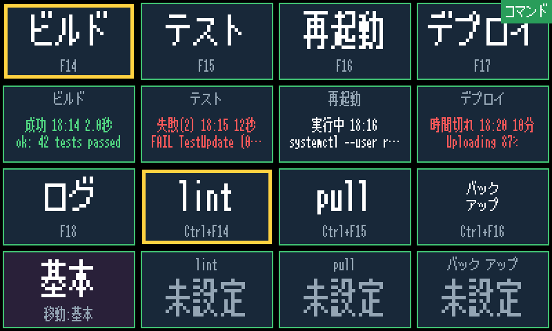
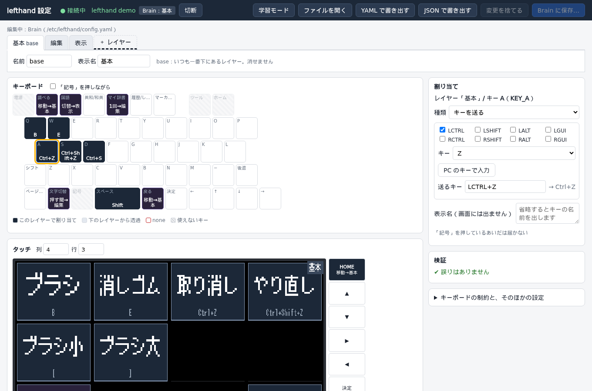

# brain-deck：PC のための手元の PDA

Sharp Brain PW-SH2 を、**PC のそばに置いて PC と一緒に使う、手元の PDA** にする。
昔の PDA は PC から離れて単独で使う道具だったが、brain-deck は PC の横に置き、PC の予定、Todo、天気、ビルドの結果などを
いつも目に入る場所に出し、ボタンやキーで PC を操作する。PC から外して持ち歩いても、時計、Todo、受け取り済みの予定などはそのまま使える
（PC から外したときの使い方はフェーズ P2 で整えた。同期はフェーズ P3 で整える）。

> **充電について**：**Brainux では USB につないでも充電されない。充電は純正のファームウェアで行う。**
> つないだままでも電池は減るので、電池の電圧が 3.5 V を下回ったら知らせ、3.4 V を下回ったらデータを保存して電源を切る（本番の設定）。
> 詳しくは[充電](#充電)。

Brain 上の Brainux で動くデーモン **lefthand** と、PC で動くコマンド **brain-deck**、PC のブラウザで開く**設定 GUI** からなる。

- **ホーム画面**：アプリ（入る先の画面）のアイコンと名前を並べた入り口（`home`）。予定、Todo、天気、電卓、メモ、左手デバイス、端末、本体の情報などをアプリとして置き、タップで入って、画面右の HOME でどこからでも戻る。アイコンは組み込みのドット絵 39 個か、自分の画像。
- **アプリ（レイヤー）**：アプリの中身は、タッチの格子に置いたウィジェットとキーのセル。格子の大きさもセルの組み合わせも、アプリごとに自由に決める。
- **ウィジェット**：時計、テキスト（PC から書き換える）、Todo、カレンダーの予定、月の表示（卓上カレンダー。祝日を赤く、予定のある日に点）、天気予報（今日と明日。気象庁の天気アイコン、気温、降水確率）、グラフ（PC から送った値）、電卓、プレゼン用タイマー、電池の残り、ストップウォッチ、ポモドーロ、カウンター、QR コード、在席ランプ。セルは複数の格子にまたがる大きさにもできる（`span`）。
- **状態の帯**：画面の上に、時刻、電池、PC とつながっているか、マウスの形、最後に同期した時刻を出す細い帯（`status_bar`）。アプリごとに出すか決められる。
- **画面の向き**：ボタンひとつで縦向き（480×800）と横向き（800×480）を切り替える（`rotate`）。アプリごとに縦向き用の並び（`touch_portrait`）を書ける。タッチも向きに合わせて回り、ベゼルに印刷された画面右のボタンはそのまま使える。
- **左手デバイス**（アプリの 1 つ）：本体のキーボードとタッチパネルの入力を、設定どおりのキー入力やマウスの操作に変えて、USB HID のキーボードとマウスとして PC に送る。PC には標準の USB キーボードとして見えるので、PC 側に専用のソフトは要らない。
  - **キーボード**：本体のキーごとに、PC に送るキーやショートカットを割り当てる。例：A キーで Ctrl+Z。
  - **タッチのセル**：セルごとにキーを割り当てる。セルの枠とラベルが画面に表示され、押しているセルは枠が黄色く光る。
  - **レイヤー**：キーとタッチの割り当てを、まとめて切り替えられる。押しているあいだだけ、押すたびに、次の 1 キーだけ、の切り替え方がある。
  - **トラックパッド**：タッチパネルのセルを、マウスのトラックパッドにできる（`widget: trackpad`）。指でカーソルを動かし、タップでクリック、右端の帯でスクロール。起動したときはブートキーボード（BIOS でも使える）で、マウスを使うときだけ USB の形を切り替える（`usb_mode`）。
  - **メディアキー、F13〜F24、スリープ解除**：音量や再生のキー、PC のキーボードにない F13〜F24（OS のショートカットにコマンドを割り当てる）、スリープ中の PC をキーで起こす。
- **PC から**：PC の **brain-deck** で、ビルドの結果などのテキストを出したり（`brain-deck text build "ビルド成功" --style ok`）、Todo を足したり、カレンダー（ICS）の予定や天気予報を送ったり（`brain-deck calendar sync`、`brain-deck weather sync`）、グラフの値を足したり、URL を QR コードにして出したり、在席ランプを変えたり、Brain の時刻を合わせたりする。Brain のボタンから PC のコマンドを動かすこともできる（F13〜F18 と `brain-deck exec`）。
- **端末モード**：Brain の画面とキーボードを、USB でつないだ PC のコンソールの端末にする（アプリの 1 つとして置ける）。Brain 自身のシェルも開ける（日本語も打てる）。
- **自動減光**：しばらく触らなければ画面を暗くし、さらに時間がたったら消す（`backlight`）。暗いときのタッチは明るくするだけで、セルは押さない。
- **背景画像**：セルごとの背景、レイヤーとホーム画面の壁紙、アイコンに、好きな画像を置ける。画像の切り抜きと変換は設定 GUI（PC）で行い、Brain は変換済みの画像を写すだけ。
- **PC から外したとき**：PC とつながっているか、電源だけか、外れているかを見分け、外れているあいだは PC に送るセルを休みにして「PCなし」と出す。外れたらホーム画面に切り替えられる（`offline`）。Todo は Brain のキーボードで足せ、時刻も Brain で合わせられる（`input`）。
- **日本語の入力**：Brainux に入っている uim-fep と Anthy で、Todo などの入力欄と、Brain 自身のシェルで日本語を打てる（`ime`。[日本語の入力](#日本語の入力)）。外しているあいだの自動減光を別に決められ、電池が少なくなったら知らせ、さらに少なくなったら保存して電源を切る（`battery`）。
- **時刻合わせ**：設定 GUI や brain-deck が接続したときに PC の時刻に合わせる。Brainux は内蔵 RTC を使っていないが、lefthand が起動したときに RTC のレジスタを直接読み、時刻が合っていなければ合わせる（`clock`）。
- **設定 GUI**：PC のブラウザ（Chrome / Edge）から、USB シリアル経由で設定を読み書きする。ホーム画面、アイコン、状態の帯、縦向きの並びも編集し、向きを切り替えてプレビューで確かめられる。保存するとデーモンを止めずにすぐ反映する。
- **保守**：一度入れたあとの更新、再起動、ログ、設定の読み書きは、ssh を使わずに brain-deck で行える（`brain-deck update`）。
- **設定のアプリ**：Brain だけで、明るさ、暗くなるまでの時間、フォトフレーム、画面の向き、読み物の文字の大きさ、ふたを閉じたときの動き、時刻を変える。変えた値は設定ファイルを書き換えず「上書き」として置く。版、電池、SD カードの空きなどの情報と、再起動・電源を切るボタン（2 秒押し続ける）もある。
- **ヘルプ**：使い方の説明を、Brain の画面で読む（デーモンに入っていて、版と合う）。
- **ふた**：ふたを閉じたら画面を消し、タッチを受け付けず、描き直しも止める。開けたら元の画面に戻す。画面を裏返したタブレットの形のあいだは、本体のキーを使わない（`lid`）。

設定に `home` を書かなければ、今までどおり左手デバイス（base のレイヤー）から始まる。
「PC のための手元の PDA」として使う例は [config/pda-example.yaml](config/pda-example.yaml)（今のダッシュボードや道具をアプリとして並べ、縦向きの並びも入れたもの）。

## 目次

1. [仕組み](#仕組み)
2. [必要なもの](#必要なもの)
3. [ビルド](#ビルド)
4. [インストール](#インストール)
5. [PC との接続](#pc-との接続)
6. [設定](#設定)
7. [マウスとトラックパッド](#マウスとトラックパッド)
8. [ペンタブレットと手書きメモ](#ペンタブレットと手書きメモ)
9. [メディアキー、F13〜F24、スリープ解除](#メディアキーf13f24スリープ解除)
10. [コマンドのショートカット](#コマンドのショートカット)
11. [設定 GUI](#設定-gui)
12. [brain-deck（PC のコマンド）](#brain-deckpc-のコマンド)
13. [Brain の保守（ssh を使わない）](#brain-の保守ssh-を使わない)
14. [時刻合わせ](#時刻合わせ)
15. [PC から外して使う](#pc-から外して使う)
16. [フォトフレーム](#フォトフレーム)
17. [読み物](#読み物)
18. [同期](#同期)
19. [タッチのキャリブレーション](#タッチのキャリブレーション)
20. [設定のアプリとヘルプ、ふた](#設定のアプリとヘルプふた)
21. [日常の操作](#日常の操作)
22. [シリアルコンソール](#シリアルコンソール)
23. [端末モード](#端末モード)
24. [画面とコンソール](#画面とコンソール)
25. [困ったとき](#困ったとき)
26. [開発](#開発)
27. [フォントとライセンス](#フォントとライセンス)

## 仕組み


```
本体キーボード (brain-kbd-i2c)  ─┐
                                  ├─ lefthand ─→ /dev/hidg0 ─→ USB ─→ PC（キーボードとマウスとして認識）
タッチパネル   (mxs-lradc-ts)   ─┘      │  │
                                         │  └─→ /dev/fb0（セルとラベルを表示）
PC のブラウザ（設定 GUI） ←─ USB シリアル ─→ /dev/ttyGS1（設定の読み書き、学習モード）
```

- **入力の専有**：デーモンは本体のキーボードとタッチパネルを専有する。動いているあいだ、Brain 自身のコンソールには入力が届かない。
- **送信**：押したキーの組み合わせを、標準の 8 バイトのキーボードレポート（前にレポート ID 1 を付ける）で送る。同時に押せる通常キーは 6 つまで。オートリピートは PC 側に任せる。マウスは、レポート ID 2 のレポート（ボタン 3 つ、移動、縦と横のホイール）で送る。
- **終了時**：すべてのキーとマウスのボタンを離したレポートを送ってから終わる。キーやボタンが押しっぱなしにならない。
- **PC が応答しないとき**：PC が未接続やスリープ中でも、デーモンは止まらない。送れなかった状態は 0.2 秒ごとに送り直す。

起動時は、次の順に動く。

1. `ethernet_gadget.service` が USB ガジェットを作る。Brainux 標準の処理を drop-in で置き換え、ネットワーク（NCM）、キーボードとマウス（HID）、シリアル 2 つ（ACM。コンソール用と設定 GUI 用）の複合デバイスにする。Brain の usb0 には固定 IP 192.168.7.2 を付ける。
2. `lefthand.service` がデーモンを起動する。ガジェットの作成と、ログイン画面の ly の起動を待ってから動く。

電源を入れてからキー入力を受け付けるまで、約 68 秒かかる。

## 必要なもの

- **Brain 本体**：Sharp Brain PW-SH2 に Brainux（Debian 13 ベース）を入れたもの。カーネルが USB ガジェットの HID と ACM に対応していること。Brainux 標準のカーネルは対応していないので、再ビルドする。手順は [docs/kernel-build.md](docs/kernel-build.md)。
- **PC**：ビルド用に Go 1.27 以降。cgo は使わない。
- **USB ケーブル**：Brain と PC をつなぐもの。動作確認は Linux の PC で行った。

## ビルド

PC で、ARMv5（ARM926EJ-S）向けにクロスコンパイルする。

```sh
GOOS=linux GOARCH=arm GOARM=5 CGO_ENABLED=0 go build -trimpath -o lefthand
go test ./...
```

できる実行ファイルは約 5.5MB で、フォントも含めてこれ 1 つで動く。

## インストール

初めて入れるときは、SD カードに直接入れる（ssh が要らない）か、ssh で送って Brain 上で入れる。一度入れたあとの更新は、`brain-deck update` で USB のシリアルから行える（[Brain の保守](#brain-の保守ssh-を使わない)）。

**SD カードに直接入れる**：Brainux を書いた SD カードを PC に挿し、ルートのパーティションがマウントされた場所を `--root` に書く。ファイルを置き、lefthand.service を有効にする（`/boot` には触らない）。SD カードを Brain に戻して起動すれば、USB キーボードとして動き、brain-deck で操作できる。

```sh
GOOS=linux GOARCH=arm GOARM=5 CGO_ENABLED=0 go build -trimpath -o lefthand
sudo sh install.sh --root /media/$USER/rootfs     # rootfs はルートのパーティションの名前（環境による）
```

**ssh で入れる**：PC から Brain にファイルを送り、Brain 上で install.sh を実行する。

```sh
scp -r lefthand config.yaml install.sh gadget-setup.sh console-setup.sh systemd brain:lefthand/
ssh brain 'cd ~/lefthand && sudo sh install.sh'
```

install.sh は次のファイルを配置し、`systemctl daemon-reload` を行う。

| 手元のファイル | Brain 上の配置先 |
| --- | --- |
| lefthand | /usr/local/bin/lefthand |
| gadget-setup.sh | /usr/local/sbin/lefthand-gadget-setup |
| config.yaml | /etc/lefthand/config.yaml（まだ無いときだけ） |
| systemd/ethernet_gadget.service.d/lefthand.conf | /etc/systemd/system/ethernet_gadget.service.d/ |
| systemd/lefthand.service | /etc/systemd/system/ |

- **設定ファイル**：install.sh は、既にある `/etc/lefthand/config.yaml` を上書きしない。手元の設定を反映するときは、手動でコピーする。

  ```sh
  ssh brain 'cd ~/lefthand && sudo install -m 0644 config.yaml /etc/lefthand/config.yaml && sudo systemctl restart lefthand.service'
  ```

- **自動起動**：install.sh はサービスを有効にしない。初めて入れたときは、一度だけ有効にする。

  ```sh
  ssh brain sudo systemctl enable --now lefthand.service
  ```

- **ガジェットの設定**：drop-in と gadget-setup.sh は、次に Brain を起動したときから使われる。再起動せずに設定 GUI 用のシリアルを足すときは、`ssh brain sudo /usr/local/sbin/lefthand-gadget-setup` を実行する。USB を一度付け直すので、SSH が数秒止まる。そのあいだ lefthand.service を止め、終わったら再開する（このカーネルでは、/dev/hidg0 を開いたまま付け直すと、HID が使えなくなるため）。SSH が切れても止まらないよう、`sudo systemd-run --collect /usr/local/sbin/lefthand-gadget-setup` で実行するとよい。
- **元に戻す**：drop-in を消して `systemctl daemon-reload` すると、Brainux 標準のガジェット設定に戻る。Brainux 本体のファイルは書き換えていない。
- **シリアルコンソール**：1 つ目のシリアル（/dev/ttyGS0）でログインできるようにするには、一度だけ次を実行する（[シリアルコンソール](#シリアルコンソール)）。

  ```sh
  ssh brain 'cd ~/lefthand && sudo sh console-setup.sh on'
  ```

## PC との接続

USB でつなぐと、PC には次の 4 つが見える。

| 機能 | インターフェイスの番号 | PC 側の見え方 | Brain 側 | 用途 |
| --- | --- | --- | --- | --- |
| NCM | 0、1 | ネットワークインターフェース（Linux では enx8a158b443a01） | usb0 | SSH |
| HID | 2 | 「SHARP Brain」のキーボード（ブートキーボード）。マウスをオンにすると「SHARP Brain Keyboard」と「SHARP Brain Mouse」（Linux の /dev/input/by-id/ では `…-if02-event-kbd` と `…-if02-event-mouse`） | /dev/hidg0 | 左手デバイスとしての入力 |
| CDC-ACM（1 つ目） | 3、4 | シリアルポート（Linux では /dev/ttyACM0、by-id は `…-if03`） | /dev/ttyGS0 | シリアルコンソール（getty のログイン画面）。設定 GUI のコンソールのタブ。[端末モード](#端末モード)では逆向きに使う |
| CDC-ACM（2 つ目） | 5、6 | シリアルポート（Linux では /dev/ttyACM1、by-id は `…-if05`） | /dev/ttyGS1 | 設定 GUI、brain-deck |

- **HID は 2 つの形を切り替える**：Brain の USB コントローラは、PC へ送るためのエンドポイント（IN）が 7 本しかなく、NCM（2 本）、HID（1 本）、ACM 2 つ（4 本）ですべて使っている。マウスを別の HID にすると足りなくなり、ガジェット全体がつながらなくなる。そこで、1 つの HID を次の 2 つの形で切り替える（[USB の形の切り替え](#usb-の形の切り替えマウスのオンとオフ)）。インターフェイスの番号は、どちらの形でも同じ。
  - **キーボードだけ（起動したときの形）**：ブートキーボード。PC の BIOS や UEFI の画面、起動前のパスワード入力でも使える。
  - **キーボードとマウス**：レポート ID でキーボード（1）とマウス（2）を入れた形。ブートキーボードではないので、BIOS や UEFI の画面では使えない。

キーボードとしては、つなぐだけで使える。SSH を使うには、PC 側のインターフェースに固定 IP を付ける。PC に DHCP サーバーは要らない。

| 機器 | アドレス |
| --- | --- |
| PC | 192.168.7.1/24 |
| Brain の usb0 | 192.168.7.2/24 |

PC の `~/.ssh/config` に次のように書いておくと、`ssh brain` で入れる。この README のコマンドは、この設定を前提にしている。

```
Host brain
    HostName 192.168.7.2
    User user
```

## 設定

設定は `/etc/lefthand/config.yaml` に YAML（または JSON）で書く。[設定 GUI](#設定-gui) を使うか、ファイルを直接編集して `sudo systemctl restart lefthand.service` で反映する。
設定 GUI で保存すると、ファイルは GUI が YAML で書き直すので、**手で書いたコメントは消える**。前の版は `/etc/lefthand/config.yaml.prev` に残る。
形式の詳細は [docs/config.md](docs/config.md)、本体のキーの名前は [docs/keymap-pwsh2.md](docs/keymap-pwsh2.md) にある。
書き方の例は、このリポジトリの config.yaml にある。

変更する前に、デーモンを止めずに検証できる。

```sh
ssh brain lefthand -check /etc/lefthand/config.yaml
```

### 全体

```yaml
hid_device: /dev/hidg0      # 送信先。省略可
keyboard: brain-kbd-i2c     # 本体キーボード。省略可
touch: { ... }              # タッチパネルとソフトキーの範囲。省略するとタッチと画面を使わない
layers: [ ... ]             # レイヤーごとの割り当て。最初のものが base
display: { ... }            # 画面表示。省略可
backlight: { ... }          # 自動減光。省略すると減光しない
```

入力デバイスは、`/dev/input/eventN` のパスでも、デバイス名でも指定できる。
event の番号は起動の順で変わることがあるので、デバイス名で書く。

### レイヤー（layers）

```yaml
layers:
  - name: base
    label: "基本"
    keys:
      KEY_Q: B                               # Q で B
      KEY_A: LCTRL+Z                         # A で Ctrl+Z
      KEY_LEFTALT: { layer_hold: edit }      # 文字切り替えを押しているあいだ edit
      KEY_ESC: { layer_to: base }            # 調べる・戻るで base に戻る
    touch:
      cols: 4
      rows: 3
      cells:
        "0,0": { key: B, label: "ブラシ" }
        "3,2": { layer_toggle: edit, label: "編集" }
  - name: edit
    label: "編集"
    keys:
      KEY_Q: LCTRL+C                         # edit では Q で Ctrl+C
      KEY_W: none                            # 何もしない
```

- **キーの名前**：左側は Linux のキー名（`KEY_A`、`KEY_SPACE` など）。どのキーがどの名前かは [docs/keymap-pwsh2.md](docs/keymap-pwsh2.md) にある。
- **送るキー**：右側は送るキーを `+` でつなぐ。大文字小文字は区別しない。
- **切り替え**：`layer_hold`（押しているあいだ）、`layer_toggle`（押すたび）、`layer_oneshot`（次の 1 キーだけ）、`layer_to`（そのレイヤーへ移る）の 4 つ。
- **透過**：書いていないキーとセルは、下のレイヤーの割り当てを使う。`none` と書くと無効になる。
- **押したまま切り替えたとき**：キーは押したときの割り当てで離すので、押しっぱなしにならない。
- **base に戻る手段**：切り替えたままになるレイヤーには、base に戻る手段が要る。ないと、読み込み時にエラーになる。
- **旧形式**：トップレベルに `keys` と `touch.cells` を書く形式も、base レイヤーとしてそのまま読める。

PC に送れるキーの名前は次のとおり。

| 種類 | 名前 |
| --- | --- |
| 修飾キー | LCTRL、LSHIFT、LALT、LGUI、RCTRL、RSHIFT、RALT、RGUI |
| 文字 | A〜Z、0〜9 |
| ファンクション | F1〜F12、F13〜F24（PC のキーボードにないキー。OS のショートカットにコマンドを割り当てて使う。[F13〜F24](#f13f24)） |
| 編集 | ENTER、ESC、BACKSPACE、TAB、SPACE、INSERT、DELETE、HOME、END、PAGEUP、PAGEDOWN |
| 矢印 | UP、DOWN、LEFT、RIGHT |
| テンキー | KP0〜KP9、KPPLUS（+）、KPMINUS（-）、KPASTERISK（*）、KPSLASH（/）、KPDOT（.）、KPENTER |
| 記号 | MINUS（-）、EQUAL（=）、LEFTBRACE（[）、RIGHTBRACE（]）、BACKSLASH（\）、SEMICOLON（;）、APOSTROPHE（'）、GRAVE（`）、COMMA（,）、DOT（.）、SLASH（/） |

記号は US 配列での位置を送る。PC が日本語配列のときは、PC 側で別の文字になることがある。
`+` のように配列で位置が違う文字は、テンキーの名前で送ると配列によらない。例：拡大の Ctrl++ は `LCTRL+KPPLUS`。

### タッチパネル（touch とレイヤーの touch）

パネルの設定は `touch` に、格子とセルの割り当ては各レイヤーの `touch` に書く。

```yaml
touch:
  device: mxs-lradc-ts
  swap_xy: false
  min_x: 226
  max_x: 3938
  min_y: 3803
  max_y: 384
  soft_areas:                                 # 画面右の印刷された帯
    home: { x: [3740, 4095], y: [3377, 4095] }
```

- **セルの番号**：`"列,行"` で書き、左上が `"0,0"`。列は右へ、行は下へ増える。
- **min_x などの値**：パネルの生の座標と画面の端との対応。値の求め方は[タッチのキャリブレーション](#タッチのキャリブレーション)を参照。
- **判定**：触れた瞬間のセルで決まり、離すまで変わらない。指を滑らせても、別のセルには移らない。
- **格子の大きさ**：レイヤーごとに変えられる。cols と rows を省略すると base と同じ大きさになる。
- **label**：日本語も使える。`"\n"` で改行できる。その場合はダブルクォートで囲む。
- **label の大きさ**：セルに収まるよう、自動で決まる。等倍でも収まらない部分は切れる。
- **label がないセル**：送るキーを短く書き直して表示する。例：`LCTRL+LSHIFT+Z` は `Ctrl+Shift+Z`。
- **画面の見た目**：割り当てのないセルは、暗い枠だけを描く。押しているあいだ、そのセルの枠を太い黄色の二重の枠にする（`display.press_style`）。レイヤーを切り替えるセルは紫で描く。
- **ソフトキー**：画面右の帯（HOME ▲ ▼ ▶ ◀ 決定 戻る 操作機能）はタッチに反応する。レイヤーの `soft_keys` で割り当てられる。帯の座標は画面の右端と重なるので、割り当てた区画だけがセルより優先される。

### ウィジェットとセルの大きさ

タッチのセルには、キーの代わりにウィジェットを置ける。今あるのは時計（`clock`）、テキスト（`text`）、Todo（`todo`）、カレンダー（`calendar`）、月の表示（`month`）など。
また、どのセルも `span: [列数, 行数]` で、右と下のセルにまたがる大きさにできる。

```yaml
cells:
  "0,0": { widget: clock, span: [2, 2] }                          # 大きな時計（2 列 × 2 行）
  "2,0": { widget: clock, format: "15:04:05", label: "秒" }       # 秒まで出す（1 秒ごとに描き直す）
  "3,0": { widget: clock, tz: America/Los_Angeles, label: LA, key: LGUI+SPACE }  # タップでキーを送る
  "0,2": { key: ENTER, span: [3, 1], label: "決定" }              # 横に 3 つぶんのキー
  "2,1": { widget: text, id: build, label: "ビルド" }             # テキスト。中身は PC から brain-deck で書き換える
  "0,0": { widget: todo, span: [2, 3], label: Todo }              # Todo の一覧（別のレイヤーの例）
  "0,0": { widget: calendar, span: [2, 3], label: 予定 }          # 今日の予定と次の予定（別のレイヤーの例）
  "0,0": { widget: month, id: cal, span: [2, 2] }                 # 月の表示（別のレイヤーの例）
  "2,0": { widget: calendar, follow: cal, span: [2, 2] }          # 月の表示で選んだ日の予定を出す
```

- **書式**：`format`（時刻、既定 `15:04`）と `date_format`（日付、既定 `1月2日({wday})`、`none` で出さない）は Go の書き方。`{wday}` は日本語の曜日。詳しくは [docs/config.md](docs/config.md) の「ウィジェット」。
- **タップしたとき**：`key` や `layer_*` を書けば、ふつうのセルと同じく働く。書かなければ何もしない（枠も光らない）。
- **描き直し**：時計は 1 分に 1 回（秒を出すときだけ 1 秒に 1 回）、変わったセルだけを描き直す。実機で、秒つきの時計 1 つの描き直しは約 4 ms。
- **時刻を合わせていないとき**：時刻を橙色で描き、日付の代わりに「時刻未設定」と出す（[時刻合わせ](#時刻合わせ)）。
- **テキスト**：中身は設定ファイルではなく Brain のデータ（`/var/lib/lefthand/text.json`）で、PC の [brain-deck](#brain-deckpc-のコマンド) から書き換える。色は通常・成功・失敗・警告の 4 種類。有効期限を過ぎると、消さずに薄く表示する。一度も書いていない id は「未設定」と出る。長い文は折り返し、入りきらなければ「…」で切る。
- **Todo**：項目は Brain のデータ（`/var/lib/lefthand/todo.json`）で、設定 GUI の「Todo」タブか [brain-deck todo](#todo) で書き換える。未完了の下に、完了した項目を薄く（取り消し線で）並べる。Brain では、**項目を 0.5 秒押し続けると完了を切り替える**（押しているあいだ、その行が黄色になる）。入りきらないときは、セルの下の帯の **▲ ▼ をタップしてページを送る**（画面右の帯の ▲▼ はレイヤーの切り替えに使っているため、別にした）。`rows: 3` で 1 ページの行数を決められる。見出しには残りの件数を出す（「Todo 残り 3」）。ページを送ったあと 1 分触らなければ、1 ページ目に戻る（`page_reset: 30s` で変えられる。`off` で戻らない）。Todo のセルには `key` や `layer_*` は書けない。
- **カレンダー**：予定は Brain のデータ（`/var/lib/lefthand/calendar.json`）で、PC の [brain-deck calendar sync](#カレンダー) が ICS の URL から取ってきて送る。今日の予定（終日、時刻の順）と、今日より先の次の予定を 1 つ出す。**今の予定は行を青く塗り**、終わった予定は薄く出す。左の色の帯はカレンダーの色。いちばん下に**最終更新の時刻**を小さく出し、3 時間より古い（`stale: 3h` で変えられる）、取得に失敗した、Brain の時刻を合わせていない、のどれかなら橙色にする。入りきらないときは Todo と同じく下の ▲▼ でページを送り、触っていないときは「今かこれからの予定」があるページを出す。`calendars: [仕事]` で出すカレンダーを選べる。
- **月の表示**：年と月、曜日、7 列の日付を並べる卓上カレンダー（2×2 のセル以上）。前後の月の日付は薄く、**今日は反転**、土曜は青、**日曜と祝日は赤**。予定のある日には、数字の下にカレンダーの色の点を出す（1 日 3 つまで。4 つ以上は 2 色と灰色の点）。下の帯の **▲▼ で前後の月**に送り、**日付をタップするとその日を選ぶ**（帯に日付、祝日の名前、予定の数が出る。帯の中央で今月に戻る。1 分触らなければ今月と今日に戻る）。同じレイヤーのカレンダーのセルに `follow: <月の表示の id>` を書くと、選んだ日の予定を出す。週の始まりは `week_start: monday` で月曜に。祝日は、calendars.yaml のカレンダーに `holiday: true` を書いて送る（[カレンダー](#カレンダー)）。例は [config/month-example.yaml](config/month-example.yaml)、書き方は [docs/config.md](docs/config.md) の「月の表示（month）」。
- **例**：[config/widgets-example.yaml](config/widgets-example.yaml) は、2026-10-07 の本番の設定に、メニューから入る「情報」と「Todo」のレイヤーを足したもの。今の本番の設定（[config/current.yaml](config/current.yaml)）にも、Todo、カレンダー、天気、道具などのアプリがある。

PC から送った値を描くグラフ（`graph`）もある。値は [brain-deck graph](#グラフ) で 1 つずつ足す（CPU、メモリ、温度を送る例は [contrib/graph/linux-stats.sh](contrib/graph/linux-stats.sh)）。例は [config/graph-example.yaml](config/graph-example.yaml)、書き方は [docs/config.md](docs/config.md) の「グラフ（graph）」。

電池、ストップウォッチ、ポモドーロ、カウンター、QR コード、在席ランプもある。

```yaml
cells:
  "0,0": { widget: stopwatch, span: [2, 1] }                       # タップで開始と停止、長押しで 0 に戻す
  "2,0": { widget: battery, label: 電池 }                          # 電池の残りと、USB から給電しているか
  "3,0": { widget: counter, id: coffee, label: コーヒー }           # タップで +1、長押しで 0 に戻す
  "0,1": { widget: pomodoro, span: [2, 2], work: 25m, break: 5m }  # タップで開始と一時停止、長押しで最初に戻す
  "2,1": { widget: presence, span: [2, 2] }                        # 在席ランプ。タップで次の状態、長押しで前の状態
  "0,0": { widget: qr, id: share, span: [2, 3] }                   # QR コード。中身は brain-deck qr share "https://..." で送る
```

- **長押し**：ストップウォッチ、ポモドーロ、カウンター、在席ランプは、タップ（離したとき）と、**0.5 秒の長押し**（Todo と同じ長さ）で働きが違う。長押しの働きは離す前に起き、離しても何もしない。誤って触れただけで 0 に戻らないよう、リセットは長押しにした。これらのセルには `key` などのタップの動きは書けない。
- **電池**：PW-SH2 では、残りと充電中を電池の電圧から見積もる（`/sys/class/power_supply` がないため。[docs/config.md](docs/config.md) の「電池」）。USB につないでいるあいだは、残りが多めに出る。
- **ストップウォッチ**：1 秒ごとに描き直す（実機で約 5 ms）。デーモンを再起動しても数え続ける。Brain を再起動すると止まる（Brainux は内蔵 RTC を使っておらず、起動直後の時刻が当てにならないため。終了した時点までの時間は残る）。
- **ポモドーロ**：作業（既定 25 分）と休憩（既定 5 分）をくり返す。**切り替わるとセルを 15 秒点滅させ、画面が暗ければ明るくする**。点滅はタップで止まる。
- **QR コード**：中身はテキストのタイルと同じ仕組みで、PC の [brain-deck qr](#qr-コード) で送る（UTF-8 で 400 バイトまで、有効期限も付けられる）。セルに入らないときは「QR が入りません」と出る。
- **プレゼン用タイマー**（`presenter`）：持ち時間（`duration`、既定 10 分）から残り時間を大きく出し、残りが区切り（`colors`。既定は残り 5 分で黄、1 分で赤）を下回ると色を変える。時間を過ぎたら超えた時間を赤で出し、セルを点滅させる。タップで開始と一時停止、長押しで 0 に戻す。**動いているあいだは自動減光をしない**。スライド送りのセルと並べた例は [config/presenter-example.yaml](config/presenter-example.yaml)（「発表」は 20 分、「LT」は 5 分で残り 1 分で黄、30 秒で赤）。
- **電卓**（`calculator`）：四則演算と括弧、10 進・16 進・2 進。数は分数のまま計算するので、`0.1+0.2` も `1÷3×3` も誤差が出ない。「入力」のボタンで、結果を PC にキーとして打ち込む（数字、`-`、`.`、A〜F だけを使うので、US 配列でも JIS 配列でも同じ文字になる。PC の日本語入力はオフにしておく）。電卓のレイヤーにいるあいだは、Brain のキーでも入力できる（Q〜P が 1〜0 など。表は [docs/config.md](docs/config.md) の「電卓」）。履歴は 20 個まで覚える。例は [config/calculator-example.yaml](config/calculator-example.yaml)。
- **在席ランプ**：セル全体を状態の色で塗る。状態の名前と色は `states` で決める（既定は在席、集中、会議中、休憩）。PC から [brain-deck presence](#在席ランプ) でも変えられる。
- **状態の保存**：ストップウォッチ、ポモドーロ、カウンター、在席ランプの状態は `/var/lib/lefthand/widgets.json` に残す。同じ `id` のセルは同じ状態を出す（`id` を省略すると種類の名前）。
- **例**：[config/gadgets-example.yaml](config/gadgets-example.yaml)（widgets-example.yaml に、メニューから入る「道具」と「共有」のレイヤーと、自動減光を足したもの）。

### ホーム画面（home）

アプリ（入る先のレイヤー）のアイコンと名前を並べた入り口。書けば、Brain を起動したときにこの画面が出る。書かなければ今までどおり。

```yaml
home:
  apps:
    - {name: 予定, icon: calendar, layer: calendar}   # タップで calendar のレイヤーへ
    - {name: Todo, icon: todo, layer: todo}
    - {name: 左手, icon: keyboard, layer: base}       # 左手デバイス（base）もアプリの 1 つ
    - {name: 写真, icon: 11af1a4e111547aa, layer: photo}  # 自分の画像（64×64）のアイコン
```

- **戻る**：画面右の帯の **HOME**（`soft_key`）で、どのレイヤーからでもホーム画面に戻る（レイヤーの HOME の割り当てより優先する）。ホーム画面で HOME を押すと 1 ページ目へ。
- **並び**：1 ページは横向きで 4×3、縦向きで 3×4（`cols`、`rows`、`portrait` で変えられる）。入りきらなければ、下の帯の ◀ ▶ と画面右の帯の ◀ ▶ でページを送る。
- **アイコン**：組み込みのドット絵（`calendar`、`todo`、`weather`、`calculator`、`memo`、`keyboard`、`terminal`、`settings`、`help` など 39 個。ウィジェットの種類と同じ名前のものもある）か、自分の画像（背景画像と同じく設定 GUI で 64×64 に変換して送る）。組み込みのアイコンは、このリポジトリのために描いたもの。
- **起動したとき**：`start: base` なら、今までどおり base から始まる（HOME でホーム画面へ）。
- **例**：[config/pda-example.yaml](config/pda-example.yaml)。書き方の詳細は [docs/config.md](docs/config.md) の「ホーム画面（home）」。

### 状態の帯（status_bar）

画面の上の細い帯（高さ 28 ドット）に、今のレイヤーの名前と、最後に同期した時刻、マウスの形、PC とのつながり、電池、時刻を出す。帯を出すレイヤーでは、格子がその分だけ小さくなる。

```yaml
status_bar:
  show: true                 # status_bar を書いていないレイヤーでも出す（既定は出さない）
  items: [sync, mouse, pc, battery, time]   # 出す項目（左から。省略するとこの 5 つ）
layers:
  - name: base
    status_bar: false        # このレイヤーでは出さない（左手デバイスの格子を広く使う）
```

- **PC とのつながり**：USB の状態（UDC の state）を 2 秒ごとに見て、つながっていれば緑の「PC」、PC がスリープ中なら「PC休止」、外れていれば橙の「PCなし」。
- **同期**：今は、最後に PC から時刻を合わせた時刻。一度もなければ橙の「未同期」（フェーズ P3 で `brain-deck sync` の時刻にする）。
- **ホーム画面**：既定で出す（`home.status_bar: false` で出さない）。
- **詳しく**：[docs/config.md](docs/config.md) の「状態の帯（status_bar）」。

### 画面の向き（rotate）と縦向きの格子（touch_portrait）

キー、セル、ソフトキーに `rotate` を割り当てると、画面を縦向き（480×800）と横向き（800×480）に切り替えられる。

```yaml
"0,1": {rotate: next, label: 回す}     # 押すたびに 90 度回す
"2,1": {rotate: 90, label: 縦向き}     # 画面の上が本体の右（ソフトキーの帯の側）
```

- **向きは残る**：変えた向きは Brain に保存し、再起動しても続く。設定 GUI の「Brain もこの向きにする」でも変えられる。
- **タッチ**：向きに合わせて回す（トラックパッドの指の動きも）。キャリブレーションの値はそのまま。
- **画面右の帯**：ベゼルに印刷されていて動かないので、向きによらず同じ区画（HOME、▲▼、◀▶、決定、戻る、操作機能）として働く。縦向き 90 度では帯は上、270 度では下になる。
- **縦向きの並び**：レイヤーの `touch_portrait` に、縦向き用の格子を書ける（書き方は `touch` と同じ）。書いていないレイヤーは、横向きの格子の列と行を入れ替えて使う（`display.portrait_grid: transpose`。4×3 は 3×4 になり、セルの形がほぼ同じになる）。`stretch` にすると、横向きの格子をそのまま縦に伸ばす。
- **端末モード**：向きによらず、横向き（設定の `display.rotate`）で描く。
- **詳しく**：[docs/config.md](docs/config.md) の「画面の向きと縦向きの格子」。

### 自動減光（backlight）

```yaml
backlight:
  dim_after: 1m       # 触らずに 1 分たったら暗くする
  dim_level: 1        # 暗くしたときの明るさ（PW-SH2 は 0〜7。ふだんは 7）
  off_after: 5m       # 触らずに 5 分たったら消す
  wake_on_key: true   # 本体キーでも明るくする
  in_terminal: false  # 端末モードのあいだは暗くしない
```

- **暗いときのタッチ**：明るくするだけで、そのタッチではセルもソフトキーも押さない（誤操作を防ぐため）。次のタッチから、ふつうに働く。
- **暗いときのキー**：本体キーは、暗いときもそのまま PC に送る。`wake_on_key: true`（既定）なら、キーで明るくもなる。
- **端末モード**：`in_terminal: false`（既定）なら、端末モードのあいだは暗くしない。
- **プレゼン用タイマー**：動いているあいだは暗くしない。
- **ほかに明るくするとき**：ポモドーロの作業と休憩が切り替わったとき。
- **終わるとき**：デーモンが終わると、起動したときの明るさに戻す（落ちたときも、サービスの ExecStopPost の `lefthand -restore-console` が戻す）。
- **バックライト**：PW-SH2 では `/sys/class/backlight/backlight@0`（pwm-backlight、0〜7）。実機で、暗くする・消す・明るくする・終了時に戻す、を確かめた。
- **書かなければ**、今までどおり減光しない。設定 GUI では編集しないが、GUI で保存しても残る。詳しくは [docs/config.md](docs/config.md) の「自動減光」。
- **PC から外しているあいだ**：`offline:` の下に書いた `dim_after`、`off_after`、`level`、`dim_level` だけ、そちらを使う（電池を持たせるため早めに暗くするなど）。

### PC から外したとき（offline、input、battery、clock）

```yaml
offline:
  home: true            # PC から外れたらホーム画面に切り替え、つなぎ直したら前の画面に戻す（既定 false）
battery:
  warn: 20              # 電池だけのとき、残り 20% で知らせる（既定 20）
  critical: 10          # 10% でもう一度知らせる（既定 10）
  poweroff: 5           # 5% を下回ったら、60 秒後に保存して電源を切る（既定 0 で切らない）
clock:
  rtc: read             # 起動したときに内蔵 RTC から時刻を合わせる（既定 read。write で書き戻し、off で使わない）
```

セルやキーに `{input: todo}` を割り当てると Brain のキーボードで Todo を足す欄が、`{input: clock}` で時刻を合わせる欄が開く。
書かなくても、外れているあいだは PC に送るセルを休みにする（押しても送らず、「PC につながっていません」と出す）。
使い方は下の「[PC から外して使う](#pc-から外して使う)」、書き方の詳細は [docs/config.md](docs/config.md) の「PC から外したとき」「電池」「時刻と内蔵 RTC」。

### 背景画像

セルの背景（`background`）と、レイヤーの壁紙（`touch.background`）に画像を置ける。キーのセル、ウィジェットのセル、span のセルのどれでもよい。

```yaml
layers:
  - name: base
    touch:
      cols: 4
      rows: 3
      background: 7f8f231d4a49bfee                                  # 壁紙（格子全体、800×480）
      cells:
        "0,0": {key: LGUI+S, label: 保存, background: b18c7e1fecc29a03} # セルの背景（セルの枠の内側、192×152）
```

- **ふだんの使い方**：設定 GUI でセルかレイヤーを選び、「画像を選ぶ…」で PNG、JPEG、WebP を選ぶ（欄やプレビューのセルにドロップしてもよい）。切り抜く範囲をドラッグとホイールで決め、明るさとディザリングを選ぶ。「Brain に保存」で、まだ Brain にない画像だけを送ってから設定を保存する。設定には画像の id（ハッシュ）が書かれる。
- **変換は PC で**：読み込み、切り抜き、縮小、明るさ、RGB565（Brain の画面の色数）への変換、ディザリング（既定は Floyd–Steinberg、「なし」も選べる）は、ブラウザで行う。Brain は受け取ったファイルを、描くときに画面へ写すだけ。
- **重ね方**：下から、壁紙（なければ黒）、セルの背景画像（なければ壁紙、壁紙もなければ今までのセルの色）。壁紙は、セルと同じく、格子の大きさが同じあいだ下のレイヤーのものが透過する。
- **文字の読みやすさ**：背景画像のあるセルでは、ラベルとウィジェットの文字に 1 ドットの黒い縁取りを付ける。画像を暗く（明るく）する強さは、GUI で変換するときに画像に焼き込む（既定は 35% 暗く）。
- **押したとき**：今までどおり枠を光らせる（`press_style: border`）。外側の黒い線があるので、明るい画像の上でも見える。離すと、枠の帯だけを画像で描き直す。`fill` では今までどおり黄色で塗りつぶす。
- **ない画像**：設定にある id の画像が Brain にないときは、背景なしで描く。起動時と `lefthand -check` の警告、ログ（`images: background ... is not on this Brain`）、GUI の「Brain の背景画像」で分かる。大きさがセルと違う画像は、中央に置き、はみ出す分は切る（警告も出す）。
- **上限**：1 枚は画面いっぱい（800×480、768,008 バイト）まで。合計 16 MiB まで。保存したあとも SD カードに 64 MiB（ファイルシステムが小さければ、その 10%）の空きを残せないときは、保存を断って理由を返す。
- **消すとき**：GUI の「Brain の背景画像」の「使っていない画像を Brain から消す」か、`brain-deck images prune`。今の設定（GUI では編集中の設定も）で使っていない画像を消す。`config.yaml.prev` に戻す予定があるなら、先に消さないこと（その設定の画像も消える）。
- **画面の向き**：縦向きの格子（`touch_portrait`）の壁紙とセルの背景画像は、設定 GUI のプレビューを「縦向き」にして選べば、縦向きの大きさで切り抜く。横向きの格子の画像を縦向き（入れ替えた格子）で描くときは、中央に置いて切る。ホーム画面の壁紙は 800×480 で、縦向きでは中央を切り取って描く。
- **例**：[config/background-example.yaml](config/background-example.yaml) と、式で描いた画像 [config/background-images/](config/background-images/)（`go run ./tools/mkbg config/background-images` で作り直せる）。Brain に送るには `brain-deck images put config/background-images/*.565`。

### データの置き場所（/var/lib/lefthand）

ウィジェットのデータは、設定ファイルとは別に `/var/lib/lefthand/` に置く（デーモンが作る。`-data-dir` で変えられる）。設定 GUI で設定を保存しても消えない。

| ファイル | 内容 |
| --- | --- |
| clock.json | 最後に時刻を合わせた記録（起動ごとの ID、時刻、ずれ、送った側） |
| display.json | 画面の向き（`rotate` で変えたもの）と、そのときの設定の display.rotate |
| text.json | テキストのタイルの中身（id ごとに、テキスト、色、書いた時刻、有効期限、送った側）。64 個まで覚え、超えたら古いものから捨てる |
| todo.json | Todo の項目（ID、文、完了、更新番号、時刻、変えた側）。数の上限はない |
| calendar.json | カレンダーの予定（カレンダーごとに、名前、色、祝日か、取ってきた時刻、取得の失敗、予定）と、送られた範囲。展開したあとの予定で、1000 件まで（約 250 KB） |
| qr.json | QR コードのウィジェットの中身（text.json と同じ形）。64 個まで |
| calc.json | 電卓の基数と履歴（id ごとに 20 個まで）。= を押したときと、基数を変えたときに書く |
| graph.json | グラフの値（id ごとに新しい 120 個、32 個の id まで）。値を受け取るたびには書かず、5 分に 1 回まとめて書く（デーモンが終わるときにも書く） |
| widgets.json | ストップウォッチ、ポモドーロ、カウンター、在席ランプ、プレゼン用タイマーの状態（種類と id ごと。種類ごとに 64 個まで）と、書いたときの起動の ID、終了した時刻 |
| images/&lt;id&gt;.565 | 背景画像。8 バイトのヘッダ（`LHI1`、幅、高さ）と RGB565 の画素。id はファイルの SHA-256 の先頭 16 文字 |
| images/index.json | 背景画像の名前（元のファイル名など）、大きさ、SHA-256、足した時刻、送った側 |
| overrides.json | Brain の設定のアプリで変えた上書きの値（明るさ、暗くなるまで、フォトフレーム、ふた）。設定ファイルの値の代わりに使う。上書きがなければファイルはない（[設定のアプリとヘルプ、ふた](#設定のアプリとヘルプふた)） |

- **書き込み**：一時ファイルに書いて rename する。SD カードへの書き込みは数秒かかることがあるので、通信の返事は書き込みを待たずに返す。続けて書き換えたときは、まとめて 1 回書く。
- **消すとき**：`brain-deck text <id> --clear`。全部消すなら、デーモンを止めて `sudo rm /var/lib/lefthand/text.json`。

- **Todo を全部消すとき**：GUI の「Todo」タブか `brain-deck todo rm`。ファイルごと消すなら、デーモンを止めて `sudo rm /var/lib/lefthand/todo.json`。

- **予定を消すとき**：`brain-deck calendar clear`。

- **QR コードを消すとき**：`brain-deck qr <id> --clear`。

- **グラフの値を消すとき**：`brain-deck graph <id> --clear`。

- **ストップウォッチなどの状態を消すとき**：Brain で長押しすれば 0（最初）に戻る。ファイルごと消すなら、デーモンを止めて `sudo rm /var/lib/lefthand/widgets.json`。

- **背景画像を消すとき**：`brain-deck images prune`（使っていない画像だけ）。受け取りの途中で切れた一時ファイル（`images/.upload-*.part`）は、60 秒たつか、デーモンを再起動すると消える。

### 今のレイヤーの表示

画面の右上に、今のレイヤーの label を出す（状態の帯を出すレイヤーでは、帯の左に出す）。色で入り方がわかる。

| 色 | 状態 |
| --- | --- |
| 青 | base だけ |
| 緑 | layer_toggle か layer_to で切り替えたまま |
| 橙 | layer_hold か layer_oneshot で、一時的に切り替えている |

セルの枠も同じ色になる。

### 画面表示（display）

```yaml
display:
  enabled: true     # false で画面を使わない
  device: /dev/fb0
  vt: 0             # 0 なら tty8 以降の空いている VT を使う
  rotate: 0         # 画面の回転。0, 90, 180, 270
  press_style: border  # 押したときの見せ方。border（枠を光らせる、既定）か fill（塗りつぶす）
```

- **press_style**：`border` は、押しているセルの内側に、外側が黒、内側が黄色の二重の枠を描く。どんな背景の上でも見えるようにするためで、描き直すのは枠の部分だけ。`fill` は、以前と同じくセル全体を黄色で塗りつぶす。詳しくは [docs/config.md](docs/config.md)。
- **設定 GUI から変えられる項目**：`display` のうち `press_style` だけは、GUI で保存すると再起動なしで反映する。

画面が使えないときは、ログに理由を出して、入力の変換だけを続ける。

## マウスとトラックパッド

タッチのセルをトラックパッドにでき（`widget: trackpad`）、キー、セル、ソフトキーにマウスのボタンやスクロールを割り当てられる（`mouse: left`）。
例は [config/trackpad-example.yaml](config/trackpad-example.yaml)（メニュー →「マウス」で入る。左 3 列ぶんがトラックパッド、右の列が左・右・中のボタンと「基本」）。

```yaml
- name: mouse
  label: マウス
  touch:
    cols: 4
    rows: 4
    cells:
      "0,0": { widget: trackpad, span: [3, 4], label: トラックパッド }   # 値を書かなければ既定値
      "3,0": { mouse: left, label: 左 }
      "3,1": { mouse: right, label: 右 }
      "3,2": { mouse: middle, label: 中 }
      "3,3": { layer_to: base, label: 基本 }
```

### 操作

| 操作 | 動き |
| --- | --- |
| 指を動かす | カーソルが動く。速く動かすほど大きく動く（加速。`accel`） |
| 短くタップする（0.25 秒まで） | 左クリック。ボタンは、離してから 0.11 秒あとに押し（着地の跳ねを待つ）、0.3 秒あと（`drag_ms`）に離す（そのあいだに触れるとドラッグになるため） |
| 2 回続けてタップする | ダブルクリック |
| タップして、すぐ（0.3 秒以内に）触れて動かす | ドラッグ（左ボタンを押したまま動かす）。離すとボタンも離す。ゆっくり触れ直すとドラッグにならないので、そのときは本体のキーに `mouse: left` を割り当て、押さえたまま動かす |
| 右端の帯（▲▼ の帯。幅は `scroll_width`）をなぞる | 縦のスクロール。既定はナチュラル（指を下へ動かすと中身が下へ動く。スマホと同じ）。`scroll_direction: traditional` でホイールと同じ向き。帯をタップしてもクリックしない |
| 長押し | 既定では何もしない。`long_press: right` で、0.6 秒動かさずに押すと右クリック |
| マウスのセルやキー（`mouse: left` など） | 押しているあいだボタンを押したまま（ドラッグにも使える）。`scroll_down` などは 1 段送り、押し続けると繰り返す |

- **長押しを既定で使わない理由**：抵抗膜のパネルでは、指を止めて考えているときや、ゆっくり動かし始めるときにも「動かずに押している」状態になり、意図しない右クリックになりやすい。右クリックは、トラックパッドの横に `mouse: right` のセルを置くのを勧める。
- **離す安全**：レイヤーが切り替わったとき、設定を保存して反映したとき、デーモンが終わるときに、押しているマウスのボタンをすべて離す（レイヤーを切り替えた入力そのもののボタンは残す）。トラックパッドのドラッグ中にレイヤーが変わると、そのタッチは指を離すまで何もしない。
- **画面**：トラックパッドのセルには見出しと、右端のスクロールの帯を描く。触っているあいだは描き直さない（入力を遅らせない）。
- **シングルタッチ**：パネルは 1 本の指しか分からないので、2 本指のスクロールやピンチはできない。

### ブレ対策と既定値

抵抗膜のタッチパネル（mxs-lradc-ts）は、サンプルが 26 ms ごと（約 38 回/秒）で、触れた直後と離す直前は押す強さが弱く、座標が跳ねる。
止めていても少し揺れ、押す強さが変わるにつれて位置がゆっくり流れる。なぞっている途中で、一瞬離れたことになることもある。次の順に処理する。
値は設定（設定 GUI のトラックパッドの欄）で変えられる。単位のドットは画面の 1 ドット（800×480）。
既定値は、2026-10-08 に実機で記録したタッチ（`testdata/touch/`）から決めた。根拠は [docs/config.md](docs/config.md) の「既定値の根拠」。

| 項目 | 既定値 | 内容 |
| --- | --- | --- |
| `min_pressure` | 500 | 押す強さ（ABS_PRESSURE）がこれより小さいサンプルを捨てる。そういうサンプルしかないタッチは、なかったことにする |
| `settle_ms` | 80 | 触れてから、この時間のサンプルを捨てる（触れた直後の跳ねと、押し始めの流れ） |
| `smooth` | 3 | 最後のこの数のサンプルの平均を使う |
| `deadzone` | 1.5 | 平均の位置が、この距離（ドット）より動かなければ無視する（ヒステリシス。止めているときの揺れ）。その内側の、6 ドット/秒より遅い流れも送らない |
| （固定） | | 離す直前のサンプル 2 つは使わない（離す瞬間の跳ね） |
| （固定） | | なぞる・スクロール・ドラッグの途中で 0.15 秒より短く離れても、同じタッチの続きにする（ドラッグのボタンは離さない）。タップのあと 0.11 秒のうちに触れ直したら、着地の跳ねとみなす |
| `speed` | 1.2 | 画面の 1 ドットの動きを、マウスの何カウントにするか（ゆっくり動かしたとき） |
| `accel` | 2.0 | 速さ v ドット/秒のとき、speed × (1 + accel × min(v/1000, 3)) 倍 |
| `scroll_width` | 96 | 右端のスクロールの帯の幅（ドット）。0 で帯なし |
| `scroll_step` | 24 | ホイール 1 段に当たる指の動き（ドット） |
| `tap_ms`、`tap_move` | 250、8 | これより短く（ミリ秒）、これより動かずに（ドット）離せばタップ |
| `drag_ms` | 300 | タップで離してから、この時間のうちに触れるとドラッグ。0 にすると、タップですぐクリックする（タップでのドラッグはしない） |

PC の OS も、マウスの動きに加速をかける（Windows の「ポインターの精度を高める」、Linux や macOS のマウスの速度）。Brain の `accel` と重なるので、速すぎるときはどちらかを弱める。

### スマホで使う

- **Android**：USB OTG のケーブル（または USB-C どうしのケーブル）でつなぐだけで、キーボードとマウスとして使える。画面にカーソルが出る。NCM とシリアルは、Android では使わない（無視される）。
- **iPhone、iPad**：キーボードはそのまま使える。マウスのカーソルを出すには、「設定」→「アクセシビリティ」→「タッチ」→「AssistiveTouch」をオンにする（iPad は、オンにしなくてもカーソルが出る）。ケーブルは、Lightning なら「Lightning - USB カメラアダプタ」、USB-C なら USB-C どうし。
- **電源**：Brain は自分の電池で動くので、スマホから給電しなくてよい。スマホが USB 機器に電気を送れないと言うときは、電源付きのアダプタを使う。

### USB の形の切り替え（マウスのオンとオフ）

Brain は起動したとき、USB の HID をキーボードだけ（ブートキーボード）にする。マウス（トラックパッド、`mouse:` の割り当て）を使うときは、キーボードとマウスの形に切り替える。

| 切り替え方 | 書き方 |
| --- | --- |
| キーかセル | `{ usb_mode: toggle }`（押すたびにオンとオフ）、`{ usb_mode: mouse }`（オン）、`{ usb_mode: keyboard }`（オフ）。例では「マウス」レイヤーの「マウス切替」 |
| 設定 GUI | トラックパッドやマウスの割り当てを選ぶと、「マウスをオンにする」のボタンが出る |
| PC のコマンド | `brain-deck usb-mode mouse`、`brain-deck usb-mode keyboard`、`brain-deck usb-mode`（今の形を見る） |

- **切り替えると USB を付け直す**：2〜3 秒、PC へのキー入力、SSH（usb0）、シリアル（設定 GUI、コンソール）が切れる。設定 GUI は接続し直す。押していたキーとマウスのボタンは、切り替える前にすべて離す。切り替えのあいだに押したキーは、つながってから届く。
- **画面**：マウスがオフのあいだ、トラックパッドのセルに「マウスはオフ」と橙色で出す。触っても何もしない。
- **起動したときからマウスを使う**：`/etc/lefthand/gadget.env` に `HID_MOUSE=1` と書く。
- **仕組み**：lefthand が /dev/hidg0 を閉じ、`HID_MOUSE=1`（か 0）と `LEFTHAND_SELF=1` を付けて `/usr/local/sbin/lefthand-gadget-setup` を実行し（lefthand.service は止めない）、付け直したあとに HID の形を読み直す（`journalctl -u lefthand` の `usb: ... keyboard + mouse`）。gadget-setup.sh は、HID と、そのあとの ACM 2 つのリンクを外し、HID の属性を書いて、同じ順でリンクし直す。インターフェイスの番号は変わらない。
- **新しくするとき**：デーモンと gadget-setup.sh は組で入れる。古いデーモンは、キーボードとマウスの形を正しく扱えない。
- **メディアキー**：キーボードとマウスの形には、メディアキー（`media:`）も入る（[メディアキー、F13〜F24、スリープ解除](#メディアキーf13f24スリープ解除)）。

### トラックパッドの調整（タッチの記録と再生）

本物のタッチは自動では作れないので、タッチパネルの生のイベントを記録し（`lefthand -record-touch`）、PC で再生して判定を確かめる（`lefthand -replay-touch`、テスト）。
記録は `tools/record-touch.sh` で、動きごとに順に行う。記録のあいだは lefthand.service を止め（PC へのキー入力も止まる）、終わったら戻す。
画面には config/trackpad-example.yaml の「マウス」のレイヤーが出るので、そのトラックパッドの中で動かす。

```sh
scp lefthand brain:lefthand/
scp config/trackpad-example.yaml brain:lefthand/config/
scp tools/record-touch.sh brain:lefthand/tools/
ssh -t brain 'cd ~/lefthand && sudo bash tools/record-touch.sh'      # 全部。tap scroll のように名前を並べると、その動きだけ
scp 'brain:lefthand/touch-rec/*.touch' testdata/touch/
go test -run PadRealRecordings -v .                                   # 動きごとに、期待どおりに判定できるか
go run . -replay-touch -replay-ops testdata/touch/tap.touch          # 1 つずつ見る。送るマウスの操作も書く
go run . -replay-touch -replay-params '{"smooth":4,"deadzone":2}' testdata/touch/*.touch   # 値を変えて試す
```

| 動き | やること | 確かめること |
| --- | --- | --- |
| slow | 左から右へゆっくり 5 回、上から下へゆっくり 5 回 | クリックしない。動いた量 |
| fast | 左から右へ速く 5 回、右から左へ速く 5 回 | クリックしない。加速 |
| tap | 1 秒以上あけて 10 回タップ | すべてクリック。カーソルが動かない |
| doubletap | 2 回続けてタップを 6 組 | ダブルクリック 6 回 |
| tapdrag | タップしてすぐ触れて動かす、を 6 回 | 記録の間（0.4〜0.85 秒）では、クリックしてからカーソルを動かす。間を 0.15 秒に詰めるとドラッグ 6 回。`drag_ms: 900` なら記録のままでもドラッグ 6 回 |
| scroll | 右端の帯を上から下へ 4 回、下から上へ 4 回 | ホイールだけ。カーソルは動かない（2026-10-08 の記録は帯の手前をなぞっていたので、テストでは右へ 90 ドットずらして再生する） |
| hold | 指を 3 秒止めて離す、を 4 回 | クリックしない。揺れでカーソルがほぼ動かない（1 回あたり 4 カウント以下） |
| light | ごく軽く触れてなぞる・タップする | ダブルクリックやドラッグにならない。離した直後の弱い接触を使わない |

本番の設定（/etc/lefthand/config.yaml）を変えずに、例の設定のトラックパッドを実機で試すときは、本番のサービスを止め、例の設定のデーモンを時間を区切って動かす。
マウスをオンにすると USB を付け直して SSH が切れるので、`systemd-run` で動かす（SSH が切れても止まらない）。時間が来ると止まり、本番のサービスが起動し直す。

```sh
scp lefthand brain:lefthand/ && scp config/trackpad-example.yaml brain:lefthand/config/
ssh brain 'sudo systemctl stop lefthand.service && sudo systemd-run --collect --unit=lefthand-try -p RuntimeMaxSec=600 -p "ExecStopPost=/bin/systemctl start lefthand.service" $HOME/lefthand/lefthand $HOME/lefthand/config/trackpad-example.yaml'
ssh brain sudo systemctl stop lefthand-try    # 早く終えるとき（本番のサービスが起動し直す）
```

`-replay-touch` は、タッチごとに長さ、サンプル数、最初と最後の位置、押す強さの範囲、最初の 1 歩の距離（触れた瞬間の跳ね）、いちばん大きな 1 歩を出し、最後に判定の結果（タップ、クリック、ドラッグ、動いた量、ホイール）をまとめる。
記録のファイルの形は record.go の先頭に書いてある。

## ペンタブレットと手書きメモ

スタイラスで書く 2 つのウィジェット（フェーズ H）。書き方は docs/config.md の「ペンタブレット」「手書きメモ」「線の読み取り」、例は `config/pen-example.yaml`（本番の設定にレイヤー「ペン」と「メモ」を足したもの）。本番の設定にも入れた（フェーズ R3。[本番の設定](#本番の設定configcurrentyaml)）。

### ペンタブレット（widget: pentablet）

- PC には HID のペン（デジタイザ）として届く。**キーボードとマウスの形（`usb_mode: mouse`）のときだけ**使える（USB のエンドポイントに空きがないので、マウスと同じ HID に入れた。キーボードだけの形では、セルに「マウスありの形で使えます」）。
- PC から外しているあいだは休み。抵抗膜はペンを浮かせた位置を読めないので、触れているあいだだけペンがある。
- 筆圧：押す強さ（ABS_PRESSURE）を 0〜1023 にして送る。指の記録では、同じ線の中でも 2〜3 倍変わる粗い値なので、使いにくければ `pressure: false`。

| OS | 扱い（調べた結果） | 確かめたか |
| --- | --- | --- |
| Linux | hid-generic が、Digitizer の中の Stylus を、BTN_TOOL_PEN、BTN_TOUCH、ABS_X、ABS_Y、ABS_PRESSURE のある入力（名前は「SHARP Brain」）として作る。libinput はタブレットの道具として扱い、Wayland（tablet-v2）と X11（xf86-input-libinput）のアプリ（GIMP、Krita、Xournal++ など）で筆圧が使える。全体を全画面（GNOME では「設定」→「Wacom タブレット」で画面を選べることがある）に当てはめる | 入力の種類として受け付けられたことまで（下の「確かめた結果」）。ペンの入力を送って窓を操作する試験はしていない |
| Windows | 標準の HID のペン（Windows Ink）として扱う（Tip Switch、In Range、X、Y、Tip Pressure は Windows のペンの必須の項目）。筆圧は Windows Ink に対応したアプリで使える | 未確認 |
| macOS | 標準のペンのドライバーがなく、マウスのような絶対座標の入力になるか、使えないことがある。筆圧はふつう使えない | 未確認 |

**確かめた結果（Linux、2026-10-11）**：試験のデーモンでキーボードとマウスの形にすると、PC（Linux 6.8）の `/proc/bus/input/devices` に「SHARP Brain」（Handlers mouse1 event11、PROP=1（INPUT_PROP_POINTER）、KEY に BTN_TOOL_PEN と BTN_TOUCH、ABS に X、Y、PRESSURE）ができ、udev は `ID_INPUT_TABLET=1`、`ID_INPUT_WIDTH_MM=108`、`ID_INPUT_HEIGHT_MM=65` とした。アプリケーションを Pen（0x02）にしていたときは、画面に重なったペン（PROP=2、INPUT_PROP_DIRECT）になったので、PC の外にあるタブレットとして Digitizer（0x01）にした。

### 手書きメモ（widget: memo）

- 書いた線を点の列で Brain に保存する（PC から外していても使える）。上の帯：細・中・太、消（消しゴム）、戻す、全消（長押し）、＋頁、新規、前・次。
- 書いている途中は線の部分だけを描き足す（紙は描き直さない）。縦向きでも書ける（横向きで書いたページは縮めて出す）。
- PC で取り出す：`brain-deck memo list`、`brain-deck memo get <番号> -o メモ.png`（ページは縦に並べる。`--page 2` で 1 ページ）、`brain-deck memo rm <番号>`。

### ペンの記録を取る（線の読み取りの値を見直す）

線の読み取りの既定値（`min_pressure` 400、`settle_ms` 20、`smooth` 3、離す直前の 2 サンプル、つなぎ 120 ms・24 ドット）は、**指で記録したタッチから決めた仮の値**。スタイラスで記録して、値を見直す。

1. Brain で `config/pen-example.yaml` を使う（`brain-deck config put config/pen-example.yaml`）。
2. 本番を止めて記録する（ssh。1 回 1 分。記録しているあいだ、線は画面に出ない）：
   ```sh
   sudo systemctl stop lefthand
   sudo lefthand -record-touch /tmp/pen-write.touch -record-layer memo -record-gesture pen-write -record-note "スタイラスで「あいうえお」と 3 回書く" -record-for 1m /etc/lefthand/config.yaml
   sudo lefthand -record-touch /tmp/pen-dots.touch -record-layer memo -record-gesture pen-dots -record-note "スタイラスで点を 20 個打つ" -record-for 30s /etc/lefthand/config.yaml
   sudo lefthand -record-touch /tmp/pen-line.touch -record-layer memo -record-gesture pen-line -record-note "スタイラスで、ゆっくり長い線、速い線、弱い押し方の線" -record-for 1m /etc/lefthand/config.yaml
   sudo lefthand -record-touch /tmp/finger-line.touch -record-layer memo -record-gesture finger-line -record-note "指で同じ線を書く（ペンと見分けられるかを見る）" -record-for 1m /etc/lefthand/config.yaml
   sudo systemctl start lefthand
   ```
3. PC に写して（`scp brain:/tmp/*.touch testdata/touch/`）、`go run . -replay-pen -replay-png pen-write.png testdata/touch/pen-*.touch`。線の数、捨てたサンプル、いちばん大きな点の間、PNG を見る。`-replay-params '{"min_pressure":300,"smooth":4,"hold_back":2,"join_ms":100}'` で値を変えて比べる。
4. 押す強さの分布は `python3` などで `ABS_PRESSURE`（コード 24）を集計し、ペンと指で見分けられるか（ペンのほうが弱い・強いなど）を見る。
5. 決めた値を `stroke.go` の `defaultPen` にし、`TestStrokeFilterRecordings` に記録を足す。

### 目で確かめる手順（フェーズ H）

1. `brain-deck config put config/pen-example.yaml`。ホーム画面の 2 ページ目に「ペン」と「メモ」。
2. **メモ**：「メモ」に入り、スタイラスで字を書く。線が遅れずに出ること。細・中・太・消、戻す、全消（短く押すと説明、長押しで消える。戻すで戻る）、＋頁、新規、前・次を試す。縦向き（「画面の向き」→「縦向き」）でも書けること。PC から外しても書けること。
3. PC で `brain-deck memo list`、`brain-deck memo get 1 -o メモ.png` を開き、Brain の画面と同じ線であること。
4. **ペン**：「本体」→「マウス切替」でキーボードとマウスの形にしてから、「ペン」に入る。Linux なら GIMP か Xournal++ で、なぞった線が描け、強く押すと太くなること（筆圧）。マウスなしの形に戻すと、セルに「マウスありの形で使えます」。
5. Windows と macOS で使えるかは未確認（上の表）。試したら結果を教えてほしい。
6. 終わったら `brain-deck config put config/current.yaml`。要らないメモは `brain-deck memo rm`。

## メディアキー、F13〜F24、スリープ解除

USB の HID でできること。例は [config/media-example.yaml](config/media-example.yaml)（メニュー →「メディア」か「F13〜F24」で入る）。

| 機能 | ブートキーボードの形（起動したとき） | キーボードとマウスの形（`usb_mode: mouse`） |
| --- | --- | --- |
| メディアキー（`media:`） | 使えない（押しても何も送らない） | 使える |
| F13〜F24 | 使える | 使える |
| スリープ解除 | 使える（Linux は設定なしで許す） | 使える（Linux は PC の設定が要る） |
| BIOS や UEFI の画面での入力 | 使える | 使えない |

### 仕組みと、ブートキーボードでメディアキーを使えない理由

Brain の USB コントローラ（ci_hdrc）は IN のエンドポイントが 7 本で、NCM、HID、ACM 2 つですべて使っている。HID のファンクションは増やせないので、メディアキー（HID の Consumer Control）は、今の HID（`/dev/hidg0`）の中にレポート ID 3 で入れた。
ところが、ブートキーボードの形（レポートに ID を付けない、決まった 8 バイト）には、別のレポートを入れられない。入れると、BIOS や UEFI の画面で使えなくなる。そのため、メディアキーは**キーボードとマウスの形（`usb_mode: mouse`）のときだけ**使える。

- **ブートキーボードの形で押したとき**：何も送らない。`-v` のログに `media: ... not sent: the USB is the boot keyboard` と出る。画面では、メディアキーのセルの下の小さな文字が「マウスオフでは無効」になり、文字が暗くなる。マウスをオンにすると、ふつうの表示に戻る。
- **切り替え方**：「マウスとトラックパッド」の [USB の形の切り替え](#usb-の形の切り替えマウスのオンとオフ)（`usb_mode` のセル、`brain-deck usb-mode mouse`）。
- **起動したときからメディアキーを使う**：Brain の `/etc/lefthand/gadget.env` に `HID_MOUSE=1` と書き、Brain を再起動する（か `sudo /usr/local/sbin/lefthand-gadget-setup` を実行する。USB を付け直すので数秒切れる）。そのかわり、BIOS や UEFI の画面では Brain のキーが使えなくなる。使うときは `brain-deck usb-mode keyboard` で戻す。

  ```sh
  ssh brain 'echo HID_MOUSE=1 | sudo tee -a /etc/lefthand/gadget.env'
  ```

- **書き方**：`{ media: play_pause }` など。名前の一覧は [docs/config.md](docs/config.md) の「メディアキー」。

### F13〜F24

F13〜F24 は、PC のキーボードにないファンクションキー。ほかのキーと重ならないので、PC の OS のショートカットにコマンドを割り当てて使う（`key: F13`、`key: LCTRL+F13` など）。どちらの USB の形でも送れる。

- **ディスクリプタ**：前の版のブートキーボードのレポートディスクリプタは、キーの番号の上限が 0x65 だった。F13（0x68）〜F24（0x73）は上限を超えるので、PC が捨てていた（Linux の hid-input は上限を超えた値を無視する）。上限を 0x73 に上げた（`hid.go` の `hidKeyMax`、`gadget-setup.sh` の `KBD_DESC`）。
- **BIOS や UEFI**：BIOS や UEFI はブートプロトコル（決まった 8 バイト）でキーを読み、レポートディスクリプタは読まない。上限を上げても、送る 8 バイトの形は同じなので、BIOS や UEFI での入力は変わらない（はず）。実機の BIOS では、まだ確かめていない。確かめ方は下の「BIOS や UEFI で確かめる」。
- **Linux でのキーの名前**：X11（xkb の既定）では、F13 は `XF86Tools`、F14〜F18 は `XF86Launch5`〜`XF86Launch9`、F20 は `XF86AudioMicMute`（マイクのミュート）、F21〜F23 は `XF86TouchpadToggle`、`XF86TouchpadOn`、`XF86TouchpadOff` になり、F19 と F24 には名前がない（`/usr/share/X11/xkb/symbols/inet` の evdev）。**F20〜F23 は、デスクトップによっては押すだけでマイクやタッチパッドを切り替える**ので、ショートカットには F13〜F18 を先に使う。デスクトップごとの割り当て方は [コマンドのショートカット](#コマンドのショートカット)。
- **ガジェットを作り直すまで**：デーモンだけを新しくして、Brain を再起動していない（ガジェットが前の版のディスクリプタのまま）ときは、F13〜F24 が PC に届かない。`journalctl -u lefthand` の `hid:` の行に `old descriptor` と出る。`sudo /usr/local/sbin/lefthand-gadget-setup` を実行するか、Brain を再起動する。

### スリープ解除（USB のリモートウェイクアップ）

PC がスリープしているときに Brain のキー（本体のキー、セル、マウスのボタン、トラックパッド、メディアキー）を押すと、PC を起こす。

- **Brain 側**：gadget-setup.sh が、USB の構成に「リモートウェイクアップできる」印（bmAttributes の 0x20。`0xa0`）を立てる。lefthand は、USB がサスペンド（`/sys/class/udc/ci_hdrc.0/state` が `suspended`）のときにキーを押すと、`/sys/class/udc/ci_hdrc.0/srp` に 1 を書いて起こす（カーネルの `usb_gadget_wakeup`。ChipIdea のドライバが対応している）。押したキーはいつものとおり送り、PC が起きてから届く。
- **起きたかのログ**：`journalctl -u lefthand` に `wakeup: woke the PC` か、`wakeup: the PC did not wake up`（PC が許していない）か、`wakeup: the USB is not attached`（PC がスリープ中に USB の電源を切った）と出る。`brain-deck status` の USB の行に、スリープ中なら「PC はスリープ中」と出る。
- **やめる**：Brain の `/etc/lefthand/gadget.env` に `USB_WAKEUP=0` と書き、Brain を再起動する（印を立てないので、PC はスリープ解除を許さない）。PC 側で `power/wakeup` を disabled にしてもよい。

**PC（Linux）の設定**（PC の設定はユーザーが行う）：

1. Brain の USB デバイスの番号を調べる（下の例では `3-2`）。

   ```sh
   grep -l Brain /sys/bus/usb/devices/*/product    # /sys/bus/usb/devices/3-2/product
   cat /sys/bus/usb/devices/3-2/power/wakeup        # enabled なら、そのままで起こせる
   ```

2. **ブートキーボードの形（起動したとき）**：Linux の usbhid が、ブートキーボードには自分で `enabled` にするので、設定は要らない（2026-10-09 にこの PC で確かめた）。
3. **キーボードとマウスの形**：`disabled` のまま（2026-10-09 にこの PC で確かめた）。その場で許すなら次のとおり。USB の形を切り替えるたびに戻るので、続けて使うなら udev の規則（[contrib/udev/72-brain-wakeup.rules](contrib/udev/72-brain-wakeup.rules)）を入れる（規則は書いただけで、まだ試していない）。

   ```sh
   echo enabled | sudo tee /sys/bus/usb/devices/3-2/power/wakeup
   # 続けて使う
   sudo install -m 0644 contrib/udev/72-brain-wakeup.rules /etc/udev/rules.d/
   sudo udevadm control --reload
   ```

4. **それでも起きないとき**：
   - USB のホストコントローラが、スリープ中の USB からの起動を許しているか：`cat /proc/acpi/wakeup` の `XHCI`（か `XHC`）が `*enabled`（この PC は enabled）。
   - ルートハブ：`cat /sys/bus/usb/devices/usb3/power/wakeup`（3 は Brain の番号の最初の数字）。この PC は `disabled`。起きないときは `echo enabled | sudo tee /sys/bus/usb/devices/usb3/power/wakeup` を試す。
   - BIOS や UEFI の「USB からの起動（USB Wake Support など）」の設定。
   - **スリープ中に USB の電源が切れる PC**：Brain から見ると、サスペンドではなく、抜いたのと同じ（`/sys/class/udc/ci_hdrc.0/state` が `not attached`）になり、起こせない。そのときにキーを押すと、`journalctl -u lefthand` に `wakeup: the USB is not attached` と出る（PC が起きてから `ssh brain sudo journalctl -u lefthand --since -10min | grep wakeup` で見る）。
   - スリープの種類：`cat /sys/power/mem_sleep`（この PC は `deep`、S3）。

macOS と Windows では、キーボードからのスリープ解除は、ふつうは設定なしで許される（試していない）。

### PC で確かめる

**Linux**：

```sh
# Brain の入力デバイスを見る（root でなくてよい）。キーボードとマウスの形では「SHARP Brain Keyboard」と「SHARP Brain Mouse」
grep -A8 'SHARP Brain' /proc/bus/input/devices
# 押したキーを見る（evtest。sudo apt install evtest）。一覧から SHARP Brain（Keyboard）を選び、Brain のセルを押す
sudo evtest
#   F13 → KEY_F13 (183)、F24 → KEY_F24 (194)
#   メディアキー → KEY_PLAYPAUSE (164)、KEY_VOLUMEUP (115)、KEY_MUTE (113) など（キーボードとマウスの形のとき。
#   Linux では、メディアキーは「SHARP Brain Keyboard」のデバイスに出る）
# X11 のキーの名前を見る（xev。開いた窓にフォーカスを置いて押す）
xev -event keyboard | grep -A2 KeyPress
#   F13 → keycode 191 (keysym 0x1008ff81, XF86Tools)、F14 → keycode 192 (XF86Launch5) など
# Wayland では、xev の代わりに wev か、sudo libinput debug-events
```

ブートキーボードの形でメディアキーを押しても、evtest には何も出ない（送っていないため）。Brain の `-v` のログ（`ssh brain sudo journalctl -u lefthand -f` は `-v` なしでは出ないので、[ログを見ながら試す](#ログを見ながら試す)の手順で動かす）に `media: ... not sent` と出る。

**スリープ解除**：

1. `cat /sys/bus/usb/devices/3-2/power/wakeup` が `enabled` であることを確かめる（上の「PC（Linux）の設定」）。
2. PC をスリープさせる（`systemctl suspend`）。
3. 数秒待ってから、Brain の本体のキー（文字のキーなど）を押す。PC が起きれば OK。
4. 起きたあと、`ssh brain sudo journalctl -u lefthand --since -10min | grep wakeup` に `wakeup: woke the PC` が出ている。`the PC did not wake up` なら、上の「それでも起きないとき」。

**macOS**：メディアキーはそのまま効く（音量の表示が出る）。F13〜F15 は画面の明るさの変更に使われることがある。「キーボード」の設定の「キーボードショートカット」で、F13 などを割り当てられるか確かめる（試していない）。
**Windows**：メディアキーはそのまま効く。F13〜F24 は、アプリのショートカットとして割り当てる（試していない）。

### BIOS や UEFI で確かめる

1. Brain をブートキーボードの形にする（`brain-deck usb-mode` が「キーボードだけ（ブートキーボード）」。違えば `brain-deck usb-mode keyboard`）。
2. PC を再起動し、BIOS や UEFI の設定画面（F2 や Del など。PC による）に入る。Brain の本体のキーで、矢印、Enter、Esc、文字が打てるか確かめる。
3. ブートローダー（GRUB など）のメニューで、矢印と Enter が効くか確かめる。
4. 打てなければ、`/usr/local/sbin/lefthand-gadget-setup.prev`（前の版。キーの番号の上限 0x65）に戻して比べる：`ssh brain 'sudo HID_MOUSE=0 /usr/local/sbin/lefthand-gadget-setup.prev'`（USB を付け直す）。

## コマンドのショートカット

Brain のセルを押すと、USB でつないだ PC で決めておいたコマンドが動き、結果が Brain のテキストのタイルに出る。ssh も、PC で常駐するプログラムも使わない。

```
Brain のセル（key: F14）──USB の HID──→ PC の OS のショートカット（F14 → build.sh）
                                                     │
Brain のタイル（widget: text, id: build）←─USB のシリアル── brain-deck exec --result build -- make
```

- **Brain の側**：セルは、F14 などのキーを送るだけ（[F13〜F24](#f13f24)。修飾キーとの組み合わせ `LCTRL+F14` も書ける）。どちらの USB の形でも送れる。
- **PC の側**：OS のショートカットの設定で、そのキーにスクリプトを割り当てる（下の手順。PC の設定はユーザーが行う）。
- **結果**：スクリプトの中で `brain-deck exec --result <id> -- <コマンド>` を使う。実行する前にタイルに「実行中」を出し、終わったら、終了コードが 0 なら緑で「成功」、それ以外なら赤で「失敗(終了コード)」と、時刻、かかった時間、出力の最後の行を出す。
- **例**：[config/shortcuts-example.yaml](config/shortcuts-example.yaml)（メニュー →「コマンド」）。上の段のセルが F14〜F17、その下が結果のタイル。スクリプトの例は [contrib/shortcuts/](contrib/shortcuts/)。



### 使うキー

| キー | X11 の名前 | 使い方 |
| --- | --- | --- |
| F14〜F18 | `XF86Launch5`〜`XF86Launch9` | 修飾なしで使う（5 個）。GNOME、KDE とも既定の割り当てはない |
| F13 | `XF86Tools` | **修飾なしでは使わない**。GNOME（`control-center-static`）と KDE Plasma（5.19 以降）は、F13 で「設定」を開く既定のショートカットを持っている。Ctrl などとの組み合わせなら使える |
| Ctrl / Alt / Shift + F13〜F18 | 同じ名前に修飾キー | 足りない分はこれで増やす（Ctrl だけでも 6 個） |
| F19〜F24 | F19、F24 は名前なし。F20〜F23 はマイクとタッチパッド | 使わない |

macOS では、F13〜F19 はどれも既定の働きがなく、ショートカットに使える（外付けのキーボードで、F14 と F15 を画面の明るさにしている設定もある。下の手順を参照）。

**この PC（Ubuntu 22.04、Enlightenment、X11）で調べた結果（2026-10-09）**：F13〜F18 と、修飾なし・Ctrl・Alt・Shift・Ctrl+Alt・Ctrl+Shift・Alt+Shift・Ctrl+Alt+Shift の 48 通りすべてを、X のショートカット（`XGrabKey`）として取れた（ほかのプログラムが使っていない）。調べ方が正しいことは、Enlightenment が使っている Alt+Tab が「使用中」になることで確かめた。キーの番号は、F13〜F18 が X のキーコード 191〜196（evdev の KEY_F13〜KEY_F18 に 8 を足したもの）。`XF86Tools` には 179 も割り当てられているので、名前でなくキーコードで指定するソフトでは 191 を使う。

### Linux（GNOME）

「設定」→「キーボード」→「キーボードショートカットを表示およびカスタマイズ」→「カスタムショートカット」→「＋」。名前（ビルド）、コマンド（`/home/<ユーザー>/bin/build.sh` のように絶対パス）を書き、「ショートカットを設定」で Brain のセル（F14）を押す。表示は `Launch5` などになる。

コマンドでも登録できる（GNOME のショートカットの設定を書き換えるので、自分で実行する）：

```sh
P=/org/gnome/settings-daemon/plugins/media-keys/custom-keybindings/brain-build/
gsettings set org.gnome.settings-daemon.plugins.media-keys custom-keybindings "['$P']"   # ほかのカスタムショートカットがあれば並べて書く
gsettings set org.gnome.settings-daemon.plugins.media-keys.custom-keybinding:$P name 'Brain ビルド'
gsettings set org.gnome.settings-daemon.plugins.media-keys.custom-keybinding:$P command "$HOME/bin/build.sh"
gsettings set org.gnome.settings-daemon.plugins.media-keys.custom-keybinding:$P binding 'XF86Launch5'   # F14。Ctrl+F14 は '<Control>XF86Launch5'
```

- 修飾なしの F13（`XF86Tools`）は「設定」を開くので使わない（変えるなら「設定」→「キーボード」→「システム」の「設定を開く」）。
- Wayland でも同じ（キーの名前は xkb が決める）。

### Linux（KDE Plasma）

「システム設定」→「キーボード」→「ショートカット」→「新規追加」→「コマンドまたはスクリプト」（Plasma 5 は「カスタムショートカット」→「編集」→「新規」→「グローバルショートカット」→「コマンド/URL」）。コマンドにスクリプトの絶対パスを書き、ショートカットの欄で Brain のセルを押す。F14 は「Launch (5)」、F13 は「Tools」と表示される。F13 は既定で「システム設定」を開く。

### Linux（Enlightenment）

「設定」→「設定パネル」→「入力」→「キー割り当て」→「追加」（英語の表示では Settings → Settings Panel → Input → Key Bindings → Add）。セルを押してキーを決め、右の「アクション」で「起動」→「コマンド」（Launch → Command）を選び、下の欄にスクリプトの絶対パスを書いて「適用」。この PC の Enlightenment は、F13〜F18 をどの修飾でも使っていない（上の結果）。

### macOS（「ショートカット」アプリ）

1. 「ショートカット」アプリで新しいショートカットを作り、アクションに「シェルスクリプトを実行」を足す。中身に、スクリプトの絶対パスを書く（`/Users/<ユーザー>/bin/build.sh`）。PATH が短いので、スクリプトの中では `brain-deck` も絶対パスで呼ぶか、`PATH=$HOME/.local/bin:$PATH` を足す（[contrib/shortcuts/build.sh](contrib/shortcuts/build.sh) のように）。
2. ショートカットの詳細（右の ⓘ）→「キーボードショートカットを追加」で、Brain のセル（F14）を押す。
3. 初めて実行するとき、ショートカットが brain-deck の実行やファイルへのアクセスの許可を求めることがある。
4. F14 と F15 が画面の明るさになっているときは、「システム設定」→「キーボード」→「キーボードショートカット」の「ディスプレイ」で、明るさの項目を外す。

macOS の実機では試していない（手元に Mac がない）。F13〜F19 を macOS がショートカットに使えることは、Apple のコミュニティなどの情報による。

### brain-deck exec

```sh
brain-deck exec --result build -- make -j4                 # 結果をタイル build に出す
brain-deck exec --result deploy --limit 30m -- ./deploy.sh # 時間の上限（既定 10m。過ぎたら止めて「時間切れ」）
brain-deck exec --result test --ttl 1h -- make test        # 結果を 1 時間で薄く表示（期限切れ）にする
```

| 項目 | 内容 |
| --- | --- |
| `--result <id>` | 結果を出すテキストのタイルの id（必須）。設定にそのセルがなくても、コマンドは実行する |
| `--` | コマンドの前に必ず書く（コマンドの引数を brain-deck のオプションと取り違えないため） |
| タイルの文 | 実行中：`実行中 18:16` とコマンド。終わったら `成功 18:14 2.0秒`、`失敗(2) 18:15 12秒`、`時間切れ 18:20 10分`、`実行不可`（コマンドがない）のどれかと、出力（標準出力と標準エラー）の最後の空でない行。色のエスケープと `\r` の書き直しは除く。どの行も、4×4 の格子の 1×1 のセルで縮めずに描ける幅（半角 19 文字）に切る |
| 出力 | コマンドの出力は、そのまま brain-deck の標準出力と標準エラーにも出す（ショートカットから動かすときは、スクリプトでファイルに残す） |
| 時間の上限 | `--limit`（既定 10 分）。過ぎたら、コマンドのプロセスグループに SIGTERM、5 秒後に SIGKILL を送り、終了コード 124 |
| 重ねない | 同じ id で実行中なら、何もせずに終了コード 75（ロックファイル `$XDG_RUNTIME_DIR/brain-deck-exec-<uid>-<id>.lock`）。ショートカットを続けて押しても、ビルドが 2 つ動かない。違う id は同時に動く |
| タイルに書けないとき | Brain がない、設定 GUI が接続中のときも、コマンドは実行し、コマンドの終了コードを返す（標準エラーに注意を出す）。ポートを開くのはタイルに書く一瞬だけなので、コマンドの中で `brain-deck text` などを使ってもよい |
| Ctrl-C | brain-deck が受けた SIGINT、SIGTERM はコマンドにも送る |

### 確かめる手順

1. 設定 GUI で `config/shortcuts-example.yaml` を開き、「Brain に保存…」で保存する（または `brain-deck config put config/shortcuts-example.yaml`）。メニュー →「コマンド」。
2. PC で `xev -event keyboard`（Wayland では `wev`）を開き、Brain の「ビルド」を押す。`keycode 192 (keysym 0x1008ff45, XF86Launch5)` と出れば、F14 が PC に届いている。「lint」（Ctrl+F14）では `Control_L` に続いて同じキーが出る。
3. 端末で `brain-deck exec --result build -- sh -c 'sleep 3; echo ok'` を実行し、Brain の「ビルド」のタイルが「実行中」→ 緑の「成功」と `ok` になることを確かめる。
4. OS のショートカットに [contrib/shortcuts/build.sh](contrib/shortcuts/build.sh)（`PROJECT` を自分のディレクトリに）を F14 で割り当て、Brain の「ビルド」を押す。

## 設定 GUI

PC のブラウザから、USB シリアル（WebSerial）で Brain の設定を読み書きする。ソースは `gui/`、プロトコルは [docs/protocol.md](docs/protocol.md)。



### 開き方

WebSerial に対応した **Chrome か Edge** で開く。WebSerial は https のページか localhost でしか使えない。Firefox と Safari は対応していない。

- **localhost で開く**（Node.js 22 以降）：

  ```sh
  cd gui
  npm install
  npm run dev          # http://localhost:5173/ を開く
  ```

  作り直しなしで置くだけにするなら、`npm run build` で `gui/dist/` に静的なファイルができる。`npx vite preview`（http://localhost:4173/）か、任意の静的サーバーで開く。`file://` では開けない。
- **https で開く**：`gui/dist/` をそのまま https のサーバーに置く。パスは相対なので、サブディレクトリでもよい。GitHub Pages なら、`.github/workflows/gui-pages.yml` が main への push のたびに置き直す（リポジトリの Settings → Pages の Source を「GitHub Actions」にしておく）。
- **Brain なしで試す**：URL に `?demo` を付けて開くと、設定の例（config.yaml）を持った模擬のデーモンにつながる。保存しても Brain には何も送らない。

### Linux でシリアルを使う権限

Linux では、/dev/ttyACM* は root と dialout グループしか開けない。ブラウザでポートを選んでも開けないときは、自分を dialout グループに入れる。

```sh
ls -l /dev/ttyACM*            # crw-rw---- 1 root dialout ... なら必要
sudo usermod -aG dialout $USER
```

一度ログアウトしてログインし直すと有効になる（`id` で dialout が出ればよい）。Windows と macOS では要らない。

ログインし直さずに今だけ使うなら、`sudo setfacl -m u:$USER:rw /dev/ttyACM1` でもよい。ただし、ケーブルを抜き差ししたり Brain を再起動したりすると、デバイスが作り直されて権限は消える。

**ModemManager に注意**：ModemManager が動いている Linux の PC（Ubuntu などは既定で動く）では、Brain をつなぐたびに、ModemManager が 2 つのシリアルを数十秒かけて調べ、AT コマンドを送る。そのあいだは GUI からも開けないことがある。それよりも困るのは、1 つ目のシリアル（コンソール）ではログイン画面が待っているので、AT がユーザー名とパスワードとして入力され、Brain に「ログインの失敗」が残ること。Brain を使う PC には、ModemManager に Brain（1d6b:0104）を調べさせない udev の規則を入れておく。

```sh
sudo install -m 0644 contrib/udev/70-brain-modemmanager.rules /etc/udev/rules.d/
sudo udevadm control --reload
# そのあと、Brain のケーブルを抜き差しする
```

規則の中身は `ATTRS{idVendor}=="1d6b", ATTRS{idProduct}=="0104", ENV{ID_MM_DEVICE_IGNORE}="1"` の 1 行。効いているかは、ケーブルを抜き差ししたあと `journalctl -b -u ModemManager | tail` に Brain（`usb3/3-2` など）の行が増えないことで分かる。

### 使い方

1. **接続**：Brain と PC を USB ケーブルでつなぎ、「Brain に接続」を押す。ポートの一覧から Brain（USB 1d6b:0104）の設定用のポートを選ぶ。Brain のシリアルは 2 つあり、設定用は 2 つ目（Linux では ttyACM1、macOS では番号の大きい cu.usbmodem…）、1 つ目はコンソール用。ブラウザからは 2 つを見分けられないので、GUI は役割の分からないポートに自動では何も書かず、一覧で選んでもらう（コンソール用に書くと、ログイン画面にユーザー名として入力されてしまうため）。コンソール用を選んでも、ログイン画面の文字が届けば何も送らずにそう伝える。選んだポートは、ページを開いているあいだ覚えていて、次からは聞かない。ページを開き直したときと、ケーブルを抜き差ししたときは、もう一度選ぶ（コンソールのタブでポートが分かっていれば、設定用はその逆なので聞かない）。「シリアルポートを開けません」と出るときは、権限がない（下の「Linux でシリアルを使う権限」）か、ほかのアプリが使っている。上に `lefthand` のバージョンと、Brain の今のレイヤーが出る。
2. **レイヤー**：上のタブで切り替える。「＋ レイヤー」で追加、「このレイヤーを消す」で削除。名前を変えると、そのレイヤーへ切り替える割り当ても書き換わる。表示名は Brain の画面の右上に出る名前。
3. **キーボード**：Brain の本体キーが並ぶ。濃い色がこのレイヤーで割り当てたキー、薄い色は下のレイヤーから透過したキー、斜線は割り当てられないキー（電源、ツール、ホーム、記号）。「『記号』を押しながら」にすると、記号キーを押しているあいだに届くコード（Q なら KEY_1）を編集できる。
4. **タッチ**：Brain の画面と同じ比率で、格子とラベルを、実機と同じ色と字形で描く。セルをクリックして選ぶ。セルをマウスで押さえているあいだは、Brain で押したときの見た目になる。見せ方（枠を光らせる、塗りつぶす）は「押したとき」で選ぶ。右の帯は、画面右に印刷されたソフトキー（HOME、▲ など）。列と行の数はここで変える。base 以外のレイヤーでは、格子を下のレイヤーのままにするか、上書きするかを選ぶ。小さくしてはみ出すセルがあれば、消してよいか聞く。「タッチパネルの調整」で、キャリブレーションの値とソフトキーの区画の座標も変えられる。
5. **割り当て**：選んだキーやセルに、右の欄で割り当てる。種類は、透過（このレイヤーには書かない）、キーを送る、何もしない（none）、レイヤーの 4 つの切り替え方。
6. **送るキー**：修飾キーのチェックと、キーの一覧から選ぶ。「PC のキーで入力」を押してから PC のキーボードで押すと、そのまま取り込む（例：Ctrl+Shift+Z を押すと `LCTRL+LSHIFT+Z`）。取り込むのは押した位置のキーなので、日本語配列の PC でも US 配列の名前になる。Ctrl+W や Ctrl+T など、ブラウザが先に使うキーは取り込めないので、一覧から選ぶ。
7. **学習モード**：「学習モード」を押してから Brain のキーを押すかタッチすると、そのキーやセルが選ばれる。そのあいだ、Brain は PC にキーを送らない。もう一度押すと終わる。GUI を閉じても、30 秒で Brain は元に戻る。
8. **検証**：編集するたびに Brain で検証し、誤りをその場所（キーやセルの赤い枠、タブの数字）と右の一覧に出す。一覧をクリックすると、その場所へ移る。
9. **保存**：「Brain に保存…」で、変更点の一覧が出る。確かめて「保存して反映する」を押すと、Brain が検証してから保存し、すぐに反映する。押しているキーはいったん離れる。誤りがあるあいだは保存できない。
10. **ファイル**：「YAML で書き出す」「JSON で書き出す」で、編集中の設定を PC に保存する。「ファイルを開く」で読み込む。読み込んだだけでは Brain は変わらない。Brain につないでいなくても、ファイルの編集はできる（検証は Brain につないだときに行う）。

- **Todo**：上の「Todo」タブで、項目を足す（Enter。Shift+Enter か「先頭に追加」で先頭に）、チェックで完了を切り替える、文を書き換える（Enter か欄を離れたとき）、↑↓ で並べ替える（未完了と完了の境はまたがない）、削除、完了した項目をまとめて消す。変更はすぐ Brain に書く（「Brain に保存」は要らない）。Brain で長押しして切り替えると、通知ですぐ反映する。Brain で変わったあとの古い一覧のまま書き換えようとすると、書き換えずに読み直す。
- **背景画像**：セルを選ぶと割り当ての欄に「背景画像」、レイヤーの欄に「壁紙」がある。「画像を選ぶ…」（またはドロップ）で切り抜きの画面が開き、元の画像の上で範囲をドラッグで動かし、ホイールか「拡大」で大きさを変える（縦横比はセルの枠の内側か画面に合わせる）。「明るさ」と「ディザリング」を選び、下の Brain の画面のプレビュー（ラベル、縁取り、「押したときの枠を重ねる」）で確かめて「この範囲にする」。このタブで選んだ画像は「切り抜きを直す」でやり直せる。保存すると、まだ Brain にない画像を送ってから設定を保存する（画面いっぱいの画像は 1 枚 2 秒ほど）。接続したときに、設定で使っている Brain の画像を読んでプレビューに使う。タッチの欄の下の「Brain の背景画像」に、名前、大きさ、使っている場所の一覧と、使っていない画像を消すボタンがある。
- **ウィジェット**：セルを選び、種類を「ウィジェット（時計、テキスト、Todo）」にすると、時計の書式とタイムゾーン、テキストの id、見出し、タップしたときの動きを選べる。テキストは、接続したときに Brain から読んだ中身でプレビューに出る（GUI の接続中は brain-deck が書けないので、中身は変わらない）。プレビューは PC の今の時刻で描き、時刻が変わるたびに描き直す（Brain のタイムゾーンが PC と違うと、`tz` を書いていない時計の表示は Brain と違う）。
- **ホーム画面**：レイヤーのタブの「＋ ホーム画面」で、今のレイヤーをそれぞれアプリにしたホーム画面を作る（あとから足し、消し、並べ替える）。タブの「ホーム」で、プレビューのアイコンをクリックしてアプリを選び、名前、入る先、アイコン（組み込みの一覧か「画像を選ぶ…」。アイコンに画像ファイルをドロップしてもよい）を変える。1 ページの格子、起動したときの画面、戻るソフトキー、状態の帯、壁紙もここで決める。同じ画面の「状態の帯」で、書いていないレイヤーにも出すかと、出す項目を選ぶ。
- **状態の帯（レイヤー）**：レイヤーの欄の「状態の帯」で、そのレイヤーに出す・出さない・書かない（全体の設定のとおり）を選ぶ。出すと、プレビューのセルが帯の下に並ぶ。
- **縦向き**：タッチの欄の「横向き」「縦向き」で、プレビューの向きを切り替える。縦向きでは、そのレイヤーの縦向きの格子を出す。横向きから作った格子（`touch_portrait` を書いていない）は編集できないので、「縦向きの格子を作る」で今の並びを写してから編集する（大きさ、セル、壁紙、背景画像）。「横向きから作るのに戻す」で消せる。「書いていないレイヤー」で、列と行を入れ替えるか、そのまま縦に伸ばすかを選ぶ。接続中で、Brain の向きとプレビューの向きが違えば「Brain もこの向きにする」で Brain の向きを変えられる。接続したときは、Brain の今の向きで始める。
- **画面の向きを変える割り当て**：種類の「画面の向きを変える（rotate）」で、回す（next）か、向き（0、90、180、270）を選ぶ。
- **セルの大きさ**：セルを選び、「大きさ」の列と行を変える。広げた範囲に、このレイヤーのセルがあれば、消してよいか聞く。
- **時刻**：接続するたびに、PC の時刻を Brain に送って合わせる。ずれていたときと、Brain のタイムゾーンが PC と違うときは、そのことを出す。
- **上書きの値**：Brain の設定のアプリで変えた値（明るさ、暗くなるまで、フォトフレーム、ふた）があれば、上に橙色の枠で一覧が出る。設定ファイル（GUI で編集して保存するもの）より優先される。「設定ファイルの値に戻す」で消す（[設定のアプリとヘルプ、ふた](#設定のアプリとヘルプふた)）。
- **GUI で変えられない項目**：`hid_device`、`keyboard`、`touch.device`、`display`（`press_style` を除く）は、デーモンを再起動しないと変えられないので、GUI からの保存では変えられない（変えると誤りになる）。ファイルを直接編集して、サービスを再起動する。
- **コンソール**：上の「コンソール」タブで、Brain のシリアルコンソール（1 つ目のシリアル）にログインできる（[シリアルコンソール](#シリアルコンソール)）。設定のタブとは別のポートなので、両方を同時に開いておける。
- **ほかの人が同時に**：ポートは 1 つのタブしか開けない。GUI が接続しているあいだは、brain-deck も使えない（[同時に使えない仕組み](#設定-gui-と同時に使えない仕組み)）。SSH でファイルを直接編集したときは、GUI で「切断」して接続し直すと読み直す。

## brain-deck（PC のコマンド）

PC から、Brain のウィジェットを書き換えるコマンド（Linux と macOS 用）。設定 GUI と同じ USB シリアル（Brain 側 `/dev/ttyGS1`）と、同じプロトコル（[docs/protocol.md](docs/protocol.md)）を使う。ネットワークのポートは使わない。

```sh
brain-deck text build "ビルド成功" --style ok --ttl 10m   # テキストのタイル（id: build）を書き換える
brain-deck text build --clear                              # 消す（「未設定」に戻す）
printf "複数行も\n書ける" | brain-deck text note -          # 標準入力から読む
brain-deck text --list                                     # Brain にあるテキストの一覧
brain-deck qr share "https://example.com/" --ttl 1h        # QR コードのセル（id: share）に出す
brain-deck presence 会議中                                 # 在席ランプを「会議中」にする（next、prev でも）
brain-deck graph cpu 12.5 mem 48                           # グラフのセル（id: cpu、mem）に値を足す
brain-deck todo add "牛乳を買う"                           # Todo を足す
brain-deck todo                                            # Todo の一覧（番号は Brain の画面と同じ順）
brain-deck todo done 2                                     # 2 番を完了にする
brain-deck calendar sync                                   # カレンダー（ICS）の予定を取ってきて送る
brain-deck images                                          # Brain にある背景画像の一覧
brain-deck time sync                                       # PC の時刻を Brain に送る
brain-deck terminal on                                     # 端末モードに入る（off で抜ける。引数なしで今の状態）
brain-deck status                                          # 版、レイヤー、Brain の時刻と内蔵 RTC、PC とのつながり、電池、画面の明るさ、ふた、上書き
brain-deck overrides clear all                             # Brain の設定のアプリで変えた上書きを消し、設定ファイルの値に戻す
brain-deck battery log > battery.csv                       # 電池だけで動かしたときの電圧の記録（--fit で残りの見積もりの表を作る）
brain-deck exec --result build -- make                     # コマンドを実行し、結果をタイル build に出す（コマンドのショートカット）
brain-deck update lefthand-<版>.update.tar.gz             # lefthand と gadget-setup.sh を組で更新する（Brain の保守）
brain-deck logs -f                                         # Brain の lefthand のログを追いかける
brain-deck config put my.yaml                              # 設定を検証して、コメントもそのまま書き、すぐ反映する
```

### 入れ方

PC で、リポジトリの中でビルドする（Go 1.27 以降。cgo は使わない）。

```sh
go build -o ~/.local/bin/brain-deck ./cmd/brain-deck          # Linux
GOOS=darwin GOARCH=arm64 go build -o brain-deck ./cmd/brain-deck   # Apple シリコンの Mac 用（Intel の Mac は amd64）
```

- **Linux**：実行するユーザーが **dialout グループ**に入っている必要がある（設定 GUI と同じ。[権限](#linux-でシリアルを使う権限)）。入っていなければ、終了コード 6 で手順を出す。
- **macOS**：権限の設定は要らない。署名していないので、ほかの Mac にコピーしたときは `xattr -d com.apple.quarantine brain-deck` が要ることがある。

### テキスト

| 引数 | 内容 |
| --- | --- |
| `<id>` | セルの `id`（`{ widget: text, id: build }`）。英数字と `_ . -` の 32 文字まで。設定にない id でも保存はし、注意を出す |
| `<テキスト>` | 200 文字、8 行まで。`-` なら標準入力から読む（最後の改行は除く）。`-` で始まる文は `--` のあとに書く |
| `--style` | `normal`（白、既定）、`ok`（緑）、`error`（赤）、`warn`（黄） |
| `--ttl` | 有効期限（`90s`、`10m`、`2h`、`1d`。30 日まで）。過ぎると、消さずに薄く表示する。書かなければ期限なし |
| `--clear` | 消す |

- **時刻**：有効期限を正しくするため、Brain の時刻がずれていれば（合わせていない、または 2 秒以上違う）、書く前に PC の時刻に合わせる。`--no-time-sync` で合わせない。時刻を合わせる前に書いたテキストは、あとで時刻を合わせたときに、期限も同じだけずらす（書いてから `--ttl` の時間で切れる）。
- **書き換えの速さ**：コマンド全体で 40〜100 ms、Brain での描き直しは 1 セル 5〜20 ms（実機）。続けて何度も書いたときは、SD カードへの保存と重なって 100 ms を超えることがあった。入力の処理は待たせない。

### QR コード

```sh
brain-deck qr share "https://github.com/endohizumi/brain-deck"    # QR コードのセル（id: share）に出す
brain-deck qr share "https://example.com/meet/abc" --ttl 1h       # 1 時間たったら薄く出す
git remote get-url origin | brain-deck qr share -                 # 標準入力から読む
brain-deck qr share --clear                                       # 消す（「未設定」に戻す）
brain-deck qr --list                                              # Brain にある中身の一覧
```

- **形**：テキスト（`brain-deck text`）と同じ。`--style` だけは使えない。長さは UTF-8 で 400 バイトまで（改行、タブも可）。
- **読み取り**：Brain の画面の QR コードは、スマホのカメラで読める（白い余白付き、1 升 2 ドット以上）。小さいセルに長い文字列を送ると「QR が入りません」と出るので、`span` でセルを大きくする。

### 在席ランプ

```sh
brain-deck presence                    # 在席ランプの今の状態と、選べる状態（id ごと）
brain-deck presence 会議中             # id: presence（省略したとき）のランプを「会議中」に
brain-deck presence next --id door     # id: door のランプを次の状態に（prev で前の状態）
```

```
$ brain-deck presence
id	今の状態	選べる状態
door	在室	在室、不在
presence	会議中	在席、集中、会議中、休憩
```

- **選べる状態**：設定のセルの `states`（同じ id のセルの状態）。ないものは終了コード 5 で、選べる状態を出す。
- **例**：カレンダーの予定の始まりに合わせて cron から `brain-deck presence 会議中`、終わったら `brain-deck presence 在席`。

### Todo

```sh
brain-deck todo add "牛乳を買う"            # 最後に足す
brain-deck todo add "急ぎの用事" --top      # 先頭に足す
grep -h "TODO" src/*.go | brain-deck todo add -   # 標準入力の 1 行ごとに足す
brain-deck todo                            # 一覧（todo list と同じ）
brain-deck todo list --json                # JSON で（スクリプト用。ID と rev も出る）
brain-deck todo done 2 3                   # 2 番と 3 番を完了にする
brain-deck todo undo 5                     # 未完了に戻す
brain-deck todo edit 1 "牛乳と卵を買う"     # 文を書き換える
brain-deck todo rm 4                       # 消す
brain-deck todo clear-done                 # 完了した項目をまとめて消す
```

```
$ brain-deck todo
  1 [ ] 急ぎ：Brain の電池を充電
  2 [ ] 牛乳を買う
  3 [x] PR #42 のレビュー
未完了 2 件、完了 1 件
```

- **番号**：Brain の画面と同じ順（未完了を並べた順に、そのあとに完了）で 1 から数える。完了にすると下に移るので、番号は変わる。番号の代わりに ID（`t12` など、`--json` で分かる）も使える。
- **同時の編集**：番号で選んだ項目は、読んだときの更新番号を付けて書き換える。そのあいだに Brain で長押しして変わっていたら、書き換えずに終了コード 5 で終わる（「brain-deck todo list で確かめてから、もう一度」）。
- **並べ替え**：コマンドではできない。設定 GUI の「Todo」タブで行う。
- **速さ**：実機で、1 回のコマンドは 30〜60 ms。Brain の画面は 10〜30 ms で描き直す。

### カレンダー

ICS（iCalendar）の URL から予定を取ってきて、Brain のカレンダーのセル（`widget: calendar`）と月の表示（`widget: month`）に送る。Brain はインターネットに出ない。取ってくるのも、繰り返しの予定とタイムゾーンを解くのも PC で行い、Brain には「先月の初めから来月の終わりまで」の予定だけを送る。

```sh
brain-deck calendar sync                   # ~/.config/brain-deck/calendars.yaml のカレンダーを送る
brain-deck calendar sync --dry-run         # 取ってきた予定を表示するだけ（Brain には送らない）
brain-deck calendar sync --ics "https://…/basic.ics" --days 3   # 設定ファイルを使わず、URL を直接（何度でも書ける）
brain-deck calendar                        # Brain にある予定と、カレンダーごとの最終更新
brain-deck calendar clear                  # Brain の予定を消す
```

```
$ brain-deck calendar sync
9/1〜11/30 の予定を送りました（仕事：31 件、家：18 件、祝日：6 件）
Brain の時刻を合わせました（719ms 遅れていた。今 2026-10-09 23:16:06）
```

**設定ファイル**（`~/.config/brain-deck/calendars.yaml`。`$XDG_CONFIG_HOME` があれば `$XDG_CONFIG_HOME/brain-deck/`。macOS も同じ場所）

```yaml
past_months: 1                # 何か月前の 1 日からを送るか（0〜3。既定 1：先月の初めから）
future_months: 1              # 何か月後の末日までを送るか（0〜3。既定 1：来月の終わりまで）
days: 7                       # 少なくとも今日から何日先までを送るか（1〜31。既定 7。月末の近くで来月を越えるときに効く）
calendars:
  - name: 仕事                # Brain の画面と、セルの calendars: で使う名前（32 文字まで）
    url: https://calendar.google.com/calendar/ical/xxxx/private-xxxx/basic.ics
    color: blue               # #rrggbb か、blue green orange purple yellow cyan pink gray red white
  - name: 家
    url: webcal://p00-caldav.icloud.com/published/2/xxxx
    color: green
  - name: 祝日                # 祝日のカレンダー（Google の「日本の祝日」。公開のカレンダーなので、この URL のまま使える）
    url: https://calendar.google.com/calendar/ical/ja.japanese%23holiday%40group.v.calendar.google.com/public/basic.ics
    color: red
    holiday: true             # 月の表示で日付を赤くする。点は付けない
```

**祝日のカレンダー**：上の「祝日」の 4 行を、今の calendars.yaml の `calendars:` の下に足して、`brain-deck calendar sync` を実行する。

- `holiday: true` のカレンダーは、月の表示で日付を赤くするのに使い、予定の印（点）は付けない。祝日の名前は、月の表示で日付をタップしたときに出る。カレンダーのセル（今日の予定と次の予定）には、ふつうの終日の予定として出る（出したくなければ、そのセルの `calendars:` で外す）。
- Google の「日本の祝日」には、祝日のほかに、祝日でない行事（七五三、ひな祭り、母の日、クリスマス、大晦日、銀行休業日など。ICS の説明が「祭日」）も入っている。これらを赤くしないよう、`holiday: true` のカレンダーでは「祭日」を送らない。送りたいときは `observances: true` を書く（行事も赤くなる）。
- 祝日のカレンダーは、ほかのカレンダーと同じく、取得に失敗すれば前の予定を残す。

- **URL は秘密の情報**：ICS の非公開 URL を知っていれば、だれでも予定を読める。このファイルはリポジトリに入れず、`chmod 600` にする（ほかのユーザーが読めると注意を出す）。brain-deck は、エラーにも `-v` のログにも、Brain に送るデータにも URL を出さない（ホスト名だけ）。
- **URL の調べ方**：Google カレンダーは「設定と共有」→ カレンダーを選ぶ →「iCal 形式の非公開 URL」。iCloud は、カレンダーの「共有」→「公開カレンダー」の URL（`webcal://`）。Outlook（Microsoft 365）は「設定」→「予定表」→「共有の予定表」→「予定表を公開する」の ICS のリンク。ファイル（`/home/me/cal.ics`、`file://…`）も読める。
- **時刻**：PC の時刻を正とする。予定を送る前に、Brain の時刻を PC に合わせる（`--no-time-sync` で合わせない）。「今日」と時刻の表示は、Brain のタイムゾーン（PC と同じ Asia/Tokyo を想定）で決める。
- **範囲**：`past_months` か月前の 1 日の 0 時から、`future_months` か月後の末日の終わりまで（既定は先月の初めから来月の終わりまで。10/9 なら 9/1〜11/30 の 91 日分）。今日から `days` 日先がそれより先なら、そこまで広げる。範囲の前から続いている予定も送る。`--ics` で URL を直接書いたときも、同じ既定の範囲。
- **繰り返し**：RRULE（毎日、毎週、毎月、毎年、間隔、回数、終わりの日、BYDAY など）、EXDATE（除いた回）、RDATE、RECURRENCE-ID（1 回だけ時刻や名前を変えた回）、STATUS:CANCELLED（中止した予定や回）に対応する。繰り返しは、その予定のタイムゾーンの壁時計の時刻で数えるので、夏時間をまたいでも 10:00 の予定は 10:00 のまま。
- **終日の予定**：日付だけで送り、Brain の日付で今日かどうかを決める。何日も続く予定は、毎日「終日」に出る。
- **タイムゾーン**：TZID の IANA の名前（Google、iCloud）、Windows の名前（Outlook の「Tokyo Standard Time」など、よく使うもの）、ファイルの中の VTIMEZONE の順に解決する。TZID のない時刻は、カレンダーの X-WR-TIMEZONE か、PC のタイムゾーンとみなす。知らない名前は PC のタイムゾーンとみなし、注意を出す。
- **送るもの**：予定の名前、場所、始まりと終わりだけ。説明、参加者、通知は送らない。
- **上限**：予定は合わせて 1000 件、送る JSON は 200 KiB まで（Brain が 1 回に受け取れるのは 256 KiB）。超えたら、今日から遠い予定から外して送り、外した数を「注意」に出す（終了コードは 0 のまま）。祝日のカレンダーの予定は先に残す。`-v` で、送る件数と大きさを出す（「送る予定 1000 件、148.5 KiB」）。超えるときは `past_months`、`future_months` を減らす。
- **Brain での保存の時間**：SD カードへの保存は、返事のあとに Brain が別に行う（brain-deck は待たない）。実機で、予定 60 件ほどは 0.1〜0.2 秒、1000 件は 1.0〜7.1 秒だった。
- **取得に失敗したとき**：ほかのカレンダーは送り、失敗したカレンダーは Brain に前の予定を残す。Brain の画面では、最終更新の行が橙色になり「失敗 1」と出る。終了コードは 7。
- **時間**：予定の取得は、ポートを開く前に行う（取得に時間がかかっても、そのあいだ設定 GUI を締め出さない）。Brain とのやりとりは 0.1 秒ほど（実機）。

### 写真（フォトフレーム）

```sh
brain-deck photo add 海.jpg 山.png         # 800x480 に切り抜いて送る（中央、拡大なし）
brain-deck photo add 海.jpg --of 1 --center 1200,800   # 1 番の写真を、縦向き（480x800）に切り抜き直す
brain-deck photo add 塔.png --portrait --zoom 1.3      # 縦向きだけの写真
brain-deck photo                            # 一覧（* は今出している写真）
brain-deck photo get 1 -o 1.png             # Brain の写真を PNG で取り出す
brain-deck photo rm 2
```

`--center x,y` は元の画像の画素の位置、`--zoom` は 1〜8、`--brightness` は百分率（-100〜100）、`--no-dither` でディザリングなし。変換は設定 GUI と同じ計算（README の「フォトフレーム」）。

### 背景画像

```sh
brain-deck images                          # 一覧（id、大きさ、容量、使っている場所の数、名前）
brain-deck images list --json              # JSON で
brain-deck images put config/background-images        # 変換済みの画像（.565）を送る。ファイルでもディレクトリでもよい
brain-deck images prune --dry-run          # 今の設定で使っていない画像（消すもの）を表示する
brain-deck images prune                    # 消す
```

- **変換はしない**：PNG などを Brain の画像にするのは設定 GUI の役目（切り抜く範囲を目で決めるため）。`put` が送れるのは、GUI や `tools/mkbg` が作った `.565` だけ。名前は、同じディレクトリの `index.json` にあればそれを、なければファイル名を使う。
- **時間**：`put` は、`--timeout` を書かなければ 2 分まで待つ。実機で、画面いっぱいの画像（751 KB）は 1.8〜2.0 秒、セルの画像（58 KB）は 0.1 秒。
- **断られたとき**：合計の上限（`quota_exceeded`）や SD カードの空き（`no_space`）で断られたら、終了コード 5 で理由を出す。

### 定期的に予定を送る（cron、systemd、launchd）

予定は自動では更新されない。PC で定期的に `brain-deck calendar sync` を実行する。設定はユーザーが行う。Brain がつながっていない（終了コード 3）、設定 GUI の接続中（4）は、何もせずに終わる。

cron（`crontab -e`）：

```cron
# 15 分ごとに、予定を送る（Brain の時刻も合わせる）。失敗したときだけログに残す
*/15 * * * * $HOME/.local/bin/brain-deck -q calendar sync >> $HOME/.cache/brain-deck.log 2>&1
```

systemd のユーザータイマー（Linux。スリープから戻ったあとも、逃した回をすぐ実行する）。同じものが [contrib/systemd/](contrib/systemd/) にあるので、`~/.config/systemd/user/` にコピーして使える：

```ini
# ~/.config/systemd/user/brain-deck-calendar.service
[Unit]
Description=Brain にカレンダーの予定を送る

[Service]
Type=oneshot
ExecStart=%h/.local/bin/brain-deck -q calendar sync
# 3（Brain がない）と 4（設定 GUI の接続中）は失敗にしない
SuccessExitStatus=3 4
```

```ini
# ~/.config/systemd/user/brain-deck-calendar.timer
[Unit]
Description=15 分ごとに Brain にカレンダーの予定を送る

[Timer]
OnCalendar=*:0/15
Persistent=true

[Install]
WantedBy=timers.target
```

```sh
cp contrib/systemd/brain-deck-calendar.{service,timer} ~/.config/systemd/user/
systemctl --user daemon-reload
systemctl --user enable --now brain-deck-calendar.timer
journalctl --user -u brain-deck-calendar   # 結果を見る
```

macOS の launchd（`~/Library/LaunchAgents/local.brain-deck.calendar.plist`。`launchctl load` で読み込む）：

```xml
<?xml version="1.0" encoding="UTF-8"?>
<!DOCTYPE plist PUBLIC "-//Apple//DTD PLIST 1.0//EN" "http://www.apple.com/DTDs/PropertyList-1.0.dtd">
<plist version="1.0"><dict>
  <key>Label</key><string>local.brain-deck.calendar</string>
  <key>ProgramArguments</key><array>
    <string>/Users/me/.local/bin/brain-deck</string><string>-q</string><string>calendar</string><string>sync</string>
  </array>
  <key>StartInterval</key><integer>900</integer>
  <key>StandardErrorPath</key><string>/tmp/brain-deck.log</string>
</dict></plist>
```

- **dialout（Linux）**：cron と同じく、実行するユーザーが dialout グループに入っている必要がある（[cron で時刻を合わせる](#cron-で時刻を合わせる)の注意も参照）。systemd のユーザータイマーは、ログインし直せば新しいグループで動く。
- **時刻合わせ**：`calendar sync` は時刻も合わせるので、別に `time sync` の cron を置かなくてよい。
- **間隔**：短くしても Brain の負担は小さい（受け取って描き直すだけ）。ICS の提供元によっては、短い間隔での取得を制限することがある（Google は数時間遅れることがある）。15 分〜1 時間を勧める。

### 天気

天気予報 API（livedoor 天気互換、https://weather.tsukumijima.net/ 。データの元は気象庁）から予報を取ってきて、Brain の天気のセル（`widget: weather`）に送る。Brain はインターネットに出ない。

```sh
brain-deck weather sync                    # ~/.config/brain-deck/weather.yaml の地点の予報を送る（まだ Brain にない天気アイコンも）
brain-deck weather sync --dry-run          # 取ってきた予報を表示するだけ（Brain には送らない）
brain-deck weather sync --city <ID>        # 設定ファイルを使わず、地点を直接
brain-deck weather                         # Brain にある予報と、天気アイコンの数
```

```
$ brain-deck weather sync
東京都 東京 の予報を送りました（10-10 晴れ、10-11 晴れ）。アイコン 4 個を送りました
Brain の時刻は合っています（ずれ 3ms）
$ brain-deck weather sync --dry-run
東京都 東京（10/09 17:00 気象庁発表）
10/10(土) 100 晴れ  最高 26℃ 最低 16℃  降水 0%/0%/0%/0%
10/11(日) 100 晴れ  最高 27℃ 最低 16℃  降水 10%/10%/10%/10%
10/12(月) 201 曇時々晴  最高 25℃ 最低 16℃  降水 30%/30%/30%/30%
取得 10/10 03:39
（Brain には送っていません）
```

**設定ファイル**（`~/.config/brain-deck/weather.yaml`。calendars.yaml と同じ場所。リポジトリには入れない）

```yaml
# 地点定義表 https://weather.tsukumijima.net/primary_area.xml の、一次細分区域（city タグ）の id（6 桁）
city: "<一次細分区域の ID>"
```

- **地点の ID の調べ方**：地点定義表（XML）をブラウザで開き、都道府県（`pref`）の中の、住んでいる地域の `<city title="…" id="……">` の `id` を写す。県庁所在地のほか、県内のいくつかの地域（一次細分区域）に分かれている。
- **API のお願いを守る**：brain-deck は独自の User-Agent（`brain-deck/<版> (+https://github.com/endohizumi/brain-deck)`）を付ける。続けてアクセスするときは 0.6 秒あける（前のアクセスの時刻を `~/.cache/brain-deck/` に残すので、brain-deck を続けて実行しても間があく）。予報の発表は 1 日に数回（5 時、11 時、17 時ごろ）なので、定期実行は 1 時間に 1 回にする（下のタイマーの例）。
- **取れなかったとき**：API は、正確さや続くことが保証されていない（気象庁のサイトの非公開の API から作られている）。取れなかったときは、Brain に失敗だけを知らせ、Brain は前の予報を残す。画面の最終更新の行が橙色になり「失敗」と出る。終了コードは 7。
- **時刻**：送る前に、Brain の時刻を PC に合わせる（`--no-time-sync` で合わせない）。「今日」は Brain の日付で決める。

**画面に出すもの**（大きさに応じて変える。書き方は [docs/config.md](docs/config.md) の「天気（weather）」）

| セルの大きさ（4×3 の格子） | 出すもの |
| --- | --- |
| 1×1 | 今日：見出し（今日 10/10(土)）、アイコン、天気、最高/最低気温、6 時間ごとの降水確率 |
| 2×1 | 今日と明日を並べる（幅が 288 ドット以上あれば明日も） |
| 2×2 など縦長 | アイコンの下に天気と気温、降水確率には時間帯の見出し（0-6、6-12、12-18、18-24）も |
| 低いセル（4×8 の格子の 1 行など） | 1 行に、アイコン、見出し、天気、気温 |

- **最終更新**：いちばん下に「更新 9:05 5時発表 出典:気象庁」と小さく出す。最終更新が 3 時間（`stale` で変える）より古い、最後の取得に失敗した、Brain の時刻を合わせていないときは橙色。幅が足りなければ、発表の時刻、「出典:」の順に省く。
- **取れない値**：今日の最低気温は、予報にない（null）。17 時の発表のあとは、今日の最高気温もない。過ぎた時間帯の降水確率も「--%」で来る。どれも「--」と出す。今日の過ぎた時間帯の降水確率は、Brain の時刻で薄く描く。
- **0 時〜5 時**：API は、前の日の発表の「明日」を「今日」として返す。Brain は予報を日付で持ち、今日の日付のものを今日として出す。このあいだは、前の日に発表した予報なので、最低気温と 0〜6 時の降水確率も出る。発表の時刻に日付が付く（「10/9 17時発表」）ので、前の日の発表だと分かる。日付が変わっても sync していなければ、前に送った予報の「明日」を今日として出し、「古い」と出す。
- **予報のない日**：明日の予報がなければ「データなし」。一度も受け取っていなければ「天気を受け取っていません」、取得に失敗しただけなら「天気を取得できません」。

**天気アイコン**

- API が返す気象庁の天気アイコン（SVG）を、PC の brain-deck が、セルに合う大きさの透明度付きの RGB565 にして送る（SVG を描き、Floyd–Steinberg のディザリングで減色する。背景画像と同じ考え方）。Brain は受け取ったものを `/var/lib/lefthand/weather-icons/` に残し、描くときにセルの背景に重ねるだけ。
- アイコンは天気の種類（100 番 晴れ、201 番 曇時々晴 など）とセルの大きさごとに 1 つ。Brain は sync のたびに、まだないもの（今の設定のセルの大きさ × 予報の天気）を知らせ、brain-deck はそれだけを送る。SVG は PC のキャッシュ（`~/.cache/brain-deck/weather-icons/`、macOS は `~/Library/Caches/brain-deck/`）に残し、2 回目からは取りに行かない。
- Brain のアイコンの合計は 2 MiB まで。超えたら、今の設定で使わない大きさのものから古い順に消す。SD カードの空きが少ないとき（背景画像と同じく 64 MiB かファイルシステムの 10%）は受け取らない。
- **セルの大きさを変えたら**：設定を保存してから `brain-deck weather sync` を実行する（次のタイマーでもよい）。それまでは、アイコンなしで文字だけを出す。設定 GUI のプレビューも同じ。
- **アイコンの絵はリポジトリに入れていない**：テストのアイコン（`gui/test/fixtures/weather-icons/`）は、テスト用に描いた円と帯。

**出典と利用条件**

- 気象庁のサイトのコンテンツ（予報、天気アイコン）は、「公共データ利用規約（第 1.0 版）」に準拠した条件で使える（https://www.jma.go.jp/jma/kishou/info/coment.html ）。出典の記載と、加工したときは加工したことの記載が要る。
- 出典：気象庁ホームページ（https://www.jma.go.jp/bosai/forecast/ ）の天気予報。天気アイコンは、気象庁ホームページの天気予報の天気アイコン（https://www.jma.go.jp/bosai/forecast/img/ ）を加工して作成（縮小、RGB565 への減色、ディザリング）。
- 予報は、天気予報 API（livedoor 天気互換、(C) 天気予報 API（livedoor 天気互換）、https://weather.tsukumijima.net/ ）を通して取得している。API の作者は気象庁ではなく、この API も brain-deck も、気象庁や国が作ったものではない。
- 画面には「出典:気象庁」（幅が足りなければ「気象庁」）と出す。とても狭いセルでは、最終更新の時刻を優先して省くことがあるので、そのときは README のこの記載が出典の表示になる。

**定期的に送る**（systemd のユーザータイマー。[contrib/systemd/](contrib/systemd/) にある）

```sh
cp contrib/systemd/brain-deck-weather.{service,timer} ~/.config/systemd/user/
systemctl --user daemon-reload
systemctl --user enable --now brain-deck-weather.timer
systemctl --user list-timers brain-deck-weather.timer   # 次に動く時刻
journalctl --user -u brain-deck-weather                  # 結果を見る
```

- タイマーは毎時 17 分に、さらに 0〜5 分ずらして動く（毎時 0 分にアクセスが集まらないように）。Brain がない（終了コード 3）、設定 GUI の接続中（4）は失敗にしない。予報を取れなかった（7）は失敗として残る（`systemctl --user status brain-deck-weather` で分かる）。
- cron なら `17 * * * * $HOME/.local/bin/brain-deck -q weather sync`。macOS の launchd は、カレンダーの例の `calendar` を `weather` に、`StartInterval` を `3600` にする。

### グラフ

グラフのセル（`widget: graph`）に値を足す。Brain は id ごとに新しい 120 個を覚え、折れ線か棒で描く（[docs/config.md](docs/config.md) の「グラフ（graph）」）。

```sh
brain-deck graph cpu 12.5                  # id: cpu に 12.5 を足す
brain-deck graph cpu 12.5 mem 48 temp -3   # いくつかの id に一度に足す（負の数もそのまま書ける）
brain-deck graph cpu --clear               # cpu の値を消す
brain-deck graph --list                    # Brain にある値の数、最新の値と時刻（--json でそのまま）
```

- **時刻**：送る前に、Brain の時刻がずれていれば PC に合わせる（`--no-time-sync` で合わせない）。値の時刻は Brain が受け取った時刻で、「古い」の判断に使う。
- **セルがない id**：値は Brain に覚え、「今の設定には…ありません」と標準エラーに出す（終了コード 0）。
- **SD カード**：Brain は値を受け取るたびには書かず、5 分に 1 回まとめて書く（[データの置き場所](#データの置き場所varliblefthand)）。数秒ごとに送ってもよい。
- **設定 GUI と同時には使えない**：設定 GUI が接続しているあいだは、終了コード 4 で何もしない（[設定 GUI と同時に使えない仕組み](#設定-gui-と同時に使えない仕組み)）。

**CPU、メモリ、温度を送る（Linux）**：[contrib/graph/linux-stats.sh](contrib/graph/linux-stats.sh) は、CPU の使用率（`/proc/stat` を 1 秒あけて 2 回読む）、メモリの使用率（`/proc/meminfo` の MemTotal と MemAvailable）、温度（`/sys/class/thermal/thermal_zone*/temp` のいちばん高いもの）、負荷（`/proc/loadavg`）を測り、`brain-deck graph cpu … mem … load … temp …` で送る。config/graph-example.yaml の「グラフ」のレイヤーと組で使う。

```sh
sh contrib/graph/linux-stats.sh --loop 10      # 端末で試す（10 秒ごと。Ctrl-C で終わる）

# 30 秒ごとに送る（systemd のユーザータイマー）
cp contrib/graph/linux-stats.sh ~/.local/bin/brain-deck-linux-stats
cp contrib/systemd/brain-deck-graph.{service,timer} ~/.config/systemd/user/
systemctl --user daemon-reload
systemctl --user enable --now brain-deck-graph.timer
systemctl --user list-timers brain-deck-graph.timer
```

- 30 秒ごとなら、Brain の 120 個で 1 時間ぶん（`points: 120` のセルで 1 時間、既定の 60 個で 30 分）。もっと細かく見るなら `--loop 10` を、ログインしているあいだ動かす（systemd のタイマーは、短くても 30 秒くらいにしておく）。
- Brain がない（終了コード 3）、設定 GUI の接続中（4）は、スクリプトは何もせずに 0 で終わる。

### 終了コード

| コード | 意味 | 例 |
| --- | --- | --- |
| 0 | 成功 | |
| 1 | 予期しないエラー | |
| 2 | 使い方の誤り | 知らないコマンド、`--ttl` の書き方 |
| 3 | Brain が見つからない、返事がない | ケーブルが抜けている、lefthand.service が止まっている |
| 4 | 設定 GUI が接続中（ほかのプログラムがポートを使っている） | 「設定 GUI が接続中です（chromium (pid 1234) が … を開いています）」。ほかの brain-deck が 5 秒以内に終わらないときも |
| 5 | Brain がエラーを返した | `--style` の誤り、古い lefthand（`set_text` がない）、Todo を読んだあとに Brain で変わった |
| 6 | ポートを開く権限がない | Linux で dialout に入っていない |
| 7 | 予定や予報の取得に失敗した（`calendar sync`、`weather sync`） | ICS の URL が 404、ネットワークにつながらない、天気予報 API が 500。取れたカレンダーは送っている。天気は Brain に失敗を知らせ、Brain は前の予報を残す |
| 8 | 更新や再起動に失敗した（`update`、`restart`、`config put --restart`、`reboot`） | 新しい lefthand が起動しなかった（Brain は前の版に戻した）、`reboot` で Brain のポートが消えない |

`exec` は、実行したコマンドの終了コードを返す（タイルに書けなくても）。ほかに、コマンドが `--limit` の時間内に終わらなかったら 124（`timeout` コマンドと同じ）、同じ `--result` の id で実行中なら 75。使い方の誤りは 2。

- **待つ時間**：Brain との通信は、全体で 5 秒（`--timeout` で変える）。`calendar sync` の予定の取得と、`weather sync` の予報とアイコンの取得は、これとは別に 30 秒まで（`--fetch-timeout`）。Brain が見つからない、GUI が接続中のときは、すぐに終わる。ビルドのスクリプトから呼んでも止まらない。
- **出力**：成功したときは 1 行を標準出力に、エラーは標準エラーに出す。`-q` で成功の出力を消す。`-v` で通信の中身を出す。

### ポートの探し方

Brain のシリアルは 2 つあり、1 つ目はコンソール（ログイン画面）用、2 つ目が設定用。コンソール用のポートに書き込むと、ログイン画面にユーザー名として入力されてしまうので、brain-deck は**ポートの名前だけで設定用を見分け、コンソール用のポートは開かない**。

| OS | 探す場所 | 設定用 | コンソール用（開かない） |
| --- | --- | --- | --- |
| Linux | `/dev/serial/by-id/` の `usb-SHARP_Brain_<シリアル番号>-if<番号>` | インターフェイス番号が大きいほう（`-if05`） | `-if03` |
| macOS | `/dev/cu.usbmodem0123456789<番号>`（`0123456789` は Brain のシリアル番号） | 末尾の番号が大きいほう（`…6`） | `…4` |

- `/dev/ttyACM1` などの番号は、つなぎ直すと変わることがあるので使わない。
- 名前で選んだ 1 つのポートだけを開いて `hello` を送り、`lefthand` が答えることを確かめる。
- Brain のポートが 1 つしかないとき（ガジェットが古く、コンソール用しかない）は、どれも開かずに「Brain が見つかりません」で終わる。
- macOS では、Brain のシリアル番号で始まる名前だけを見るので、ほかの USB シリアルの機器には書かない。macOS の名前の付け方（末尾はインターフェイス番号 + 1）は、手元に Mac がないので実機では確かめていない。見つからないときは `ls /dev/cu.usbmodem*` で名前を見て、`--port` で指定する。
- **`--port`** で直接指定できる（環境変数 `BRAIN_DECK_PORT` でも）。指定したポートには、そのまま `hello` を送るので、コンソール用を指定しないこと。
- **開き直し**：返事がなければ、一度だけ開き直して試す。デーモンの再起動の直後など、Brain 側のデーモンがまだポートを開いていないうちに送った行は、Brain で捨てられて返事が来ないため（実機で確かめた）。

### 設定 GUI と同時に使えない仕組み

同じシリアルポートを 2 つのプロセスが同時に開くと、Brain からの返事がどちらかのプロセスに分かれて届き、両方の通信が壊れる。そこで、設定 GUI が接続しているあいだは、brain-deck は書かずに終了コード 4 で終わる。

| 仕組み | 内容 |
| --- | --- |
| TIOCEXCL | brain-deck はポートを開いたらすぐ TIOCEXCL（排他モード）にする。以後、ほかのプロセスがそのポートを開くと EBUSY になる。Chrome の WebSerial も、Linux と macOS ではポートを開くと TIOCEXCL にする（Chromium の `serial_io_handler_posix.cc` の `PostOpen`）。そのため、GUI の接続中に brain-deck が開くと EBUSY になり、「設定 GUI が接続中」とすぐ分かる。逆に、brain-deck が動いているあいだに GUI で接続すると、GUI は「シリアルポートを開けません」になる（brain-deck はふつう 0.1 秒で終わるので、押し直せばつながる） |
| ほかの開き手を調べる（Linux） | 開けたときも `/proc/*/fd` を見て、ほかにそのポートを開いているプロセス（TIOCEXCL を使わないプログラム、root で動くプログラム）がいれば、使わずに終了コード 4 で終わる。エラーには、開いているプロセスの名前と pid を出す |
| flock | brain-deck どうし（cron とビルドのスクリプトが重なったなど）は、ロックファイル（`$XDG_RUNTIME_DIR/brain-deck.lock`、なければ `/tmp/brain-deck-<uid>.lock`）で順番を待つ（最長 `--timeout`）。TIOCEXCL だけでは、相手が GUI か brain-deck か区別できないため |

**確かめた結果**

| 環境 | 確かめたこと | 結果 |
| --- | --- | --- |
| Linux（Ubuntu 22.04、カーネル 6.8、Chromium 147） | Chromium の WebSerial で ttyACM0 と ttyACM1 を開いたまま、ほかのプロセスが開く | どちらも EBUSY。brain-deck は「設定 GUI が接続中です（chromium (pid …) が … を開いています）」で終了コード 4 |
| 〃 | TIOCEXCL で開いたまま、Chromium の WebSerial で開く | Chromium は「Failed to open serial port」 |
| 〃 | brain-deck を 6 つ同時に実行 | flock で順に実行し、6 つとも成功 |
| macOS | 実機は試していない（手元に Mac がない） | Chromium のソースでは、macOS でも同じ `PostOpen` で TIOCEXCL にする。macOS（BSD）の TIOCEXCL も、root 以外の open を EBUSY にする。確かめ方は下 |

macOS での確かめ方（Mac をお持ちなら）：Chrome で設定 GUI を開いて接続したまま、ターミナルで `brain-deck status; echo $?` を実行する。「設定 GUI が接続中です」と出て 4 になればよい。GUI で「切断」してからもう一度実行し、0 になることも確かめる。

- **root で実行しない**：root は TIOCEXCL を無視して開ける。Linux では `/proc` で GUI に気づいて止まるが、macOS では気づけない。`sudo brain-deck` は使わない。
- **ほかのブラウザやツール**：TIOCEXCL を使わない端末ソフト（`screen`、`minicom` など）がポートを開いていると、Linux では `/proc` で気づいて止まる。macOS では気づけないので、使い終わったら閉じる。

### ビルドやテストのスクリプトから呼ぶ

Brain がつながっていない、GUI が接続中などで失敗しても、ビルドそのものは止めたくないので、`|| true` を付ける。

```sh
#!/bin/sh
# ビルドの結果を Brain の「build」のタイルに出す
brain-deck -q text build "ビルド中…" --style warn || true
if make test > build.log 2>&1; then
  brain-deck -q text build "成功 $(date +%H:%M)" --style ok --ttl 2h || true
else
  brain-deck -q text build "失敗 $(tail -1 build.log)" --style error || true
  exit 1
fi
```

npm の例（`package.json`）：

```json
"scripts": {
  "test": "vitest run && (brain-deck -q text test \"テスト OK\" --style ok --ttl 1h || true) || (brain-deck -q text test \"テスト失敗\" --style error || true; exit 1)"
}
```

### cron で時刻を合わせる

Brainux は内蔵 RTC を使っていないので、lefthand が起動したときに RTC から合わせられなければ、電源を切ると時刻が遅れる（[時刻合わせ](#時刻合わせ)）。PC の cron から定期的に合わせられる。設定はユーザーが行う（`crontab -e`）。

```cron
# 10 分ごとに Brain の時刻を合わせる。Brain がつながっていないとき（終了コード 3）や、
# 設定 GUI の接続中（4）は何もしないで終わるので、エラーのメールを出さないよう出力を捨てる
*/10 * * * * $HOME/.local/bin/brain-deck -q time sync >/dev/null 2>&1
```

- **パス**：cron の PATH は狭いので、brain-deck は絶対パスで書く。
- **dialout（Linux）**：cron のジョブは、cron のデーモンが起動したときのグループで動くことがある。dialout に入れたあとは、ログインし直すだけでなく、PC を再起動する（または `sudo systemctl restart cron`）。届かないときは、`*/10 * * * * $HOME/.local/bin/brain-deck time sync >> /tmp/brain-deck.log 2>&1` で一度ログを取り、終了コード 6（権限）が出ていないかを見る。
- **ユーザー**：自分の crontab に書く（root の crontab や `/etc/cron.d` で root として動かさない）。root は TIOCEXCL を無視するので、GUI の接続中に割り込んでしまうことがある。
- **macOS**：cron も使えるが、launchd（`~/Library/LaunchAgents/` の plist で `StartInterval` 600）のほうが、スリープから戻ったあとも動く。
- **NTP との比較**：PC を NTP サーバーにする方法（下）は、つないでいるあいだずっと合い続けるが、PC の設定が要る。brain-deck は cron に 1 行足すだけでよい。

## Brain の保守（ssh を使わない）

一度 lefthand を入れたあとは（[インストール](#インストール)。SD カードに直接入れれば、最初から ssh は要らない）、USB のシリアルだけで、更新、再起動、ログ、設定の読み書きができる。どれも Brain の画面での確認はしない（USB でつながっていることを、手元の PC からの操作とみなす）。そのかわり、失敗したら戻せるようにしてある。

```sh
go run ./tools/mkupdate                      # ARMv5 向けにビルドし、lefthand-<版>.update.tar.gz を作る（約 4 MB）
brain-deck update lefthand-<版>.update.tar.gz   # 送る → Brain で確かめる → 入れ替える → つなぎ直して確かめる
brain-deck update --rollback                 # 前の版に戻す（もう一度実行すると、戻す前の版になる）
brain-deck update --status                   # 今の版、前の版があるか、最後の更新の結果
brain-deck restart                           # lefthand を再起動する
brain-deck restart --usb                     # USB も付け直す（数秒、キー入力と SSH とシリアルが切れる）
brain-deck logs -n 200                       # lefthand と更新の係のログ（journal）
brain-deck logs -f                           # 追いかける（Ctrl-C で終わる。lefthand を再起動しても続く）
brain-deck config get > brain.yaml           # 設定ファイルを、コメントもそのまま読む（--prev で前の版）
brain-deck config check brain.yaml           # Brain で検証するだけ
brain-deck config put brain.yaml             # 検証してから、そのまま書き、すぐ反映する（前の版は .prev）
brain-deck reboot                            # Brain を再起動し、起動するまで待つ（約 1 分）
brain-deck poweroff                          # Brain の電源を切る
```

### 更新（update）

lefthand（デーモン）と gadget-setup.sh は、HID のディスクリプタを同じにしておく必要があるので、いつも**組で**入れ替える。更新のファイル（`tools/mkupdate` が作る tar.gz）には、`manifest.json`、`lefthand`、`gadget-setup.sh` が入っている。

1. **送る**：brain-deck が 96 KiB ずつ送る（実機で 4.3 MB を 6.8 秒）。途中で切れたら、Brain は受け取ったものを捨てる。
2. **確かめる**（まだ何も変えない）：SHA-256（全体と manifest のファイルごと）、新しい lefthand を実際に `-version` で実行して manifest の版と同じか（CPU の種類が違えばここで分かる）、`-check-gadget` で新しい lefthand のディスクリプタと gadget-setup.sh のものが同じか、`-check` で今の設定を新しい lefthand が読めるか、`bash -n`。gadget-setup.sh が変わるときは、`GADGET_CHECK=1` で USB の付け直しが要るかを調べる。brain-deck は結果（版、gadget-setup.sh が変わるか、付け直しが要るか、その理由）を出す。`--dry-run` ならここで消して終わる。
3. **入れ替える**：Brain のデーモンが、別のユニット（`lefthand-update`）で「係」（`lefthand -update-apply`）を起動する。係は lefthand.service を止め、今の lefthand と gadget-setup.sh を `.prev` に残して入れ替え、gadget-setup.sh が変わっていれば実行し（違うところがあれば USB を付け直す。今の USB の形は保つ）、lefthand.service を起動する。
4. **確かめる**：新しい lefthand が起動を知らせ（版が合う）、brain-deck がシリアルでつなぎ直して `update_confirm` を送るのを待つ。**どちらかが時間内に来なければ（起動 45 秒、つなぎ直し 90 秒）、係は前の版（と前の `.prev`）に戻して起動し直す**。brain-deck は「前の版に戻しました」と理由を出し、終了コード 8 で終わる。

- **時間**（実機）：同じ gadget-setup.sh で 41 秒、gadget-setup.sh が変わる（付け直しは要らない）ときで 37 秒、`--rollback` で 23 秒。brain-deck の `--timeout` の既定は 5 分。
- **断るとき**：端末モードのあいだ、USB の形の切り替えの途中、ほかの更新や再起動の途中（`conflict`）。SD カードの空きが足りない（tar.gz の 3 倍と、16 MiB かファイルシステムの 10% を残せない）とき（`no_space`）。
- **最初の一度**：この仕組みは、この版の lefthand から入っている。それより前の lefthand は `brain-deck update` を知らないので、最初の一度だけ [インストール](#インストール) の手順で入れ替える。
- **`--rollback` で古い版に戻すとき**：起動を知らせる仕組みがない古い版（2026-10-09 より前）に戻すときは、10 秒動き続けるかだけを確かめる。戻した先の版では `brain-deck update` が使えないので、次は [インストール](#インストール) の手順で入れる。
- **ログ**：係の動きは `brain-deck logs` に `update-apply:` の行で出る。最後の結果は Brain の `/var/lib/lefthand/update/state.json`。

### 再起動（restart、reboot、poweroff）

- **restart**：係が lefthand.service を止めて起動し、新しい lefthand が起動を知らせるまで待つ（実機で 11 秒）。`--usb` なら、止めているあいだに UDC から切り離して gadget-setup.sh で付け直す（15 秒）。lefthand が自分で自分を止めることはできないので、どれも係（別のユニット）が行う。
- **reboot**：Brain が返事を送ってから 0.5 秒後に `systemctl reboot`。brain-deck は Brain のポートが消えるのを待ち、また現れて lefthand が答えるまで待つ（`--timeout` の既定 4 分）。`--no-wait` なら頼んだらすぐ終わる。
- **poweroff**：同じく `systemctl poweroff`。ポートが消えたら終わる。起動するときは Brain の電源ボタン。

### 設定（config）

- **put**：書く前に `-check` と同じ検証をし、誤りがあれば場所（`/layers/0/keys/KEY_Q` など）を出して何も書かない。正しければ、送ったファイルを**コメントもそのまま**置き換え（設定 GUI の保存と違い、書き直さない）、前の版を `config.yaml.prev` に残し、再起動せずに反映する。
- **再起動が要る項目**（`hid_device`、`keyboard`、`touch.device`、`display`）が変わるときは、何も書かずに終了コード 5 で、その項目を出す。`--restart` を付けると、書いてから lefthand を再起動する。新しい設定で lefthand が起動しなければ、前の設定（`.prev`）に戻して起動し直す。
- **get**：今のファイルをそのまま出す（`--prev` で前の版）。戻すときは `brain-deck config get --prev > prev.yaml && brain-deck config put prev.yaml`。

### 本番の設定（config/current.yaml）

2026-10-10（フェーズ R）から、本番の設定は「PC のための手元の PDA」の形。起動するとホーム画面が出て、画面右の帯の HOME でどのレイヤーからもホーム画面に戻る。
2026-10-11（フェーズ R3）に、読み物、手書きメモ、ファイル、ペンタブレット、同期のアプリと、フォトフレームを足し、1 ページ目をよく使うものに並べ替えた。
同じ日（フェーズ K1）に、設定（settings）とヘルプ（help）のアプリと、ふた（`lid.close: off`）を足した。

| ページ | アプリ（入る先のレイヤー） |
| --- | --- |
| 1 | 左手デバイス（base）、ダッシュボード、Todo、カレンダー、天気、読む（read）、メモ（memo）、電卓、道具、入力、同期（sync）、設定（settings） |
| 2 | 本体、ペン（pen）、ファイル（files）、発表、画面の向き、メニュー、コード、ブラウザ、デバッグ、記号、ウィンドウ、ヘルプ（help） |

- **フェーズ K1 で変えたもの**：1 ページ目の最後に「設定」（歯車のアイコン）、2 ページ目の最後に「ヘルプ」。「本体」は 2 ページ目の先頭に移し、アイコンを電池にした（歯車は設定に使うため）。どれもユーザーと決めた。今のレイヤー、キー、セル、ソフトキーは変えていない。

- **フェーズ R3 で足したもの**：読む（`widget: reader`）、メモ（`widget: memo`）、ファイル（`widget: files`、見られる場所は既定）、ペン（`widget: pentablet`。キーボードとマウスの形のときだけ使えるので、下に「マウス切替」と「トラックパッド」）、同期（Ctrl+F18 のボタン、時計、時刻合わせ。PC のショートカットの設定は[同期](#同期)）。どれも縦向きの格子がある。前の並びは、1 ページ目が 左手デバイス、ダッシュボード、Todo、カレンダー、天気、電卓、道具、入力、発表、本体、画面の向き、メニュー、2 ページ目が コード、ブラウザ、デバッグ、記号、ウィンドウ。
- **本体**：4×4 にして、いちばん下の行に「タッチ調整」（[タッチのキャリブレーション](#タッチのキャリブレーション)）。前からのセルの割り当てと位置は同じ（行が 1 つ増えて、少し低くなった）。
- **フォトフレーム**：つないでいるときも外しているときも、自動減光の「暗くする」段階で写真を出す（1 分ごと、明るさ 4、23:00〜7:00 は出さずに消す）。写真がなければ、今までどおり暗くするだけ。写真は設定 GUI の「写真」か `brain-deck photo add` で足す。**写真を出しているあいだは、暗くするより電気を使う**（明るさ 4。[充電](#充電)）。

- **今までのレイヤー**（base、メニュー、コード、ブラウザ、デバッグ、記号、ウィンドウ、ダッシュボード、入力）の割り当ては変えていない。変わったのは HOME だけ（base では base に、入力ではメニューに戻っていた）。base の ▲▼ などのソフトキー、メニューのセルからの移り方はそのまま。
- **状態の帯**：ホーム画面、ダッシュボード、Todo、カレンダー、天気、道具、本体、画面の向き。キーのレイヤー（base、メニュー、コードなど）と、入力、電卓、発表は、セルの大きさを優先して出さない。ダッシュボードのセルは帯の分だけ低くなり（152 → 143 ドット）、セルの背景画像は上下が少し（5〜10 ドット）切れる（`-check` の注意。設定 GUI でその大きさに切り抜き直せば消える）。
- **画面の向き**：ホーム画面の「画面の向き」で、横向き、縦向き、回す、縦向き（逆）。足したアプリと画面の向きには縦向きの格子がある。今までのレイヤーは、縦向きでは列と行を入れ替えた格子になる。
- **PC から外したとき**：ホーム画面に切り替え、つなぎ直したら前の画面に戻す（`offline.home`）。Todo のレイヤーの「Todo 追加」（と 決定）、「時刻合わせ」で Brain のキーボードから入れる（本体のレイヤーにも時刻合わせ）。
- **自動減光**：つないでいるときは 3 分で暗く、15 分で消す。外しているときは 1 分で暗く、5 分で消す。本体キーで明るくなる（キーはそのまま PC に送る）。暗いときのタッチは明るくするだけ。端末モードのあいだと、プレゼン用タイマーが動いているあいだは暗くしない。
- **電池**：電池だけで動いているあいだ、20% と 10% で知らせる。**電源は自動では切らない**（`poweroff` を書いていない。電池だけで動かした記録で見積もりを見直してから決める）。内蔵 RTC は、PC から時刻を合わせたら書き戻す（`clock.rtc: write`。フェーズ R2 で read から変えた）。
- **PC 側の準備が要るもの**：天気（`~/.config/brain-deck/weather.yaml` の `city` と、`brain-deck weather sync` の定期実行。[天気](#天気)）、カレンダーと月の表示の予定（`brain-deck calendar sync` の定期実行。祝日を赤くするなら `holiday: true` のカレンダー。[カレンダー](#カレンダー)）、時刻（`brain-deck time sync`。[cron で時刻を合わせる](#cron-で時刻を合わせる)）、Todo と ダッシュボードの「お知らせ」（`brain-deck text notify …`）。定期実行の例は contrib/systemd/。
- **元に戻す**：先に「画面の向き」→「横向き」で横向きに戻す（向きは Brain に残るので、縦向きのまま前の設定に戻すと縦向きのままになる）。そのあと、すぐ前の設定に戻すなら `brain-deck config get --prev > prev.yaml && brain-deck config put prev.yaml`（`.prev` は最後に書く前の版だけ。あとで設定を書き換えていたら使えない）。いつでも戻せる方法は、リポジトリから取り出すこと：`git show 00997a2:config/current.yaml > before-r.yaml && brain-deck config put before-r.yaml`（00997a2 はフェーズ R の前の本番の設定）。

### まだ ssh（か Brain 本体でのログイン）が要ること

- カーネルの入れ替え（[docs/kernel-build.md](docs/kernel-build.md)）、Brainux そのものの更新（apt）。
- systemd のユニットと drop-in（`lefthand.service`、`ethernet_gadget.service.d`）、`/etc/lefthand/gadget.env`、シリアルコンソール（`console-setup.sh`）の変更。
- `/var/lib/lefthand/`（Todo、テキストなど）のバックアップ。
- Brain の設定のアプリで変えた値（上書き）は、ssh なしで見る・消す：`brain-deck overrides`、`brain-deck overrides clear all`。
- lefthand が起動しなくなったとき（係が戻せなかったとき）。Brain 本体のキーボードと画面で、ログイン画面（ly）からログインして直すこともできる。

## 時刻合わせ

### Brain の時計（実機で調べた結果）

| 項目 | 結果 |
| --- | --- |
| タイムゾーン | `/etc/localtime` が Asia/Tokyo（JST）。`/etc/timezone` は Etc/UTC と書いてあるが、使われていない |
| RTC | Linux からは使っていない。カーネルにドライバ（stmp3xxx-rtc）はあるが、デバイスツリーで無効になっていて、`/dev/rtc0` もない。i.MX28 の内蔵 RTC そのものは動いていて、lefthand が `/dev/mem` からレジスタを読む（下の「[内蔵 RTC](#内蔵-rtc)」） |
| 起動したときの時刻 | systemd-timesyncd が保存した時刻（`/var/lib/systemd/timesync/clock`）と、fake-hwclock（`/etc/fake-hwclock.data`、1 時間ごとと終了時に保存）から戻す |
| 電源を切ったあと | 保たれない。最後に保存した時刻から再開するので、切っていたあいだの分だけ遅れる。調べたときは PC より 37 時間 25 分遅れていた |
| NTP | systemd-timesyncd は動いているが、届くサーバーがなく、一度も同期していない |

### 設定 GUI と brain-deck で合わせる（既定）

設定 GUI は、Brain に接続するたびに PC の時刻を送り（`set_time`）、デーモンがシステムの時刻を合わせる。PC の `brain-deck time sync` でも同じことをする（`brain-deck text` も、ずれていれば先に合わせる）。

- **合わせたかどうか**：Brain を起動してから一度でも合わせれば「合わせ済み」。デーモンを再起動しても覚えている（`/var/lib/lefthand/clock.json`）。Brain を再起動すると「未設定」に戻り、時計に「時刻未設定」と出る。
- **タイムゾーン**：変えない。Brain と PC で違えば、GUI がそのことを出す。時計ごとに `tz` で変えられる。
- **確かめ方**：`ssh brain date` か、GUI の接続の知らせ。`ssh brain cat /var/lib/lefthand/clock.json` で最後に合わせた記録が見られる。

### 内蔵 RTC

i.MX28 の内蔵 RTC（HW_RTC_SECONDS、0x80056030）は、本体の電池が残っている限り数え続ける。Brain 純正のファームウェアは、これを「2000-01-01 00:00:00 から数えた秒、日本の時刻」として使う（[参考の記事](https://qiita.com/kurokouji/items/66ddd4884cefbc89d736)の「6. 時計」。PW-SH6 での話）。
lefthand は起動したとき、時刻が合っていなければ RTC の時刻に合わせる（設定の `clock.rtc`。既定は読むだけ）。RTC が今の時刻（前に止まったときの時刻）より前なら、狂っているとみなして使わない。

2026-10-10 に PW-SH2 で読むだけで調べた結果：

| 項目 | 結果 |
| --- | --- |
| `/dev/mem` から読めるか | 読める。カーネルは `CONFIG_STRICT_DEVMEM=y` だが `CONFIG_IO_STRICT_DEVMEM` は無効で、ドライバが使っていない RTC の範囲（0x80056000）は root で読める |
| HW_RTC_STAT | 0xe0000000（RTC、アラーム、ウォッチドッグがある。NEW_REGS と STALE_REGS は 0） |
| HW_RTC_PERSISTENT0 | 0x00820121（クロックは 32.768 kHz の水晶、AUTO_RESTART が 1）。lefthand は PERSISTENT に触らない |
| 数えているか | 数えている（2 秒で 2 増える） |
| 進み方 | PC の時刻との差を 12 分のあいだに 3 回測った（21:29、21:35、21:40）。12 分で 34 ms 進んだ（50 ppm ほど速い。1 日に 4 秒ほど。測った時間が短いので目安） |
| 2000 年起点の日本の時刻とみなすと | 2026-10-05 02:29:15（そのときの正しい時刻は 2026-10-10 20:43）。**5 日 18 時間 13 分 48 秒遅れている** |
| 1970 年起点の UTC とみなすと | 1996-10-05。こちらの形ではない |

2000 年起点の形とみなすと日付はもっともらしいが、5 日 18 時間ほど遅れている。純正のファームウェアで最後に時刻を合わせてから、RTC が止まっていた時間があったのかもしれない（電池が切れていたなど）。形が同じかは、次の手順で純正のファームウェアの時計と比べて確かめる。確かめるまでは `clock.rtc: read`（読むだけ）のままにし、RTC には書かない。今の RTC は遅れているので、起動したときにも使われない（`brain-deck status` の「起動したとき：not used: …」）。

**純正のファームウェアの時計と比べる手順**（ユーザーが行う）

1. PC で `brain-deck status` を実行し、「内蔵 RTC」の時刻と「PC との差」を書き留める（例：`2026-10-05 03:04:37（PC との差 −5日18h13m50s、読むだけ）`）。
2. `brain-deck poweroff` で電源を切る。画面が消えてから 10 秒ほど待ち、**USB ケーブルを抜く**（5V があると起動し直すことがあるため。下の「[電源を切る試験](#usb-につないだまま電源を切ると起動し直すか)」）。
3. **microSD カードを抜く**。電源ボタンで電源を入れる。内蔵の eMMC にある純正のファームウェアが起動する（起動しなければ、Brainux の wiki の手順で純正の OS を起動する）。
4. 純正のホーム画面に出る時刻（日付と時刻）と、そのときの PC の時刻を書き留める。
   - 1. の RTC の時刻に、1. からたった時間を足したものと同じ（1 分以内）なら、**形は記事と同じ**（2000 年起点の日本の時刻）。
   - 大きく違えば、形が違う。表示された時刻と、1. の値を報告する。
5. （形が同じだったとき）純正の設定で、日付と時刻を正しく合わせる。これで RTC が正しくなる。
6. 電源を切り、microSD カードを挿して電源を入れ（Brainux が起動する）、USB で PC につなぐ。
7. `brain-deck status` の「内蔵 RTC」の「PC との差」が数秒以内なら、純正で合わせた時刻を Brainux から正しく読めている。「Brain の時刻」が「合わせてある：内蔵 RTC」なら、lefthand が起動したときに RTC から時刻を合わせた（PC がなくても時刻が合う）。
8. 結果を報告する。形が同じと確かめられたら、合わせた時刻を RTC に書き戻す（`clock.rtc: write`）かを決める。

### PC を NTP サーバーにする（提案。PC 側の設定はユーザーが行う）

NCM（USB のネットワーク）で、Brain の timesyncd が PC から時刻を取るようにもできる。GUI を開かなくても、つないでいるあいだ時刻が合い続ける。NTP で合っているあいだは、デーモンも「合わせ済み」とみなす。

1. **PC（Linux、chrony の例）**：`/etc/chrony/conf.d/brain.conf`（ディストリビューションによっては `/etc/chrony.conf` に追記）に次を書き、`sudo systemctl restart chronyd`（または `chrony`）。ファイアウォールがあれば、usb のインターフェースで UDP 123 を通す。

   ```
   allow 192.168.7.0/24
   # PC がインターネットにつながっていないときも、自分の時計を配る
   local stratum 10
   ```

   macOS では、標準の時刻合わせ（timed）は NTP サーバーにならないので、Homebrew の chrony などを使う。

2. **Brain**：timesyncd に PC を教える。

   ```sh
   ssh brain 'sudo mkdir -p /etc/systemd/timesyncd.conf.d && printf "[Time]\nNTP=192.168.7.1\n" | sudo tee /etc/systemd/timesyncd.conf.d/lefthand.conf && sudo systemctl restart systemd-timesyncd'
   ssh brain timedatectl     # System clock synchronized: yes になればよい
   ```

- **どちらがよいか**：まずは設定 GUI の `set_time` で足りる（GUI を開くたびに合う）。GUI を開かない日も時計を使うなら、[cron で brain-deck time sync](#cron-で時刻を合わせる) を実行するか、NTP を足す。
- **注意**：NTP は、PC の usb のインターフェースに 192.168.7.1 が付いているあいだだけ届く。

## PC から外して使う

brain-deck は PC のそばに置いて使うが、USB を抜いて持ち歩いても使える。設定の例は [config/pda-example.yaml](config/pda-example.yaml)。

### PC とつながっているかの見分け方

| 状態の帯の「PC」 | 意味 | 見分け方 |
| --- | --- | --- |
| PC（緑） | PC とつながっている | USB コントローラ（UDC）の state が configured |
| PC休止（灰） | PC がスリープ中。キーで起こせる（つながっているとみなす） | suspended |
| 給電のみ（橙） | USB の 5V はあるが、PC と通信していない（充電器、電源の切れた PC） | configured、suspended 以外で、5V がある |
| PCなし（橙） | 外れている | configured、suspended 以外で、5V がない |

USB の形の切り替え（マウスのオンとオフ）や端末モードでは、USB を付け直すあいだ数秒 configured でなくなるので、5V があるときは 8 秒続いてから「外れた」とみなす。ケーブルを抜いたとき（5V がなくなったとき）は、2 秒以内に切り替わる。

### 外れているあいだ

- **休みにするもの**：PC に送るキーとセル、マウス、トラックパッド、メディアキー、端末モード。押しても何も送らず、画面の下に「PC につながっていません」と出る。セルは文字が薄くなり、下に「PCなし」と出る。PC から受け取るテキストとグラフのタイル、トラックパッドは、右下の隅に「PCなし」の札が出る（前に受け取った中身はそのまま）。
- **そのまま使えるもの**：ホーム画面とアプリの移動、時計、Todo（見る、長押しで完了、Brain のキーボードで足す）、カウンター、ストップウォッチ、ポモドーロ、プレゼン用タイマー、電卓の計算、受け取り済みの予定と月の表示と天気、QR コード、在席ランプ、電池、画面の向き。
- **ホーム画面に切り替える**：`offline: {home: true}` なら、外れたときにホーム画面に切り替える。つなぎ直したとき、ホーム画面のまま触っていなければ、外れる前の画面に戻る（外しているあいだに入ったアプリは、そのまま）。
- **自動減光**：`backlight.offline` に、外しているあいだの時間と明るさを書ける（電池を持たせるため、早めに暗くするなど）。

### Brain のキーボードで Todo を足す、時刻を合わせる

`{input: todo}`、`{input: clock}` を割り当てたキーやセルを押すと、画面の下に入力欄が開く（例の設定では、Todo のアプリの「Todo 追加」と 決定、本体のアプリの「時刻合わせ」）。

- **打てる文字**：英字、数字、スペース、記号（シフトで大文字と記号。「記号」とシフトで US 配列の記号すべて。端末モードと同じ）。**日本語**は、uim-fep が使えるとき（既定。題の横に［英数］か［かな］が出る）に打てる（[日本語の入力](#日本語の入力)）。使えないときは英数字と記号だけ（題に「（英数字と記号）」と出る）。日本語の Todo は、設定 GUI か `brain-deck todo add` でも足せる。
- **操作**：決定で確定、戻る（調べる）でやめる、後退で 1 字消す、← → でカーソル、↑ ↓ で先頭と最後（英数字だけのとき）、マーカーテスト（Delete）でカーソルの後ろの 1 字を消す。開いているあいだ、本体キーは PC に送らない。
- **Todo**：決定で一覧の先頭に足し、「Todo に足しました：…」と出る。Brain のデータ（`/var/lib/lefthand/todo.json`）に足すので、PC から外していても失われず、つないだあとに `brain-deck todo` や設定 GUI で見える（Todo は Brain のデータが正）。
- **時刻**：開くと今の時刻（合っていなければ目安）が「2026-10-10 09:41」の形で入っている。直して決定で、Brain の時刻を合わせる。形が違えば赤で知らせ、欄は開いたまま。

### 時刻

- **起動したとき**：時刻が合っていなければ、内蔵 RTC の時刻に合わせる（上の「[内蔵 RTC](#内蔵-rtc)」）。RTC が使えなければ、最後に分かっていた時刻（合っているあいだ 30 分ごとに残す）まで進める（「時刻未設定」のまま。目安）。
- **外したあと**：電源を入れたままなら、Brain の時計は進み続ける（Linux のシステムの時計。USB は関係しない）。
- **PC がないとき**：「時刻合わせ」で Brain のキーボードから合わせられる。
- **確かめる**：`brain-deck status` の「Brain の時刻」（合わせた側：設定 GUI、brain-deck、Brain のキーボード、内蔵 RTC）と「内蔵 RTC」（RTC の時刻と PC との差）。

### 電池

- **残りの見積もり**：PW-SH2 は充電の状態を読めないので、電池の電圧から見積もる（`battery.go`）。見積もりの表は `battery.curve` で変えられる。電池だけで動かした記録から、表を作り直せる（下の手順）。
- **知らせ**：電池だけのとき、残りが `battery.warn`（既定 20%）以下で「電池が少なくなりました」、`battery.critical`（既定 10%）以下で「電池がほとんどありません」と画面の下に出す（画面も明るくする）。
- **電源を切る**：`battery.poweroff` を書けば、その値以下が続いたとき、60 秒後に電源を切ると知らせ、キーかタッチがなければ、データを保存して電源を切る。USB の 5V があるあいだは切らない（下の試験で確かめる）。既定は切らない。
- **記録**：電池だけのあいだ、30 秒ごとに電圧を `/var/lib/lefthand/battery-log.csv` に記録する（既定。`battery.log: false` で止める。1 MiB ほどまで）。`brain-deck battery log` で PC に取り出す。

### 目で確かめる手順（フェーズ P2）

設定 GUI で [config/pda-example.yaml](config/pda-example.yaml) を開いて「Brain に保存…」してから行う（元に戻すときは `config/current.yaml` を開いて保存する）。

1. **外したとき**：ホーム画面から「左手」に入る。USB ケーブルを抜く。2 秒ほどでホーム画面に切り替わり、帯に「PCなし」（橙）。
2. **休みのセル**：外したまま「左手」に入る。セルの文字が薄く、下に「PCなし」。セルを押すと画面の下に「PC につながっていません」が 4 秒出て、消える。
3. **Todo を足す**：ホーム画面 →「Todo」→ 決定。画面の下に「Todo を足す（英数字と記号）」の欄。シフトを押しながら B、続けて「uy milk」と打ち、決定。「Todo に足しました：Buy milk」と出て、一覧の先頭に「Buy milk」。
4. **時刻を合わせる**：ホーム画面 →「本体」→「時刻合わせ」。今の時刻が入っている。後退で分を消して 1 分先の分を打ち、決定。「時刻を合わせました」と出て、時計が変わる。戻るでやめられることも確かめる。
5. **時計は進む**：外したまま 5 分ほど待ち、時計が進むこと（帯の時刻、本体の時計）。
6. **つなぎ直す**：ホーム画面のまま USB をつなぐ。帯が「PC」（緑）になり、1. で入っていた「左手」に戻る。PC で `brain-deck status` を実行し、「Brain の時刻」の「PC との差」が、4. でずらした分（1 分ほど）であること。`brain-deck time sync` で合わせ直す。`brain-deck todo` に「Buy milk」が出ること。
7. **給電のみ**：USB の充電器（PC でないもの）につなぐ。8 秒ほどで帯が「給電のみ」になり、セルは休みのまま。
8. **外したときの暗くなり方**：外したまま 30 秒触らないと暗くなり、2 分で消える（つないでいるときは 1 分、5 分）。

### USB につないだまま電源を切ると、起動し直すか

i.MX28 は、USB の 5V があるときに電源を切ると、起動し直してしまうと報告されている（[参考の記事](https://qiita.com/kurokouji/items/66ddd4884cefbc89d736)の「7. ハマったこと」）。HW_RTC_PERSISTENT0 の AUTO_RESTART が 1 になっていることも関係するかもしれない（lefthand は触らない）。電池が少ないときに電源を切る機能は、5V があるときは切らないように作ってある。PW-SH2 で同じかを、次の手順で確かめる（ユーザーが行う）。

1. USB で PC につないだまま、`brain-deck poweroff` を実行する（`--no-wait` を付けなければ、終わるまで待つ）。
2. 画面が消えたあと、1〜2 分のあいだに Brain が自分で起動し直すか（画面に起動のメッセージが出るか、`brain-deck status` が答えるようになるか）を見る。
3. 起動し直さなければ、電源ボタンで電源を入れる。
4. 次に、電池だけで電源を切る。USB でつないだまま `ssh brain 'sudo systemd-run --on-active=60s /bin/systemctl poweroff'` を実行し、60 秒以内に USB ケーブルを抜く。電源が切れたあと、切れたままになるかを見る。
5. 電源が切れたままの Brain に USB をつなぎ、自分で起動するかを見る。
6. 2.、4.、5. の結果を報告する。

### 電池だけで動かして記録を取る

残りの見積もり（電圧と残りの表）を見直すための記録。ユーザーが行う。lefthand をこの版にしてあれば、設定を変えなくても記録する。

1. USB でつないだまま、電池を満たす（`brain-deck status` の「電池」が 4.15 V 以上になってから、さらに 1 時間ほど）。
2. ふだんの使い方に近い画面（ホーム画面か、よく使うアプリ）にして、USB を抜いた時刻を書き留める。そのまま置いておく（自動減光の設定も、ふだんのまま）。
3. Brain が自分で止まるまで待つ（数時間かかる）。止まった時刻が分かれば書き留める。`battery.poweroff` を書いていれば、その手前で知らせて電源を切る（書いていなければ、電池が切れて突然止まる。SD カードへの書き込みの途中で止まると、まれにファイルが壊れることがある）。
4. USB でつないで電源を入れ、起動したら、PC で `brain-deck battery log > brain-battery-$(date +%Y%m%d).csv` と `brain-deck battery log --fit` を実行する。
5. CSV と `--fit` の出力を、次のセッションに渡す（`--fit` の `battery: curve:` を設定に書けば、すぐ使える）。

## フォトフレーム

自動減光の「暗くする」段階で、暗くする代わりに、Brain に置いた写真を順に出す（フェーズ G）。設定の `backlight.photo: true`（PC から外しているあいだは `backlight.offline.photo`）と `photo`（間隔、順番、夜間、明るさ、枚数）。書き方は docs/config.md の「フォトフレーム」、例は `config/photo-example.yaml`（本番の設定に写真を足したもの）。本番の設定にも入れた（フェーズ R3。[本番の設定](#本番の設定configcurrentyaml)）。

- **写真を足す**：設定 GUI の「写真」のタブ（切り抜きの画面で範囲を決めて「この範囲で Brain に送る」。設定の保存とは別に、すぐ送る）か、`brain-deck photo add <ファイル>`。変換は PC で行い、GUI と brain-deck は同じ整数の計算（`internal/imgconv` と `gui/src/image.ts`。同じ元の画像から画素単位で同じ結果。JPEG はブラウザと Go のデコーダの違いで、わずかに違うことがある）。
- **縦向き**：縦向きの画面では、横向きの写真を縦向きに切り抜き直したもの（GUI の「縦向きに切り抜く…」、`brain-deck photo add <ファイル> --of <番号>`）を出す。なければ縮めて上下に黒い帯を入れる。縦向きだけの写真（「縦向きの写真を足す…」、`--portrait`）も足せる。
- **出さないとき**：時刻が合っていない、プレゼン用タイマーかポモドーロが動いている、端末モード、写真がない（暗くするだけ）。夜間（既定 23:00〜7:00）は写真を出さずに消す。
- **戻る**：写真をタッチすると元の画面に戻る（セルは押さない）。本体キーも（`wake_on_key`）。
- **数と空き**：既定 10 枚（`photo.max`）。1 枚 750 KiB。SD カードの空きが 64 MiB を下回るときは断る。一覧と削除は GUI の「写真」か `brain-deck photo list`、`photo rm <番号>`。
- **写真は自分で撮ったもの・自分で作ったもの**を使う（このリポジトリと例の設定には写真を入れていない）。

### 目で確かめる手順（フェーズ G）

1. PC で `brain-deck photo add <自分の写真>`（2〜3 枚）と、1 枚を `brain-deck photo add <同じ写真> --of 1`（縦向き）。`brain-deck photo list` に出ること。
2. `brain-deck config put config/photo-example.yaml`。昼間（7:00〜23:00）に、触らずに 3 分待つと、写真が明るさ 4 で出て、1 分ごとに替わること。`brain-deck status` の「画面の明るさ」が「写真を出している」。
3. 写真をタッチすると元の画面に戻り、そのタッチでセルが押されないこと。
4. 「画面の向き」→「縦向き」にして 3 分待つと、縦向きに切り抜いた写真と、帯の入った横向きの写真が出ること。終わったら「横向き」。
5. 道具のポモドーロを動かしているあいだは、写真を出さずに暗くなること（止めると、次からは写真）。
6. 15 分で画面が消えること。23:00 を過ぎてから試すと、3 分で（写真を出さずに）消えること。
7. 終わったら `brain-deck config put config/current.yaml` で本番の設定に戻し、要らない写真は `brain-deck photo rm <番号>` で消す。

## 読み物

昔の PDA の AvantGo のように、PC につないでいるときに読み物を取り込み、PC から外しても読む（フェーズ I）。Brain の読み物のアプリ（`widget: reader`）で、縦書き（文庫本のように）か横書きで読む。例の設定は `config/reader-example.yaml`（本番の設定にレイヤー「読む」を足したもの）。本番の設定にも入れた（フェーズ R3。[本番の設定](#本番の設定configcurrentyaml)）。

### 取り込む（brain-deck read）

```sh
brain-deck read add 作品_ruby.zip            # 青空文庫のテキスト版（zip のまま、Shift_JIS のまま）
brain-deck read add https://www.aozora.gr.jp/cards/000879/files/92_ruby_164.zip
brain-deck read add 本.epub                   # DRM のない EPUB
brain-deck read add https://example.com/記事    # Web の記事（本文だけを取り出す）
brain-deck read add 作品.zip -o x.json.gz      # Brain に送らずに、送る形をファイルに書く（確かめる）
brain-deck read                               # 一覧（番号、id、種類、題名、大きさ、文字の数、しおり）
brain-deck read rm 2
brain-deck read feed add https://example.com/feed.xml --limit-items 10   # RSS を足す（~/.config/brain-deck/feeds.yaml）
brain-deck read feed sync                      # RSS の新しい記事を取り込む
brain-deck read feed list、feed rm <番号>
```

- **DRM のかかった電子書籍（Kindle など）は扱わない**。EPUB に暗号化の印（META-INF/encryption.xml、rights.xml）があれば断る。DRM を外す仕組みは作らない。
- **青空文庫**：ルビ（《》と ｜）、字下げ、見出し、傍点、縦中横、改ページ、`U+` で書いた外字を解釈する。解釈できない注記は読み捨て、本文は残す。JIS X 0213 の面区点番号だけの外字は ※ のまま。末尾の「底本：」からあと（底本、入力者、校正者など）は消さずに残す（少し薄く描く）。
- **EPUB**：spine の順に、見出し（h1〜h6）、段落、ルビ（`<ruby>`）、傍点（`em` と class の sesame など）、縦中横（class の tcy）。章の始まりは改ページ。画像は扱わない。
- **Web の記事**：ライブラリを使わない自作の簡単な方法で本文を取り出す（`<article>` か `<main>`、なければ `<p>` の文字のいちばん多いところ。nav、header、footer、aside、script などは読まない）。題名は og:title、h1、title。画像は扱わない。うまく取り出せないページもある。
- **Web のアクセス**：同じホストには 2 秒あけてアクセスする。User-Agent は `brain-deck/<版> (+https://github.com/endohizumi/brain-deck; reading for a handheld)`。
- **RSS**：RSS 2.0、1.0、Atom。Brain にまだない URL の記事を、新しいものから取り込む。1 つの RSS で Brain に置く記事は `max_items`（既定 10。`--limit-items`）まで。超えたら足さずに知らせる（古い記事は `read rm` で消す。自動では消さない）。
- **量**：Brain に置く読み物の合計は 32 MiB まで（gzip。青空文庫の長編 1 冊で 0.2 MB ほど）。SD カードの空きが 64 MiB を下回るときは断る。

### 読む（Brain）

- 一覧の行をタップして開く。左右のタップか、本体キーの ← → とスペースでめくる。真ん中のタップで道具（一覧、目次、文字の大きさ 24・32 ドット、縦書き・横書き）。
- **縦書き**：行は右から左、ルビは右。句読点（、。）は右上へ、小さいかなは少し右上へ、長音（ー）、括弧（「」『』（）など）、ダッシュ、三点リーダーなどは 90 度回す。半角の英数字は 90 度回す。前後が全角の 1〜2 桁の数字と縦中横の注記は、横に並べて 1 文字の箱に入れる。
- **禁則**：行の頭に句読点が来るときはぶら下げる。閉じ括弧、小さいかな、長音などは前の文字と一緒に次の行へ送る。開き括弧は行の終わりに置かない。ルビの付いた語は行をまたがない。
- **しおり**：開いているページの始まりの位置で覚える。文字の大きさや向きを変えても、読んでいた位置を含むページを開く。
- 実機の速さ（`TestHWReader`、16 万字の「こころ」）：開く 1.4 秒、文字を初めて使うとき 1.4 秒（24 ドット）・2.2 秒（32 ドット）、ページを数える 0.9〜1.2 秒、**ページめくりの描き直し 79〜80 ms（中央値）**。

### フォント

| ファイル | 内容 | ライセンス |
| --- | --- | --- |
| `font/reader-24.lrf.gz`、`reader-32.lrf.gz` | 本文（24、32 ドット）。JIS X 0208 のすべて（第一・第二水準の漢字、かな、記号）と ASCII など 7423 字。16 階調 | SIL Open Font License 1.1（`font/reader-OFL.txt`）。Noto Serif JP（Copyright 2017-2024 Adobe。Noto is a trademark of Google Inc.）を `tools/mkreadfont` でビットマップにしたもの。名前に Noto は使わない（「lefthand 読み物の明朝」） |
| `font/reader-12.lrf.gz`、`reader-16.lrf.gz` | ルビ（12、16 ドット）。かなと ASCII と記号 311 字 | 同じ |

- 作り直す：`go run ./tools/mkreadfont -otf NotoSerifJP-Regular.otf -o font`（OTF は https://github.com/notofonts/noto-cjk の Serif/SubsetOTF/JP）。
- **大きさへの影響**：lefthand は 9.3 MB から 12.1 MB（+2.8 MB。フォントは gzip のまま埋め込む）。Brain の SD カードには、lefthand と前の版（.prev）で +5.6 MB まで。メモリは、使う大きさを初めて使うときに 2.2 MB（24 ドット）か 3.9 MB（32 ドット）を使う。
- フォントにない文字は k8x12 を 2 倍にして描く。

### 目で確かめる手順（フェーズ I）

1. PC で `brain-deck read add testdata/reader/kumono_ito_aozora.zip`（青空文庫の「蜘蛛の糸」）と、好きな青空文庫の長編、DRM のない EPUB、Web の記事を 1 つずつ。`brain-deck read` に出ること。
2. `brain-deck config put config/reader-example.yaml`。ホーム画面の 2 ページ目の「読む」。
3. 縦向き（「画面の向き」→「縦向き」）で「蜘蛛の糸」を開き、文庫本のように読めること：ルビが右、句読点が右上、「」が縦向き、長音が縦、行の頭に「。」「」」が来ないこと。見出し「一」「二」「三」。最後に底本と入力者の情報。
4. 左右のタップ、← → とスペースでめくれること。真ん中で道具：文字を大きく、横書き、目次。大きさや向きを変えても、読んでいたところが出ること。
5. 一覧に戻って、別の読み物を開き、また戻ると、しおりの位置から開くこと。PC から外しても読めること。
6. `brain-deck read feed add <RSS>` と `read feed sync` で、記事が足されること。
7. 終わったら `brain-deck config put config/current.yaml`。要らない読み物は `brain-deck read rm`。

## ファイル

Brain のファイルを、Brain の画面（ファイルエクスプローラ、`widget: files`）、PC のコマンド（`brain-deck files`）、設定 GUI の「ファイル」のタブで見る。どれも、設定の `files.roots` の場所だけ（[docs/config.md](docs/config.md) の「ファイル（files）」）。書かなければ、ホーム（`/home/user`）と、写真、メモ、読み物のデータ。例は `config/files-example.yaml`。本番の設定にも入れた（フェーズ R3）。

| | Brain の画面 | brain-deck | 設定 GUI |
| --- | --- | --- | --- |
| 一覧（名前、大きさ、更新した日時、SD カードの空き） | タップでフォルダを開く、↑ で上へ | `files ls [<フォルダ>]` | フォルダの名前をクリック |
| 大きい順（フォルダは中の合計） | 「並び」 | `--sort size` | 「大きい順」 |
| 見る | テキスト（読み物と同じ描き方）、画像（写真と同じ変換） | — | 「見る」（テキストは最初の 64 KiB） |
| 取り出す | — | `files get <ファイル> [-o 名前]` | 「取り出す」 |
| 足す | — | `files put <ファイル>... <フォルダ>` | 「ファイルを足す…」かドロップ |
| 消す | 行を 0.8 秒押し続けて「消す」 | `files rm <ファイル>...` | 「削除」 |
| ほかのアプリで開く | 見ているときに真ん中をタップ：読み物、写真、背景画像に足す | — | — |

- **見られないもの**：`/proc` `/sys` `/dev` `/run`、`/boot`、`/root`、`/etc/shadow` などのパスワードのファイル、`/etc/ssh`、`.ssh` と `.gnupg`。シンボリックリンクはたどらない。
- **消す・足す**：`delete: true` の場所だけ。`delete: true` は `/home/` `/media/` `/mnt/` `/tmp/` の下と、写真、メモ、読み物のデータにだけ書ける（`/etc` や `/boot` に書くと設定の誤り）。写真、メモ、読み物のデータを消すと、それぞれのアプリの一覧からも消える。データの場所には足せない（`photo add`、`read add` を使う）。同じ名前のファイルがあれば足さない。
- **重い画像**：Brain は遅い（ARM926、RAM 112 MB）。50 万画素を超える画像は「時間がかかります」と出し（実機で 200 万画素に 5 秒、380 万画素に 9 秒）、400 万画素を超える画像と 64 MiB を超えるファイルは Brain では開かない（PC に取り出して見る）。テキストは 4 MiB まで。
- **送る速さ**：96 KiB ずつ、USB のシリアルで送る。

## 同期

`brain-deck sync` は、PC と Brain のあいだでやり取りするものを 1 つのコマンドでまとめて行う（フェーズ P3）。

```sh
brain-deck sync                    # sync.yaml のとおりに行う
brain-deck sync --wait 90s         # Brain が答えるまで 90 秒まで待ってから（つないだ直後）
brain-deck sync --if-older 10m     # Brain が 10 分のうちに同期していれば、何もしない
```

| 順 | すること | 既定 |
| --- | --- | --- |
| 1 | 時刻を合わせる（`time sync`）。内蔵 RTC にも書き戻す（`clock.rtc: write`）。**書き戻す前の RTC と PC の差**を出し、Brain に記録する | する |
| 2 | 予定（`calendar sync`） | `~/.config/brain-deck/calendars.yaml` があれば |
| 3 | 天気（`weather sync`） | `weather.yaml` があれば |
| 4 | 読み物の RSS（`read feed sync`） | `feeds.yaml` があれば |
| 5 | 手書きメモを PC に写す（`<id>.png` と `<id>.json`。前と同じものは書かない） | `sync.yaml` に `memo.dir` があれば |

- **どれかが失敗しても、ほかは続ける**。最後に「成功・失敗・飛ばした」をまとめて書き、終了コードは、すべて成功（飛ばしたものを含む）なら 0、失敗があれば 9、Brain が見つからなければ 3。
- **Brain の画面**：始めると画面の下に「同期しています…」、状態の帯の「同期」が「同期中」。終わると「同期しました」と、帯に最後に同期した時刻（失敗があれば橙）。`brain-deck status` と `get_status` の `sync` にも結果。
- **Brain のデータが正**：同期は、Brain の Todo、手書きメモ、しおりを書き換えない。PC から外しているあいだに Brain で足した Todo や書いたメモはそのまま残る。PC に写しを持つのは手書きメモだけで、写しは Brain のメモで上書きする（PC で写しを書き換えても Brain には戻らない）。Todo としおりは PC に写しを持たない。

`~/.config/brain-deck/sync.yaml` の例（**ユーザーが作る**。なければ上の既定）：

```yaml
time: true          # 時刻を合わせる（内蔵 RTC にも書き戻す）
calendar: true      # 予定（calendars.yaml があれば）
weather: true       # 天気（weather.yaml があれば）
feeds: true         # 読み物の RSS（feeds.yaml があれば）
memo:
  dir: ~/Documents/Brain-memo   # 手書きメモを写すフォルダ（書かなければ取り出さない）
wait: 90s           # Brain の準備を待つ（--wait と同じ）
```

### つないだときに自動で同期する（Linux）

1. udev の規則で、Brain の設定用のシリアル（インターフェイス 5）ができたら、ユーザーの `brain-deck-sync.service` を起動する：
   ```sh
   sudo install -m 0644 contrib/udev/73-brain-sync.rules /etc/udev/rules.d/
   sudo udevadm control --reload
   install -D -m 0644 contrib/systemd/brain-deck-sync.service ~/.config/systemd/user/brain-deck-sync.service
   systemctl --user daemon-reload
   ```
2. サービスは `brain-deck sync --wait 90s --if-older 10m`。つないだ直後は Brain の lefthand が答えるまで時間がかかる（Brain が起動したばかりなら 1 分ほど）ので、3 秒ごとに 90 秒まで試す。USB の形を切り替えたとき（usb_mode）や端末モードに入るときも USB を付け直すが、10 分のうちに同期していれば何もしない。
3. ログは `journalctl --user -u brain-deck-sync`。手で動かすときは `systemctl --user start brain-deck-sync`。

### Brain のボタンから同期する

Brain のセルに Ctrl+F18（X11 の名前は `XF86Launch9` と Ctrl）を割り当て、PC の OS のショートカットで、そのキーに `brain-deck sync` を割り当てる（`brain-deck exec` と同じ考え方。README の「コマンドのショートカット」）。例の設定 `config/sync-example.yaml` のホーム画面の「同期」。

- GNOME：「設定」→「キーボード」→「キーボードショートカット」→「カスタムショートカット」で、コマンド `brain-deck sync`、ショートカットに Brain の「同期」を押す（Ctrl+Launch9 と出る）。
- KDE Plasma：「システム設定」→「ショートカット」→「カスタムショートカット」で同じく。
- Enlightenment：「設定」→「入力」→「キー割り当て」で、Ctrl+XF86Launch9 に「コマンドを実行」→ `brain-deck sync`。
- macOS：「ショートカット」アプリで「シェルスクリプトを実行」（`~/.local/bin/brain-deck sync`）を作り、「キーボードショートカットを追加」で Brain の「同期」を押す（Control+F18）。
- 同期の結果は Brain の画面（帯と知らせ）に出る。

### 内蔵 RTC の遅れ方

同期の時刻合わせでは、書き戻す前に RTC を読み、PC の時刻との差（RTC は秒の単位なので ±1 秒）と、前に書いてからの時間を Brain に残す（`clock.json` の `rtc_log`。新しい 30 回）。`brain-deck time sync` と `brain-deck sync` が「内蔵 RTC は PC より 1.5 秒遅れていた。前に書いてから 2日0時間0分0秒、1 日に −0.8 秒」のように書き、`brain-deck status` の「内蔵 RTC」に新しい 5 回を出す。

## 充電

**Brainux（このカーネルと lefthand）では、USB につないでも電池は充電されない。充電は純正のファームウェアで行う。**（2026-10-11 に調べた。下の「決めたこと」）

### 決めたこと（2026-10-11）

- **i.MX28 の内蔵の充電器を brain-deck から動かす案（電源のレジスタを書く）は保留にする**。ハードウェアの制御を誤ると、電池の劣化や発火につながるおそれがあるため。
- 将来やる場合は、brain-deck とは別のタスクとし、**カーネルのドライバとして作り、Brain Hackers のコミュニティで見てもらう**形を考える。
- **充電は純正のファームウェアで行う**（Brainux を終えて純正のファームウェアに戻り、USB の AC アダプタか PC につなぐ）。
- **電池を使い切らない**：残り（%）の見積もりはまだ正確でないので、電池の電圧で決める。本番の設定は `battery.warn_mv: 3500`（知らせる）、`poweroff_mv: 3400`（60 秒の知らせのあと、データを保存して電源を切る。キーかタッチで取りやめられる）、`poweroff_plugged: true`（USB の 5V があるあいだも同じ）。書き方は docs/config.md の「電池」。

### 調べたこと（どれも読むだけ）

| 調べたもの | 結果 |
| --- | --- |
| PC の `lsusb -v` | Brain は `MaxPower 250mA` を求めていた（`gadget-setup.sh`）。つないでいるのは PC の xHCI のルートのポート（3-1）。ルートのポートは、ふつう求めた値によらず 500 mA まで流す |
| i.MX28 の POWER のレジスタ（`/dev/mem`、0x80044000） | `HW_POWER_CHARGE` **0x00010000**：内蔵の充電器は電源が切ってあり（PWD_BATTCHRG = 1）、充電の電流は 0。`HW_POWER_5VCTRL` 0x0403f113：5V から 4.2 V を作る回路は動いていて、電流の上限は最大（CHARGE_4P2_ILIMIT 0x3f）。`HW_POWER_DCDC4P2` 0x10c00000：DCDC は 4.2 V の回路と電池のどちらからも取れる（DROPOUT_CTRL の選び方 01）。`HW_POWER_STS` 0x20078a2e（VBUSVALID、DC_OK）。`HW_POWER_BATTMONITOR` の電池 0x1b9 × 8 mV = 3.53 V |
| カーネル（linux-brain） | i.MX28 の電源と充電のドライバがない。POWER のブロックは電源を切るための syscon だけ。充電のレジスタに触るのは U-Boot の SPL（`spl_power_init.c`）だけで、Brain は純正のファームウェアから U-Boot を起動するので、SPL は通らない。だから、純正のファームウェアが残した「充電器を止めた」設定のまま |
| 電池の記録 | USB をつないだ瞬間に電池の電圧は**下がる**（4117 → 4096 mV、4054 → 4038 mV）。つないだまま明るさ 7 で 1.6 mV/分ずつ下がった（4.0〜3.8 V）。2026-10-11 09:57、PC は起きたまま、つないだまま電池が切れて止まった（PC のカーネルのログに、Brain の USB の読み取りの誤り）。内蔵 RTC も 2000-01-01 に戻った |
| 外付けの充電の IC | 前の記録では「充電は外付けの IC が行う」とみなしていたが、確かめたものではなかった。上のとおり、つないでいても電池は満たされない |

### MaxPower を 500 にした結果

`gadget-setup.sh` の MaxPower を 500 mA（USB 2.0 の上限）にした（`GADGET_MAX_POWER` で変えられる。PC の `lsusb -v` で 500mA）。電池がほぼ空（3.48 V）のときに、30 秒ごとに電池と USB の 5V を記録した（Brain の `/tmp` に。本番のデータとは別）。

| 状態 | 時間 | 電池 | USB の 5V |
| --- | --- | --- | --- |
| 250 mA、画面を消している | 10:52〜11:13（21 分） | 3477 → 3484 mV（変わらない） | 4.90〜5.00 V |
| 500 mA、明るさ 7 | 11:14〜11:44（30 分） | 3484 → 3492 mV（変わらない） | 4.88〜4.98 V（明るくすると 50 mV ほど下がる） |
| 500 mA、暗い（明るさ 1、15 分で消す） | 11:50〜12:21（31 分。12:01 から消す） | 3495 → 3495 mV（変わらない） | 4.95〜5.01 V |

- **分かったこと**：電池がこのくらいまで減ると、電池からは取らず、USB の 5V（4.2 V の回路）で動く（明るさ 7 でも電池の電圧は変わらず、5V のほうが下がる）。電池が多いあいだ（4.2〜3.8 V）は電池から取って減っていく。**どちらでも充電はされない**。
- **MaxPower は効いていない**：ルートのポートなので、250 でも 500 でも流れる電流は変わらないと考えられる（ハブや一部の PC では効くことがあるので、500 のままにする）。
- 電池が切れるほど減った理由：つないでいるあいだも、電池がこのあたり（3.5 V）まで減るのは同じだが、何かの重い処理（試験、再起動、書き込み）で 5V の回路が足りなくなると、電池から取って、電池の保護か 5V の回路の低電圧の検出で止まると考えられる（確かめていない）。

### 画面の明るさごとの消費の目安

電池の内部の抵抗を 0.15〜0.2 Ω とすると、明るさ 7 から 1 にしたときの電池の電圧の跳ね上がり（13〜22 mV）から、バックライトの明るさ 7 は **70〜120 mA** ほど。明るさ 1 と 0（消す）はほとんど変わらない。電池だけで明るさ 7 のときの下がり方は 1.5 mV/分ほど（4.05 V のあたり）。フォトフレームの明るさ 4 は、そのあいだの量を使う（暗くするより多い）。

### 考えた案

1. **内蔵の充電器を動かす（保留。上の「決めたこと」）**：USB の 5V があって電池が満充電でないとき、`HW_POWER_CHARGE` の充電の電流（BATTCHRG_I、例えば 0x10 = 200 mA から）と、止める電流（STOP_ILIMIT、例えば 20 mA）を書き、PWD_BATTCHRG を 0 にする。外したとき、満充電になったとき（電流が STOP_ILIMIT を下回る、または 4.2 V）、温度（LRADC の ch8）が高いとき、時間がたちすぎたときは止める。U-Boot の `mxs_power_test_battery` と、Freescale の BSP の充電のドライバと同じ手順。作るなら lefthand ではなく、カーネルのドライバとして。
2. **純正のファームウェアで充電する（これにした）**：Brainux を終えて純正のファームウェアに戻し、USB の AC アダプタで充電する（純正のファームウェアは充電する）。
3. **減りを遅くする**：つないでいるときも暗くするのを早める（例えば 1 分）、フォトフレームの明るさを 2 にする。充電にはならないので、つないで使う時間を延ばすだけ。
4. **給電付きのハブ**：電流の量の問題ではなく、充電器が止まっていることが原因なので、効かない。

### 電源の動き（読むだけで調べた結果。2026-10-11）

- ユーザーの試験：USB につないだまま電源を切ることはできる。切ったあとで USB をつなぐと起動する。
- この起動のときのレジスタ（/dev/mem を読むだけ）：`HW_POWER_STS` 0x2007862e（電源の入った理由 PWRUP_SOURCE は bit 29 だけ。i.MX28 のリファレンスマニュアルでは 5V（VBUS）の差し込み、と読める。確かめ要）、`HW_RTC_PERSISTENT0` 0x00a00121（AUTO_RESTART（bit 17）は **0**。フェーズ P2 で読んだときは 0x00820121 で 1 だった。あいだに純正のファームウェアで時刻を合わせ、電源を何度か切ったので、そのどこかで変わった。bit 21 も 0 から 1 に変わった）、`HW_POWER_5VCTRL` 0x0403f113。
- **「充電だけしたいのに起動する」のは、AUTO_RESTART ではなく、5V の差し込みで電源が入る i.MX28 の働きと考えられる**（AUTO_RESTART は「自分で電源を切ったあと約 180 ms で起動し直す」設定で、今は 0。それでも USB をつなぐと起動する）。5V の差し込みで電源が入るのを、レジスタで止める方法は見つけていない。
- 提案（実装していない）：起動したときに `HW_POWER_STS` の PWRUP_SOURCE を読み、5V の差し込みだけで起動したとき（電源ボタンでない）は、lefthand が「充電中。キーを押すと起動します」と出し、10 秒のうちにキーかタッチがなければ電源を切る（純正のファームウェアの充電の画面と同じ考え方）。USB につないだまま電源を切るとそのまま切れていることは試験で分かっているので、切り直した電源は、USB を抜いて差し直すまで入らないはず。ビットの意味は、リファレンスマニュアルで確かめてから作る。
- 電池が少ないときの電源断（`battery.poweroff`）と `brain-deck poweroff` は、この動きを前提にしている：USB の 5V があるあいだは電池で切らない（P2 のまま）。`brain-deck poweroff` で切ったあとに USB を差し直すと起動する。

## タッチのキャリブレーション

### 画面の十字を押す（タッチ調整。2026-10-11 から）

Brain の画面に十字を出し、順に押してもらって、パネルの座標から画面のドットへの変換を決める。計算は tslib と同じアフィン変換（ずれ、傾き、伸び縮みをまとめて直す）で、点が多いときは最小二乗法で決める（`touchcal.go`、`calibui.go`）。

| 始め方 | |
| --- | --- |
| Brain だけで | ホーム画面の「本体」→「タッチ調整」（5 点）。PC がなくてもできる |
| PC から | `brain-deck calibrate`（5 点）、`brain-deck calibrate --points 9`（3×3 の 9 点）。終わるまで待ち、前と後のずれを出す（`--no-wait` で始めるだけ） |
| 今の変換を見る | `brain-deck calibrate --status` |
| 前に戻す | `brain-deck calibrate --reset`（保存したものをやめ、設定の `touch.min_x` などに戻す。前のファイルは `touch-cal.json.prev`） |

1. 光っている十字の真ん中を、ペン先か爪で押し、少し止めてから離す。5 点は、四隅から 1 割内側の 4 点と真ん中。9 点は 3×3。
2. 次のときは、同じ点をもう一度押してもらう：押す時間が短い、押しているあいだに 10 ドットより動いた、十字から 100 ドットより離れている（ほかの十字を押した）、全部を押したあとで、ほかの点で決めた変換から 1 点だけ 20 ドットより外れる。
3. 確かめの画面：画面を押すと、押した場所に赤い点を描く（新しい変換で）。十字の真ん中を押して、点が重なるかを見る。上に「ずれ　前：平均 … 最大 …　→　後：…」。
4. 「保存」（か 決定のソフトキー、本体の決定）で保存して使う。「やり直す」で最初から。「やめる」（か 戻るのソフトキー、本体の Esc）で前のまま。3 分さわらなければやめる。**保存しなければ何も変わらない**。

- **保存する場所**：`/var/lib/lefthand/touch-cal.json`（変換の 6 つの係数、押した点、前と後のずれ、測ったときの設定の min と max）。設定ファイルの `touch.min_x` などより優先する。設定の値はそのまま残る（`--reset` で戻せる）。
- **あいだの入力**：タッチと本体キーはキャリブレーションが使い、PC には送らない。ソフトキーの帯（画面の外）は今までどおり生の座標で決めるので、戻る（やめる）と決定（保存）はいつでも効く。
- **画面の向き**：十字はいつも向き 0（横向き、ソフトキーの帯は右）で出す。変換は向き 0 の画面のドットで決め、縦向きでは今までどおりそこから回す。
- **使うところ**：セルの判定、トラックパッド、ペンタブレット、手書きメモ、ウィジェットのタップ。ソフトキーは変換しない。

### 四隅を押して min と max を決める（前の方法）

パネルの座標と画面の端の対応を測り、`touch` の min_x などに書く。画面に目印を出さない。上の「タッチ調整」を保存すると、こちらの値は使われない。

1. デーモンを止める。

   ```sh
   ssh brain sudo systemctl stop lefthand.service
   ```

2. 測定する。四隅を、左上、右上、右下、左下の順に 1 回ずつ押して離す。

   ```sh
   ssh brain 'cd ~/lefthand && sudo timeout 60 ./lefthand -calibrate config.yaml'
   ```

3. 終わると、推奨値が YAML の形で表示される。設定ファイルの `touch` に書き写す。
4. デーモンを再開する。

   ```sh
   ssh brain sudo systemctl start lefthand.service
   ```

- **押し方**：爪やペン先で、画面の端ぎりぎりを押す。指の腹で押すと、セルの境目が内側に寄る。
- **押す順番**：最後の 4 回を四隅として扱う。四隅以外を最後に押すと、推奨値がおかしくなる。
- **軸の反転**：min が max より大きいと、軸を反転して扱う。Brain の Y 軸は上下が逆なので、min_y が max_y より大きい。
- **画面の端**：端から指一本分ほどは、指の腹では反応しにくい。枠に当たってパネルを押し込めないためで、設定では直せない。

## 設定のアプリとヘルプ、ふた

フェーズ K1（2026-10-11）で足した。本番の設定にも入れた（ホーム画面の 1 ページ目の最後に「設定」、2 ページ目の最後に「ヘルプ」）。書き方は docs/config.md の「設定のアプリ（settings）」「ヘルプ（help）」「ふた（lid）」「上書きの値（overrides.json）」。

### 設定のアプリ（widget: settings）

- **設定**：明るさ（1〜7）、暗くなるまで（PC につないでいるとき、外しているとき。30 秒〜30 分、しない）、フォトフレーム（使う・使わない）、画面の向き、読み物の文字（24・32。ヘルプも同じ）、ふたを閉じたとき（画面を消す・何もしない）、時刻合わせ（入力欄を開く）。行をタップすると選ぶ画面が出る。
- **上書き**：明るさ、暗くなるまで、フォトフレーム、ふたは、**設定ファイル（`/etc/lefthand/config.yaml`）を書き換えず**、`/var/lib/lefthand/overrides.json` に「上書き」として置き、設定ファイルの値の代わりに使う（コメント付きの設定ファイルを壊さないため）。上書きしている行は橙色で「上書き」の札が付く。選ぶ画面の「設定ファイルの値に戻す」か、最後の行の「設定ファイルの値に戻す」（すべて）で消す。設定 GUI の保存や `brain-deck config put` で設定ファイルを変えても、上書きは残る。画面の向きと読み物の文字の大きさは、もとから Brain の状態（`display.json`、`reader/`）なので、上書きではない。
- **情報**：デーモンの版、電池、SD カードの空き、PC とのつながり、最後に同期した時刻、時刻、ふた、上書きの数。
- **電源**：再起動、電源を切る。**2 秒押し続ける**と、データを保存してから行う（短く押すだけでは行わない）。**電池は充電されない**ので、電源を切ったあとの充電は純正のファームウェアで（[充電](#充電)）。
- **PC から**：`brain-deck status` の「上書き」と「ふた」。`brain-deck overrides`（一覧）、`brain-deck overrides clear <名前>... | all`（消す）、`brain-deck overrides set <名前> <値>`（置く。例 `brain-deck overrides set backlight.level 5`）。設定 GUI では、上に「上書き」の一覧と「設定ファイルの値に戻す」が出る。

### ヘルプ（widget: help）

使い方の説明（基本の操作、アプリごとの使い方、PC から外したとき、困ったとき）を、読み物と同じ描き方で読む。中身はデーモンに埋め込んだ `help/ja.md`（README をもとに、Brain の画面で読みやすい短さにしたもの）で、デーモンを更新すると一緒に新しくなる。右の 3 分の 1 をタップで次、左で前、真ん中で目次と文字の大きさ。本体キーの ← → とスペースでもめくれる。Brain でページを数えるのは 1 秒ほど（文字を初めて使うときは、フォントを戻すのに 1.4〜2.2 秒）。

### ふた（lid）

2026-10-11 に実機で調べた結果：キーボード（brain-kbd-i2c）が、ふたを閉じると `EV_SW SW_LID 1`、開けると `0` を出す。半分（45 度ほど）まで閉じたときは何も出ない。画面を裏返してタブレットの形にすると `SW_TABLET_MODE 1`、戻すと `0`。どれも、タッチやキーのイベントは出ない。ドライバは起動したときの状態を読まない（`EVIOCGSW` は、変わるまで 0）。

- **閉じたとき**（`lid.close: off`、既定）：画面を消し、タッチを受け付けない。閉じているあいだはキーや知らせがあっても点けない。画面の描き直しも止める（時計などを描かない。CPU を使わない）。時計、タイマー、同期、電池の見張りは動き続け、フォトフレームは出さない。
- **開けたとき**：全体を一度描き直して（今の時刻）画面を点け、元の画面（閉じる前のアプリ）に戻す。自動減光の時間は開けたときから数え直す。
- **タブレットの形**（画面を裏返す）：裏になったキーボードが押されることがあるので、本体のキーを PC にも brain-deck の操作にも使わない（`lid.tablet_keys: off`、既定。押しても画面は明るくならない）。タッチは使える。使うなら `lid.tablet_keys: on`（設定のアプリの「タブレットの形の本体キー」→「使う」でもよい）。電源を入れたときは、ドライバが状態を読まないので、ふつうの形とみなす。
- **何もしない**：`lid.close: none`（設定のアプリの「ふたを閉じたとき」→「何もしない」でもよい）。
- **閉じたまま電源を入れたとき**：開いているとみなす。一度開ければ、そのあとは見分ける。
- **確かめた結果**（2026-10-11、本番）：閉じると明るさ 0、開けると元の明るさ（1 秒以内）。閉じたまま 1 分でも 0 のまま。暗いときに閉じて開けると明るくなる。開けたときは閉じる前の画面のまま。

### 目で確かめる手順（フェーズ K1）

1. ホーム画面の 1 ページ目の最後に「設定」（歯車）、2 ページ目の先頭に「本体」（電池のアイコン）、最後に「ヘルプ」（？）があること。縦向きでも収まっていること。
2. 「設定」→ 明るさ → 3：画面が暗くなり、行が橙色で「上書き」の札が付く。`brain-deck status` の「上書き」に「明るさ：3（設定ファイル：起動したときの明るさ）」。もう一度 明るさ →「設定ファイルの値に戻す」で札が消え、明るさが戻る。
3. 暗くなるまで（PC あり）→ 30 秒：触らずに 30 秒で暗くなる（写真があれば写真）。最後の行「設定ファイルの値に戻す」→「戻す」で、3 分に戻る。
4. 画面の向き → 縦向き、横向き。読み物の文字 → 大きい（32）：「読む」と「ヘルプ」の文字が大きくなる。
5. 時刻合わせ：画面の下に入力欄が開く（戻るで閉じる）。
6. 情報のタブ：版が `brain-deck update --status` と同じ、電池と SD カードの空きが `brain-deck status` と合う。
7. ふた：ふたを閉じて 5 秒後に開ける → 画面が点き、閉じる前のアプリのまま。閉じたまま 1 分待って開けても点く。暗くなってから閉じて開けると、明るくなる。「ふたを閉じたとき」→「何もしない」にすると、閉じても消えない（確かめたら「設定ファイルの値に戻す」）。
8. ヘルプ：右をタップで次のページ、左で前、真ん中で道具 →「目次」→「困ったとき」で、その章が開く。← → キーでもめくれる。
9. 電源のタブ：「再起動」を短く押すと「2 秒押し続けてください」。（許せるときに）2 秒押し続けると再起動し、ホーム画面に戻ってくる。上書きは再起動しても残る。

## 日常の操作

コマンドはどれも PC から実行する。

| やりたいこと | コマンド |
| --- | --- |
| 状態とログを見る | `ssh brain 'systemctl status lefthand.service; sudo journalctl -u lefthand -n 30'` |
| 止める | `ssh brain sudo systemctl stop lefthand.service` |
| 再開する | `ssh brain sudo systemctl start lefthand.service` |
| 設定を反映する | `ssh brain sudo systemctl restart lefthand.service` |
| 画面のスクリーンショット | `tools/fbshot.sh`（下の「画面のスクリーンショット」） |

### ログを見ながら試す

デーモンを止めてから、`-v` を付けて手動で起動する。
受け取ったイベント、送ったレポート、タッチから送信までの時間、レイヤーの切り替え、画面の描き直しにかかった時間がログに出る。

```sh
ssh brain 'cd ~/lefthand && sudo timeout 60 ./lefthand -v /etc/lefthand/config.yaml'
```

手動で起動するときは、必ず `timeout` で時間を区切る。
デーモンはキーボードを専有するので、Brain 側からは止められない。

### 画面のスクリーンショット

Brain の画面（フレームバッファ /dev/fb0）を、PC に PNG で保存する。PC で、リポジトリの中で実行する。lefthand は止めない。

```sh
# PC で実行する（ssh brain を付けない。スクリプトが自分で Brain に ssh する）
cd ~/brainix-lefthand-device/lefthand
tools/fbshot.sh                      # 今のディレクトリの brain-YYYYmmdd-HHMMSS.png に保存
tools/fbshot.sh shot.png             # 名前を指定する
tools/fbshot.sh -raw fb.raw out.png  # 保存してある生のデータを変換するだけ
```

- **取れるもの**：そのとき Brain の画面に出ているもの。端末モードなら端末の画面、ウィジェットはそのときの中身。
- **仕組み**：1 回の `ssh brain` で、画面の大きさと `/dev/fb0` の中身（800×480、1 ドット 2 バイトの RGB565 で 768,000 バイト）を読み、PC の python3 で PNG にする。追加のライブラリは要らない。実機で約 4 秒（そのうち約 2.5 秒は ssh の接続）。
- **接続先**：既定は `ssh brain`。変えるときは `BRAIN=user@192.168.7.2 tools/fbshot.sh`。
- **回転**：`display.rotate` で回転していても、回転する前の向き（フレームバッファのまま）で保存する。
- **実機なしで見た目を確かめるとき**：設定から描くなら `lefthand -render-png`（[開発](#開発)）。

### Brain 本体で文字を打つとき

デーモンが動いているあいだは、Brain のキーボードがコンソールに届かない。
デーモンを止めると、画面がログイン画面の ly に戻り、キーボードも使えるようになる。

## シリアルコンソール

1 つ目のシリアル（Brain の /dev/ttyGS0、PC の Linux では /dev/ttyACM0、macOS では番号の小さい /dev/cu.usbmodem0123456789…）で、Brain にログインできる。ネットワーク（SSH）の設定が壊れたときにも使える。

### 有効にする・元に戻す

```sh
ssh brain 'cd ~/lefthand && sudo sh console-setup.sh on'      # 有効にして、今すぐ起動する
ssh brain 'cd ~/lefthand && sh console-setup.sh status'        # 状態を見る
ssh brain 'cd ~/lefthand && sudo sh console-setup.sh off'     # 元に戻す
```

console-setup.sh は、Brainux 本体のファイルを書き換えない。systemd の標準の `serial-getty@.service` を、次の 3 つで動かすだけ。`off` で 3 つとも消す。

| 置くもの | 役目 |
| --- | --- |
| /etc/systemd/system/getty.target.wants/serial-getty@ttyGS0.service | `systemctl enable`。起動時に動かす |
| /etc/systemd/system/dev-ttyGS0.device.wants/serial-getty@ttyGS0.service | Wants のリンク。ttyGS0 が作られたとき（起動時に遅れてできたときも）に動かす |
| /etc/systemd/system/serial-getty@ttyGS0.service.d/lefthand.conf | 端末の種類を `xterm-256color` にする（既定の vt220 では色が出ない）。起動したときに何も書かず、Enter が届いてからログイン画面を出す（下の「ログイン画面を Enter まで出さない理由」） |

- **起動の順序**：ttyGS0 は、`ethernet_gadget.service`（gadget-setup.sh）がガジェットを作ったときにできる。getty は ttyGS0 ができるのを待ってから起動する。
- **USB を付け直したとき**：gadget-setup.sh が USB を付け直すと、getty の端末は一度切れる（ハングアップ）。getty は `Restart=always` ですぐ起動し直し、ログイン画面に戻る。ログインしていたシェルは終わる。
- **ログイン画面を Enter まで出さない理由**：getty が起動したとき（起動時、USB を付け直したとき、[端末モード](#端末モード)を抜けたとき）に PC がポートを開いていないと、書いたもの（systemd の端末のリセットと大きさの問い合わせ、ログイン画面）は USB の送信待ちに残り、あとで PC がポートを開いた瞬間に届く。PC の tty が生のモードになる前（エコーがオン）に届くと、PC がそれを Brain に送り返し、getty がユーザー名として読んで、ログインの失敗が残ることがあった（設定 GUI の Chromium でも起きた。以前の `FAILED LOGIN … FOR ^[[6n…` の記録はこれ）。そこで drop-in で systemd のリセットをやめ（`TTYReset=no`）、agetty に `--wait-cr` を付けた。Enter が届くまでに打った文字は捨てる。前の drop-in は `lefthand.conf.prev` に残してある。
- **パスワード**：ログインには、ユーザー名とパスワードが要る（Brainux の設定のまま。console-setup.sh は変えない）。

> **初期パスワードを変えること**：Brainux のユーザー `user` の初期パスワード（`brain`）のままだと、USB ケーブルで PC につなげるだけで、誰でもログインして sudo できる。シリアルコンソールを有効にしたら、Brain で `passwd` を実行して、ほかの人に分からないパスワードに変える。SSH は鍵でログインしているなら、パスワードを変えても影響しない。

### 使い方

- **設定 GUI**：「コンソール」タブで「接続」を押す。初めてのときは、ポートの一覧から 1 つ目（Linux では ttyACM0）を選ぶ。Enter を押すとログイン画面が出る（getty は Enter が届くまで何も出さない）。GUI は自分からは何も送らない（打った文字と、下の stty だけを送る）。
  - **ポートを覚える**：選んだポートは、ページを開いているあいだ覚えていて、次の接続では聞かない。設定のタブで設定用のポートが分かっていれば、コンソールはその逆なので聞かない（逆も同じ）。ページを開き直したときと、ケーブルを抜き差ししたときは、ブラウザが別のポートとして扱うので、もう一度選ぶ。
  - **設定用を選んだとき**：何か打つと lefthand のエラー（JSON）が返るので、GUI が「これは設定用のポートです」と出す。「切断」して、もう一方を選ぶ。
  - **端末の大きさ**：シリアルでは端末の大きさが Brain に伝わらない（`vi` や `less` が 24×80 のまま描く）。シェルのプロンプトが出ているときに「大きさを合わせる」を押すと、`stty rows <行> cols <桁>` を送る。ログイン画面やエディタに入力されてしまうので、自動では送らない。窓の大きさを変えたら、押し直す。
  - **文字コード**：UTF-8。Brain のロケールは `en_US.UTF-8` なので、日本語のファイル名や出力も、そのまま表示できる。等幅の和文フォント（Noto Sans Mono CJK JP など）が PC にないと、全角の文字の間が空いて見える。
  - **切断**：「切断」で閉じる。ケーブルが抜けたときや、Brain が USB を付け直したときは、端末と帯に「ケーブルが抜けたか、Brain の USB が付け直されました」と出る。つなぎ直してから「接続」を押す。シェルはログインしたまま残るので、使い終わったら `exit` でログアウトする。
  - **届かないキー**：Ctrl+W、Ctrl+T、Ctrl+N など、ブラウザが先に使うキーは Brain に届かない。
- **端末ソフト**：`screen /dev/ttyACM0 115200`、`picocom /dev/ttyACM0`、macOS では `screen /dev/cu.usbmodem01234567894` など。ACM なので速度はどれでもよい。端末の大きさは、同じように `stty rows … cols …` で伝える。使い終わったら閉じる（開いたままだと、GUI のコンソールのタブで開けない）。

## 端末モード

Brain の画面とキーボードを、USB でつないだ PC のコンソールの端末にする。画面やキーボードをつないでいない PC（ヘッドレスの PC）に、Brain からログインして操作できる。

### できること、できないこと

| | |
| --- | --- |
| **できる** | PC の OS（Linux）が起動したあと、Brain の画面とキーボードで PC にログインし、シェル、vi、less、top、htop、mc などを使う。色、罫線、日本語の出力も表示する |
| **できない** | **BIOS や UEFI の設定画面、GRUB、カーネルの起動メッセージ、ディスクの暗号のパスワード（initramfs）は見えない。** BIOS と GRUB は USB のシリアルを話さず、Linux も PC 側の ttyACM をカーネルのコンソールにはできないため。そのあいだも Brain は USB のキーボード（ブートキーボード）なので、PC の画面が見えればキーは打てる |
| **できる** | **Brain 自身のシェル**（`terminal: brain`）では日本語の入力（uim-fep と Anthy。[日本語の入力](#日本語の入力)）。PC の端末では、PC 側に uim-fep などがあれば同じキーで使える（Brain は文字を送るだけ） |
| **できない** | マウスの操作。端末モードのあいだ、Brain のキーとタッチは PC にキーやマウスとして送らない |
| **前もって要る** | PC 側の設定を一度だけ（[PC 側の設定](#pc-側の設定一度だけ)）。PC に画面があるうちに行う。Linux（systemd と udev）用。macOS と Windows では、ssh で使う方法を勧める（[macOS と Windows で使う](#macos-と-windows-で使う)。試していない） |

画面は 100 桁 × 31 行（`terminal.font: narrow` で 200 桁）。下に記号と特殊キーのタッチのキーが 2 段、上に状態の帯が出る。

### 仕組み

ふだん、1 つ目のシリアル（Brain の /dev/ttyGS0、PC の `-if03`）では Brain の getty がログイン画面を出している（[シリアルコンソール](#シリアルコンソール)）。端末モードでは、これを逆向きに使い、Brain から PC の getty にログインする。
両端の getty が同時に動くと、互いのログイン画面をユーザー名として読み合い、ログインの失敗が続く。そこで、PC の getty は「Brain が端末モードのときだけ」動かす。

1. **入る**：lefthand が、PC にキーとマウスのボタンをすべて離したことを送る → USB を切り離す → Brain の getty を止める → USB の構成の名前を `NCM+HID+ACM+ACM terminal` にしてつなぎ直す → PC の udev がその名前を見て、`-if03` で getty を起動する → lefthand が ttyGS0 を開く。約 4 秒。
2. **抜ける**：USB を切り離す → lefthand が ttyGS0 を閉じる → 構成の名前を元に戻してつなぎ直す（PC の getty は、デバイスが消えたので止まる。ログインしていたシェルはハングアップで終わる）→ Brain の getty を起動し直す。約 4 秒。
3. **ふだん**：構成の名前は `NCM+HID+ACM+ACM` なので、PC は何も起動しない。設定 GUI のコンソールのタブは今までどおり使える。

- **切り替えのあいだ**：USB を付け直すので、2〜3 秒、キー入力、SSH、設定 GUI の接続が切れる（[USB の形の切り替え](#usb-の形の切り替えマウスのオンとオフ)と同じ）。
- **切り離しているあいだに getty を止める理由**：Brain の USB シリアル（u_serial）は、つながったまま最後に閉じられると、PC が読んでいない出力（getty のログイン画面）が送られるのを最大 15 秒待ち、開いたまま付け直すと、その残りを次の接続で PC に送る。切り離しているあいだなら、待たずに捨てる。
- **lefthand が途中で落ちたとき**：`/run/lefthand-terminal` の印を見て、`lefthand -restore-console`（lefthand.service の ExecStopPost）と次の起動が、構成の名前と Brain の getty を元に戻す。
- **PC 側は制御線（DCD）を当てにしない**：このカーネルの ACM は、ttyGS0 を開いたときに一度だけ状態を送るので、PC がポートを開く前だと届かない（PC で調べると、Brain の getty が開いていても DCD は 0 だった）。

### PC 側の設定（一度だけ）

PC に画面があるうちに、次の 3 つを入れる（このリポジトリの `contrib/`）。PC で実行する。

```sh
sudo install -m 0644 contrib/udev/71-brain-terminal.rules /etc/udev/rules.d/
sudo install -m 0644 contrib/systemd/brain-terminal-getty@.service /etc/systemd/system/
sudo install -m 0644 contrib/profile.d/brain-terminal.sh /etc/profile.d/
sudo systemctl daemon-reload
sudo udevadm control --reload
```

| ファイル | 役目 |
| --- | --- |
| 71-brain-terminal.rules | Brain（1d6b:0104）の構成の名前が `… terminal` のときだけ、インターフェイス 3（`-if03`）の ttyACM で `brain-terminal-getty@ttyACMn.service` を起動する |
| brain-terminal-getty@.service | systemd の serial-getty@.service と同じ getty。端末の種類を `xterm-256color` にし、`BRAIN_TERMINAL=1` を付ける。デバイスが消えると止まる（BindsTo） |
| brain-terminal.sh | ログインしたとき（`BRAIN_TERMINAL=1` のときだけ）、Brain に端末の大きさを聞いて `stty rows 31 cols 100` を実行する。シリアルでは大きさが伝わらず、vi や less が 24×80 のまま描くため。ログインが 0.5 秒ほど遅れる。bash と dash で確かめた。zsh や fish がログインシェルなら、同じことを各シェルの設定に書く |

- **ModemManager の規則とは一緒に使う**：[70-brain-modemmanager.rules](#linux-でシリアルを使う権限) は ModemManager に調べさせない印（`ID_MM_DEVICE_IGNORE`）を付けるだけ、71 は getty を起動する印（`SYSTEMD_WANTS`）を付けるだけで、ぶつからない。ModemManager が動く PC では、70 も入れておく（入れないと、端末モードで PC の getty に AT が入力される）。
- **確かめ方**：Brain を端末モードにして（`brain-deck terminal on`）、PC で `systemctl status 'brain-terminal-getty@*'` が active、`cat /sys/bus/usb/devices/*/configuration` に `NCM+HID+ACM+ACM terminal` が出ればよい。
- **ログイン**：PC のユーザー名とパスワードでログインする（PC の設定のまま）。パスワードのないユーザーや、root にパスワードがある PC では、USB ケーブルをつなぐだけでログインできる人が増えることに注意する。
- **元に戻す**：`sudo rm /etc/udev/rules.d/71-brain-terminal.rules /etc/systemd/system/brain-terminal-getty@.service /etc/profile.d/brain-terminal.sh && sudo systemctl daemon-reload && sudo udevadm control --reload`

### 入り方、抜け方

| 入る | 書き方・操作 |
| --- | --- |
| キーかセル | `{ terminal: toggle }` か `{ terminal: on }`（[docs/config.md](docs/config.md) の「端末モード」） |
| 設定 GUI | 「コンソール」タブの「端末モードに入る」 |
| PC のコマンド | `brain-deck terminal on`（`brain-deck terminal` で今の状態） |

| 抜ける | 操作 |
| --- | --- |
| タッチ | 画面右の帯の **HOME** |
| キーボードだけで | **文字切り替え + 調べる（または 戻る）**（Alt+Esc） |
| 設定 GUI | 「コンソール」タブの「端末モードを抜ける」 |
| PC のコマンド | `brain-deck terminal off` |

- **抜けたあと**：入る前のレイヤーと、HID のキー入力に戻る。Brain の getty も起動し直すので、設定 GUI のコンソールのタブが使える（つなぎ直す）。
- **ログアウト**：抜けると PC のシェルはハングアップで終わる（ログインしたままにはならない）。

### キーの打ち方

端末モードのあいだ、本体キーは PC に HID のキーとしては送らず、lefthand が文字にして端末に送る。文字は US 配列で決めるので、Brain のコンソール（カーネルのキーマップ）で打てなかった `|` なども打てる。

| 本体のキー | 端末に送るもの |
| --- | --- |
| 文字キー、スペース | そのまま。シフトで大文字 |
| 決定 | Enter |
| 後退 | Backspace（`^?`） |
| 国語 | Tab（シフトで Shift+Tab） |
| 調べる、戻る | Esc |
| ページアップ（《 を横に倒した記号） | Ctrl（押しながら文字。Ctrl+C、Ctrl+D など） |
| 文字切り替え | Alt（ESC を前に付ける。Alt+B など） |
| ← ↑ ↓ → | 矢印。Ctrl やシフトと一緒にも使える |
| 英和/和英、マイ辞書 | PageUp、PageDown。**シフトと一緒なら、端末の履歴を見る** |
| 履歴/しおり、マーカーテスト | Insert、Delete |
| 文字切り替えを 1 回押す（ほかのキーを押さずに離す） | Brain 自身のシェルで日本語入力を通しているとき：かな/英数 の切り替え（Ctrl+Space と同じ NUL）。PC の端末では何も送らない |

記号は「記号」キーを押しながら打つ。シフトも一緒に押すと、右の欄の記号になる（Brain のカーネルが出すキーコードを US 配列で読む）。

| 記号 + | 記号 | 記号 + シフト + |
| --- | --- | --- |
| Q W E R T Y U I O P | 1 2 3 4 5 6 7 8 9 0 | ! @ # $ % ^ & * ( ) |
| D | `` ` `` | ~ |
| F | = | + |
| G | \ | （届かない。下の注意） |
| H | ; | : |
| J | ' | " |
| K | [ | { |
| L | ] | } |
| N | , | < |
| M | . | > |
| − | / | ? |

`-` は − キー、`_` はシフト + −。記号を押しているあいだは、A、S、Z〜B、スペース、決定、戻る、矢印が届かない（カーネルの制約）。3 つのキーを同時に押すのが難しいときは、下のタッチのキーを使う。

- **`|` は本体キーでは打てない**：記号 + シフト + G は、キーボードのコントローラが G を知らせない（実機で記録すると、シフトだけが届き、G はどの順で押しても届かなかった。記号 + G の `\`、記号 + シフト + K の `{` は届く）。ソフトでは直せないので、タッチのキーの 1 ページ目の左上の `|` を使う。
- **記号を先に離したとき**：ドライバは、記号のコードを離したことを送るだけで、余計な文字は入らない（ドライバのソースで確かめた）。念のため、離した直後（15 ミリ秒以内）に同じキーの組のコードが押されたら、文字にしない。
- **繰り返し**：キーを 0.5 秒押し続けると、繰り返し始める（0.04 秒ごと）。Brain のカーネルの繰り返し（0.25 秒で始まる）は使わない。パスワードのように画面に出ない入力で、気づかないまま同じ文字が 2 つ入らないようにするため。
- **パスワードが通らないとき**：ログイン画面のユーザー名の欄にパスワードを打ってみると、何が送られるか画面で確かめられる。確かめたら **Enter を押さずに** Ctrl + U（ページアップ + U）で消す（Enter を押すと、ログインの失敗として PC に記録される）。

### タッチのキーと、画面右の帯

画面の下の 2 段は、押すと 1 文字（または特殊キー）を送るタッチのキー。帯の ▶ ◀ でページを切り替える（右下にページの名前が出る）。

| ページ | 上の段 | 下の段 |
| --- | --- | --- |
| 1：記号 | `\|` `~` `\` `/` `-` `_` `=` `+` `*` `&` `;` `:` | `$` `#` `^` `%` `@` `!` `?` `'` `"` `` ` `` `<` `>` |
| 2：操作 | Esc Tab `(` `)` `[` `]` `{` `}` Home End PgUp PgDn | ^C ^D ^Z ^L ^R Ctrl Alt ← ↓ ↑ → Del |
| 3：日本語 | かな（Ctrl+Space）英数（Ctrl+^）変換（スペース）確定（Enter）取消（Esc）←文節 文節→ 縮める（Shift+←）伸ばす（Shift+→）前候補（↑）次候補（↓）BS | ひらがな（F6）カタカナ（F7）半角カナ（F8）全角英数（F9）半角英数（F10）Esc Tab Ctrl ^C ^D ^L Del |

- **Ctrl と Alt のキー**：次の 1 キーだけに効く（本体のキーでもタッチのキーでもよい）。押すと緑になり、状態の帯に [Ctrl] と出る。もう一度押すと取り消す。
- **1 ページ目**は、本体では「記号」とシフトを同時に押す必要がある、シェルでよく使う記号。**2 ページ目**は、括弧と、本体にないか押しにくい操作のキー。**3 ページ目**は日本語入力（uim-fep）のキー（[日本語の入力](#日本語の入力)。PC の端末でも、PC に uim-fep があれば同じ）。

画面右の帯（印刷されたソフトキー）は、端末モードのあいだ次の働きになる（レイヤーの `soft_keys` の割り当ては使わない）。

| 帯 | 働き |
| --- | --- |
| HOME | 端末モードを抜ける |
| ▲ ▼ | 履歴を 1 画面ずつ見る（何か打つと今の画面に戻る） |
| ▶ ◀ | タッチのキーのページを切り替える |
| 決定 | Enter |
| 戻る | Esc |
| 操作機能 | Ctrl（次の 1 キーだけ） |

### 画面の表示

上の帯に、端末モードであること（「端末モード」の青い札）と、PC との接続の状態を出す。

| 帯の表示 | 意味 |
| --- | --- |
| 準備中…、USB を付け直しています… | 入っている途中（黄） |
| PC の応答を待っています… | ttyGS0 を開いたが、PC からまだ何も届いていない（黄） |
| PC から応答がありません | 5 秒たっても何も届かない（赤）。PC 側の設定がない、PC が起動していない、PC の getty が止まっている。決定（Enter）を押すと、PC の getty がログイン画面を出し直す |
| USB がつながっていません | Brain の USB が PC につながっていない（赤） |
| PC のログイン画面 | カーソルの行が `… login:` か `Password:`（緑） |
| PC とつながっています | ログインしたあとなど（緑） |
| 抜けています… | 抜けている途中 |

帯の右には、履歴を見ているときの位置、Ctrl と Alt、端末の大きさ（100×31）、抜け方を出す。

- **端末**：VT100 と xterm の一部（カーソルの移動、消去、スクロールの範囲、行と文字の挿入と削除、色（16 色、256 色、24 ビット）、太字、下線、反転、取り消し線、別画面（vi や less を終えると元の画面に戻る）、DEC の線画の文字、アプリケーションのカーソルキー、端末の大きさや位置の問い合わせ）。知らない制御シーケンスは読み捨てる。PC 側の TERM は `xterm-256color`。
- **文字**：k8x12 のフォント。半角の英数記号は、見分けやすいよう全角英数の字形（8×12）で描く。全角の文字（漢字、かな）は 2 桁。罫線（─ │ ┌ など）とブロック（█ ▀ ▄ ░ など）は、隣の桁とつながるように描く。フォントにない文字は □。
- **描き直し**：変わった行だけを描き直す。画面全体が流れたときは、描いた点を行単位でずらし、新しく出た行だけを描く。描画は優先度を下げた別のスレッドで行い、キー入力は描画を待たずに PC へ送る。
- **履歴**：画面から流れた行を 1000 行（`terminal.scrollback`）まで覚える。別画面（vi など）の中身は残さない。

### ssh で使う（terminal.command）

設定の `terminal.command` を書くと、端末モードのつなぎ方が、シリアルから「Brain の上で動かすコマンド」に切り替わる。書いたコマンド（ふつうは ssh）を Brain の上で動かし、その画面を端末モードに出す。本体キーの入力は、そのコマンドに届く。Brain から USB のネットワーク（NCM）越しに PC へ ssh すれば、PC 側に要るのは sshd だけで、PC の OS を選ばない。

```yaml
terminal:
  command: [ssh, -t, me@192.168.7.1]   # PC の sshd に、USB のネットワーク（NCM）で入る
  user: user                           # Brain のこのユーザーで動かす（root は不可）
```

| | シリアル（既定） | ssh（`terminal.command`） |
| --- | --- | --- |
| PC 側に要るもの | 上の 3 つのファイル | sshd と、Brain のユーザーの鍵（`~/.ssh/authorized_keys`）、PC の usb のインターフェースの固定 IP（192.168.7.1） |
| PC のネットワークの設定が壊れたとき | 使える | 使えない |
| getty がぶつかる問題 | 構成の名前で避ける（USB を付け直す） | ない（USB も Brain の getty も触らない。すぐ入れる） |
| 端末の大きさ | profile.d のスクリプトが合わせる | そのまま伝わる |
| 同時に開ける数 | 1 つ | いくつでも |

- **勧め**：ヘッドレスの PC の保守には、ネットワークの設定によらず使える**シリアルを主に**する。PC に sshd があり、ネットワークも使えるなら、ssh を足してもよい（設定はどちらか一方。切り替えは設定の `command` を書く・消す）。
- **ssh の準備**（`me` は PC のユーザー名）：
  1. PC で sshd を動かし、Brain の USB のネットワークのインターフェースに 192.168.7.1/24 を付ける（[PC との接続](#pc-との接続)）。
  2. Brain で `ssh-keygen` を実行し、`~/.ssh/id_ed25519.pub` の中身を PC の `~/.ssh/authorized_keys` に足す。
  3. 最初に一度、Brain で `ssh me@192.168.7.1 true` を実行して、PC のホスト鍵を覚えさせる（覚えていないと「Host key verification failed」で終わる）。
  4. Brain の `/etc/lefthand/config.yaml` に上の `terminal` を書く。次に端末モードに入ったときから使われる（再起動は要らない）。
- **コマンドが終わったとき**：帯に「コマンドが終わりました」と、画面に終了コードを出す。決定（Enter）でもう一度動かす。
- **command は何でもよい**：ssh のほかに、たとえば `[bash, -l]` で Brain のシェルにもなる（ログインはしないので、Brain を手にした人が `user` のシェルを使える。勧めない）。
- **確かめた範囲**：コマンドが `user` の権限で、31×100 の PTY で動き、日本語の出力が出ることは実機で確かめた。PC への ssh のログインそのものは、Brain の鍵を PC に入れていないので試していない。

### 日本語の入力

Brainux には uim-fep 1.9.6 と uim-anthy（Anthy 0.4、入力方式 `anthy-utf8`）が入っている（Mozc は入っていない。`uim-skk` のプラグインはあるが辞書がない）。brain-deck は、これを **Todo などの入力欄**と、**端末モードの Brain 自身のシェル**で使う（設定の `ime`。[docs/config.md](docs/config.md) の「日本語の入力（ime）」。フェーズ K2）。

| | 入力欄（`input: todo`、`input: clock`） | Brain 自身のシェル（`terminal: brain`） |
| --- | --- | --- |
| 仕組み | 欄を 2 行の小さな端末にして、その中で `uim-fep -u anthy-utf8 -s lastline -e bash line.sh`（1 行を readline で読む）を `user` の権限で動かす。uim-fep が描く変換中の文字（下線）、文節と候補（反転）、候補の一覧（2 行目）を、端末の描き方でそのまま欄に描く | `/bin/login -p` に `BRAIN_IME=anthy-utf8` を渡し、`/etc/profile.d/lefthand-ime.sh` がログインしたシェルを `uim-fep` の中で開き直す（uim-fep は user の権限） |
| かな/英数 | **文字切り替えを 1 回押す**（押してから、ほかのキーを押さずに離す）か Ctrl+Space。題の横に［かな］［英数］ | 同じ（文字切り替えを押しながら文字キーを押せば、今までどおり Alt）。下の帯に `anthy-utf8[Anあ Ｒ]`（あ：かな、-：英数）。タッチのキーの 3 ページ目「日本語」の「かな」「英数」でも |
| 変換 | ローマ字で打つとひらがな（下線）。スペースで変換、もう一度スペースで次の候補（2 行目に `1:日本語 2:にほんご 3:ニホンゴ [2/3]` のように一覧。選んでいる候補は反転）。← → で文節を移り、Shift+← → で文節の長さ。決定で確定。F6 ひらがな、F7 カタカナ、F8 半角カナ、F9 全角英数、F10 半角英数（uim の既定のキー） | 同じ。候補の一覧は画面のいちばん下の行（uim-fep の状態の行） |
| やめる | 戻る（Esc）：変換中なら変換をやめる。変換中でなければ欄をやめる | Esc で変換をやめる（uim の既定） |
| 時刻の欄 | 開くときに英数にする（Ctrl+^ を送る）。時刻は英数字で入れる | ― |
| 使えないとき | 題に「（英数字と記号）」と出て、英数字だけの入れ方（設定が `off`、uim-fep がない、起動できない、途中で止まった） | ふつうのシェル |

- **初めて開くとき**：uim-fep の起動に 3〜5 秒かかる（「日本語入力を準備しています…」）。そのあいだに打ったキーはためておいて、起動が終わってから入る。一度起動したら欄を閉じても止めず、10 分（`ime.idle`）使わなければ止めてメモリを空ける。かな/英数の状態は、次に開くときも残る（時刻の欄だけ英数にする）。
- **メモリと時間**（実機、2026-10-11）：uim-fep は起動してすぐ 4.3 MB、一度変換したあと 7.0 MB（PSS 2.2 → 4.7 MB）、bash 3.4 MB、uim-helper-server 1.4 MB。Anthy の辞書（22 MB）はファイルのまま mmap され、必要なページだけ読む。起動は単体で 2.8 秒、デーモンの中で 4〜7 秒（画面の描き直しと重なるため）。打った文字の反映 10〜50 ミリ秒、最初の変換 0.2〜0.4 秒（辞書の読み込み）、2 回目から 40 ミリ秒ほど。デーモンの入力と描画には影響しなかった（別のプロセス。uim-fep が止まっても欄は英数字の入れ方に切り替わる）。
- **設定**：`ime.method`（`auto`、`off`、方式の名前）、`ime.user`、`ime.idle`、`ime.terminal`。Brain の設定のアプリの「日本語入力」で、使わない・自動・入っている方式を選べる（上書き `ime.method`。設定ファイルは書き換えない）。`brain-deck status` の「日本語入力」に、方式、uim-fep が動いているか、入っている方式が出る。
- **uim の設定**：`~/.uim` は書き換えず、lefthand が作る `/var/lib/lefthand/ime/uim.scm` を `LIBUIM_USER_SCM_FILE` で渡す（かな/英数のキーに Ctrl+Space と Ctrl+^、やめるキーに Ctrl+] を足し、最後に `~/.uim` があれば読む）。Anthy の学習は、ふつうどおり user の `~/.anthy` に残る。
- **制御のキーは 1 つずつ送る**：uim-fep は、1 回の読み取りで制御の文字（Ctrl+^ など）と文字が一緒に届くと、知らないエスケープシーケンスとみなして、そのまま readline に渡す（実機で、Ctrl+^ と時刻を一度に書いたら Ctrl+^ が効かなかった）。lefthand は制御の文字を 1 つずつ、30 ミリ秒の間を置いて書く。
- **ほかの方式**：uim に登録されている方式（`/usr/share/uim/installed-modules.scm`）なら `ime.method` に書ける。SKK（`uim-skk`）はプラグインはあるが辞書（`skkdic` の `/usr/share/skk/SKK-JISYO.L`）が入っていないので、使うには armel の `skkdic`（または `skkdic-extra`）の .deb を入れて `uim-module-manager --register skk` する（Brain はネットにつながっていないので、PC で `apt download skkdic` して SD カードか `brain-deck files` で送り、`dpkg -i`）。Mozc（`uim-mozc`、`mozc-server`、`mozc-data`。armel の .deb は Debian の公式には**ない**ので、自分でビルドする必要がある。128 MB の RAM では重い）は勧めない。
- **できないこと**：PC の端末（シリアル、ssh）では、Brain は文字を送るだけなので、日本語入力は PC 側の仕組み（PC の uim-fep など）で行う。入力欄での ↑ ↓ は readline の履歴になる（先頭・最後には動かない）。単語の登録（`anthy-dic-tool`）は Brain のシェルから行う。
- **既に入れてある Brain**：`/etc/profile.d/lefthand-ime.sh` は install.sh が置く（`brain-deck update` はデーモンだけを入れ替える）。`scp contrib/brain/lefthand-ime.sh brain:/tmp/ && ssh brain sudo install -m 0644 /tmp/lefthand-ime.sh /etc/profile.d/` で置く。

#### 目で確かめる手順（フェーズ K2）

1. ホーム画面の Todo に入り、「Todo追加」（または決定）で欄を開く。題の横に［英数］か［かな］が出ること（出なければ設定のアプリの「日本語入力」を見る）。初めてなら「日本語入力を準備しています…」が 3〜5 秒で消えること。
2. 文字切り替えを 1 回押して［かな］にし、`nihongo` と打つと「にほんご」（下線）、スペースで「日本語」（反転）、もう一度スペースで下に候補の一覧が出ること。決定で確定し、もう一度決定で「Todo に足しました：日本語」と出て、Todo の一覧に入ること。
3. かなで `kyouhaii` と打ち、スペースで変換してから ← → で文節を移り、Shift+→ で文節を伸ばせること。戻るで変換をやめると、ひらがなに戻って欄は開いたままなこと。もう一度戻るで欄が閉じること。
4. 本体のアプリの「時刻合わせ」を開くと、かなにしていても［英数］で開き、今の時刻が入っていること。戻るで閉じる。
5. 設定のアプリの「日本語入力」を「使わない」にすると、Todo の欄の題が「Todo を足す（英数字と記号）」になること。「自動」に戻すと、次に開いたときに［英数］が出ること（起動し直すので 3〜5 秒かかる）。
6. 本体のアプリの「端末」で Brain を選び、ログインする。下の行に `anthy-utf8[An- Ｒ]` が出ること。文字切り替えを 1 回押すと `[AnあＲ]` になり、`nihongo` スペース で変換、決定で確定できること。文字切り替えを押しながら B を押すと、今までどおり Alt+B（1 語戻る）になること。タッチのキーの 3 ページ目「日本語」の「かな」「英数」でも切り替わること。
7. 10 分以上欄を開かずにおいて、`brain-deck status` の「日本語入力」が「uim-fep は止まっている」になること。

### macOS と Windows で使う

今の版では、PC 側の設定（`contrib/`）は Linux 用だけで、**macOS と Windows では、シリアルの端末モードは使えない**（PC 側に設定がないので、Brain の画面に「PC から応答がありません」と出るだけ）。Brain 側は PC の OS によらず動くので、[ssh で使う](#ssh-で使うterminalcommand)方法なら使える見込みがある。**どちらも、手元に機械がなく試していない。**

| | macOS | Windows |
| --- | --- | --- |
| ssh で使う（勧める） | 「システム設定」→「一般」→「共有」の「リモートログイン」をオンにすると sshd が動く。あとは上の「ssh の準備」と同じ | 「設定」→「システム」→「オプション機能」で OpenSSH サーバーを入れて起動する。ログインすると PowerShell かコマンドプロンプトになる。鍵の置き場所は Windows の OpenSSH の決まりに従う（管理者のユーザーは別の場所） |
| USB のネットワーク（NCM） | 標準で認識するかは確かめていない | 新しい版には NCM のドライバがあるはずだが、確かめていない |
| シリアルで使う | シリアル用の getty はあるが、「Brain が端末モードのときだけ起動する」仕組み（Linux の udev に当たるもの）がない。常駐するスクリプトを作れば実現できる可能性はあるが、作っていない | シリアルでログインを受け付ける仕組みが標準でない。COM ポートとシェルをつなぐプログラムを作る必要があり、パスワードの確認も自分で用意しないと、つなぐだけで誰でも操作できてしまう。勧めない |

- **ssh の前提**：PC のネットワークの設定と sshd が動いていること。ネットワークの設定が壊れた PC を直す用途には向かない。
- **PC ごとの使い分け**：`terminal.command` は設定に 1 つしか書けない。Linux の PC にはシリアル、Mac には ssh のように使い分けるには、そのたびに設定を書き換える。
- **表示**：日本語や色などの表示は、つなぎ方によらず同じ。

### 確かめた結果（2026-10-08）

- **PC 側の設定を入れた PC（Ubuntu 22.04）で**：Brain を端末モードにすると、PC で `brain-terminal-getty@ttyACM0` が起動し、Brain の画面に PC のログイン画面（`hizumi-M10 login:`）が出た。抜けると PC の getty は止まり、構成の名前は `NCM+HID+ACM+ACM` に戻り、Brain の getty が起動し直した。入る・抜けるを続けて 15 回繰り返し、PC にも Brain にもログインの試みは 1 回もなかった。
- **時間**：入るのに約 4 秒、抜けるのに約 4 秒。
- **端末**：PC から送った日本語、色、ログイン画面が Brain の画面に出る。Brain は端末の大きさ（`ESC[8;31;100t`）、カーソルの位置、端末の種類の問い合わせに答える。profile.d のスクリプトは、その答えで `stty rows 31 cols 100` を実行する（bash と dash で、模擬の端末で確かめた）。
- **抜けたあと**：設定 GUI のコンソールのタブ（Chromium の WebSerial）でつなぐと、何も届かず（送り返しなし）、Enter でログイン画面が出る。
- **落ちたとき**：lefthand を SIGKILL で止めても、ExecStopPost が構成の名前と Brain の getty を元に戻した。
- **terminal.command**：コマンドが `user` の権限で 31×100 の PTY で動き、日本語の出力が出る。USB と Brain の getty は触らない。
- **本体キーでのログインと打鍵**：ユーザーが下の「目で確かめる手順」で確かめ、ログインできた（Brain のカーネルに uinput がないので、自動では押せない）。記号 + シフト + G の `|` だけは、キーボードのコントローラが G を知らせないので打てない（タッチのキーで打つ）。

### 目で確かめる手順

1. PC で `brain-deck terminal on`（または設定 GUI のコンソールのタブの「端末モードに入る」）。約 4 秒で Brain の画面が黒い端末になり、上の帯に「端末モード」「シリアル：PC のログイン画面」、下にタッチのキーが出る。
2. Brain のキーボードで PC のユーザー名、決定、パスワード、決定と打つ。ログインすると帯が「PC とつながっています」になる。
3. `stty size` が `31 100` になる。`ls --color`、`echo 日本語` が化けずに出る。
4. 記号：記号 + シフト + G で `|`、記号 + シフト + D で `~`、記号 + G で `\`、記号 + シフト + K、L で `{` `}`、記号 + シフト + N、M で `<` `>`。タッチのキー（1 ページ目）の `|` も押す。
5. ページアップ（Ctrl）+ C で `^C`、文字切り替え（Alt）+ B、国語で Tab の補完、↑ で履歴、`vi` か `less` を開いて矢印と Esc、`:q`。
6. ▶ で 2 ページ目、Ctrl を押してから C、Esc、矢印。▲ で履歴を見て、何か打つと戻る。
7. HOME（または文字切り替え + 戻る）で抜ける。約 4 秒で元のレイヤーの画面に戻り、本体キーが PC にキーとして届く。
8. 設定 GUI のコンソールのタブで接続し、Enter で Brain のログイン画面が出る。
9. ログインの失敗が増えていないこと：PC で `journalctl -b | grep -iE 'FAILED LOGIN|authentication failure'`、Brain で `sudo journalctl --since today | grep -i 'FAILED LOGIN'`（2 で打ち間違えたぶんは増える）。

### Brain 自身にログインする（terminal: brain）

PC がなくても、Brain の画面とキーボードで Brain のシェル（Linux）を使える。

| | |
| --- | --- |
| **入り方** | PC から外しているときは `{ terminal: on }`（か `toggle`）のセル・キー。PC につないでいるときは、同じ操作で「PC」と「Brain」を選ぶ画面が出る（タッチ、本体キーの P、B、戻るでやめる）。`{ terminal: brain }` で直接。PC からは `brain-deck terminal brain` |
| **ログイン** | lefthand が `/bin/login user`（`terminal.brain_user`）を疑似端末（PTY）で動かす。パスワードは Brain の login が聞く（lefthand は覚えない。`login -f` は使わない）。root のシェルは開かない（`brain_user` に root は書けない） |
| **USB** | 構成も Brain の getty（ttyGS0）も変えない。PC につないでいれば、キーボードやほかのシリアルはそのまま |
| **PC をつなぐ・外す** | Brain のシェルは閉じない。PC の端末（シリアル）の途中で PC が外れたら、画面に「PC から外れました」と出す |
| **ログアウト** | `exit` でログインの画面に戻る（決定でもう一度）。抜ける（HOME、文字切り替え + 戻る）とシェルは終わる |
| **打ち方、画面** | PC の端末と同じ（100 桁 × 31 行、タッチの記号のキー） |

目で確かめる手順（ユーザーが行う。パスワードを打つのでユーザーだけ）：

1. PC から USB を抜き（電池で動かす）、ホーム画面の「本体」の「端末」を押す。黒い端末に `login:` ではなく `Password:` が出る（ユーザー名は `user` を渡している）。
2. Brain の user のパスワードを打って決定。シェルのプロンプトが出る。`id` が `uid=1000(user)`、`tty` が `/dev/pts/N`、`stty size` が `31 100`。
3. 記号のキー、`ls --color`、`vi` を試す。
4. USB を PC につなぐ。シェルが閉じずに残る。
5. `exit` でログインの画面に戻る。HOME で抜ける。
6. PC につないだまま「端末」を押すと、「PC」と「Brain」を選ぶ画面が出る。B で Brain、戻るでやめる。

## 画面とコンソール

Brain の画面は、tty2 のログイン画面（ly）と、tty1 の getty も使っている。
デーモンはこれらと取り合わないよう、専用の仮想端末（VT）を使う。

- **起動時**：空いている VT（通常は tty8）に切り替え、グラフィックモードにして描く。コンソールは自分の VT が表示されていないあいだ画面に描かないので、取り合いは起きない。
- **自動消灯とカーネルのメッセージ**：グラフィックモードの VT は、自動消灯の対象にならない。カーネルのメッセージも画面に出ない。
- **終了時**：元の VT とテキストモードに戻し、専用 VT を解放する。SIGTERM、SIGINT、入力デバイスのエラーのいずれでも同じ。
- **強制終了されたとき**：systemd の `ExecStopPost` で `lefthand -restore-console` を実行し、`/run/lefthand-vt` に残った情報から元の VT に戻す。
- **ほかのプロセスが VT を切り替えたとき**：描画を止めて切り替えを許可し、2 秒後に専用 VT を取り戻す。デーモンの動作中はキーボードを専有していて、コンソールが見えても操作できないため。
- **描画の負荷**：起動時とレイヤーを切り替えたときに画面全体を描き、そのあとは変わったセルだけを描き直す。`press_style: border` では、セルのうち枠の帯だけを描き直して転送する。描画は優先度を下げた別のスレッドで行い、キー入力の処理を待たせない。

- **背景画像の負荷**：画像は描くときに SD カードから読み、4 MiB までメモリに置く（使ってから長いものから捨てる）。起動したときと設定を保存したときに、設定で使う画像を優先度を下げて先に読んでおく。実機で比べた時間（`TestHWBackground`、6 回の中央値）：

  | 描き直し | 背景なし | 背景画像あり |
  | --- | --- | --- |
  | レイヤーの切り替え（メニュー、壁紙あり） | 39 ms | 52 ms |
  | レイヤーの切り替え（ダッシュボード、壁紙とセルの画像） | 37 ms | 53 ms |
  | レイヤーの切り替え（基本、セルの画像 2 つ） | 39 ms | 34 ms |
  | 押したとき・離したとき（セル 1 つ） | 1.8〜2.0 ms | 1.6〜2.5 ms |
  | 初めて切り替えたとき（画像を SD カードから読む） | — | 150〜170 ms（ダッシュボード、メニュー） |

  画面いっぱいの画像 1 枚の読み込みは 80〜150 ms。SD カードへの書き込みが続いているあいだは、1〜3 秒かかったことがある。入力の処理は、どの場合も描画を待たない。

| 画面の仕様 | 値 |
| --- | --- |
| デバイス | /dev/fb0（braindrmfb） |
| 解像度 | 800 × 480 |
| 色 | 16 ビット、RGB565 |

## 困ったとき

| 症状 | 確かめること |
| --- | --- |
| PC にキーが届かない | `ls /dev/hidg0` でデバイスがあるか。ログに `hid write failed` が出ていないか。PC がスリープから戻ると、自動で送信を再開する |
| `ssh brain` がつながらない | PC 側のインターフェースに 192.168.7.1/24 が付いているか。USB ケーブルが抜けていないか |
| 押した位置と違うセルが反応する | キャリブレーションをやり直す |
| 設定ファイルを変えたのに、明るさや減光の時間が変わらない | Brain の設定のアプリで変えた上書きが優先されている。`brain-deck status` の「上書き」か設定 GUI の上の一覧を見て、`brain-deck overrides clear all`（か Brain の「設定ファイルの値に戻す」） |
| 本体のキーが効かない（タッチは効く） | タブレットの形だと思っている（`brain-deck status` の「ふた」に「本体のキーは使っていない」）。画面を一度裏返して戻す。タブレットの形でもキーを使うなら `lid.tablet_keys: on`（設定のアプリの「タブレットの形の本体キー」） |
| 画面が消えたまま、タッチしても点かない | ふたが閉じていると思っている（`brain-deck status` の「ふた」）。ふたを一度開け閉めする。閉じても消さないなら `lid.close: none`（設定のアプリの「ふたを閉じたとき」） |
| 画面が戻らず、デーモンの表示が残っている | `ssh brain sudo /usr/local/bin/lefthand -restore-console` で元の VT に戻す |
| 画面に何も表示されない | ログに `display disabled` が出ていないか。設定の `display.enabled` が false になっていないか |
| ラベルの一部が □ になる | フォントにない文字。JIS 第一・第二水準の漢字と、一般的な記号は表示できる。設定 GUI では、入力したときに知らせる |
| コンソールのタブで何も出ない | Enter を押す。`ssh brain sh ~/lefthand/console-setup.sh status` で getty が active か。設定用のポートを選んでいないか（何か打つと「設定用のポートです」と出る） |
| コンソールでログインに失敗する、Brain に覚えのない失敗が残る | PC の ModemManager が AT を送っていないか（[設定 GUI の権限の節](#linux-でシリアルを使う権限)の udev の規則） |
| 設定 GUI がつながらない | ポートの一覧に Brain が 2 つあるか（`ls /dev/ttyACM*` で 2 つ）。1 つしかないなら、Brain のガジェットが古い（[インストール](#インストール)の「ガジェットの設定」）。Linux で開けないなら dialout グループ（[設定 GUI](#linux-でシリアルを使う権限)）。ログに `control: listening on /dev/ttyGS1` が出ているか |
| 設定 GUI で保存できない | 右の「検証」の一覧に誤りがないか。`hid_device` などを変えていないか |
| 時計に「時刻未設定」と出る | Brain を起動してから、時刻を合わせていない。設定 GUI で接続する（[時刻合わせ](#時刻合わせ)） |
| 時計の時刻が数時間ずれる | Brain のタイムゾーン（`ssh brain timedatectl`）。時計ごとに `tz` でも変えられる |
| brain-deck が「設定 GUI が接続中です」で終わる | 設定 GUI で「切断」するか、タブを閉じる。出ている pid のプロセスがブラウザでなければ、そのプログラムを閉じる |
| brain-deck が「Brain から返事がありません」で終わる | `ssh brain systemctl status lefthand`。`brain-deck -v status` で、どのポートに送ったかを見る |
| brain-deck が「Brain が見つかりません」で終わる | Linux は `ls /dev/serial/by-id/`、macOS は `ls /dev/cu.usbmodem*` に Brain があるか。`--port` で指定もできる |
| テキストのタイルに「未設定」と出る | その id に一度も書いていない。`brain-deck text --list` で、Brain にある id を見る |
| 背景画像が出ない | `brain-deck images` の「Brain にない画像」、ログの `images: background ... is not on this Brain`。GUI で画像を選び直して保存すると送る |
| PC でカーソルが動かない | マウスがオンか（トラックパッドに「マウスはオフ」と出ていないか、`brain-deck usb-mode`）。オフなら「マウス切替」などで[オンにする](#usb-の形の切り替えマウスのオンとオフ)。PC の `/proc/bus/input/devices` に「SHARP Brain Mouse」があるか。トラックパッドのセルの中で触っているか |
| タップしてもクリックにならない、勝手にクリックする | [トラックパッドの調整](#トラックパッドの調整タッチの記録と再生)で記録して、`tap_ms`、`tap_move`、`min_pressure` を見直す |
| タップしてから触れて動かしても、ドラッグにならない | 触れ直すまでが `drag_ms`（0.3 秒）より長い。速く触れ直すか、`drag_ms` を長くする（クリックのボタンを離すのが遅れ、クリックのあとすぐ動かすとドラッグになりやすくなる）。本体のキーに `mouse: left` を割り当て、押さえたまま動かしてもよい |
| 帯をなぞってもスクロールしない、カーソルが動く | 触れ始めが帯の外。帯の ▲▼ の線の上から触れ始める。ずれが大きいなら、`scroll_width` を広げるか、キャリブレーションをやり直す |
| ガジェットを付け直したら `ssh brain` がつながらない | PC の `journalctl -k` に `cdc_ncm ... failed to get mac address` が出ていないか。Brain で別のガジェット（NCM を含むもの）を作って消すと、このカーネルでは NCM の MAC アドレスの文字列が壊れる。Brain を再起動すると直る |
| 端末モードで「PC から応答がありません」 | PC 側の設定（[端末モード](#pc-側の設定一度だけ)）。PC で `cat /sys/bus/usb/devices/*/configuration` に `… terminal` が出るか、`systemctl status 'brain-terminal-getty@*'`。決定（Enter）でログイン画面を出し直す |
| 端末モードで vi や less が 24×80 で描く | PC の `/etc/profile.d/brain-terminal.sh` があるか。ログインシェルが bash か sh か（zsh などは別に書く）。手で `stty rows 31 cols 100` でもよい |
| 端末モードから抜けられない | 画面右の帯の HOME、文字切り替え + 戻る、`brain-deck terminal off`、設定 GUI のコンソールのタブ。どれもだめなら `ssh brain sudo systemctl restart lefthand.service`（Brain の getty と USB の構成の名前も戻る） |
| 端末モードのあと、設定 GUI のコンソールで何も出ない | USB を付け直したので、コンソールのタブでつなぎ直す。Enter を押す。`ssh brain systemctl is-active serial-getty@ttyGS0` |
| 背景画像を保存できない（容量） | `brain-deck images` で合計と SD カードの空きを見る。`brain-deck images prune` で使っていない画像を消す |

## 開発

### ファイル構成

| ファイル | 内容 |
| --- | --- |
| main.go | 入力の読み取り（touchProc）、HID レポートの送信、キャリブレーション、コマンドラインの処理 |
| hid.go | HID の形（キーボードだけか、キーボードとマウスとメディアキーか）。レポートディスクリプタと、configfs から形を読み取る処理 |
| mouse.go | マウスのレポート（ボタン、移動、ホイール）、マウスの割り当て（mouse:） |
| media.go | メディアキーのレポート（Consumer Control）、メディアキーの割り当て（media:） |
| wakeup.go | スリープ中の PC を起こす（USB のリモートウェイクアップ。UDC の state と srp） |
| usbmode.go | USB の形の切り替え（キーボードだけ ⇔ キーボードとマウス。usb_mode、set_usb_mode）。端末モードの構成の名前 |
| term.go | 端末（VT100 / xterm の一部）。制御シーケンスの解釈、画面の文字の格子、履歴、文字の幅 |
| termkeys.go | 端末モードの本体キーの変換（US 配列、Ctrl、Alt、矢印）と、タッチのキーのページ |
| termdraw.go | 端末モードの画面（状態の帯、文字の格子、タッチのキー）の描画 |
| termmode.go | 端末モードの入り方と抜け方（Brain の getty、USB の付け直し、ttyGS0）、入力の振り分け、PC と Brain を選ぶ画面、PC が外れたとき、落ちたあとの後始末 |
| termpty.go | terminal.command と Brain のログイン（/bin/login）を PTY につないで動かす |
| trackpad.go | トラックパッドの判定（タップ、ドラッグ、スクロール、ブレ対策）と描画 |
| record.go | タッチの記録（-record-touch）と再生（-replay-touch） |
| config.go | 設定の読み込み、旧形式の変換、割り当ての組み立てと検証（誤りに場所を付ける） |
| control.go | 設定 GUI とのシリアル通信（/dev/ttyGS1） |
| widget.go | ウィジェット（時計、テキスト）の書式、折り返し、描き直しの間隔、描画 |
| gadgetwidget.go | 電池、ストップウォッチ、ポモドーロ、カウンター、QR コード、在席ランプの検証、描画、タップと長押し |
| gadgets.go | ストップウォッチ、ポモドーロ、カウンター、在席ランプの状態（widgets.json）、再起動と時刻合わせの扱い |
| qr.go | QR コードの符号化（Project Nayuki の手順をバイトモードに絞ったもの。gui/src/qr.ts も同じ） |
| battery.go | 電池の状態（power_supply か、i.MX28 の LRADC の電圧）と、残りの見積もりの表 |
| batteryguard.go | 電池が少ないときの知らせと電源断（battery）、電池だけのあいだの記録（battery-log.csv） |
| backlight.go | 自動減光（設定の backlight）。暗いときのタッチを捨てる、終わるときに戻す |
| weather.go | 天気予報（set_weather、get_weather の中身）と、その保存。取得の失敗のときは前の予報を残す |
| weathericon.go | 天気アイコンの置き場所（.lha、透明度付きの RGB565）、受け取り（upload_* の weather_icon）、上限、重ねて描く処理 |
| weatherwidget.go | 天気のセルの配置（描くものの並び）、最終更新の行、アイコンの箱の大きさ、描画 |
| image.go | 背景画像の置き場所、受け取り（transfer.go を使う）、一覧、削除、読み込みとキャッシュ、先読み |
| transfer.go | 分割して送られる大きなファイルの受け取り（SHA-256 の確認、一時ファイル、順番、時間切れ）。種類を選べる upload_*（update、image、weather_icon、photo） |
| pen.go | ペンタブレット：HID のペンのレポート、セルを PC の画面に当てはめる、筆圧、描画 |
| memo.go | 手書きメモ：メモの置き場所、帯のボタン、描き足し、ページの変換、保存 |
| stroke.go | スタイラスの線の読み取り（跳ね、平均、つなぎ）。penreplay.go は -replay-pen |
| internal/ink | 線の描き方（丸いペン先）。lefthand と brain-deck memo get が使う |
| readdoc.go | 読み物の形（ReadDoc）、置き場所、しおり、受け取り |
| readlayout.go | 読み物のページの組み方（禁則、ルビ、縦中横、傍点、縦書き・横書き）とページの分け方 |
| readerwidget.go | 読み物のアプリ（一覧、読む、道具、目次、キー） |
| files.go | 見られる場所（files.roots）、ファイルの一覧、読み出し、削除、PC から足す（list_files、get_file、delete_file、kind: file） |
| filewidget.go | ファイルエクスプローラ（widget: files。一覧、テキストと画像を見る、ほかのアプリに足す、長押しで消す） |
| settingswidget.go | 設定のアプリ（widget: settings。設定、情報、電源のタブ、選ぶ画面、2 秒押し続ける電源のボタン） |
| helpwidget.go、help/ja.md | ヘルプ（widget: help。埋め込んだ help/ja.md を読み物の描き方で読む） |
| overrides.go | 上書きの値（/var/lib/lefthand/overrides.json。設定ファイルの値に重ねる） |
| lid.go | ふたの開け閉め（SW_LID。閉じたら画面を消し、タッチを捨てる） |
| ime.go | 日本語の入力（uim-fep を user の権限で 2 行の端末に動かし、欄に貸す。Brain のシェルに渡す環境変数。uim.scm、inputrc、line.sh を作る） |
| readfont.go | 読み物の文字（font/reader-*.lrf.gz）と、縦書きの文字の向き |
| cmd/brain-deck/aozora.go、read.go、readweb.go | brain-deck read（青空文庫、EPUB、Web の記事、RSS） |
| sync.go | 同期の状態（set_sync、状態の帯の「同期中」、sync.json）。cmd/brain-deck/sync.go は brain-deck sync |
| photo.go | フォトフレーム：写真の置き場所（/var/lib/lefthand/photos）、受け取り、一覧、削除、向きに合わせて縮める、順に出す係（自動減光の段階から呼ぶ） |
| internal/imgconv | 画像の変換（縮小、切り抜き、面積の平均、明るさ、Floyd–Steinberg、帯を入れて縮める）。整数だけで計算し、gui/src/image.ts と同じ結果にする。brain-deck と lefthand が使う |
| update.go | 更新のファイルの展開と確かめ（-version、-check-gadget、-check、GADGET_CHECK）、係の起動、restart、power、get_logs、起動の知らせ（-ready-file） |
| updatehelper.go | 入れ替えの係（-update-apply）：止める、.prev に残して入れ替える、gadget-setup.sh、起動、確認を待つ、戻す |
| todo.go | Todo の項目（get_todo、todo_* のコマンドの中身）と、その保存、変わったことの通知 |
| todowidget.go | Todo のセルの配置、描画、ページ送り、長押しでの切り替え |
| text.go | テキストのタイルの中身（set_text、get_text）と、その保存 |
| timesync.go | 時刻合わせ（set_time）と、合わせたかどうかの判断、起動したときに内蔵 RTC から合わせる、最後に分かっていた時刻 |
| rtc.go | i.MX28 の内蔵 RTC のレジスタを /dev/mem から読み書きする（clock.rtc） |
| store.go | データの置き場所（/var/lib/lefthand）の読み書き |
| apply.go | 設定の保存と、再起動なしの反映、失敗したときの巻き戻し |
| keymap_pwsh2.go | 設定 GUI に渡す、本体キーの配置と制約 |
| version.go | バージョンの文字列 |
| layer.go | レイヤーの重なり、透過の解決、押したときの割り当ての記録、画面の向きとタッチの判定 |
| display.go | セルの配置と描画、描画用の goroutine（向きが変わったら裏画面を作り直す） |
| fb.go | フレームバッファの読み書き、裏画面への描画（回した向きでも、塗りは物理の矩形を行単位で書く） |
| home.go | ホーム画面（設定の home から作るレイヤー、アプリの配置、ページ、タップ、描画） |
| icons.go | 組み込みのアイコン（16×16 のドット絵）。gui/src/icons.json も同じ表 |
| statusbar.go | 状態の帯（項目、配置、描き直しの時刻） |
| rotate.go | 画面の回転（rotate、向きの保存 display.json、タッチの座標の変換、縦向きの格子の作り方） |
| link.go | PC とのつながり（UDC の state と USB の 5V を 2 秒ごとに見て、つながっている、電源だけ、外れているを見分ける） |
| offline.go | PC から外れたとき（PC に送るものを休みにする、ホーム画面に切り替える、休みのセルの描き方） |
| prompt.go | 画面の下に重ねて出す知らせと、Brain のキーボードで文字を入れる欄（input: todo、clock） |
| vt.go | 専用 VT の確保と、元の VT への復帰 |
| font.go、font/ | 埋め込みフォントと、そのライセンス |
| tools/mkfont/ | BDF フォントを埋め込み用の形式に変換するツール |
| gadget-setup.sh | USB ガジェットを作るスクリプト。bash で実行すること（sh では HID の設定が壊れる） |
| systemd/ | サービスと drop-in（serial-getty@ttyGS0.service.d/ はシリアルコンソールの getty） |
| install.sh | Brain 上での配置。`--root` で、PC から SD カードのルートに直接入れる |
| console-setup.sh | シリアルコンソール（ttyGS0 の getty）を有効にする・元に戻す |
| contrib/udev/ | PC 用。ModemManager に Brain のシリアルを調べさせない udev の規則（70）、端末モードのときだけ getty を起動する規則（71）、スリープ解除を許す規則（72） |
| contrib/systemd/brain-terminal-getty@.service、contrib/profile.d/brain-terminal.sh | PC 用。端末モードの getty と、端末の大きさを合わせるスクリプト |
| contrib/brain/lefthand-ime.sh | Brain 用（install.sh が /etc/profile.d に置く）。端末モードで Brain 自身にログインしたとき、uim-fep の中でシェルを開き直す |
| config.yaml | 設定の例。実機と同じ値 |
| config/current.yaml | Brain で動いている本番の設定の写し（2026-10-10 のフェーズ R で、ホーム画面、PC から外したとき、自動減光、電池の知らせを入れた。[本番の設定](#本番の設定configcurrentyaml)）。下の「current.yaml に〜を足したもの」の例は、フェーズ R より前の本番の設定（ホーム画面なし）がもと |
| config/widgets-example.yaml | ウィジェットと span の例（current.yaml に「情報」と「Todo」のレイヤーを足したもの） |
| config/background-example.yaml、config/background-images/ | 背景画像の例（current.yaml に背景を足したもの）と、式で描いた例の画像 |
| tools/mkbg/ | 例の画像（グラデーションと模様）を作るツール |
| config/trackpad-example.yaml | トラックパッドとマウスのボタンの例（current.yaml に「マウス」のレイヤーを足したもの） |
| config/media-example.yaml | メディアキーと F13〜F24 の例（current.yaml に「メディア」と「F13〜F24」のレイヤーを足したもの） |
| config/pda-example.yaml | 「PC のための手元の PDA」の例（ホーム画面、状態の帯、縦向きの格子、画面の向きのセル、PC から外したとき、Todo 追加と時刻合わせ、電池、内蔵 RTC。gadgets-example.yaml に月、天気、電卓、グラフ、マウス、発表、メモ、端末、本体のレイヤーを足したもの） |
| config/gadgets-example.yaml | 電池、ストップウォッチ、ポモドーロ、カウンター、QR コード、在席ランプと、自動減光の例（widgets-example.yaml に「道具」と「共有」のレイヤーと backlight を足したもの） |
| tools/mkupdate/ | brain-deck update で送る更新のファイル（manifest.json、lefthand、gadget-setup.sh の tar.gz）を作る |
| config/shortcuts-example.yaml | コマンドのショートカットの例（current.yaml に「コマンド」のレイヤーを足したもの。F14〜F18、Ctrl + F14〜F16、結果のタイル） |
| contrib/shortcuts/ | PC 用。OS のショートカットに割り当てるスクリプトの例（brain-deck exec でビルド、サービスの再起動） |
| tools/record-touch.sh | トラックパッドの調整のために、動きごとにタッチを記録する（Brain で実行） |
| tools/fbshot.sh | Brain の画面のスクリーンショットを、PC に PNG で保存する（PC で実行） |
| testdata/touch/ | Brain で記録したタッチ（テストで再生する） |
| contrib/systemd/ | PC で `brain-deck calendar sync` を 15 分ごと、`brain-deck weather sync` を 1 時間ごと、グラフの値（contrib/graph/linux-stats.sh）を 30 秒ごとに送る、ユーザー単位の systemd のタイマー |
| contrib/graph/linux-stats.sh | PC（Linux）の CPU、メモリ、温度、負荷を、`brain-deck graph` で送る例 |
| config/calculator-example.yaml | 電卓の例（「電卓」3×3、「電卓(小)」2×2 と 0x を付ける設定） |
| calc.go、calcwidget.go | 電卓の計算（有理数、式のトークン、基数、履歴、PC に打ち込むキー）と、セルの配置、描画、ボタン、Brain のキーの表 |
| config/presenter-example.yaml | プレゼン用タイマーとスライド送りのボタンの例（「発表」20 分、「LT」5 分） |
| presenter.go | プレゼン用タイマーの設定（持ち時間、色の区切り）、表示、点滅 |
| config/graph-example.yaml | グラフのウィジェットの例（widgets-example.yaml に「グラフ」のレイヤーを足したもの） |
| graph.go、graphwidget.go | グラフの値（add_graph、clear_graph、get_graph、間引いた保存）と、グラフのセルの配置と描画 |
| cmd/brain-deck/graph.go | PC の `brain-deck graph` |
| config/weather-example.yaml | 天気のウィジェットの例（widgets-example.yaml に「天気」と「天気(小)」のレイヤーを足したもの） |
| cmd/brain-deck/weather.go | PC の `brain-deck weather`：天気予報 API からの取得（User-Agent、間をあける）、天気アイコンの SVG の取得とキャッシュ、変換、送信 |
| cmd/brain-deck/svg.go、svgfilter.go | PC の brain-deck の SVG の描画（天気アイコン用。道筋、線、グラデーション、埋め込みの PNG、フィルター） |
| docs/config.md | 設定ファイルの形式（設定 GUI と共有） |
| docs/keymap-pwsh2.md | PW-SH2 のキー配列、同時押しの制約、画面右の帯の座標 |
| docs/kernel-build.md | HID と ACM を有効にしたカーネルのビルドと、SD カードへの差し替え |
| kernel/brain-deck.config | カーネルの設定の差分（brain_defconfig に重ねる） |
| docs/protocol.md | 設定 GUI とのプロトコル |
| gui/ | 設定 GUI（TypeScript、Vite） |
| cmd/brain-deck/ | PC のコマンド brain-deck（Linux、macOS）。ポートを探す、排他、終了コード |
| REPORT.md | 作業の記録 |

### テスト

```sh
go test ./...            # デーモンと brain-deck
cd gui && npm test      # 設定 GUI（シリアルはモック）
```

設定 GUI のテストは、デモ用の模擬デーモン（`gui/src/demo.ts`）につないで、接続、編集、検証、保存、学習モード、切断を確かめる。
プレビューは、`gui/test/fixtures/` の PNG（`lefthand -render-png` で書き出したもの）と画素単位で比べる。画面の描き方を変えたら、PNG を作り直す。

```sh
go run . -render-png gui/test/fixtures/base.png config.yaml
go run . -render-png gui/test/fixtures/view.png -render-layer view config.yaml
go run . -render-png gui/test/fixtures/edit-hold.png -render-layer edit:hold -render-pressed "0,0 3,2" config.yaml
go run . -render-png gui/test/fixtures/base-pressed.png -render-pressed "0,0 3,0 0,2" config.yaml
go run . -render-png gui/test/fixtures/base-pressed-fill.png -render-press-style fill -render-pressed "0,0 3,0 0,2" config.yaml
# ウィジェット。時計の時刻と PC のタイムゾーンを固定する
T=2026-10-06T09:41:27+09:00; C=config/widgets-example.yaml
TZ=Asia/Tokyo go run . -render-png gui/test/fixtures/widgets.png -render-layer info -render-time $T $C
TZ=Asia/Tokyo go run . -render-png gui/test/fixtures/widgets-unsynced-pressed.png -render-layer info -render-time $T -render-unsynced -render-pressed "3,0 0,2" $C
TZ=Asia/Tokyo go run . -render-png gui/test/fixtures/widgets-pressed-fill.png -render-layer info -render-time $T -render-press-style fill -render-pressed "3,0 0,2" $C
# テキストのタイル。中身は gui/test/fixtures/texts.json（build は表示中、deploy は期限切れ）
X=gui/test/fixtures/texts.json
TZ=Asia/Tokyo go run . -render-png gui/test/fixtures/widgets-texts.png -render-layer info -render-time $T -render-texts $X $C
TZ=Asia/Tokyo go run . -render-png gui/test/fixtures/widgets-texts-pressed.png -render-layer info -render-time $T -render-texts $X -render-pressed "2,1 3,1" $C
TZ=Asia/Tokyo go run . -render-png gui/test/fixtures/widgets-texts-pressed-fill.png -render-layer info -render-time $T -render-texts $X -render-press-style fill -render-pressed "2,1 3,1" $C
# Todo。項目は gui/test/fixtures/todo.json（11 件。2 ページ目に完了した項目）。todo-empty.png は項目が 0 件の todo.json で書く
D=gui/test/fixtures/todo.json
TZ=Asia/Tokyo go run . -render-png gui/test/fixtures/todo.png -render-layer todo -render-time $T -render-texts $X -render-todo $D $C
TZ=Asia/Tokyo go run . -render-png gui/test/fixtures/todo-page2.png -render-layer todo -render-todo-page 2 -render-time $T -render-texts $X -render-todo $D $C
echo '{"rev":0,"next_id":1,"items":[]}' > /tmp/empty.json
TZ=Asia/Tokyo go run . -render-png gui/test/fixtures/todo-empty.png -render-layer todo -render-time $T -render-texts $X -render-todo /tmp/empty.json $C
# カレンダー。予定は gui/test/fixtures/calendar.json（今は 09:30〜10:30 の予定）と calendar-stale.json（古い、家の取得に失敗）
K=gui/test/fixtures/calendar.json
TZ=Asia/Tokyo go run . -render-png gui/test/fixtures/calendar.png -render-layer calendar -render-time $T -render-calendar $K $C
TZ=Asia/Tokyo go run . -render-png gui/test/fixtures/calendar-page2.png -render-layer calendar -render-calendar-page 2 -render-time $T -render-calendar $K $C
TZ=Asia/Tokyo go run . -render-png gui/test/fixtures/calendar-stale.png -render-layer calendar -render-time $T -render-calendar gui/test/fixtures/calendar-stale.json $C
TZ=Asia/Tokyo go run . -render-png gui/test/fixtures/calendar-none.png -render-layer calendar -render-time $T -render-unsynced $C
# 月の表示。予定と祝日は gui/test/fixtures/calendar-month.json（9/1〜11/30、4 つのカレンダーと祝日）
M=gui/test/fixtures/calendar-month.json; N=config/month-example.yaml
TZ=Asia/Tokyo go run . -render-png gui/test/fixtures/month.png -render-layer month -render-time $T -render-calendar $M $N
TZ=Asia/Tokyo go run . -render-png gui/test/fixtures/month-select.png -render-layer month -render-time $T -render-calendar $M -render-month-select 2026-10-17 $N
TZ=Asia/Tokyo go run . -render-png gui/test/fixtures/month-prev-holiday.png -render-layer month -render-time $T -render-calendar $M -render-month-offset -1 -render-month-select 2026-09-22 $N
TZ=Asia/Tokyo go run . -render-png gui/test/fixtures/month-wide.png -render-layer month-wide -render-time $T -render-calendar $M -render-month-select 2026-10-12 $N
TZ=Asia/Tokyo go run . -render-png gui/test/fixtures/month-unsynced.png -render-layer month -render-time $T -render-unsynced $N
TZ=Asia/Tokyo go run . -render-png gui/test/fixtures/month-out-of-range.png -render-layer month -render-time $T -render-calendar $K -render-month-offset 1 $N
# 背景画像。画像は config/background-images（-render-images）
B=config/background-example.yaml; I=config/background-images
TZ=Asia/Tokyo go run . -render-png gui/test/fixtures/bg-base-pressed.png -render-pressed "0,0 3,2" -render-images $I $B
TZ=Asia/Tokyo go run . -render-png gui/test/fixtures/bg-base-pressed-fill.png -render-press-style fill -render-pressed "0,0 1,1" -render-images $I $B
TZ=Asia/Tokyo go run . -render-png gui/test/fixtures/bg-menu.png -render-layer menu -render-pressed "1,1" -render-images $I $B
TZ=Asia/Tokyo go run . -render-png gui/test/fixtures/bg-dashboard.png -render-layer dashboard -render-time $T -render-texts $X -render-todo $D -render-calendar $K -render-images $I $B
# 天気。予報は gui/test/fixtures/weather*.json（-render-weather）、アイコンは gui/test/fixtures/weather-icons（-render-weather-icons。
# テスト用に描いた円と帯。LEFTHAND_UPDATE_WEATHER=1 go test -run TestWeatherFixtures で、配置の表 weatherlayout.json と一緒に作り直す）
F=gui/test/fixtures; WI=$F/weather-icons; W=config/weather-example.yaml
TZ=Asia/Tokyo go run . -render-png $F/weather.png -render-layer weather -render-time $T -render-weather $F/weather.json -render-weather-icons $WI $W
TZ=Asia/Tokyo go run . -render-png $F/weather-small.png -render-layer weather-small -render-time $T -render-weather $F/weather.json -render-weather-icons $WI $W
TZ=Asia/Tokyo go run . -render-png $F/weather-night.png -render-layer weather -render-time 2026-10-06T03:12:00+09:00 -render-weather $F/weather-night.json -render-weather-icons $WI $W
TZ=Asia/Tokyo go run . -render-png $F/weather-stale-fill.png -render-layer weather -render-time $T -render-weather $F/weather-stale.json -render-weather-icons $WI -render-press-style fill -render-pressed "2,0 2,1" $W
TZ=Asia/Tokyo go run . -render-png $F/weather-none.png -render-layer weather -render-time $T -render-unsynced -render-weather-icons $WI $W
TZ=Asia/Tokyo go run . -render-png $F/weather-failed.png -render-layer weather-small -render-time $T -render-weather $F/weather-failed.json -render-weather-icons $WI $W
# 電卓。状態は gui/test/fixtures/calc.json と calc-result.json（-render-calc。押しているボタンは -render-calc-pressed 行,列）
K=config/calculator-example.yaml
TZ=Asia/Tokyo go run . -render-png $F/calc.png -render-layer calc -render-time $T -render-calc $F/calc.json $K
TZ=Asia/Tokyo go run . -render-png $F/calc-small.png -render-layer calc-small -render-time $T -render-calc $F/calc.json $K
TZ=Asia/Tokyo go run . -render-png $F/calc-result.png -render-layer calc -render-time $T -render-calc $F/calc-result.json -render-calc-pressed 4,4 $K
TZ=Asia/Tokyo go run . -render-png $F/calc-small-error.png -render-layer calc-small -render-time $T -render-calc $F/calc-result.json -render-calc-pressed 1,0 $K
TZ=Asia/Tokyo go run . -render-png $F/calc-none.png -render-layer calc-small -render-time $T $K
# プレゼン用タイマー。状態は gui/test/fixtures/presenter-state.json（動いている）と presenter-paused.json
P=config/presenter-example.yaml
TZ=Asia/Tokyo go run . -render-png $F/presenter.png -render-layer presen -render-time $T -render-widgets $F/presenter-state.json $P
TZ=Asia/Tokyo go run . -render-png $F/presenter-lt-over.png -render-layer lt -render-time $T -render-widgets $F/presenter-state.json $P
TZ=Asia/Tokyo go run . -render-png $F/presenter-paused.png -render-layer presen -render-time $T -render-widgets $F/presenter-paused.json $P
TZ=Asia/Tokyo go run . -render-png $F/presenter-idle-fill.png -render-layer lt -render-time $T -render-widgets $F/presenter-paused.json -render-pressed 0,0 -render-press-style fill $P
# グラフ。値は gui/test/fixtures/graph.json と graph-few.json（-render-graph）
G=config/graph-example.yaml
TZ=Asia/Tokyo go run . -render-png $F/graph.png -render-layer graph -render-time $T -render-graph $F/graph.json $G
TZ=Asia/Tokyo go run . -render-png $F/graph-few.png -render-layer graph -render-time $T -render-graph $F/graph-few.json $G
TZ=Asia/Tokyo go run . -render-png $F/graph-pressed-fill.png -render-layer graph -render-time $T -render-graph $F/graph.json -render-pressed 3,1 -render-press-style fill $G
# ホーム画面、状態の帯、縦向き（-render-rotate は向き、-render-size は物理の大きさのまま）。画像のアイコンと壁紙は gui/test/fixtures/home-images.yaml
C=config/pda-example.yaml; H=$F/home-images.yaml; I=config/background-images; S=2026-10-06T09:30:00+09:00
TZ=Asia/Tokyo go run . -render-png $F/pda-home.png -render-time $T -render-battery 87 -render-last-sync $S $C
TZ=Asia/Tokyo go run . -render-png $F/pda-home-p2-portrait.png -render-rotate 90 -render-home-page 2 -render-time $T -render-battery 12 -render-link suspended -render-mouse-off $C
TZ=Asia/Tokyo go run . -render-png $F/pda-tools.png -render-layer tools -render-time $T -render-battery 50,charging -render-link "not attached" -render-widgets $F/widgets-state.json $C
TZ=Asia/Tokyo go run . -render-png $F/pda-calendar-portrait.png -render-rotate 90 -render-layer calendar -render-time $T -render-calendar $F/calendar.json -render-last-sync 2026-10-05T18:00:00+09:00 $C
TZ=Asia/Tokyo go run . -render-png $F/pda-info-portrait-pressed.png -render-rotate 270 -render-layer info -render-time $T -render-pressed "0,0 1,3" $C
TZ=Asia/Tokyo go run . -render-png $F/pda-system-portrait-fill.png -render-rotate 90 -render-layer system -render-time $T -render-pressed "0,2" -render-press-style fill -render-battery 50,plugged $C
TZ=Asia/Tokyo go run . -render-png $F/pda-base-180.png -render-rotate 180 -render-layer base -render-time $T $C
TZ=Asia/Tokyo go run . -render-png $F/home-images.png -render-time $T -render-images $I $H
TZ=Asia/Tokyo go run . -render-png $F/home-images-portrait.png -render-rotate 90 -render-time $T -render-images $I $H
TZ=Asia/Tokyo go run . -render-png $F/home-images-stretch.png -render-rotate 90 -render-layer info -render-time $T -render-images $I $H
# PC から外したとき（-render-link が configured、suspended 以外なら、PC に送るセルを休みと描く）
TZ=Asia/Tokyo go run . -render-png $F/pda-base-offline.png -render-layer base -render-time $T -render-link "not attached" $C
TZ=Asia/Tokyo go run . -render-png $F/pda-todo-offline.png -render-layer todo -render-time $T -render-battery 64 -render-link power -render-texts $F/texts.json -render-todo $F/todo.json $C
TZ=Asia/Tokyo go run . -render-png $F/pda-mouse-offline-portrait.png -render-rotate 270 -render-layer mouse -render-time $T -render-link "not attached" -render-pressed "3,0" $C
```

組み込みのアイコンの表（icons.go）を変えたら、GUI に同梱した表も `LEFTHAND_UPDATE_ICONS=1 go test -run IconsJSON` で書き直し、上の PNG も作り直す。
PC から外したときは、実機で `sudo LEFTHAND_HW_TEST=1 timeout 120 ./lefthand.test -test.run HWOffline -test.v`（本番を止めてから。pda-example.yaml を同じディレクトリに置く）。内蔵 RTC を読み（読むだけ）、USB の 5V を読む時間を測り、外れたとき（ホーム画面への切り替え）、休みのセルを押したときの知らせ、Todo の欄に打つ・確定する、時刻の欄（形を確かめるだけで、システムの時刻は変えない）、つなぎ直したときの描き直しの時間を測って、そのたびに画面が全体を描いたもの（重ねた欄と知らせも）と同じことを確かめる。Todo と電池の記録はテストの一時ディレクトリに書く。
ホーム画面、状態の帯、画面の向きは、実機で `sudo LEFTHAND_HW_TEST=1 timeout 120 ./lefthand.test -test.run HWHomeRotate -test.v`（本番を止めてから。テストの実行ファイルと同じディレクトリに config/pda-example.yaml を pda-example.yaml として置く）。アプリのタップ（横向きと、本体を回して持ったときの位置）、HOME、4 つの向きへの回転、帯の描き直しの時間を測り、そのたびに画面が全体を描いたものと同じことを確かめる。

天気のウィジェットの配置（`gui/src/weatherwidget.ts`）は、Go の結果の表（`gui/test/fixtures/weatherlayout.json`。文字、色、アイコンの箱の位置）と比べる。配置を変えたら `LEFTHAND_UPDATE_WEATHER=1 go test -run TestWeatherFixtures` で書き直し、上の PNG も作り直す。

本物の天気アイコンでの見え方は、気象庁の SVG を手元に置いて確かめる（リポジトリには入れない）。`BRAIN_DECK_SVG_DIR=<SVG のディレクトリ> BRAIN_DECK_ICON_OUT=/tmp/icons BRAIN_DECK_ICON_BOXES=87x58,183x122 go test ./cmd/brain-deck -run TestMakeIconsDir` で、箱の大きさのアイコン（.lha）を作り、`-render-weather-icons /tmp/icons` で描く。`TestRenderSVGDir`（`BRAIN_DECK_SVG_DIR`、`BRAIN_DECK_SVG_SIZE`）は、SVG を PNG にして、ブラウザで描いたものと見比べるのに使う。

背景画像の変換（`gui/src/image.ts`）のファイルの形と id は、`config/background-images/` のファイル（`tools/mkbg` が Go で書いたもの）と同じになることをテストで確かめる。

時計の書式は、GUI（`gui/src/clock.ts`）でも Go と同じ結果になるよう作り直している。Go の結果の表（`gui/test/fixtures/goformat.json`）と比べるので、書式の処理を変えたら `LEFTHAND_UPDATE_GOFORMAT=1 go test -run GoFormatTable` で書き直す。
テキストの折り返し（`gui/src/textwidget.ts`）も同じく、Go の結果の表（`gui/test/fixtures/textlayout.json`）と比べる。折り返し方を変えたら `LEFTHAND_UPDATE_TEXTLAYOUT=1 go test -run TextLayoutTable` で書き直す。
Todo の配置と「…」での省略（`gui/src/todowidget.ts`）も、Go の表（`gui/test/fixtures/todolayout.json`）と比べる。変えたら `LEFTHAND_UPDATE_TODOLAYOUT=1 go test -run TodoLayoutTable`。
カレンダーの行、ページ、最終更新（`gui/src/calwidget.ts`）も、Go の表（`gui/test/fixtures/callayout.json`。3 つの予定 × 6 つの時刻 × 4 つの大きさ × 5 つの設定）と比べる。変えたら `LEFTHAND_UPDATE_CALLAYOUT=1 go test -run CalLayoutTable`。
月の表示の日付、色、印、配置と、`follow` のカレンダーに出す選んだ日の予定（`gui/src/monthwidget.ts`）も、Go の表（`gui/test/fixtures/monthlayout.json`）と比べる。変えたら `LEFTHAND_UPDATE_MONTHLAYOUT=1 go test -run MonthLayoutTable`。実機では `sudo LEFTHAND_HW_TEST=1 timeout 90 ./lefthand.test -test.run HWMonth -test.v`（本番を止めてから。下の試験のユニットと同じく `Conflicts=` と `After=lefthand.service` を付ける）。

グラフ、電卓、プレゼン用タイマーは `sudo LEFTHAND_HW_TEST=1 timeout 150 ./lefthand.test -test.run 'HWGraph|HWCalc|HWPresenter' -test.v`（描き直しの時間、描いている最中の入力の時間、画面が全体を描いたものと同じか。電卓の打ち込みは /dev/hidg0 ではなく一時ファイルに書いて、レポートを確かめる。プレゼン用タイマーは実際のバックライトで、動いているあいだ暗くならないことを確かめる。終わると明るさを戻す）。

brain-deck のテストは、PTY を Brain の代わりにして、ポートの排他、開き直し、終了コードを確かめる（Linux だけ）。カレンダーは、Google と Outlook の形の ICS（繰り返し、例外、中止、夏時間、Windows の名前、VTIMEZONE）の展開と、ローカルの HTTP サーバーからの `calendar sync`（URL が漏れないこと、取得の失敗、終了コード 7）を確かめる。macOS 向けは `GOOS=darwin go vet ./cmd/brain-deck` でビルドできることだけを確かめている。

本体キーの表（keymap_pwsh2.go）を変えたら、GUI に同梱した表も `LEFTHAND_UPDATE_KEYMAP=1 go test -run KeymapJSON` で書き直す。

画面の見た目は、実機がなくても PNG に書き出して確かめられる。

```sh
go run . -render-png out.png -render-pressed "0,0 3,2" config.yaml
go run . -render-png edit.png -render-layer edit:hold config.yaml   # edit を一時的に重ねた画面
```

実機では、描画テストで専用 VT への切り替え、セルの押下と解除、元の VT への復帰を確かめられる。
押下中の画面は `/tmp/lefthand-fb-pressed.raw` に保存される。
Brain のカーネルには uinput がないので、タッチを自動で再現するテストはできない。

```sh
GOOS=linux GOARCH=arm GOARM=5 CGO_ENABLED=0 go test -c -o lefthand.test
scp lefthand.test config.yaml brain:lefthand/
ssh brain 'sudo systemctl stop lefthand.service; cd ~/lefthand && sudo LEFTHAND_HW_TEST=1 timeout 60 ./lefthand.test -test.run HW -test.v; sudo systemctl start lefthand.service'
```

`TestHWTodo` は、Todo のセルの行と ▼ を（エンジンを通して）押し、長押しの黄色、完了の切り替え、ページ送りの描き直しの時間をログに出し、フレームバッファが全体を描き直したものと同じことを確かめる。
`TestHWBackground` は、背景画像の例（`background-example.yaml` と `bgimages/` に画像を置く）で、レイヤーの切り替えと押下・解除の時間を、背景画像を除いた同じ設定と比べ、画面が全体を描き直したものと同じことを確かめる。

トラックパッドのテストは、跳ねと揺れを入れて作った記録と、`testdata/touch/` の実機の記録を再生し、移動、タップ、ダブルタップ、ドラッグ、スクロール、レイヤーの切り替えでボタンを離すことを確かめる。
トラックパッドの既定値を変えたら、`LEFTHAND_UPDATE_PADDEFAULTS=1 go test -run PadDefaults` で `gui/test/fixtures/pad-defaults.json` を書き直し、`gui/src/model.ts` の `PAD_DEFAULTS` も直す。
トラックパッドのプレビューの PNG は、次のコマンドで書き出す。

```sh
C=config/trackpad-example.yaml
go run . -render-png gui/test/fixtures/trackpad.png -render-layer mouse $C
go run . -render-png gui/test/fixtures/trackpad-pressed.png -render-layer mouse -render-pressed "0,0 3,1" $C
go run . -render-png gui/test/fixtures/trackpad-pressed-fill.png -render-layer mouse -render-press-style fill -render-pressed "0,0 3,1" $C
go run . -render-png gui/test/fixtures/trackpad-off.png -render-layer mouse -render-mouse-off $C
```

メディアキーと F13〜F24 のプレビューの PNG は、次のコマンドで書き出す（`-render-mouse-off` で、メディアキーのセルが「マウスオフでは無効」になる）。
送れるキーの名前とメディアキーの名前は、Go と GUI で同じ表（`gui/test/fixtures/keynames.json`）と比べる。名前を足したら `LEFTHAND_UPDATE_KEYNAMES=1 go test -run KeyNames` で書き直す。

```sh
C=config/media-example.yaml; F=gui/test/fixtures
go run . -render-png $F/media.png -render-layer media $C
go run . -render-png $F/media-off.png -render-layer media -render-mouse-off $C
go run . -render-png $F/media-off-pressed-fill.png -render-layer media -render-mouse-off -render-pressed "1,0 0,1" -render-press-style fill $C
go run . -render-png $F/fkeys.png -render-layer fkeys $C
# コマンドのショートカット（結果のタイルの中身は gui/test/fixtures/texts-exec.json）
C=config/shortcuts-example.yaml; T=2026-10-09T18:21:00+09:00
TZ=Asia/Tokyo go run . -render-png $F/commands.png -render-layer commands -render-time $T $C
TZ=Asia/Tokyo go run . -render-png $F/commands-results.png -render-layer commands -render-time $T -render-texts $F/texts-exec.json -render-pressed "0,0 1,2" $C
```

`TestHWCalendar` は、6 秒後に始まって 9 秒後に終わる予定で、予定の始まりと終わりに自分で描き直すことと、▲▼、PC から送り直したときの描き直しの時間を測る。

電池、ストップウォッチ、ポモドーロ、カウンター、QR コード、在席ランプのプレビューの PNG は、次のコマンドで書き出す。
状態は `gui/test/fixtures/widgets-state*.json`（-render-widgets）、QR コードの中身は `qr*.json`（-render-qr）。

```sh
T=2026-10-06T09:41:27+09:00; C=config/gadgets-example.yaml; F=gui/test/fixtures
TZ=Asia/Tokyo go run . -render-png $F/gadgets-tools.png -render-layer tools -render-time $T -render-battery 87,charging -render-widgets $F/widgets-state.json $C
TZ=Asia/Tokyo go run . -render-png $F/gadgets-tools-paused.png -render-layer tools -render-time $T -render-battery 12 -render-widgets $F/widgets-state-paused.json $C
TZ=Asia/Tokyo go run . -render-png $F/gadgets-tools-alert.png -render-layer tools -render-time $T -render-widgets $F/widgets-state-alert.json -render-pressed "3,0 3,1" $C
TZ=Asia/Tokyo go run . -render-png $F/gadgets-tools-alert-fill.png -render-layer tools -render-time $T -render-battery 50,plugged -render-widgets $F/widgets-state-alert.json -render-press-style fill -render-pressed "0,1 3,1 2,0" $C
TZ=Asia/Tokyo go run . -render-png $F/gadgets-share.png -render-layer share -render-time $T -render-qr $F/qr.json -render-widgets $F/widgets-state.json $C
TZ=Asia/Tokyo go run . -render-png $F/gadgets-share-none.png -render-layer share -render-time $T -render-pressed "2,0" $C
TZ=Asia/Tokyo go run . -render-png $F/gadgets-share-expired.png -render-layer share -render-time $T -render-qr $F/qr-expired.json -render-widgets $F/widgets-state-paused.json $C
```

QR コードの模様は、Go と GUI（`gui/src/qr.ts`）で同じ表（`gui/test/fixtures/qrcodes.json`）と比べる。表は、Project Nayuki の Python 版（`pip install qrcodegen`）で同じ模様になることを確かめてある。
符号化を変えたら `LEFTHAND_UPDATE_QRCODES=1 go test -run QRCodesTable` で書き直し、Python 版とも比べ直す。
書き出した PNG の QR コードが読めることは、zxing-cpp（`pip install zxing-cpp pillow`）で確かめた（`zxingcpp.read_barcodes(Image.open("gadgets-share.png"))`）。

ストップウォッチ、ポモドーロ、自動減光は、実機で時間を区切って動かして確かめる（タッチは自動で再現できないので、状態は `widgets.json` に書いておく）。
試験の設定と `-data-dir` は本番と別にし、`/etc/lefthand/config.yaml` と `/var/lib/lefthand/` は使わない。

```sh
# PC：試験の設定（dim_after: 10s、off_after: 20s など）と、ARM の lefthand を送る
GOOS=linux GOARCH=arm GOARM=5 CGO_ENABLED=0 go build -o lefthand.new .
scp lefthand.new hwtest.yaml brain:lefthand/
# Brain：本番のサービスを止め、75 秒だけ動かす。終わると画面を戻し、本番のサービスを起動し直す
ssh brain 'sudo systemctl stop lefthand.service && sudo systemd-run --collect --unit=lefthand-try -p RuntimeMaxSec=75 \
  -p "ExecStopPost=/home/user/lefthand/lefthand.new -restore-console" -p "ExecStopPost=/bin/systemctl start lefthand.service" \
  /home/user/lefthand/lefthand.new -v -data-dir /tmp/lh-hw-data /home/user/lefthand/hwtest.yaml'
# 明るさは /sys/class/backlight/backlight@0/brightness、ログは journalctl -u lefthand-try、画面は tools/fbshot.sh で見る
```

`brain-deck update` などを試すときは、本番の場所を使わないよう、入れ替える先とデータの場所を /tmp に置いた試験用のユニットを作る（/run に置くので、Brain を再起動すると消える。時間が来ると止まり、本番のサービスを起動し直す）。

```sh
# Brain：/tmp/lhu に lefthand、gadget-setup.sh、設定の写しを置いてから
cat <<'EOF' | sudo tee /run/systemd/system/lefthand-hwtest.service
[Unit]
Conflicts=lefthand.service
After=lefthand.service
[Service]
ExecStart=/tmp/lhu/bin/lefthand -data-dir /tmp/lhu/data -update-bin /tmp/lhu/bin/lefthand -update-gadget /tmp/lhu/sbin/gadget-setup -gadget-setup /tmp/lhu/sbin/gadget-setup -ready-file /tmp/lhu/ready /tmp/lhu/config.yaml
ExecStopPost=-/tmp/lhu/bin/lefthand -restore-console
RuntimeMaxSec=1200
EOF
sudo systemctl daemon-reload
sudo systemd-run --unit=lefthand-hwtest-end --on-active=20min /bin/sh -c "systemctl stop lefthand-hwtest; systemctl start lefthand.service"
sudo systemctl start lefthand-hwtest
# PC：版を変えてビルドし、更新のファイルを作って送る
GOOS=linux GOARCH=arm GOARM=5 CGO_ENABLED=0 go build -trimpath -ldflags "-X main.version=hwtest-b" -o lefthand-b .
go run ./tools/mkupdate -bin lefthand-b -version hwtest-b -o b.tar.gz && brain-deck update b.tar.gz
```

ssh の中で、明るさを読むループを `&` で動かすときは、`nohup ... > ファイル 2>&1 < /dev/null &` にする（出力をつないだままだと、ssh がループの終わりまで戻らない）。

### コマンドラインのオプション


```
lefthand [-v] [-serial /dev/ttyGS1] [-data-dir /var/lib/lefthand] [config.yaml]
                                             通常の動作。設定を省略すると /etc/lefthand/config.yaml。
                                             -serial は設定 GUI と通信するシリアル（空なら使わない）
                                             -data-dir はウィジェットのデータと時刻合わせの記録を置く場所
lefthand -calibrate [config.yaml]            タッチの座標を測る
lefthand -check [config.yaml]                設定を検証して終わる
lefthand -dump-json [config.yaml]            layers の形にそろえた JSON を出力して終わる
lefthand -restore-console                    残った専用 VT を元に戻して終わる
lefthand -version                            版を JSON で書いて終わる（{"version":"…","update":1}。brain-deck update が新しい版を確かめる）
lefthand -check-gadget gadget-setup.sh       gadget-setup.sh のディスクリプタが、この lefthand のものと同じかを確かめて終わる
lefthand -update-apply plan.json             更新・再起動の係として動いて終わる（デーモンが systemd-run で起動する。手で使わない）
         -update-bin path                    brain-deck update で入れ替える lefthand（既定 /usr/local/bin/lefthand）
         -update-gadget path                 brain-deck update で入れ替える gadget-setup.sh（既定 /usr/local/sbin/lefthand-gadget-setup）
         -ready-file path                    起動を終えたことを書くファイル（既定 /run/lefthand-ready。空なら書かない）
         -unit name                          自分の systemd のサービス（省略すると /proc/self/cgroup から読む）
lefthand -render-png out.png [config.yaml]   画面の見た目を PNG に書き出して終わる
         -render-layer name[:hold]           base に重ねるレイヤー（hold なら一時的な色）
         -render-pressed "列,行 ..."         押下中として描くセル
         -render-press-style border|fill     設定の display.press_style の代わりに使う見せ方
         -render-size 800x480                画面の大きさ
         -render-time 2026-10-06T09:41:00+09:00  時計に出す時刻（省略すると今）
         -render-unsynced                    時刻を合わせていないときの時計を描く
         -render-texts texts.json            テキストのタイルの中身（text.json と同じ形）
         -render-todo todo.json              Todo のセルの項目（todo.json と同じ形）
         -render-todo-page 2                 Todo のセルに出すページ（1 から）
         -render-calendar calendar.json      カレンダーのセルの予定（calendar.json と同じ形）
         -render-weather weather.json        天気のセルに出す予報（weather.json の形のファイル）
         -render-weather-icons dir           天気アイコン（.lha）を探すディレクトリ（省略すると -data-dir の weather-icons）
         -render-calendar-page 2             カレンダーのセルに出すページ（1 から。省略すると触っていないときのページ）
         -render-month-offset -1             月の表示に出す月（今月からのずれ。-1 で先月）
         -render-month-select 2026-10-17     月の表示で選んだ日。follow のカレンダーにもその日の予定が出る
         -render-images dir                  背景画像を探すディレクトリ（-check でも使う。省略すると -data-dir の images）
         -render-rotate 90                   画面の向き（0、90、180、270。-render-size は物理の大きさのまま）。省略すると display.rotate
         -render-home-page 2                 ホーム画面に出すページ（1 から）
         -render-link configured             状態の帯の PC とのつながり（UDC の state。空なら出さない）
         -render-last-sync 2026-10-06T09:30:00+09:00  状態の帯の、最後に同期した時刻（省略すると未同期）
lefthand -record-touch out.touch [config.yaml]  タッチの生のイベントを記録して終わる（lefthand.service を止めてから）
         -record-gesture name                見出しに書く動きの名前（slow、tap など）
         -record-note text                   見出しに書くメモ
         -record-layer name                  画面に出すレイヤー（省略するとトラックパッドのある最初のレイヤー）
         -record-for 60s                     記録する時間（最大 10m）
         -gadget-setup path                  USB の形を切り替えるときに実行する gadget-setup.sh（既定 /usr/local/sbin/lefthand-gadget-setup）
         -render-mouse-off                   -render-png で、マウスがオフのときのトラックパッドを描く
         -render-battery 87,charging         -render-png で、電池のウィジェットに出す状態（87、87,plugged、87,charging。省略すると読めないとき）
         -render-widgets widgets.json        -render-png で、ストップウォッチなどの状態（widgets.json と同じ形）
         -render-qr qr.json                  -render-png で、QR コードの中身（qr.json と同じ形）
lefthand -replay-touch file.touch ...        記録を再生し、トラックパッドの判定の結果を書いて終わる（実機不要）
         -replay-config config.yaml          トラックパッドの設定を読む設定ファイル（省略すると既定値）
         -replay-params '{"speed":1.5}'      上書きするトラックパッドの項目（JSON）
         -replay-ops                         送るマウスの操作を 1 つずつ書く
```

## フォントとライセンス

- 読み物の文字（`font/reader-*.lrf.gz`）は SIL Open Font License 1.1（`font/reader-OFL.txt`）。Noto Serif JP（Copyright 2017-2024 Adobe）から作った。README の「読み物」→「フォント」。
- WebP の読み込み（golang.org/x/image）、HTML と文字コード（golang.org/x/net、golang.org/x/text）は BSD ライセンス（Go の拡張ライブラリ）。

ラベルの描画には、Num Kadoma（門真なむ）氏の 8×12 ドット日本語ビットマップフォント
「k8x12」2021-05-05 版を使っている。JIS 第一・第二水準の漢字を含む。
配布元は https://littlelimit.net/k8x12.htm 。

BDF 版の `k8x12.bdf` を `tools/mkfont` で固定長のバイナリ `font/k8x12.bin`（約 112KB）に変換し、
実行ファイルに埋め込んでいる。変換し直すときは次のようにする。

```sh
go run ./tools/mkfont k8x12.bdf font/k8x12.bin
```

ライセンス（`font/k8x12-LICENSE.txt` に同梱のマニュアル全文）:

> These fonts are free software.
> Unlimited permission is granted to use, copy, and distribute them, with or without modification, either commercially or noncommercially.
> THESE FONTS ARE PROVIDED "AS IS" WITHOUT WARRANTY.
>
> これらのフォントはフリー（自由な）ソフトウエアです。
> あらゆる改変の有無に関わらず、また商業的な利用であっても、自由にご利用、複製、再配布することができますが、全て無保証とさせていただきます。

Copyright (C) 2015-2021 Num Kadoma

SVG の描画（`cmd/brain-deck/svg.go`、`svgfilter.go`。PC の brain-deck が天気アイコンを描くのに使い、デーモンには入らない）は、Go の標準ライブラリだけで書いたもので、ほかのライブラリのコードは入っていない。
使えるライブラリを試したが、気象庁のアイコンが使うもの（43 個中 41 個がフィルター、51 か所の偶奇規則、グラデーションの参照）を描けなかったので、アイコンが使う範囲を自分で書いた。試したもの：oksvg と rasterx（BSD 3-Clause。グラデーションの参照とフィルターがなく、アイコンが黒く塗りつぶされる。rasterx の ScannerGV は偶奇規則に対応していない）、tdewolff/canvas（MIT。グラデーションと埋め込みの画像、フィルターが出ない）、resvg-go（GPL-3.0。WebAssembly の resvg。ライセンスで避けた）、Cogent Core の svg（BSD 3-Clause。依存が 80 個を超え、WebGPU まで入る）。
43 個のアイコンを 240×180 と 54×36 で描き、Chromium で描いたものとの差は、1 画素の色の平均で 0.32/255 と 1.08/255 だった。

天気アイコンと予報は、気象庁のサイトのコンテンツで、「公共データ利用規約（第 1.0 版）」に準拠した条件で使っている（[天気](#天気)の「出典と利用条件」）。アイコンの絵はリポジトリに入れていない（PC の brain-deck が、使うときに気象庁のサイトから取ってくる）。

QR コードの符号化（`qr.go`、`gui/src/qr.ts`）は、Project Nayuki の QR Code generator library（https://www.nayuki.io/page/qr-code-generator-library 、MIT ライセンス）の手順を、バイトモードだけに絞って書き直したもの。

> Copyright (c) Project Nayuki. (MIT License)
>
> Permission is hereby granted, free of charge, to any person obtaining a copy of this software and associated documentation files (the "Software"), to deal in the Software without restriction, including without limitation the rights to use, copy, modify, merge, publish, distribute, sublicense, and/or sell copies of the Software, and to permit persons to whom the Software is furnished to do so, subject to the following conditions:
>
> - The above copyright notice and this permission notice shall be included in all copies or substantial portions of the Software.
> - The Software is provided "as is", without warranty of any kind, express or implied, including but not limited to the warranties of merchantability, fitness for a particular purpose and noninfringement. In no event shall the authors or copyright holders be liable for any claim, damages or other liability, whether in an action of contract, tort or otherwise, arising from, out of or in connection with the Software or the use or other dealings in the Software.
