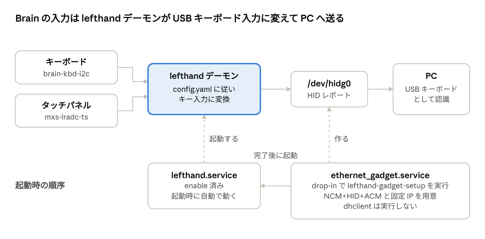

# Brain 左手デバイス 作業まとめ

2026-10-03

Sharp Brain PW-SH2 は、起動すると USB HID キーボードとして PC に認識され、本体のキーとタッチパネルの入力を設定どおりのキー入力に変換して送る。デプロイ、実機での確認、自動起動の設定まで完了した。

共有用のドキュメント: https://claude.ai/code/artifact/e37cc86b-6e33-4eea-92b1-5f55695dabd4

## 追記：フェーズ K3　バックアップと復元、PC ごとの切り替え（2026-10-12）

ユーザーが起きていて、「K3 を始めて」と言われて行った。最初に K1 のあとで決めたこと（タブレットの形、閉じているあいだの描き直し）を別のコミットで作って本番に入れ、続いて日本語入力の調整、K3 の本体を行った。デーモンは afa79624626a（K3 の最初の 2 つ）→ d7daf5ef6e33（`.prev` afa79624626a）、PC の brain-deck は a522fcd94003。設定（`config/current.yaml`）は変えていない（本番の設定に profiles は入れていない）。電池は始めるとき 3.85 V、終わるとき 3.70 V（USB 給電）。

### K3 の最初に行ったこと（K1 のあとで決めたこと）

- **ふたの確認**（README の手順 7）：REPORT の K1 のとおり、10-11 22:11〜22:21 に本番で確かめ済みだった。今回、描き直しを止めたあとにもう一度ユーザーに開け閉めしてもらった（下）。
- **ふたを閉じているあいだ描き直しも止める**（1648ad4）：`Display.SetPaused`。閉じたら（`lid.close: off` のとき）描画の goroutine は何も描かず、時計のために起きることもやめる。描き直す元（レイヤーの切り替え、押した印、知らせ、端末の出力など）は取っておき、開けたときに全体を一度描き直してから明るくする。時計とタイマーは進む（描かないだけ）。
- **タブレットの形のあいだ本体のキーを使わない**（1648ad4）：`keyFilter`（runKeyboard の入口）。`SW_TABLET_MODE` が 1 のあいだ、本体のキーを PC にも brain-deck の操作（欄、端末、読み物など）にも使わず、画面も明るくしない。前から押していたキーの離しは通し（押しっぱなしにしない）、タブレットの形で押したキーは、戻したあとの離しも捨てる。設定 `lid.tablet_keys`（`off` が既定、`on` で使う）、上書き `lid.tablet_keys`、設定のアプリの行「タブレットの形の本体キー」。上書き `lid.close` が `lid` のほかの項目を消していたのも直した。
- **実機**（試験のデーモン hwtest-k3a、本体のキーを `{input: todo}` にした試験の設定）：`config put` 2 回、上書きの設定と取り消し 3 回は止まらなかった。キーとスイッチのイベントを `/dev/input/event1` に書いて試そうとしたが、**自動の許可で止められた**（回避はしなかった）ので、ユーザーに操作してもらった。ふたを 00:33:08 に閉じて 00:34:26 に開けるまで、毎分の時計の描き直し（00:34:00）が出ず、開けたときに全体を描き直した（257 ms）。ホームのアプリを開いて HOME で戻る（レイヤーの切り替え）、タブレットの形のあいだのタッチ（電卓が動いた）、戻したあとのキー（欄が開いた）も通った。**タブレットの形のあいだ、キーのイベントは 1 つも届かなかった**（キーボードの側で止まっているか、裏返すと押せない）ので、キーを捨てる処理は実機では通っていない（安全のための網として残す）。裏返したとき USB が一度切れてつながり直した（00:35:02。ケーブルが動いたと思われる）。
- **本番**：afa79624626a を `brain-deck update` で入れ、本番の画面と `-render-png` が 0 画素の違い。

### 日本語入力の調整（K2 のあとで決めたこと）

- **欄を開いたときのかなと英数**（80d713f）：設定 `ime.start`（欄の種類ごとに `kana`、`latin`、`last`）。既定は Todo が `kana`、時刻が `latin`。かなで開くときは Ctrl+^（英数にする）のあとに Ctrl+Space（切り替え）を送るので、前の欄の状態によらずかなになる。実機（試験のデーモン）でユーザーに開いてもらい、Todo の欄が［かな］（ログで `[An- Ｒ]` → `[AnあＲ]`。2 回目も同じ）、`nihongo` の変換、時刻合わせの欄が［英数］を確かめた。
- **設定のタブの順**（7dcf943）：行の高さは変えずに 2 ページに分け、1 ページ目に 明るさ、暗くなるまで（PC あり・なし）、フォトフレーム、画面の向き、日本語入力。2 ページ目に 読み物の文字、ふた、タブレットの形の本体キー、PC ごとの設定、時刻合わせ、設定ファイルの値に戻す。画面に入らなければ組をさらに分ける。ユーザーが実機で並びを確かめた。
- **Brain のシェル**：今のまま（uim-fep が開く非ログインの bash）。

### バックアップと復元

- **作ったもの**（871da9e、44f6a5f）：`brain-deck backup [-o <ファイル>]`、`backup list`、`backup show`、`restore <ファイル> [--no-config] [--no-data] [--no-anthy] [--dry-run]`、`restore --undo`。Brain が tar.gz を作り（manifest.json を最後に置き、ファイルごとの大きさと SHA-256 を書く）、PC が受け取って確かめてから保存する。既定の置き場所は `~/.local/share/brain-deck/backups`（0700、ファイルは 0600）。
- **入れるもの**：設定ファイル（コメントもそのまま）、Todo、ウィジェットの状態、電卓、画面の向き、上書きの値、タッチの調整、PC ごとの設定の状態、手書きメモ、読み物（しおりも）、写真、背景画像、日本語入力の学習。**入れないもの**：予定、天気とアイコン、時刻の記録、テキストと QR とグラフ（PC が送る）、電池の記録、更新の記録、`ime/`。
- **日本語入力の学習を入れるか**（K2 のあとで決めたこと）：Brain の user の `~/.anthy/` に `last-record2_default.utf8`（658 バイト。選んだ候補の記録）と `lock-file_default`（空）があった。`~/.uim.d/` は fep の一時ファイルとソケットだけ。学習は小さく、取り直せないので**入れることにした**（lock-file は入れない）。戻すときは user の持ち物（0600）で書く。
- **復元**：PC で確かめて送り、Brain が形の版、名前（置き場所の外に出ないか、知っているものか）、SHA-256、JSON、設定ファイルが今のデーモンで使えるかを確かめる。今の状態を `/var/lib/lefthand/backup/before-restore.tar.gz` に残してから、更新の係（`lefthand -update-apply` に restore の動きを足した）がデーモンを止めて入れ替え（データはバックアップのとおり。設定ファイルは `.prev` を残す）、起動と PC のつなぎ直しを確かめる。起動しなければ入れ替えたものを元に戻す。`--undo` で復元の前の状態に戻す。
- **同期で自動で取る**（44f6a5f）：`brain-deck sync` の最後に、前に取ってから 20 時間たっていれば取り（`brain-sync-<日時>.tar.gz`）、7 個を超えたら sync が取った古いものから消す。`sync.yaml` の `backup`（`keep`、`every`、`dir`）で変える。**既定で取る**ようにした（下の「決めてほしいこと」1）。
- **文書**：README の「バックアップと復元、PC ごとの設定」に、扱いの注意（個人のデータが入る、暗号化、git に入れない）と、新しい SD カードに `install.sh --root` で入れ直して `restore` で戻す手順を書いた。

### PC ごとの切り替え

- **作ったもの**（9c8b4ca、44f6a5f）：設定の `profiles`（`name`、`label`、`pcs`、`start_layer`、`modifiers`、`home`、`layers`）とトップレベルの `start_layer`。PC の brain-deck が `sync` の最初に名前を知らせ（`sync.yaml` の `pc_name`、なければホスト名）、Brain は設定ファイル → プロファイル → 上書きの順に重ねる。使うプロファイルが変わったときだけ割り当てごと反映して `start_layer` を開く。知らない PC、名乗らない PC は既定。USB を抜いてつなぎ直したあと 60 秒名乗らなければ既定に戻す。手で選ぶ（`brain-deck profile use`、設定のアプリ）と、別の名前の PC が名乗るまで続く。`modifiers` はキーの名前（`LCTRL+C` → `LGUI+C`）を書き換えるので、セルの表示も合う。
- **見えるところ**：設定のアプリの 2 ページ目「PC ごとの設定」と情報のタブ、`brain-deck profile`、`brain-deck status`。状態の帯には出していない（下の「決めてほしいこと」3）。
- **設定 GUI**（23eb753）：profiles は編集しないが、保存しても消さない。レイヤーの名前を変えたり消したりすると、profiles と `start_layer` も合わせる。
- **あとで直したこと**（a522fcd）：自動の同期は `--if-older 10m` なので、USB を付け直して 10 分のうちだと同期を丸ごと飛ばし、名乗らないまま 60 秒で既定に戻ってしまう。飛ばすときも名乗るようにした。

### 実機で調べたこと（試験のデーモン hwtest-k3b）

試験のユニット（lefthand-hwtest、`-data-dir /tmp/lhu/data` に本番のデータの写し 2.6 MB、設定は本体のキーを `{input: todo}` にしたものに試験のプロファイル `k3test`（pcs: k3pc、start_layer: calendar、modifiers ctrl⇔gui）を足したもの、45 分の戻すタイマー）。前後で本番の lefthand.service を確かめた。

- `config put` 3 回、上書きの設定と取り消し、レイヤーの切り替え（ユーザーのタップ）：止まらなかった。
- **プロファイル**：`profile announce k3pc` でカレンダーが開き、`config put` のあとも続いた。`profile use none` でホーム、`profile auto` でカレンダーに戻った。
- **バックアップ**：Brain で作るのに 3.8 秒、受け取りまで 5.4 秒、1.2 MB（中身 2.5 MB、18 個のファイル。背景画像 10 個がほとんど）。
- **復元**：Todo を 1 つ足してから `restore --no-anthy`（user の本物の `~/.anthy` を書き換えないため）：31 秒で「戻しました」、足した Todo が消えた。`restore --undo --no-anthy`：22 秒で戻った。係のログは 止める → 入れ替え（4 秒）→ 起動 → 起動の知らせ（3 秒）→ つなぎ直しの確かめ → 終わり。**日本語入力の学習を戻すのは、ホストのテストだけで確かめた**。
- 試験のデータ（/tmp/lhu）、PC に取ったバックアップ（本番のデータの写しが入るもの）、比べた画面は消した。

### 確認

- ホスト：`go vet ./...`、`go test ./...`、`-race` で全体（K2 からあった TestPromptIME の競合を直した。6c5c412）、GUI の `tsc` と `vitest`（259 件）。新しいテスト：バックアップを作る・読む・壊れたものと知らない名前と置き場所の外に出る名前を断る、入れ替えと元に戻す、プロトコルと係の流れ（起動しなければ元に戻す）、設定ファイルが使えないとき、プロファイルの重ね方と検証と選び方と状態とプロトコル、PC 側の backup・restore・profile・sync のバックアップと世代・`--if-older` でも名乗る、タブレットの形のキー、描き直しの停止と再開、設定のページ、ime.start。
- コミットは機能ごとに分け、プロファイルとバックアップの段階でもビルドとテストが通ることを確かめた。
- 本番：`brain-deck update`（afa79624626a → d7daf5ef6e33、成功）。本番の画面と `-render-png` が 0 画素の違い。`brain-deck config get` が config/current.yaml と同じ。`brain-deck status` の「PC ごとの設定：既定。名乗った PC はない」。本番の `/var/lib/lefthand/` は `update/` のほかは変えていない（`backup/` と `profile.json` はまだない）。PC の `~/.local/bin/brain-deck` を a522fcd94003 にした。

### 変更したファイルとコミット

- 1648ad4 lid.go、lid_test.go、display.go、main.go、overrides.go、overrides_test.go、settingswidget.go、cmd/brain-deck/main.go、gui/src/types.ts、gui/src/demo.ts（ふたとタブレットの形）／ afa7962 文書
- 80d713f ime.go、ime_test.go、prompt.go、gui/src/types.ts（ime.start）／ 7dcf943 settingswidget.go、settings_test.go、main.go（設定の並び）／ 3dce3a6 文書
- 6c5c412 ime_test.go（テストの競合）
- 9c8b4ca profile.go、profile_test.go、config.go、layer.go、apply.go、settingswidget.go、settings_test.go、control.go、main.go（PC ごとの設定）
- 871da9e backup.go、backup_test.go、update.go、updatehelper.go、control.go、main.go（バックアップと復元）
- 44f6a5f cmd/brain-deck/backup.go、backup_test.go、profile.go、main.go、sync.go（PC のコマンド）／ 2d0a8c9 admin.go ／ a522fcd sync.go（--if-older でも名乗る）
- 23eb753 gui/src/types.ts、model.ts、gui/test/model.test.ts
- d7daf5e README.md、docs/config.md、docs/protocol.md、help/ja.md

### 目で確かめる手順

README の「バックアップと復元、PC ごとの設定」→「目で確かめる手順（フェーズ K3）」（1〜7）。5〜7（設定の並び、日本語入力の最初の状態、ふたとタブレットの形）は試験のデーモンでユーザーが確かめた。1〜3（バックアップ、復元、同期の自動のバックアップ）は本番でまだ行っていない。

### 次のフェーズ（K4 起動を速くする）に進む前に決めてほしいこと

1. **同期の自動のバックアップを既定で取るか**：今は、`sync.yaml` に何も書かなくても、次に USB をつないで自動の同期が動いたときから、1 日 1 回 `~/.local/share/brain-deck/backups` に取る（7 個残す）。個人のデータを自動で PC に書くことになるので、既定は取らない（`backup.keep` を書いたときだけ）ほうがよければ変える。
2. **本番の設定の profiles**：今は入れていない。使う PC の名前（`hostname`）と、PC ごとに変えたいこと（Mac で Ctrl と Cmd を入れ替える、最初に開くアプリなど）を教えてもらえれば、config/current.yaml に入れる。
3. **今のプロファイルの表示**：設定のアプリと `brain-deck status` にだけ出している。状態の帯にも出すか（帯は時刻、電池、PC、マウス、同期で埋まっている）。
4. **タブレットの形のキー**：実機では、裏返すとキーのイベントが届かなかった。裏返したまま本体のキーを押せる形があるか（あれば、もう一度試したい）。
5. **K4 の再起動**：起動の時間を測るには、変更の前後で再起動が要る。電池は 3.70 V で、つないだままでも 1 時間に 0.1 V ほど下がっている。K4 の前に純正のファームウェアで充電してほしい。

## 追記：フェーズ K2　日本語の入力（2026-10-11）

ユーザーが起きていて、「K2 から始めて」と言われて行った。デーモンは e338b6168600（`.prev` a30ea9e82e31）、設定は `config/current.yaml`（e338b61。`ime` を足した）を本番に反映した。電池は始めるとき 3.86 V、終わるとき 3.85 V（USB 給電）。

### 実機で調べたこと

- **入っているもの**：uim-fep 1.9.6、uim 1.9.6、uim-anthy（Anthy 0.4、辞書 22 MB。uim に登録されている方式は `anthy-utf8` だけ）、fcitx-anthy（X がないので使えない）。**Mozc は入っていない**（ユーザーの記憶の「uim-fep 経由の Mozc」は、uim-fep 経由の Anthy だった。user の `~/.bash_profile` に `fbterm -- uim-fep` があり、コンソールではそれで日本語を打っていたと思われる。PTY から fbterm を動かすと「stdin isn't a interactive tty!」で終わるだけ）。`libuim-skk.so` はあるが SKK の辞書（`/usr/share/skk`）はない。Noto Sans/Serif CJK のフォントはある。
- **uim-fep のメモリと時間**（python で疑似端末を作って user の権限で動かした）：起動してから状態の行が出るまで 2.8 秒（デーモンの中では 4〜7 秒。描画と重なる）。RSS は起動してすぐ 4.3 MB、一度変換したあと 7.0 MB（PSS 2.2 → 4.7 MB）、子の bash 3.4 MB（PSS 1.1）、uim-helper-server 1.4 MB。打った文字の反映 10〜50 ms、最初の変換 0.2〜0.4 秒（辞書の読み込み）、2 回目から 40 ms ほど。本番のデーモンの入力と描画には影響しない（別のプロセス。欄を開いているあいだの描き直しは 5〜7 ms）。
- **uim-fep が出す制御シーケンス**：CSI 6n（カーソルの位置の問い合わせ）、CSI r（スクロールの範囲）、CSI H、SGR 4（変換中の下線）、7（文節と候補の反転）、39;49、ESC ( B、CSI K。どれも term.go がもう扱えた。足したのは OSC の受け口（Term.OnOSC）だけ。状態の行は `anthy-utf8[An- Ｒ]`（かなにすると `[AnあＲ]`。あ が「- 」の 2 桁に重なる）、候補は `1:日本語 2:にほんご 3:ニホンゴ [2/3]`。記録したバイト列をテスト（TestTermUimFepSequences）にした。
- **uim の設定**：`LIBUIM_USER_SCM_FILE` で `~/.uim` の代わりのファイルを渡せる（init.scm）。既定のオン/オフのキーは zenkaku-hankaku と Shift+Space で、どちらも端末では送れないので、lefthand の uim.scm で Ctrl+Space（NUL。uim-fep は `<Control> ` にする）、Ctrl+^（英数にする）、Ctrl+]（変換中はやめる）を足した。
- **見つけた癖**：uim-fep は、1 回の読み取りで制御の文字と文字が一緒に届くと（`Ctrl+^` + `2026-10-11 23:37` を一度に書いたとき）、知らないエスケープシーケンスとみなして、そのまま子（readline）に渡す。制御の文字が 1 つだけなら効く。また、変換中はオフのキーもやめるキー以外は無視される。lefthand は制御の文字を 1 つずつ、30 ms の間を置いて書く（imeSplit）。
- **login -p**：環境変数を捨てない（HOME は渡さなければ login が決める。sudo の HOME=/root が残った状態で試したら `/root` に入れずに失敗したので、渡す環境変数は TERM、LANG、PATH、BRAIN_TERMINAL、BRAIN_IME、LIBUIM_USER_SCM_FILE だけにした）。`/etc/profile` → profile.d → `exec uim-fep` で、`UIM_FEP_PID` の入った user の bash（非ログインの対話シェル。`user@brain:~$`）が開くことを、`login -p -f user`（パスワードを聞かない。試験のためだけ）で確かめた。
- **キーの注入**：`/dev/input/event1`（brain-kbd-i2c）に EV_KEY を書くと、デーモンがふつうのキーとして受け取る（PC に漏らさないよう、試験の設定ではすべてのキーを `{input: todo}` にした。欄が開いていなければ欄を開くだけ、開いていれば欄に入る）。これで、ユーザーに頼まずに欄の試験ができた。

### 作ったもの

- **ime.go**：uim-fep の係。欄を 2 行の端末（Term）にし、`uim-fep -u <方式> -s lastline -e bash --norc --noprofile line.sh` を Brain の user の権限（startUserPTY。root は断る）で動かす。line.sh は bash の `read -e`（readline）で 1 行を読み、決定で `ESC ] 7777 ; ok ; <文字> BEL`、Ctrl+] の readline のマクロ（行を消して先頭に Ctrl+] を入れた行として確定）で `ESC ] 7777 ; cancel BEL` を書く。uim.scm、inputrc、line.sh はデータの置き場所の `ime/`（0755、0644）に作る。起動が終わる（状態の行が出る）までのキーはためて送る。欄を閉じても止めず、`ime.idle`（既定 10 分）使わなければ止める。方式が変われば止めて起動し直す。`IMEView`（1 行目の桁、カーソル、候補の行、モード、準備中の知らせ）。
- **欄（prompt.go）**：uim-fep が使えるときは欄を IME にし、キーは端末モードと同じバイト列（keyBytes）で送る。文字切り替え（Alt）を 1 回押す（ほかのキーを押さずに離す）と NUL（かな/英数）。戻るは Ctrl+]（変換中なら変換をやめ、でなければ欄をやめる。結果が cancel で届いたときに閉じる）。時刻の欄は Ctrl+^ で英数にしてから最初の文字を入れる。確定できなかったとき（空の Todo など）は、同じ文字で開き直す。使えないとき（off、uim-fep がない、起動できない、途中で止まった）は今までの英数字だけの入れ方（題に「（英数字と記号）」）。描画は倍率 2 の k8x12（全角 16 ドット）で、下線（変換中）と反転（文節、候補。青の背景）、候補の行は説明の行の代わりに出す。題の横に［かな］［英数］。
- **Brain のシェル（termmode.go、termpty.go、contrib/brain/lefthand-ime.sh）**：`/bin/login -p` に `BRAIN_IME=<方式>` と `LIBUIM_USER_SCM_FILE` を渡す。`/etc/profile.d/lefthand-ime.sh`（install.sh が置く。本番の Brain には手で置いた）が、`BRAIN_TERMINAL=1` と `BRAIN_IME` があり `UIM_FEP_PID` がない対話シェルのときだけ、`exec uim-fep -u <方式> -s lastline`（$SHELL を開く）。文字切り替えを 1 回押すと NUL（uim-fep を通しているときだけ。PC の端末では何も送らない）。タッチのキーに 3 ページ目「日本語」（かな、英数、変換、確定、取消、文節の移動と長さ、候補、BS、F6〜F10 の変換中の形、Esc、Tab、Ctrl、^C、^D、^L、Del）。
- **設定と状態**：設定の `ime`（method：auto/off/方式、user、idle、terminal）。上書き `ime.method`。設定のアプリの「日本語入力」の行（使わない、自動、入っている方式。方式が入っていなければそう出す）と情報のタブの「日本語入力」。設定の行が 10 になったので、設定のタブは 2 ページになった（時刻合わせと「設定ファイルの値に戻す」は 2 ページ目）。`get_status` の `ime`、`brain-deck status` の「日本語入力」。GUI の設定の型と模擬の Brain の上書きの名前。
- **文書**：README の「日本語の入力」（仕組み、キー、やめ方、測った値、設定、SKK と Mozc の入れ方、できないこと、目で確かめる手順）ほか、docs/config.md の `ime`、docs/protocol.md、ヘルプの「日本語を打つ」。

### 選んだ方法と、ほかの案

- 第一候補どおり、欄を「1 行（+ 状態の行）の小さな端末」にして uim-fep を動かした。端末の描き方をそのまま使え、Brain のシェルと同じ uim の設定とキーになる。
- **行を読むプログラム**：bash の readline（起動 34 ms）にした。python3 は起動に 1.1 秒、lefthand 自身の子コマンドは 0.2 秒だが、readline は UTF-8 のカーソル移動、後退、Home/End、横のスクロールをもう持っている。
- **anthy-agent を直接使う案**（ローマ字→かな、文節、候補の画面を brain-deck の中に作る）：欄の見た目は自由になるが、変換の操作をすべて作り直すことになり、Brain のシェル（uim-fep）と操作が違ってしまうので採らなかった。
- **重すぎる・入っていないとき**：Anthy は軽く（合計 10 MB ほど、辞書は mmap）、入っていたので、ローマ字→かなの自作は要らなかった。SKK は辞書がないので使えない（README に入れ方を書いた）。

### 確認

- ホスト：`go vet ./...`、`go test ./...`（全体。IME の試験は偽の uim-fep（testdata/ime/uim-fep。bash の readline で本物の line.sh と inputrc を動かす）で、確定、やめる、最初の文字、閉じて開き直す、止まったとき、idle で止まる、Prompt の流れ、欄の絵）、GUI の `tsc` と `vitest`（258 件）。
- 実機（試験のユニット lefthand-hwtest、`-data-dir /tmp/lhu/data`、25 分の戻すタイマー。前後で本番の lefthand.service を確かめた）：
  - キーを注入して、Todo の欄：文字切り替え → `nihongo` → スペース（「にほんご」が反転。Anthy の学習で 2 回目は「日本語」が先）→ スペース（候補の一覧）→ 決定 → 決定で「日本語」が todo.json に入った。`test` も入った（知らせ「Todo に足しました：test」を画面で確かめた）。
  - 戻る：変換中（かく）なら変換だけやめて欄は開いたまま、もう一度で閉じる。時刻の欄：かなにしていても英数で開き、時刻が入っている（最初の版では Ctrl+^ が効かず［かな］のままだった。上の癖を見つけて直した）。
  - `brain-deck config put`（試験の設定）、`brain-deck overrides set ime.method off`（欄が「（英数字と記号）」になり uim-fep が止まる）、`overrides clear`（次に開いたとき起動し直す。6.7 秒）。
  - idle（試験の設定では 2 分）で uim-fep が止まった（ログ `ime: idle for 2m0s, stopping uim-fep`）。
  - Brain のシェル：`login -p -f user` で、profile.d のスクリプトが uim-fep を起動し、状態の行と `UIM_FEP_PID` を確かめた。**パスワードを入れる本当のログインは、ユーザーが確かめる**。
  - 本番：`brain-deck update`（a30ea9e82e31 → e338b6168600、成功）、`config put config/current.yaml`（`config get` と同じ）、`brain-deck status` の「日本語入力：anthy-utf8（自動）、uim-fep は止まっている、Brain のシェルでも使う」。本番のホーム画面と `-render-png`（`-render-last-sync`、`-render-mouse-off`）が 0 画素の違い。
- 試験のファイル（/tmp/lhu、注入のスクリプト、uim の試験の設定）は消した。本番の `/var/lib/lefthand/` は `update/`（更新の記録）のほかは書き換えていない。**試験で user の `~/.anthy`（学習）と `~/.uim.d/fep/` に uim-fep が書いたファイルは残っている**（user のもの。害はない）。
- PC の `~/.local/bin/brain-deck` を e338b6168600 にした。

### 変更したファイルとコミット

- 285929d ime.go、ime_test.go、testdata/ime/uim-fep、term.go（OnOSC）、termpty.go（startUserPTY、openPTY、login -p）、prompt.go、config.go、main.go、control.go、termmode.go、termkeys.go、overrides.go、settingswidget.go、cmd/brain-deck/main.go、gui/src/types.ts、gui/src/demo.ts、termbrain_test.go
- 9723c3e contrib/brain/lefthand-ime.sh、install.sh
- 4d4b39c README.md、docs/config.md、docs/protocol.md、help/ja.md
- e338b61 config/current.yaml

### 目で確かめる手順

README の「日本語の入力」→「目で確かめる手順（フェーズ K2）」（1〜7）。特に 6（Brain のシェルでのログインと日本語）は、パスワードが要るので私は試していない。

### 次のフェーズ（K3）に進む前に決めてほしいこと

1. **K1 のあとで決めたことのうち、まだ作っていないもの**：タブレットの形（`SW_TABLET_MODE`）のあいだ本体キーを PC にも brain-deck にも使わない（設定で変えられる。既定は使わない）、ふたを閉じているあいだ描き直しも止める。K2 は日本語入力だけにしたので、K3 の前に小さく入れるか、K3 と一緒にするか。
2. **かな/英数の状態**：uim-fep が動いているあいだは、前の欄の状態（かな）が次の欄にも残る（時刻の欄だけ英数にする）。Todo の欄を開くたびに英数にするほうがよいか。
3. **設定のタブが 2 ページになった**：行を 1 つ足したので、時刻合わせと「設定ファイルの値に戻す」が 2 ページ目に行った。行の高さを詰めて 1 ページに戻すか、順番を変えるか。
4. **Brain のシェルの uim-fep**：ログインしたシェルは、uim-fep が開く非ログインの bash（`~/.bashrc` は読む。`~/.profile` は読まない。`~/.bash_profile` の `fbterm -- uim-fep` は動かない）。これでよいか。

## 追記：フェーズ K1　ふた、設定のアプリ、ヘルプ（2026-10-11）

ユーザーが起きていて、その場で返事をもらいながら行った。デーモンは a30ea9e82e31（`.prev` 222a193d6554）、設定は `config/current.yaml`（d79939f）を本番に反映した。

### 作ったもの

- **ふた**（lid.go）：キーボードの `EV_SW SW_LID` で、閉じたら画面を消し、タッチを受け付けない。閉じているあいだはキー、知らせ、設定の反映があっても点けない。フォトフレームも出さない。時計、タイマー、同期、電池の見張りは動き続ける。開けたら明るくして、自動減光の時間を数え直す（画面の中身はそのまま）。設定の `lid.close`（`off` が既定、`none` で何もしない）。自動減光を使っていないときも同じ。`get_status` の `lid`。
- **上書きの値**（overrides.go）：Brain で変えた値を、設定ファイルを書き換えずに `/var/lib/lefthand/overrides.json` に置き、設定ファイルの値に重ねて使う。上書きできるのは明るさ、暗くなるまで（PC あり・なし）、フォトフレーム、ふた。`get_config` は設定ファイルの値と `overrides` を返す（設定 GUI の保存や `config put` で、上書きが設定ファイルに入らない。上書きは残る）。プロトコル `get_overrides`、`set_override`、`clear_overrides`。`brain-deck overrides`（一覧、`clear <名前>... | all`、`set <名前> <値>`）、`brain-deck status` の「ふた」「上書き」、設定 GUI の上の一覧と「設定ファイルの値に戻す」。
- **設定のアプリ**（`widget: settings`）：タブ「設定」（明るさ、暗くなるまで ×2、フォトフレーム、画面の向き、読み物の文字、ふた、時刻合わせ、上書きをすべて消す）、「情報」（版、電池、SD カードの空き、PC、最後の同期、時刻、ふた、上書き）、「電源」（再起動、電源を切る。2 秒押し続けたときだけ）。上書きの行は橙色と「上書き」の札。設定ファイルと同じ値を選んだら上書きを置かない。画面の向きと読み物の文字は、もとから Brain の状態（display.json、reader の state）なので、そちらを変える。
- **ヘルプ**（`widget: help`）：`help/ja.md`（基本の操作、アプリごとの使い方、PC から外したとき、困ったとき。README をもとに短く書き直した）を lefthand に埋め込み、読み物と同じ描き方で読む。`{version}` はデーモンの版。目次、困ったときへ飛ぶ、文字の大きさ（読み物と同じ）。組み込みのアイコンに `help`（？）。
- **本番の設定**：ホーム画面の 1 ページ目の最後に「設定」（歯車）、2 ページ目の最後に「ヘルプ」。「本体」は 2 ページ目の先頭に移し、アイコンを電池に。並びとアイコンはユーザーと決めた（案：2 ページ目の最後に足す、1 ページ目に設定、2 ページ目の先頭に足す → 1 ページ目に設定。アイコン：両方歯車、設定は歯車で本体は電池 → 後者）。`lid.close: off`。
- `-render-settings settings|info|power`、`-render-settings-choice <行>`、`-render-help <ページ>`（画面を見るため）。

### 実機で調べたこと

- **ふたのスイッチ**（本番を止め、キーボードとタッチを読むだけの Python で記録。ユーザーに開け閉めしてもらった）：閉じると `SW_LID 1`、開けると `0`（17.40 秒に閉じ、21.70 秒に開けた、など 2 回）。半分（45 度ほど）まで閉じたときは何も出ない。タブレットの形にすると `SW_TABLET_MODE 1`、戻すと `0`。どれも、タッチやキーのイベントは出なかった。`EVIOCGSW` は、USB がつながっていても 0（`SW_DOCK` も 0）：ドライバ（brain-kbd-i2c.c）は起動したときの状態を読まず、変わったときだけ知らせる。`/proc/bus/input/devices` の SW=23（LID、TABLET_MODE、DOCK）。
- **ふたの動き**（本番、22:11〜22:21。充電したあとに行った）：本番のデーモンのまま、明るさを 0.25 秒ごとに記録し、ユーザーに開け閉めしてもらった。閉じると 7 → 0、開けると 0 → 7（ログの lid: closed / opened と同じ時刻）。閉じたまま 61 秒でも 0 のままで、開けたら 7。続けて 5 回開け閉めしても、1 秒以内にそのつど合わせた。開けたときはホーム画面のまま（ユーザーが目で確かめた）。最後に触ってから 3 分で 7 → 1（暗く）、暗いときに閉じて開けると明るくなった（ログと目）。閉じているあいだは画面が見えないので、消えているかは目では分からない（ユーザー）。記録で確かめた。
- **電池が切れた**：1 回目のふたの記録の最後に USB を抜いてもらったところ、電池が切れて Brain が止まった（15:10。記録は /tmp と一緒に消えた。RTC が 2000-01-01 に戻り、Brain の時刻が 10 時間ずれたので `brain-deck time sync` で直した）。さらに 15:30:43 に、USB につないだままで電池の電圧が 3318 mV まで下がり、電池の見張り（本番の設定の 3.4 V）が 15:31:43 に電源を切った。**私はこれに気づかず**、15:35 にユーザーが電源を入れ直したあとで試験を続けていた（16:28 に `uptime` で分かった）。今は 3.47 V（3%）。**純正のファームウェアで充電してほしい**。
- **設定のアプリの画面**（試験のデーモン、base を設定のアプリにした設定）：実機の画面と `-render-png -render-settings settings` が 0 画素の違い。上書き（明るさ 3、ふた 何もしない）を置くと、明るさが 3 になり、`/tmp/lhu/data/overrides.json` に書き、行に「上書き」の札が出た。デーモンを起動し直しても明るさ 3 のまま。明るさ 3 → 30 秒で 1（暗く）→ 2 分で 0（消す）と動いた（0.25 秒ごとに sysfs を読んだ記録）。
- **ヘルプ**：実機の画面と `-render-png -render-help 1` が 0 画素の違い。Brain の上で 20 ページ目を描くのに、起動の 1.2 秒を除いて、24 ドットで約 1.5 秒、32 ドットで約 2.1 秒（ほとんどが、読み物のフォントを初めて戻す時間。読み物と同じ）。ヘルプは横向き 24 ドットで 25 ページ。デーモンの RSS は 16.8 MB（試験の設定）。
- **本番の画面**：反映のあとのホーム画面と `-render-png` が 0 画素の違い。

### 見つけて直したこと

- **設定の反映で、本番のデーモンが止まった**（a30ea9e）：222a193 を本番に入れて `brain-deck config put` をしたら、返事がなく、画面も止まった（設定の書き込みと読み直しはできていた）。設定の置き場所（configStore）はロックを持ったまま反映し、反映の中で設定のアプリの描き直しを呼んで、設定のアプリのロックを待つ。描画の側は、設定のアプリのロックを持ったまま設定の置き場所を待っていた（ロックの順が逆）。タッチの処理（エンジンのロックの中で呼ばれる）も設定の置き場所を呼んでいた（反映はエンジンのロックを待つので、こちらも止まりうる）。描き直しの知らせを待たずに返す、写しは設定のアプリのロックを持たずに作る、タッチの処理は最後に描いたときの写しを使う、と直した。直す前の版では止まり、直した版では通るテスト（TestSettingsNoDeadlockWhileApplying）を足した。試験のデーモンで、本番の設定の `config put` と上書きを 3 回ずつ続けても止まらないことを確かめてから、本番に入れ直した。**止まった本番は ssh で `systemctl restart lefthand` して戻した**（16:28。止まっていたのは約 2 分）。
- **読み物の道具の箱が左上に寄っていた**（385ace8）：`image.Rect(x, y, 0, 0)` は小さいほうを Min にするので、道具の箱が画面の左上（状態の帯に重なる位置）に出ていた。設定のアプリの選ぶ画面で気づいた。
- **自動減光をやめたとき**（f8fc14e）：`backlight` を消す設定を反映すると、`d.p` が nil のまま明るさを読んで落ちるところがあった（今までは通らなかった）。

### 確認

- ホスト：`go test ./...`（全体と、`-race` で全体 1 回、K1 のテストを 3〜5 回）、GUI の `tsc` と `vitest`（258 件）。本番の設定のホーム画面（横 1 ページ目、縦 2 ページ目）と、設定とヘルプ（横と縦）の GUI のプレビューが、`-render-png` と画素単位で同じ（gui/test/pda.test.ts）。
- コミットは機能ごとに分け、どの段階でもビルド、`go vet`、テスト、GUI のテストが通ることを確かめた（作業用の worktree で、段階ごとの版を作って確かめた）。
- 試験は時間制限付きのユニット（lefthand-hwtest、`-data-dir /tmp/lhu/data`、戻すタイマー付き）で行い、前後で本番の lefthand.service を確かめた。試験のファイルは消した。本番の `/var/lib/lefthand/` は書き換えていない（overrides.json もない）。

### 反映

- デーモン：6a74e57ee33d → 222a193d6554（止まる不具合あり）→ a30ea9e82e31。`brain-deck update --status` は「222a193d6554 → a30ea9e82e31、成功」。
- 設定：`brain-deck config put config/current.yaml`。`brain-deck config get` が config/current.yaml と同じ。2 回入れたので、`/etc/lefthand/config.yaml.prev` も今のものと同じ。K1 の前の本番の設定は `git show c7bfc1e:config/current.yaml`。
- PC の `~/.local/bin/brain-deck` を a30ea9e82e31 にした。

### 目で確かめる手順

README の「設定のアプリとヘルプ、ふた」→「目で確かめる手順（フェーズ K1）」。ふた（7）と電源のボタン（9）も確かめた：22:31:20 に設定のアプリで「再起動」を 2 秒押し続け（ログ settings: reboot (held for 2s)、power: reboot requested）、Brain が再起動してホーム画面に戻った（ユーザーが目で確かめた。uptime と brain-deck status でも確かめた）。

### 変更したファイルとコミット

- 385ace8 readerwidget.go（道具の箱の位置）
- f8fc14e lid.go、lid_test.go、backlight.go、config.go、control.go、main.go（ふた）
- 70bae20 overrides.go、overrides_test.go、apply.go、control.go、main.go、cmd/brain-deck/main.go、overrides.go、overrides_test.go（上書きの値）
- 93dd75b gui/src/app.ts、demo.ts、style.css、types.ts、gui/test/app.test.ts（GUI の上書きの一覧）
- b570d7c settingswidget.go、settings_test.go、widget.go、todowidget.go、main.go、readerwidget.go、GUI（設定のアプリ）
- c7bfc1e helpwidget.go、help/ja.md、help_test.go、icons.go、gui/src/icons.json、layer.go、widget.go、todowidget.go、main.go、GUI（ヘルプ）
- d79939f config/current.yaml、gui/test/pda.test.ts、fixtures（本番の設定）
- 222a193 README.md、docs/config.md、docs/protocol.md（文書）
- a30ea9e settingswidget.go、settings_test.go（止まる不具合）

### 次のフェーズ（K2 日本語の入力）に進む前に決めてほしいこと

1. **充電**：電池が 3%（3.47 V）。USB につないでいても 3.32 V まで下がって電源が切れた。純正のファームウェアで充電してから K2 を始めたい（K2 の調べもの、変換のプログラムのメモリと時間を測る試験は、電池だけで止まると記録が消える）。
3. **タブレットの形**：画面を裏返すと、キーボードが裏になって押されることがある。今は覚えるだけ。タブレットの形のときに本体キーを PC に送らないようにするか（入力の画面のときだけ、なども考えられる）。
4. **閉じているあいだの描画**：今はバックライトを消すだけで、時計などの描き直しは続けている（CPU はほとんど使わない）。描き直しも止めるか。
5. **設定のアプリの項目**：K3 のプロファイル（PC ごとの切り替え）を、設定のアプリにも足す予定。ほかに Brain だけで変えたい項目（端末の Brain の名前、PC から外したらホームに戻るか など）があるか。

## 追記：フェーズ R3　充電の問題と、新しい機能を本番の設定に（2026-10-11）

ユーザーが起きていて、その場で返事をもらいながら行った。デーモンは ae7af4cdef23（`.prev` 78d5533a7115）、設定は `config/current.yaml`（ae72b5a）を本番に反映した。

### 充電の問題

- **原因**：Brainux では電池が充電されない。i.MX28 の内蔵の充電器が止まったまま（`HW_POWER_CHARGE` 0x00010000、PWD_BATTCHRG = 1、電流 0）で、カーネルにも lefthand にも、それを動かすものがない。純正のファームウェアから U-Boot を起動するので、U-Boot の SPL の電源の初期化も通らない。前の記録の「充電は外付けの IC」は確かめていない推測だった（README の「充電」に直した）。
- **電池が切れた**：前のセッションの 04:13 に 49%（3.77 V）。PC は起きたまま（PC のカーネルのログに suspend がない）、09:57 に Brain が USB から消えた（電池が切れた）。内蔵 RTC も 2000-01-01 に戻った（`brain-deck time sync` で直した）。ユーザーが 10:22 に起動したとき 3.49 V（4%）。
- **MaxPower**：250 → 500 mA にした（8ab7105。PC の `lsusb -v` で 500mA）。前後の電池の電圧（30 秒ごと、Brain の /tmp に記録）：250 mA・画面を消す 3477 → 3484 mV（21 分）、500 mA・明るさ 7 3484 → 3492 mV（30 分）、500 mA・暗い 3495 → 3495 mV（31 分）。**どれも変わらない**：電池がこのくらいまで減ると USB の 5V で動き（明るさ 7 で 5V のほうが 50 mV 下がる）、電池は減りも増えもしない。電池が多いあいだは電池から取って減る。ルートのポートなので、MaxPower で流れる電流は変わらないと考えられる。
- **消費の目安**：バックライトの明るさ 7 は 70〜120 mA ほど（明るさを変えたときの電池の電圧の跳ね方と、内部の抵抗 0.15〜0.2 Ω から）。明るさ 1 と 0 はほぼ同じ。電池だけで明るさ 7 のとき 1.5 mV/分ほど（4.05 V のあたり）。
- **表示を直した**：「4%、充電中」と出ていた（5V があって満充電より低ければ充電中とみなしていた）。`HW_POWER_CHARGE` を読み（書かない）、充電器が止まっていれば「USB 給電、充電していない」（ae7af4c）。電池のウィジェットは「充電していない」、状態の帯の電池は残りで色を変える。`brain-deck battery log --fit` は、もとから USB を外した記録だけで表を作るので、充電の推定の誤りの影響はない。
- **直す案**（README の「充電」）：1. lefthand で内蔵の充電器を動かす（充電の電流と止める電流を書き、PWD_BATTCHRG を 0 に。外したとき、満充電、温度、時間で止める）。2. 今は純正のファームウェアで充電する。3. 暗くするのを早める、フォトフレームの明るさを下げる。4. 給電付きのハブは効かない。**1 は電源のレジスタを書くので、決めてもらってから作る**。
- **決めたこと（ユーザー、2026-10-11）**：内蔵の充電器を brain-deck から動かす案は**保留**（ハードウェアの制御を誤ると、電池の劣化や発火のおそれがある）。将来やるなら brain-deck とは別のタスクで、カーネルのドライバとして作り、Brain Hackers のコミュニティで見てもらう。**充電は純正のファームウェアで行う**。README の冒頭と「充電」に書いた。
- **電池を使い切らない**（130f59d）：設定に `battery.warn_mv`、`poweroff_mv`、`poweroff_plugged` を足した。本番は 3500 mV で知らせ、3400 mV を 3 回続けて下回ったら 60 秒の知らせのあと電源を切る（キーかタッチで取りやめ、10 分後にもう一度確かめる。今の仕組みのまま）。USB の 5V があるあいだも同じ（USB をつないでも取りやめない）。残り（%）での知らせ（warn 20、critical 10）は 0 にした。ホストのテスト（TestBatteryGuardVoltage）で、つないでいるときといないときの、知らせる、切る、取りやめる、戻ったらもう一度知らせる、poweroff_plugged: false を確かめた。実機で電源を切る試験はしていない。反映したとき、電池は 3.51 V（知らせる値の少し上）だった。

### 本番の設定に足したもの

| もの | 中身 |
| --- | --- |
| 読む（read） | `widget: reader`、横と縦 1×1 |
| メモ（memo） | `widget: memo`、横と縦 1×1。状態の帯を出す（右上の札が「次」に重なったため） |
| ファイル（files） | `widget: files`、場所は既定（ホーム、写真、メモ、読み物） |
| ペン（pen） | `widget: pentablet`（4×3）と「マウス切替」「トラックパッド」。入力のレイヤーはいっぱいなので、ユーザーと決めて別のアプリにした |
| 同期（sync） | Ctrl+F18、時計、時刻合わせ。本体とダッシュボードはいっぱいなので、ユーザーと決めて別のアプリにした |
| フォトフレーム | `backlight.photo` と `backlight.offline.photo` を true、`photo`（1 分、足した順、23:00〜07:00、明るさ 4、10 枚）。写真が 0 枚のとき、3 分で明るさ 1 になり、画面はそのままだった（実機） |

ホーム画面の並び：前は 1 ページ目 左手デバイス、ダッシュボード、Todo、カレンダー、天気、電卓、道具、入力、発表、本体、画面の向き、メニュー／2 ページ目 コード、ブラウザ、デバッグ、記号、ウィンドウ。今は 1 ページ目 左手デバイス、ダッシュボード、Todo、カレンダー、天気、**読む、メモ**、電卓、道具、入力、**同期**、本体／2 ページ目 **ペン、ファイル**、発表、画面の向き、メニュー、コード、ブラウザ、デバッグ、記号、ウィンドウ。今のレイヤー、キー、セル、ソフトキーは変えていない（設定の JSON を前後で比べた）。

確かめたこと：`lefthand -check`、ホーム画面（横と縦の 2 ページ）と足したアプリ（横と縦）の `-render-png`。GUI のプレビューが `-render-png` と画素単位で同じ（11 枚。gui/test/pda.test.ts）。本番の設定は `brain-deck config get` と同じ。本番のホーム画面と `-render-png` は 0 画素の違い。

### 細かい確認

- **フォントのライセンス**：`font/reader-OFL.txt` の OFL の本文は Noto CJK の Serif/LICENSE と同じ。著作権の表記（© 2017-2024 Adobe、Noto is a trademark of Google Inc.）は、元の OTF の name の表と同じ。Reserved Font Name はない。README の表記も正しい。
- **青空文庫の作品**：`testdata/reader/README.md` の底本、入力、校正、公開と修正の日付は、zip の中のテキストの末尾と同じ。直すところはなかった。
- **ときどき落ちるテスト**：`-race` で全体を 5 回走らせ、1 回 `TestSetTimeLogsRTC` が「TempDir RemoveAll cleanup: directory not empty」で落ちた。set_time のあとに別の goroutine で clock.json を書くのが、テストの後片付けと重なっていた。TimeService.Wait で待つようにした（bdbe422）。直したあと、そのテストを -race で 40 回、全体を -race で 3 回、落ちなかった。

### 反映

- デーモン：8dd144e9196d → 78d5533a7115（MaxPower。USB を付け直した。ユーザーに伝えてから）→ ae7af4cdef23（充電していない、の表示）。`brain-deck update --status` は成功。
- 設定：充電の測定のあいだだけ、明るさ 7 を保つ一時の設定（dim_after 45m）を入れ、測ったあとで `config/current.yaml` を入れた。
- PC の brain-deck を ae7af4cdef23 にした。Brain の試験のユニット（lh-vlog）と記録のファイルは消した。

### 目で確かめる手順

1. ホーム画面の 1 ページ目に 読む、メモ、同期、2 ページ目に ペン、ファイル があること。横と縦（画面の向き）で、文字とアイコンが収まっていること。
2. 読む・メモ・ファイル・ペン・同期を開き、HOME で戻ること。メモの上の帯の「次」が見えること。
3. ペン：「マウス切替」でキーボードとマウスの形にしてから、なぞると PC にペンとして届くこと（PC の絵のアプリで）。
4. 同期：PC のショートカット（README の「同期」）を設定してから、「同期」のボタンで `brain-deck sync` が動くこと。
5. フォトフレーム：`brain-deck photo add 写真.jpg` で 1 枚足し、3 分触らないと写真が出ること、23 時から 7 時は出ないこと。
6. 本体の電池のセルが「充電していない」と出ること。
7. **充電**：今は純正のファームウェアで充電する（README の「充電」の案 2）。

## 無人のセッションのまとめ（2026-10-11、フェーズ R2 → G → H → I → P3 → J）

ユーザーが寝ているあいだに、質問せずに 6 つのフェーズを順に行った。どのフェーズも終わり、デーモンは本番に反映した。本番の設定を変えたのは R2 だけ。push はしていない（main は origin/main より先に進んでいる。`git log origin/main..main`）。各フェーズの細かい記録は、下の「追記：フェーズ …」。

### フェーズごとの結果

| フェーズ | 作ったもの | 終わり方 | 途中で詰まったこと |
| --- | --- | --- | --- |
| R2 RTC の書き戻し | 本番の設定の `clock.rtc: write` | 終わり。RTC に初めて書いた（PC との差 1 秒以内） | 始めたとき RTC が **23 時間 58 分進んでいた**（Brain の時刻も 1 日先だった） |
| G フォトフレーム | 写真の置き場所、減光の代わりに写真、夜は出さない、GUI の「写真」、brain-deck photo、画像の変換を整数の計算に | 終わり | 実機で、写真を止めるときの競合と、回したときの描き方の誤りを見つけて直した |
| H ペンタブレットと手書きメモ | widget: pentablet（HID のペン）、widget: memo、線の読み取り、brain-deck memo、`-replay-pen` | 終わり。Linux の PC が「SHARP Brain」のタブレットと認めた | **ペンの記録がないので、線の読み取りの値は指の記録からの仮の値** |
| I 読み物 | widget: reader（縦書き・横書き、ルビ、禁則、しおり、目次）、Noto Serif JP（OFL）を埋め込み、brain-deck read（青空文庫、DRM のない EPUB、Web、RSS） | 終わり。ページめくり約 80 ms | 実行ファイルが 9.3 → 12.1 MB |
| P3 同期 | brain-deck sync、Brain の帯の「同期中」、RTC の遅れ方の記録、udev とユーザーのサービスの例、Ctrl+F18 のボタンの例、電源のレジスタを読むだけで調べた | 終わり。本番では sync を動かしていない（本番のデータに書くため。試験のデーモンで確かめた） | — |
| J ファイルと Brain の端末 | Brain 自身へのログイン（`/bin/login user` を PTY）、PC と Brain を選ぶ画面、widget: files、brain-deck files、GUI の「ファイル」 | 終わり。Brain へのログインは試していない（パスワードはユーザーだけ） | 実機で、PC から足すときの空きの読み違いを見つけて直した |

### 反映したもの（今の本番）

```
$ brain-deck update --status
lefthand	8dd144e9196d（lefthand.service）
前の版	あり（brain-deck update --rollback で戻せる）
最後の update	53b427552923 → 8dd144e9196d、成功
```

- デーモン：9ecd42e28a7c（G）→ 4eee939c30d3（H）→ 36b6bf49ec22（I）→ 64d8bdb36652（P3）→ e508f0756286 → a7a1b1155e50 → 53b427552923 → 8dd144e9196d（J と直し）。どれも成功、本番の画面と `-render-png` は 0 画素の違い（状態の帯の分を合わせて）。`.prev` は 53b427552923。
- 本番の設定：`config/current.yaml`（8fdc3c3。R のものに `clock.rtc: write` を足しただけ）。`brain-deck config get` と同じことを最後に確かめた。
- 最後の状態：lefthand.service は active、試験のユニットとタイマーはなし、Brain の試験のファイルは消した。PC の `~/.local/bin/brain-deck` は 8dd144e9196d。

### 反映していないものと理由

| もの | 理由 |
| --- | --- |
| 例の設定（`config/photo-example.yaml`、`pen-example.yaml`、`reader-example.yaml`、`sync-example.yaml`、`files-example.yaml`） | 指示：R2 のほかは `/etc/lefthand/config.yaml` を書き換えない。試すときは `brain-deck config put config/<例>.yaml`、戻すのは `config put config/current.yaml` |
| PC 側の udev の規則とユーザーのサービス（`contrib/udev/73-brain-sync.rules`、`contrib/systemd/brain-deck-sync.service`） | 指示：PC のシステムの設定は変えない。手順は README の「同期」 |
| 本番での brain-deck sync | 本番のデータ（sync.json、clock.json）に書くため |
| 「充電だけ」の動き（5V で起動したら電源を切る） | 提案だけ（README の「同期」→「電源の動き」）。電源の動きを変えるので、ユーザーが決める |

### あとで確かめてほしいこと（無人で決めたことと理由）

1. **電池が PC につないでいても減り続けている**：01:34 に 90%（4.05 V）→ 03:40 に 59% → 04:15 に 47%（3.76 V）。「充電中」は電圧からの見積もりで、本当に充電しているかは読めない。試験で画面を明るくしたまま CPU を使ったことも効いているが、PC の USB からの電流が足りていないと考えられる。**朝いちばんに、USB の AC アダプタか、別の USB ポートで充電してほしい**。
2. **RTC が 1 日進んでいた**（R2）：純正のファームウェアで日付を 1 日先にしたのか、RTC の読み方が 1 日ずれているのか分からない。前に「同じ形」と確かめてあったので前者とみなし、書き戻しを有効にした。純正のファームウェアの時計と比べてほしい。今は RTC を PC と同じにした。
3. **「本体」→「端末」の動きが変わった**（J）：PC につないでいると、前はすぐ PC の端末だったのが、「PC」「Brain」を選ぶ画面になった（指示どおり）。P で前と同じ。
4. **ペンの値は仮**（H）：min_pressure 400、settle 20 ms、smooth 3、hold_back 2、join 120 ms・24 ドット。スタイラスの記録で見直す。
5. **ファイルの消せる場所**（J）：`delete: true` は `/home/` `/media/` `/mnt/` `/tmp/` の下とデータだけにした（指示の「/boot、/etc を消せない」より狭く）。`/boot`、`/root`、`/etc/shadow` などのパスワードのファイル、`/etc/ssh`、`.ssh`、`.gnupg` は、場所に入れても出さない。
6. **Brain で開く画像の上限**（J）：400 万画素。実機で 200 万画素に 5 秒、380 万画素に 9 秒かかった。重いものは「時間がかかります」と出す。
7. **フォント**（I）：Noto Serif JP（SIL OFL 1.1）を lefthand に埋め込んだ（`font/reader-OFL.txt`）。OFL は埋め込みと再配布を認めているが、ライセンスの文書の置き方でよいか見てほしい。
8. **試験の読み物**（I）：`testdata/reader/kumono_ito_aozora.zip`（青空文庫の「蜘蛛の糸」。著作権の切れた作品。青空文庫の取り扱い規準どおりに、ファイルを変えずに置いた。`testdata/reader/README`）。リポジトリに置いてよいか見てほしい。
9. **SD カードの空き**：「約 98 MB」と聞いていたが、`df` では 11.4 GB 空いている（ルートが 14.7 GB に広げてある）。上限（64 MiB を残す）はそのまま。
10. **Brain のデータに作ったフォルダ**：`/var/lib/lefthand/files-tmp`（空。PC からファイルを足すときの一時の置き場所。試験で一度足して消した）。既存のデータは書き換えていない（reader の state はデーモンが止まるときに自分で書く）。
11. **テストが一度だけ落ちた**（J）：`go test .` 全体が 1 回 FAIL と出た（どのテストか残していない）。そのあと全体を 9 回、files を 30 回、files と端末を -race で 3 回行い、どれも通った。時間に頼るテストのどれかと考えられる。
12. **電源のレジスタ**（P3）：AUTO_RESTART は 0 だった（P2 では 1 と読んでいた）。「充電したいのに起動する」は 5V の差し込みで電源が入るためと考えた。

### 朝にユーザーにしてほしいこと

| フェーズ | すること | 手順 |
| --- | --- | --- |
| （まず） | 充電する（上の 1） | AC アダプタにつなぎ、`brain-deck status` の電池が 4.15 V を超えるのを見る |
| R2 | 純正のファームウェアの時計と比べる（上の 2） | README の「内蔵 RTC」 |
| G | 写真を足して、減光の代わりに写真が出ること、タッチで戻る、縦向き、夜は出さない | README の「フォトフレーム」→「目で確かめる手順（フェーズ G）」 |
| H | スタイラスで 4 つの記録を取る。ペンタブレットで PC の絵のアプリに描く、手書きメモ | README の「ペンの記録を取る」と「目で確かめる手順（フェーズ H）」 |
| I | 青空文庫の作品を取り込み、縦書きと横書き、ルビ、しおり、目次 | README の「目で確かめる手順（フェーズ I）」 |
| P3 | Ctrl+F18 のショートカット、udev とユーザーのサービスを入れ、抜き差しで同期する | README の「同期」、REPORT の P3 の「目で確かめる手順」 |
| J | **Brain にログインする**（USB を抜いて「本体」→「端末」、パスワード、`id`、USB をつないでも残る、`exit`）。選ぶ画面。ファイルエクスプローラ、GUI の「ファイル」 | README の「Brain 自身にログインする」、REPORT の J の「目で確かめる手順」 |
| 電池 | 電池だけで動かした記録（満充電から止まるまで） | README の「電池だけで動かして記録を取る」 |

### 変更したファイルとコミット

108 ファイル、+18551 行、−275 行（8fdc3c3^..8fb9eec）。

- **R2**：8fdc3c3（config/current.yaml）、743a56e（記録）
- **G**：aab27d2（internal/imgconv、GUI の image.ts）、22e449c（photo.go、backlight.go、display.go）、baf432f（cmd/brain-deck/photo.go、decode.go）、49d1917（GUI の「写真」）、41ea45f、77b15e0（実機で直したこと）、213e10c、9ecd42e（文書）、3c323ea（記録）
- **H**：c8a03a8（stroke.go、pen.go、hid.go、gadget-setup.sh）、78af414（memo.go、internal/ink、cmd/brain-deck/memo.go）、a266cdb（GUI の penwidget.ts）、7a6baf0、a491135（Digitizer）、4eee939（文書）、1432ea6（記録）
- **I**：2da4b70（readfont.go、font/reader-*.lrf.gz、tools/mkreadfont）、072e17f（readdoc.go、readlayout.go、readerwidget.go）、ad0cee2（cmd/brain-deck/read.go、aozora.go、readweb.go、testdata/reader）、deb53a2（GUI の「読み物」）、36b6bf4（文書）、f835277、bd63c25（記録）
- **P3**：466fb8d（sync.go、timesync.go）、06c4f48（cmd/brain-deck/sync.go）、64d8bdb（contrib、config/sync-example.yaml、文書）、d786a7a（記録）
- **J**：50ecc3c（termmode.go、termpty.go、termdraw.go）、a5c8ef3（files.go、filewidget.go、config/files-example.yaml）、3458fce（cmd/brain-deck/files.go）、8d72c1a（GUI の「ファイル」）、9a3130d（文書）、e508f07、a7a1b11、53b4275、8dd144e（実機で直したこと）、8fb9eec（記録）

### 次に進む前に決めてほしいこと

1. **充電**：PC の USB で充電が足りないなら、つないだまま使うときの明るさ（自動減光）を強めるか、電池の知らせを早めるか。
2. **例の設定を本番に入れるか**：フォトフレーム、読み物、手書きメモ、ファイル、同期のボタン。入れるならホーム画面のどこに置くか。
3. **ペンの値**：記録を取ったあとで、見直してよいか。
4. **「充電だけ」の動き**：5V で起動したら電源を切る、を作るか（README の提案）。
5. **ファイルの場所**：SD カードのほかの場所（/media など）や、`/var/log` を読むだけで見せるか。
6. **push**：まだしていない。確かめてから push してよいか。

## 追記：フェーズ J　ファイルと Brain の端末（2026-10-11）

Brain 自身のシェルを端末モードで使えるようにし、Brain のファイルを Brain の画面、PC のコマンド、設定 GUI で扱えるようにしたフェーズ。デーモンは本番に反映した（8dd144e9196d）。本番の設定は変えていない（例の設定 `config/files-example.yaml`）。Brain へのログインは、パスワードを打つので試していない（ユーザーの手順）。

### 作ったもの

| もの | 内容 |
| --- | --- |
| Brain の端末（termmode.go、termpty.go、termdraw.go） | `terminal: brain` と、PC から外しているときの `terminal: on`：`/bin/login user`（`terminal.brain_user`）を PTY で動かす。パスワードは login が聞く（`-f` は使わない。root は書けない）。USB の構成と getty は変えない。PC につないでいるときの `on`、`toggle` は「PC」と「Brain」を選ぶ画面（タッチ、P、B、戻る）。`terminal: pc` で直接。PC をつないでも外しても Brain のシェルは閉じない。PC の端末の途中で外れたら、帯と画面に出す。ログアウトしたら決定でもう一度 |
| ファイルエクスプローラ（filewidget.go） | `widget: files`。場所の一覧 → フォルダ（名前、大きさ、更新日時、SD カードの空き）。並び：名前と大きい順（フォルダは中の合計、8 秒まで）。テキストは読み物と同じ描き方、画像は写真と同じ変換。見ているときに真ん中で「読み物に足す」「写真に足す」「背景画像に足す」。行の長押し（0.8 秒）で「消しますか？」 |
| 見られる場所（files.go） | 設定の `files.roots`（name、path、delete）。既定はホーム（/home/user）、写真、メモ、読み物（どれも delete）。`/proc` `/sys` `/dev` `/run` `/` は書けない。`/boot`、`/root`、`/etc/shadow` `/etc/gshadow` `/etc/sudoers(.d)` `/etc/ssh`、`.ssh` `.gnupg` は出さず読ませない。`delete: true` は `/home/` `/media/` `/mnt/` `/tmp/` の下とデータだけ（`/etc`、`/boot` は設定の誤り）。シンボリックリンクはたどらない。写真、メモ、読み物はそれぞれの係を通して消す（一覧も直る） |
| プロトコル | `list_files`（by_size）、`get_file`（96 KiB ずつ）、`delete_file`、`upload_*` の `kind: file`（path と name。同じ名前は断る。64 MiB まで。置いたファイルはフォルダの持ち主のものにする）。誤りは `not_allowed`、`not_found` |
| brain-deck files | `ls [<フォルダ>] [--sort size]`、`get <ファイル> [-o] [--force]`、`put <ファイル>... <フォルダ>`、`rm <ファイル>...` |
| 設定 GUI | 「ファイル」のタブ（一覧、フォルダをたどる、大きい順、見る、取り出す、選ぶかドロップで足す、確かめてから消す）。セルの種類に「ファイル」 |
| 文書と例 | README の「Brain 自身にログインする」「ファイル」、docs/config.md、docs/protocol.md、`config/files-example.yaml`、`-render-files` |

### 決めたこと

| 項目 | 決めたこと | 理由 |
| --- | --- | --- |
| Brain へのログインの仕方 | `login -- user` を PTY で。パスワードを聞く | root で動くデーモンから、パスワードなしでシェルを開かない（指示：root のシェルを開かない、パスワードを変えない） |
| ユーザー名 | 既定 `user`、`terminal.brain_user` で変えられる（root は誤り） | Brain の普段のユーザー |
| PC につないでいるときの「端末」 | 選ぶ画面を出す（前は、すぐ PC の端末に入った） | 指示。本番の設定の「本体」→「端末」の動きが変わる（P で前と同じ） |
| 見られないもの | 上の表（鍵とパスワード、起動の領域） | 指示の「システムのフォルダは出さない」。設定で場所を広げても出さない |
| 消せる場所の決まり | `/home/` `/media/` `/mnt/` `/tmp/` の下とデータだけ | 指示の「/boot や /etc を消せるようにはできない」より広めに安全側 |
| 開く画像の上限 | 400 万画素（50 万画素を超えると「時間がかかります」） | 実機で 200 万画素に 5 秒、380 万画素に 9 秒。展開すると 1 画素 8 バイトほど（RAM 112 MB） |
| テキストの上限 | Brain の画面は 4 MiB まで、GUI の「見る」は最初の 64 KiB | 325 KB で 751 ページを数えるのに 1.7 秒 |
| データの場所に PC から足す | 断る（photo add、read add を使う） | 索引を通さないファイルを置かない |
| 一時ファイル | `/var/lib/lefthand/files-tmp`（受け取りのあいだだけ。空のフォルダが残る） | ほかの upload と同じ。置き先と別のファイルシステムでもよいように写してから消す |

### 実機で調べたこと

| 調べたもの | 結果 |
| --- | --- |
| 実機のテスト（phasej_hw_test.go。本番は動かしたまま、user の権限、データは一時ディレクトリ） | /home/user の一覧 30 ms、du 込み 0.36 秒（22 個）。PNG 1600×1200 を開く 5.0 秒、2400×1600 は 8.6 秒。325 KB のテキストで 751 ページ 1.7 秒 |
| 本番の brain-deck files | 場所の一覧（写真、メモはまだフォルダがないので「まだない」）、/home/user の大きい順（lefthand/ 38.6 MB、.cache/ 17.3 MB …）。`/etc`、`/etc/shadow` は not_allowed |
| put → get → rm（/home/user に試しのファイル 293 KB） | 同じ中身で戻る。持ち主は user。同じ名前は not_allowed。消して、残っていないことを確かめた。**1 回目は SD の空きを 0 と読んで断った**（一時のフォルダがまだなかった）ので直した（a7a1b11） |
| 選ぶ画面 | `brain-deck terminal on` で「PC」「Brain」の画面、`terminal off` で戻る（getty は active、USB の構成の名前は NCM+HID+ACM+ACM のまま、本番の画面と -render-png は 0 画素の違い）。帯の「0×0」を直した（8dd144e） |

### 確認（ホスト）

- Go：files（場所の決まり、隠すもの、リンク、大きい順、読む、消す、データを係を通して消す、足す、同じ名前、一時のフォルダがないとき）、画面のファイルエクスプローラ（開く、テキスト、道具、長押しで消す・やめる、読み物と写真に足す）、Brain の端末（termbrain_test.go）。`-race` でも通る。brain-deck：偽の Brain に files ls、get、put、rm。
- GUI：240 件（ファイルのタブ）。`lefthand -check config/files-example.yaml` が通る。
- 一度だけ、`go test .` 全体が FAIL と出た（どのテストか残していない）。そのあと全体を 9 回、files を 30 回、files と端末を -race で 3 回、どれも通った。下の「あとで確かめてほしいこと」。

### 反映

- `brain-deck update` で lefthand を e508f0756286 → a7a1b1155e50 → 53b427552923 → 8dd144e9196d（直しのたび）。どれも成功、本番の画面と `-render-png` は 0 画素の違い（状態の帯の分を合わせて）。今の .prev は 53b427552923。
- PC の brain-deck を 8dd144e9196d にした（~/.local/bin）。

### 目で確かめる手順

1. **Brain のシェル**（README の「Brain 自身にログインする」）：PC から USB を抜いて、ホーム画面の「本体」→「端末」。`Password:` が出たら、Brain の user のパスワード。`id`、`tty`、`stty size`（31 100）、記号のキー、`vi`。USB を PC につないでもシェルが残ること。`exit` でログインの画面、HOME で抜ける。
2. **選ぶ画面**：PC につないで「端末」→「PC」「Brain」の画面。P で前と同じ PC の端末、B で Brain、戻るでやめる。
3. **ファイルエクスプローラ**：`brain-deck config put config/files-example.yaml`、ホーム画面の 2 ページ目の「ファイル」。ホーム → フォルダ、「並び：大きさ」、テキストをタップして左右でめくる、真ん中で「読み物に足す」→ 読む のアプリに出る、画像（写真）を開いて「写真に足す」。PC で `brain-deck files put 何か.txt /home/user` したものを長押しして「消す」。
4. **設定 GUI**：「ファイル」のタブで、フォルダをたどる、見る、取り出す、ドロップで足す、削除。
5. 終わったら `brain-deck config put config/current.yaml`。

### 残っている課題

- Brain へのログインの実機の確かめ（上の 1）。
- ファイルエクスプローラで、フォルダを作る、名前を変える、写すことはできない（PC で行う）。
- 大きな画像（400 万画素を超える）は Brain では開かない。
- 端末の Brain のシェルは、端末モードを抜けると終わる（裏で残しておく仕組みはない）。

## 追記：フェーズ P3　同期（2026-10-11）

PC と Brain のあいだのやり取りを `brain-deck sync` 1 つにまとめ、つないだとき（Linux の udev とユーザーの systemd）と Brain のボタン（Ctrl+F18 と PC のショートカット）から動かせるようにしたフェーズ。デーモンは本番に反映した（64d8bdb36652）。本番の設定は変えていない（例の設定 `config/sync-example.yaml`）。本番の Brain で `brain-deck sync` は動かしていない（本番のデータに sync.json を作るため。試験のデーモンで確かめた）。

### 作ったもの

| もの | 内容 |
| --- | --- |
| brain-deck sync（cmd/brain-deck/sync.go） | 時刻（内蔵 RTC の差も）、予定、天気、読み物の RSS、手書きメモを PC に写す（PNG と JSON。前と同じなら書かない）を順に。何をするかは `~/.config/brain-deck/sync.yaml`（ユーザーが作る。なければ、時刻と、設定ファイルのあるもの）。失敗しても続け、まとめて書き、終了コード 9。`--wait`（Brain が答えるまで 3 秒ごとに試す）、`--if-older`（少し前に同期していれば何もしない） |
| 同期の状態（sync.go） | `set_sync`（start、done）。状態の帯の「同期」が「同期中」、終わったら最後に同期した時刻（失敗があれば橙）。始めと終わりに画面の下で知らせる。sync.json と `get_status` の `sync`。10 分で「同期中」をやめる |
| 内蔵 RTC の遅れ方（timesync.go） | PC から時刻を合わせるとき、書き戻す前に RTC を読んで PC との差と、前に書いてからの時間を残す（clock.json の `rtc_log`、新しい 30 回）。`set_time` の結果の `rtc`、`get_status` の `rtc.log`。`brain-deck time sync`・`sync`・`status` が「1 日に何秒」まで書く |
| 自動の同期 | `contrib/udev/73-brain-sync.rules`（設定用のシリアルができたら、ユーザーの brain-deck-sync.service）と `contrib/systemd/brain-deck-sync.service`（`sync --wait 90s --if-older 10m`、終了コード 9 は失敗にしない） |
| Brain のボタン | 例の設定 `config/sync-example.yaml`：ホーム画面の「同期」（Ctrl+F18 と時計と時刻合わせ）。README に GNOME、KDE、Enlightenment、macOS のショートカットの手順 |
| 設定 GUI | 状態の帯のプレビューの「同期中」と、失敗したときの色 |

### 決めたこと

| 項目 | 決めたこと | 理由 |
| --- | --- | --- |
| sync.yaml がないとき | 時刻は合わせる。予定・天気・RSS は、その設定ファイルがあれば行う。メモは写さない（写す先がない） | ファイルを作らなくても役に立つ。写す先を勝手に決めない |
| 終了コード | すべて成功（飛ばしたものを含む）0、失敗があれば 9（新しい番号）、Brain が見つからない 3 | 失敗のときも、ほかは行ったことが分かる |
| つないだ直後の待ち方 | 3 秒ごとに hello まで試し、既定 90 秒まで | Brain の起動を待つことがある（lefthand が答えるまで本番で 13 秒、起動からは 1 分ほど） |
| 何度も同期しない | `--if-older 10m` を自動の同期に付ける。Brain の最後の同期の時刻で決める | usb_mode と端末モードは USB を付け直すので、そのたびにデバイスができ直す |
| 同期のボタン | Ctrl+F18 | F14〜F18 と Ctrl+F14〜F16 は例の設定 shortcuts-example.yaml で使っている。修飾なしの F13 は GNOME と KDE が使う |
| データの正 | Brain。同期は Brain の Todo、メモ、しおりを書き換えない。PC に写すのは手書きメモだけ（Brain で上書きする） | 外しているあいだの変更を失わない（指示） |
| 本番での試験 | しない（試験のデーモンで行った） | 本番のデータ（sync.json、clock.json）を書き換えないため |
| PC の設定ファイル | 試験では XDG_CONFIG_HOME を一時ディレクトリにした | ~/.config/brain-deck/ を読まない・書かないため |

### 実機で調べたこと（試験のユニット。データは /tmp/lhu/data。10 分で本番を起動し直すタイマー付き）

| 調べたもの | 結果 |
| --- | --- |
| brain-deck sync --wait 60s | 時刻：成功（ずれ 95 ms。内蔵 RTC は PC より 0.2 秒進んでいた。書き戻した）、予定・天気・RSS：飛ばした（設定ファイルがない）、手書きメモ：成功（0 個）。終了コード 0 |
| --if-older 10m | 「Brain は 10m0s のうちに同期しているので、何もしません」 |
| 状態の帯 | set_sync start で「同期中」（緑）、done（ok: false）で「同期 03:33」（橙）。画面を写して確かめた |
| brain-deck status | 「2026-10-11 03:33 に合わせたとき：内蔵 RTC は PC より 200ms 進んでいた」 |
| 電源のレジスタ（/dev/mem を読むだけ） | README の「同期」→「電源の動き」：HW_POWER_STS 0x2007862e（電源の入った理由は bit 29。5V の差し込みと読める）、HW_RTC_PERSISTENT0 0x00a00121（AUTO_RESTART は 0。P2 では 1 だった）。「充電だけしたいのに起動する」は AUTO_RESTART ではなく 5V の差し込みで電源が入るためと考えられる。提案は README（実装していない） |

### 確認（ホスト）

- Go：同期の状態と状態の帯（同期中、失敗の色、sync.json）、時刻合わせの RTC の記録（差、前に書いてからの時間、Brain のキーボードでは測らない）。brain-deck：偽の Brain に sync（sync.yaml なし、メモを写す、2 回目は書かない、RSS が取れないと失敗で終了コード 9 と set_sync の ok: false）。
- GUI：239 件。`lefthand -check config/sync-example.yaml` が通る。

### 反映

- `brain-deck update` で lefthand を 64d8bdb36652 にした（.prev は 36b6bf49ec22）。フェーズ I のあとの直し（list_reads の SD の空き）も入った（本番で 11430 MB と出る）。本番の画面が `-render-png` と 0 画素の違い（1 回目は電池の数字の 40 画素）。
- 試験のユニット、タイマー、/tmp/lhu、PC の一時ディレクトリは消した。PC の brain-deck を 64d8bdb36652 にした。

### 気づいたこと

- **PC につないでいるのに、電池が減り続けている**：01:34 に 90%（4.05 V）、02:22 に 78%（3.95 V）、02:55 に 71%（3.90 V）、03:33 に 62%（3.85 V）、03:40 に 59%（3.83 V）。`brain-deck status` の「充電中」は電圧からの見積もりで、実際に充電しているかは分からない（P2）。試験で画面を明るくしたまま CPU を使ったことも効いているが、PC の USB から充電が足りていない。下の「あとで確かめてほしいこと」。

### 目で確かめる手順

1. **ボタン**：PC のショートカット（README の「同期」→「Brain のボタンから同期する」）に Ctrl+F18 で `brain-deck sync` を割り当てる。`brain-deck config put config/sync-example.yaml`、ホーム画面の「同期」を押すと、帯が「同期中」になり、終わると「同期 HH:MM」と画面の下に「同期しました」。
2. **自動**：udev の規則とユーザーのサービスを入れ（README）、Brain の USB を抜き差しすると、1〜2 分で同期すること（`journalctl --user -u brain-deck-sync`）。続けて抜き差ししても、10 分は同期しないこと。
3. `~/.config/brain-deck/sync.yaml` を作り（README の例）、`memo.dir` に手書きメモが写ること。
4. 何日かたってから `brain-deck sync` すると、「内蔵 RTC は PC より … 遅れていた … 1 日に … 秒」と出ること（RTC の遅れ方の記録）。`brain-deck status` に新しい 5 回。
5. 終わったら `brain-deck config put config/current.yaml`。

### 残っている課題

- 同期は順に行う（1 つずつ Brain につなぎ直す。全体で 10〜30 秒）。
- 「充電だけ」の動き（5V で起動したら電源を切る）は提案だけ。
- Todo を PC 側（ファイルや外部のサービス）と同期する仕組みはない（Brain が正、PC に写しなし）。

## 追記：フェーズ I　読み物（2026-10-11）

PC につないでいるときに読み物を取り込み、PC から外しても Brain で読めるようにしたフェーズ（AvantGo のように）。本番の設定には入れていない（例の設定 `config/reader-example.yaml`）。デーモンは本番に反映した（36b6bf49ec22。設定は変えていないので、見た目と動きは前と同じ）。

### 作ったもの

| もの | 内容 |
| --- | --- |
| brain-deck read（cmd/brain-deck/aozora.go、read.go、readweb.go） | `add`：青空文庫のテキストと zip（Shift_JIS。ルビ、｜、字下げ、見出し、傍点、縦中横、改ページ、U+ の外字。解釈できない注記は読み捨て、底本などは info として残す）、DRM のない EPUB（暗号化の印があれば断る）、Web の記事（自作の簡単な本文の取り出し）。`-o` でファイルに書く。`list`、`rm`、`feed add・list・rm・sync`（RSS 2.0、1.0、Atom。RSS ごとに 10 件まで）。同じホストへは 2 秒あけ、User-Agent を付ける |
| 読み物の形と置き場所（readdoc.go） | 段落、見出し、改ページ、info と、ルビ・傍点・縦中横の文字の続き。gzip した JSON を upload_*（kind: read）で受け取り、確かめて `/var/lib/lefthand/reader/<id>.json.gz`。合計 32 MiB と SD の空き。しおりと設定は reader.json |
| 組み方（readlayout.go） | Brain でページを分ける。禁則（句読点のぶら下げ、閉じ括弧などの追い出し、開き括弧を行末に置かない）、ルビは行をまたがない、縦中横（注記と、前後が全角の 1〜2 桁の数字）、傍点、見出し（前後を空けて 2 文字下げ）、改ページ、記事は段落のあいだを空ける。縦書きでは行は右から左、ルビは右 |
| 読み物のアプリ（readerwidget.go） | 一覧、読む、道具（一覧、目次、文字 24・32、縦書き・横書き）、目次。左右のタップと本体キー（← → スペース PageUp PageDown、BS で道具。PC に送らない）。しおりは位置で覚え、大きさや向きを変えても同じ位置を含むページを開く。ページの数は別の goroutine で数える |
| フォント（readfont.go、tools/mkreadfont、font/reader-*.lrf.gz） | Noto Serif JP（OFL）を 16 階調のビットマップにした「lefthand 読み物の明朝」。本文 24・32 ドット（JIS X 0208 のすべて 7423 字）、ルビ 12・16 ドット（かなと記号）。縦書きの文字の向きと位置 |
| プロトコル | `list_reads`、`delete_read`、upload_* の `kind: read` |
| 設定 GUI | 「読み物」のタブ（一覧、種類、文字の数、しおり、削除）、読み物のアプリのセルの説明とプレビュー（読み物がないときの一覧。-render-png と画素単位で同じ 2 枚） |
| -render-png | `-render-read`（読み物を開いたページ）、`-render-read-page`、`-render-read-size`、`-render-read-horizontal` |

### 決めたこと

| 項目 | 決めたこと | 理由 |
| --- | --- | --- |
| フォント | Noto Serif JP（SIL OFL 1.1）を 24・32 ドットの 16 階調に。lefthand に gzip で埋め込む | 自由なライセンスで、明朝体で長い文章が読みやすい。16 階調にすると RGB565 の画面でなめらか。データの場所に置くより、デーモン 1 つで済む（反映も brain-deck update だけ） |
| 文字の数 | JIS X 0208 のすべて（絞らない） | 青空文庫には第二水準の漢字が多い。埋め込みは gzip で 2.6 MB で、SD カードの空き（11 GB。下の「気づいたこと」）に対して小さい |
| ルビの字 | かなと記号だけ（漢字は k8x12） | ルビはほとんどかな。軽くする |
| ページの分け方 | ページの始まりの位置の並びだけを覚え、描くときに組み直す | 16 万字でもメモリを使わない。組むのは速い（1 ページ数 ms） |
| 段落の頭の字下げ | 付けない（青空文庫は本文に全角の空白がある） | 元のとおりにする |
| 外字（JIS X 0213 の面区点番号だけ） | ※ のまま | 対応表を持っていない。本文は失わない |
| Web の本文の取り出し | ライブラリを使わない自作の方法 | ライセンスの記録が要らず、HTML の解釈（golang.org/x/net、BSD）だけで足りる。うまく取り出せないページもある（文書に書いた） |
| RSS の上限 | RSS ごとに Brain に 10 件まで。超えたら足さずに知らせ、自動では消さない | 取り込んだものを勝手に消さない（安全なほう） |
| 読み物の合計 | 32 MiB（gzip） | 長編で 1 冊 0.2 MB ほどなので、100 冊以上入る。SD の空きの下限も見る |
| 縦書きと横書き、文字の大きさ | 読み物ごとでなく、アプリの設定（Brain で選んで覚える） | 読む人の好み。設定ファイルには書かない |
| 一覧の並び | 新しく取り込んだものから | RSS の記事が上に来る |

### 実機で調べたこと（TestHWReader。本番を止めて 300 秒。読み物は一時ディレクトリ）

| 調べたもの | 結果（夏目漱石「こころ」、16 万 1217 字、gzip 177 KB） |
| --- | --- |
| 開く（gzip を戻して JSON を読む） | 1.4 秒 |
| 文字を初めて使う（gzip を戻す） | 24 ドット 1.4 秒、32 ドット 2.2 秒（1 度だけ） |
| ページを数える | 縦向き 24 ドット 638 ページ 1.0 秒、縦向き 32 ドット 1185 ページ 1.0 秒、横向き縦書き 650 ページ 1.1 秒、横向き横書き 689 ページ 0.9 秒 |
| **ページめくりの描き直し** | **縦向き 80 ms（中央値）、70〜157 ms。横向き 79 ms（中央値）、61〜208 ms** |
| 画面と同じか | 縦向き、横向きとも、フレームバッファが全体を描き直したものと同じ |

### 確認（ホスト）

- Go：禁則、ルビの組、縦中横、ページの分け方（組み直すと同じ次のページ、すべての文字が 1 度だけ、改ページ）、受け取り（誤り、上限）、アプリ（開く、タップと本体キーでめくる（PC に送らない）、道具、文字を大きくしても同じ位置、画面が全体を描いたものと同じ、目次、しおりと設定を開き直しても同じ、消すと一覧に戻る）。brain-deck：「蜘蛛の糸」（題名、見出し、ルビ、底本などの情報、外字、最後の日付）、注記（見出し、ルビ、傍点、縦中横、U+ の外字、知らない注記、字下げ、改ページ）、EPUB（章、ルビ、傍点、縦中横、DRM を断る）、Web の記事（本文だけ、nav や script を読まない）、RSS と Atom、アクセスの間隔と User-Agent、偽の Brain に add・list・feed sync・rm・-o。
- GUI：239 件。`npm run build`。
- `lefthand -check config/reader-example.yaml` が通る。

### 反映

- `brain-deck update` で lefthand を 36b6bf49ec22 にした（.prev は 4eee939c30d3）。本番の画面が `-render-png` と 0 画素の違い。そのあと、`list_reads` の SD の空きが 0 と出るのを直した（まだ反映していない。フェーズ P3 と一緒に反映する）。
- 試験のファイル（/tmp/lhi）、画面の保存は消した。PC の brain-deck と gui/dist を新しくした。

### 気づいたこと

- **SD カードの空き**：`df` では、Brain のルート（/dev/root）は 14.7 GB で、空きは 11.4 GB（「空き約 98 MB」と聞いていたが、今は広い）。背景画像などの「64 MiB を残す」はそのまま。
- 縦書きの右上の札（レイヤーの名前）が本文に重なるので、例の設定の「読む」には状態の帯を出した。

### 目で確かめる手順

README の「読み物」→「目で確かめる手順（フェーズ I）」。

### 残っている課題

- 画像（挿絵）は扱わない。
- 外字の JIS X 0213 の面区点番号だけのものは ※ のまま。
- 縦書きの英単語は 1 文字ずつ回す（単語ごとにまとめて回さない）。
- Web の記事の取り出しは簡単な方法なので、うまくいかないサイトがある。
- 設定 GUI のプレビューは、読み物がないときの一覧だけ（ページはプレビューしない）。

## 追記：フェーズ H　ペンタブレットと手書きメモ（2026-10-11）

スタイラスで書く 2 つのウィジェットを作ったフェーズ。本番の設定には入れていない（例の設定 `config/pen-example.yaml`）。デーモンは本番に反映した（4eee939c30d3。設定は変えていないので、見た目と動きは前と同じ）。**ペンの記録はまだない**ので、線の読み取りの値は指の記録から決めた仮の値。

### 作ったもの

| もの | 内容 |
| --- | --- |
| 線の読み取り（stroke.go） | 押す強さ（min_pressure 400）、触れた直後（settle 20 ms。1 つ目だけ）、離す直前（2 サンプル）、平均（3）、一瞬離れたときのつなぎ（120 ms、24 ドット）、短いタップは点。`-replay-pen`（記録を通した線の数、点、つなぎ、捨てたサンプル、最大の点の間）と `-replay-png`（読み取った線の PNG） |
| ペンタブレット（pen.go、hid.go、gadget-setup.sh） | HID のデジタイザ（レポート ID 4、8 バイト：Tip Switch と In Range、X・Y を 0〜32767、Tip Pressure を 0〜1023）を、キーボードとマウスの形の HID に足した。`map`（full、aspect、region）、`pc_screen`、`region`、`pressure`、`pressure_range`。マウスのない形と PC から外しているときは送らずに知らせ、セルに「マウスありの形で使えます」。前の版のディスクリプタのガジェットは「ペンなし」として扱う |
| 手書きメモ（memo.go、internal/ink） | 帯（細・中・太・消、戻す、全消（長押し）、＋頁、新規、前・番号・次）と紙。線は点の列で `/var/lib/lefthand/memo/<id>.json`（2 秒後と終了時に保存）。書いている途中は線の部分だけを描き足す（Display.Ink）。ページは作ったときの紙の大きさで、別の向きでは縮めて置く。上限（メモ 200、ページ 50、線 3000、点 2000）と SD の空き |
| プロトコル | `list_memos`、`get_memo`（JSON を分けて base64）、`delete_memo` |
| brain-deck | `memo list`、`memo get <番号> -o x.png [--page N]`（Brain と同じ描き方。ページは縦に並べる）、`memo rm` |
| 設定 GUI | ペンタブレット（当てはめる範囲、PC の画面、範囲、筆圧）と手書きメモの欄、プレビュー（-render-png と画素単位で同じ 3 枚） |
| そのほか | `-render-memo`、組み込みのアイコン（pentablet、reader、files、photo）、`-record-touch` がペンタブレットと手書きメモのセルでも使える、実機のテスト `TestHWMemo` |

### 決めたこと

| 項目 | 決めたこと | 理由 |
| --- | --- | --- |
| ペンの入れ場所 | マウスと同じ HID（キーボードとマウスの形）。キーボードだけの形では使えない | エンドポイントに空きがない（決めてあること）。文書とセルに書いた |
| HID のアプリケーション | Digitizer（0x01）の中の Stylus | Pen（0x02）では、Linux が画面に重なったペン（INPUT_PROP_DIRECT）にした。Brain は PC の画面の外にあるタブレット |
| ホバー | 触れているあいだだけ In Range | 抵抗膜は浮かせた位置を読めない |
| 筆圧 | 既定で送る（400〜2400 を 0〜1023。触れているあいだは 1 以上）。`pressure: false` で 1023 一定 | 値は粗い（同じ線で 2〜3 倍変わる）が、アプリの側で切れる。0 にすると描かないアプリがある |
| 仮の値 | min_pressure 400、settle 20 ms、smooth 3、hold_back 2、join 120 ms・24 ドット | 指の記録の分布（下）から。hold_back 1 では slow.touch の終わりに跳ねが残った。settle はトラックパッド（80 ms）より短くし、書き始めを失わない |
| 指とペンの見分け | しない（分からない） | 指の記録だけでは、ペンの押す強さとの違いが分からない。ペンの記録で調べる手順を README に書いた |
| メモのボタン | 押した瞬間に働く。全消だけ長押し（0.8 秒）、短く押すと説明 | 消すものは長押し（フェーズ J の削除と同じ考え方）。全消のあとの「戻す」で戻せる |
| メモの描き直し | 線を書き終えても紙は描き直さない（描き足しと同じ画素） | 書き味を優先（線が多いと全体の描き直しが重い）。テストで同じ画素を確かめる |
| ◀ ▶ | 「前」「次」にした | k8x12 に ◀ ▶ の字がない |
| メモの PNG | ページを縦に並べて 1 つの PNG（あいだは灰色 8 ドット）。`--page` で 1 ページ | `-o <ファイル.png>` が 1 つだったので |

### 指の記録から分かったこと（testdata/touch、`-replay-pen` と集計）

- 押す強さ：最初のサンプル 300〜1500、なぞっているあいだ 300〜2600（中央 1450〜1900）、軽く触れると 450〜1270（中央 800）。
- 1 つ目のサンプルの動き：中央 2〜9 ドット、多いと 47。最後のサンプル：中央 1〜17、多いと 29。なぞる途中で 54〜229 ms 離れる。
- 仮の値での結果：tap 8 本（点）、doubletap 11 本（1 回は押す強さが足りない）、slow 3 本（最大の点の間 6.5 ドット）、fast 10 本、scroll 16 本（つなぎ 1）。

### 実機で調べたこと

| 調べたもの | 結果 |
| --- | --- |
| TestHWMemo（本番を止めて 150 秒。メモは一時ディレクトリ） | 実時間（26 ms ごと）で 6 本の線（582 回の描き足し）：**頼んでから描くまで 1.5 ms（中央）、2.2 ms（90%）**、描くのは 0.1 ms（中央）〜0.4 ms。太いペンと消しゴム：1.5 ms、0.12 ms。縦向き（縮めたページ）：1.5 ms（中央）、描くのは 0.24 ms。戻す（7 本の線を全体から描き直す）はタップを含めて 256 ms。**どの段階でも、フレームバッファが全体を描き直したものと同じ** |
| Linux の PC（試験のデーモンでキーボードとマウスの形） | 「SHARP Brain」の入力（PROP=1、BTN_TOOL_PEN、BTN_TOUCH、ABS_X、ABS_Y、ABS_PRESSURE）。udev は ID_INPUT_TABLET=1、108×65 mm。ペンの入力は送っていない。終わってからキーボードだけの形に戻した |
| 確かめていないこと | スタイラスで書くこと（指でも）、ペンの記録、Windows と macOS、PC のアプリで線を描くこと |

### 確認（ホスト）

- Go：線の読み取り（作った記録：跳ねを捨てる、つなぎ、点、押す強さ。実機の記録 4 つ）、設定の誤り、ペンのレポートとディスクリプタ（前の版の形）、当てはめ（full、aspect、region）と筆圧、セルをなぞると届くレポート、マウスのない形の知らせ、メモ（書く、太さ、消しゴム、戻す、全消、ページ、新規、めくる、保存と読み直し、get と delete、描き足しと全体の描き直しが同じ画素（横向きと、縮めた縦向き）、画面と PNG で同じ画素にインク）、internal/ink（ペン先の形、線の範囲、描き方が変わらないこと）、brain-deck memo。
- GUI：236 件。ペンタブレットと手書きメモのプレビューが -render-png と画素単位で同じ（3 枚）。
- `lefthand -check config/pen-example.yaml` が通る。

### 反映

- `brain-deck update` で lefthand を 4eee939c30d3 にした（.prev は 9ecd42e28a7c）。gadget-setup.sh も入れ替わったが、キーボードだけの形のディスクリプタは同じなので USB は付け直していない。本番の画面が `-render-png` と 0 画素の違い。
- **気をつけること**：本番でキーボードとマウスの形に切り替えると、PC にはペンの入力（「SHARP Brain」）が増える。
- 試験のユニット、タイマー、/tmp/lhu、/tmp/lhh、試験の画面の保存は消した。PC の brain-deck を 4eee939c30d3 にした。

### 目で確かめる手順と、ユーザーにお願いすること

README の「ペンタブレットと手書きメモ」→「ペンの記録を取る」（スタイラスで 4 つの記録）と「目で確かめる手順（フェーズ H）」。

### 残っている課題

- 線の読み取りの値は仮（ペンの記録がない）。
- 筆圧は粗い。指とペンの見分けはしていない。
- Windows と macOS は未確認。
- メモはテキストに直さない（手書きの文字認識はない）。

## 追記：フェーズ G　フォトフレーム（2026-10-11）

自動減光の「暗くする」段階を、Brain に置いた写真を順に出すことに置き換えられるようにしたフェーズ。本番の設定には入れていない（例の設定 `config/photo-example.yaml`）。デーモンは本番に反映した（9ecd42e28a7c。設定は変えていないので、見た目と動きは前と同じ）。

### 作ったもの

| もの | 内容 |
| --- | --- |
| 画像の変換（internal/imgconv、gui/src/image.ts） | 整数（固定小数点）だけの計算に書き直した：長い辺が 2048 を超えたら整数倍で縮める、整数の画素の切り抜き（拡大率は 1000 分率）、出力の画素が覆う面積で重みを付けた平均（1/16 の単位）、百分率の明るさ、1/16 の単位の誤差を分ける Floyd–Steinberg。縦横比を保って黒い帯を入れる Fit565。**Go と TypeScript で画素単位で同じ**（Go のテストが書いた `testdata/imgconv.json` の SHA-256 を、両方のテストで確かめる。8 つの組：拡大、切り抜きと拡大と暗く、縮小とディザなし、半透明、2048 を超える画像、縦向き、帯の 2 つ） |
| フォトフレーム（photo.go、backlight.go、display.go） | `backlight.photo`（外しているあいだは `backlight.offline.photo`）。暗くする時間に写真の段階（`photo`）に入り、`photo.interval` ごとに替える。`off_after` で消す。写真は `/var/lib/lefthand/photos/<id>.565`（800×480 か 480×800）と index.json。縦向きの画面では、縦向きに切り抜き直した写真（`of`）か、横向きの写真を縮めて帯を入れたもの。夜間（`photo.night`、既定 23:00〜7:00）は消す。時刻が合っていない、プレゼン用タイマーかポモドーロが動いている、端末モード、写真がないときは暗くするだけ。写真をタッチしたら戻るだけ。明るさ `photo.level`（既定 4） |
| プロトコル | `upload_*` の `kind: photo`（`of`）、`list_photos`、`get_photo`、`delete_photo`、`get_status` の `photo` と `backlight.state: photo` |
| brain-deck | `photo add`（PNG、JPEG、GIF、WebP。`--portrait`、`--of`、`--zoom`、`--center`、`--brightness`、`--no-dither`。JPEG の EXIF の向きを直す）、`photo list`、`photo rm`、`photo get -o`、`status` の「写真」。WebP のために golang.org/x/image（BSD） |
| 設定 GUI | 「写真」のタブ（一覧、写真を足す、縦向きの写真を足す、縦向きに切り抜く、見る（横向きと縦向きの画面での見え方）、削除、上限と空き）。切り抜きの画面は背景画像と同じものを使い、すぐ Brain に送る |
| -render-png | `-render-photo <ファイル.565>`（写真を出している画面。向きが違えば帯を入れる） |
| 例の設定 | `config/photo-example.yaml`（本番の設定に `backlight.photo`、`backlight.offline.photo`、`photo` を足したもの） |

### 決めたこと（「決めてあること」の中で、無人で決めた細かいこと）

| 項目 | 決めたこと | 理由 |
| --- | --- | --- |
| 枚数の数え方 | 1 つのファイルを 1 枚（縦向きに切り抜き直したものも 1 枚） | SD カードの使う量はファイルの数で決まる。既定 10 枚で 7.3 MiB まで |
| 縦向きだけの写真 | 横向きの画面では、縮めて左右に帯を入れて出す | 縦向きの写真を横向きの画面で出さないと、横向きにしたときに写真がなくなる |
| もとの写真を消したとき | 縦向きに切り抜き直した写真は消さずに、縦向きだけの写真として残す | 消すものを勝手に増やさない（安全なほう） |
| 写真の明るさの既定 | 変換のときは焼き込まない（0）。背景画像は前のまま -35% | 写真は文字を重ねない |
| 帯を入れて縮める場所 | Brain（向きは Brain が決める）。新しい 2 枚だけ覚える | PC で縦向き用を作ると枚数と SD カードを使う。縮めるのは 0.5〜0.7 秒で、写真が替わるときだけ |
| `backlight.photo` に `dim_after` が要る | 書いていなければ設定の誤り | 写真を出し始める時刻がない |
| 画面の向きを変えたとき（`set_rotate`）、出している写真を消したとき | 写真をやめて明るくする | 写真は今の向きの裏画面に描いている |
| `night` の書き方 | `"HH:MM-HH:MM"`（日をまたいでよい）か `off`。同じ時刻なら時間帯なし | 設定で変えられるように（決めてあること） |
| 背景画像の変換の変化 | `tools/mkbg`（例の背景画像を作る道具）は浮動小数点のまま | 例の画像の id を変えないため。ユーザーの画像は GUI の新しい計算で作る |

### 実機で調べたこと（本番を止めて、15 分で本番を起動し直すタイマー付きの試験のユニット。データは /tmp/lhu/data、試験の写真は自分で描いた模様）

| 調べたもの | 結果 |
| --- | --- |
| 写真を足す（試験のデーモン） | `brain-deck photo add` で 3 枚（横、縦に切り抜き直したもの、縦だけ）。1 枚 1 秒ほど |
| 夜間（02:05） | 写真を出さずに、10 秒で画面を消した（「消している（0/7）」） |
| 写真を出す | `night: off` にすると、10 秒で「写真を出している（4/7）」。8 秒ごとに替わる。読むのは 12〜100 ms、描くのは 23〜183 ms。**横向きの画面で縦向きだけの写真に帯を入れて縮めるのは 0.5〜0.7 秒**（覚えておく前の版。直したあとは 2 回目から縮めない） |
| 画面と同じか | 横向き：写真そのものと、帯を入れた縦向きの写真（`-render-photo`）が、フレームバッファと **0 画素の違い**。縦向き（`set_rotate 90`）：縦向きに切り抜いた写真と縦向きだけの写真が 0 画素の違い（替わる途中に取ったものを除く） |
| 見つけて直したこと | (1) 写真を出しているあいだに `set_rotate` で向きを変えると、前の向きの裏画面に縦向きの写真を描いていた → 写真をやめてから回す。(2) 写真をやめても、読んだばかりの写真が画面に残ることがあった → 写真を出すのとやめるのを同じロックの中で行う。(3) 縮めるのを優先度を下げたスレッドで行い、縮めたものを覚える |
| 写真をやめたとき | 設定の保存で明るくすると、ホーム画面（縦向き）を描き直し、`-render-png` との違いは電池の数字の 20 画素だけ（電池の値の読み違い） |
| 確かめていないこと | タッチで写真をやめる（指で触れない）、本体キー、ポモドーロのあいだ、`off_after` で消えるまで、PC から外したとき。下の「目で確かめる手順」 |

### 確認（ホスト）

- Go：`go vet ./...`、`go test ./...`、`-race`。photo の設定（既定、誤り、夜間の時間帯）、写真の受け取り（上限、大きさ、of、空き、開き直し、読む、消す）、向きごとの並び、帯の入れ方が imgconv と同じ、自動減光の段階（写真の明るさ、替わる、タッチで戻る、消える、出してはいけないときは暗くする、夜間は消す、写真のあいだに夜間になったら消す）。brain-deck：PNG を送ると imgconv と同じバイト、縦向きの切り抜き、一覧、取り出し、消す、誤った使い方。EXIF の向き。
- GUI：`npx vitest run`（236 件）。画像の変換の 8 つの組が Go と同じ SHA-256、帯を入れた縦向きの写真が `lefthand -render-photo` と画素単位で同じ（fixtures/photo-portrait.png）、写真のタブ（足す、縦向き、見る、上限、消す）、`photo` と `backlight.photo` が保存で残る。`npm run build`。
- `lefthand -check config/photo-example.yaml` が通る。

### 反映

- `brain-deck update` で lefthand を 9ecd42e28a7c にした（.prev は 22c9aaa3a9d2）。`brain-deck update --status` は成功。本番の画面（fbshot）が `-render-png` と 0 画素の違い。`brain-deck status` に「写真 0 枚」。
- 本番の設定は変えていない（写真は出さない）。`/var/lib/lefthand/` は書き換えていない（photos は写真を足すまで作らない）。
- 試験のユニット、タイマー、/tmp/lhu は消した。PC の `~/.local/bin/brain-deck` を 9ecd42e28a7c に、`gui/dist/` を作り直した。

### 目で確かめる手順

README の「フォトフレーム」→「目で確かめる手順（フェーズ G）」の 7 項目（写真を足す、3 分で写真、タッチで戻る、縦向き、ポモドーロのあいだ、15 分で消える・夜間、本番の設定に戻す）。

### 残っている課題

- 写真の選び方は「足した順」と「ばらばら」だけ（フォルダや日付の選び方はない）。
- JPEG は、ブラウザと Go のデコーダの違いで、GUI と brain-deck の結果がわずかに違うことがある（PNG は同じ）。
- 縮めて帯を入れる写真は、2 枚より多いと、出すたびに縮め直す（0.5〜0.7 秒。優先度は下げてある）。

## 追記：フェーズ R2　本番で内蔵 RTC への書き戻しを有効にする（2026-10-11）

本番の設定（`config/current.yaml`）の `clock.rtc` を `read` から `write` にしただけのフェーズ。ほかの設定とデーモン（22c9aaa3a9d2）は変えていない。

### 始めたときの本番の状態

- Brain は 01:25 ごろに起動していて、起動したときに内蔵 RTC から時刻を合わせていた（`set the clock from the RTC (2026-10-12 01:24:46, 4m14s from the restored clock)`）。**RTC は PC より 23 時間 58 分 34 秒進んでいた**（2026-10-12 と読めた）。そのため Brain の時刻も 1 日進んでいて、`battery-log.csv`、`widgets.json`、`calc.json`、`display.json`、`/etc/fake-hwclock.data`、`/var/lib/systemd/timesync/clock` の日時が 2026-10-12 になっていた（デーモンと OS が自分で書いたもの。手では直していない）。
- 純正のファームウェアで時刻を合わせたときに、日付を 1 日先にしたのか、RTC の起点の読み方が 1 日ずれているのかは、ここからは分からない（ユーザーの試験で「同じ形」と確かめてあるので、前者とみなした）。下の「あとで確かめてほしいこと」。

### 反映と確認

- `lefthand -check config/current.yaml`（ホスト。注意は背景画像がホストにないことだけ）、`brain-deck config check`、`brain-deck config put --dry-run` が通った。
- `brain-deck config put config/current.yaml`（01:34）。再起動なしで反映。`brain-deck status` の内蔵 RTC が「時刻を合わせたら書き戻す」になった。`brain-deck config get` が `config/current.yaml` と同じ。
- `brain-deck time sync`（01:36:30）：「23h58m33.676s 進んでいた」。ログに `time: rtc: wrote 2026-10-11 01:36:30`。`brain-deck status`：Brain の時刻は PC との差 0s、**内蔵 RTC は PC との差 1s**（RTC は秒の単位なので、書いた瞬間の秒の端数の分だけずれる）、最後に書いた結果 ok。**実機で RTC に書いたのはこれが初めて**。NEW_REGS が 0 のときだけ書き、PERSISTENT には触れていない（P2 のまま）。
- 本番の画面（fbshot）と `-render-png`（同じ時刻、電池 88% 充電中、マウスなし、同期 01:36）が 0 画素の違い（RGB565 で比べた）。
- `/var/lib/systemd/timesync/clock` は、時刻合わせのあと timesyncd が 01:36:46 に書き直した。`/etc/fake-hwclock.data` は 02:00 の fake-hwclock-save.timer で正しい時刻に書き直される（この版の fake-hwclock は、保存した時刻より前でも書く。手では触っていない）。

### 気づいたこと

- 起動したときの RTC の確かめ方は「前に分かっていた時刻より前なら使わない」だけなので、**進んでいる RTC はそのまま使う**。今回は 1 日進んだ RTC で Brain の時計が 1 日進んだ。PC につなげば時刻合わせで直り、書き戻しで RTC も直る。進みすぎを見分けるには基準が要る（P3 の「同期」で RTC と PC の差を記録して見る）。

## 追記：フェーズ R　本番の設定にホーム画面、PC から外したときの使い方、自動減光（2026-10-10）

P1 と P2 で作った機能を、本番の設定（`/etc/lefthand/config.yaml`）に入れたフェーズ。デーモンは変えていない（22c9aaa3a9d2 のまま）。反映は `brain-deck config put`（ssh で入れ替えていない）。

### 本番の設定を確かめた結果

`brain-deck config get` の本番の設定は、`config/current.yaml`（2026-10-07 のもの）と違っていた。本番を正として current.yaml を更新した（00997a2）。違い：

- 「移動」（move）のレイヤーがない。base のソフトキー ◀（`left: {layer_toggle: move}`）もない。
- メニューの「移動」の位置（3,0）が、ラベルなしの `layer_to: input`。
- 「入力」（input）のレイヤーがある：トラックパッド（4×3）、マウスの左・中・右、`usb_mode: toggle`。ソフトキーは ESC、ENTER、スクロール 4 方向、MENU で端末モード、HOME でメニュー。
- base に壁紙、ダッシュボードの 4 つのセルに背景画像。
- ダッシュボードの並びが違う：「お知らせ」（テキスト、id notify、3×1）、時計、Todo（2×2）、予定（2×2）。ソフトキー BACK でダッシュボード。

### 作ったもの（本番の設定）

| もの | 内容 |
| --- | --- |
| ホーム画面 | 17 個、2 ページ。1 ページ目：左手デバイス（base）、ダッシュボード、Todo、カレンダー、天気、電卓、道具、入力、発表、本体、画面の向き、メニュー。2 ページ目：コード、ブラウザ、デバッグ、記号、ウィンドウ |
| 今までのレイヤー | 割り当ては変えていない。base の `home: {layer_to: base}` と入力の `home: {layer_to: menu}` だけを外した（home.soft_key が優先するので、残すと `-check` の警告になる） |
| 足したアプリ | Todo（一覧、時計、Todo 追加、時刻合わせ、お知らせ。決定で Todo 追加）、カレンダー（月の表示と、選んだ日の予定）、天気（天気、時計、予定）、電卓（コピー、貼り付け、Tab）、道具（ストップウォッチ、電池、カウンター、ポモドーロ、在席ランプ）、発表（20 分のタイマー、前へ、次へ、F5、黒い画面、終了、最初へ。◀ ▶ でも前後）、本体（電池、時計、時刻合わせ、マウス切替、端末、画面の向き、トラックパッド）、画面の向き（横向き、縦向き、回す、縦向き（逆）） |
| 状態の帯 | ホーム画面、ダッシュボード、Todo、カレンダー、天気、道具、本体、画面の向き。`status_bar.show: false` にして、出すレイヤーに `status_bar: true` |
| 縦向きの格子 | Todo、カレンダー、天気、道具、本体、画面の向き（今までのレイヤーは書かず、列と行の入れ替え） |
| PC から外したとき | `offline.home: true`。Todo のレイヤーと本体に `input: clock`、Todo のレイヤーに `input: todo` |
| 自動減光 | `dim_after: 3m`、`off_after: 15m`、`dim_level: 1`、`wake_on_key: true`、`in_terminal: false`。`offline` は `dim_after: 1m`、`off_after: 5m` |
| 電池と時刻 | `battery.warn: 20`、`critical: 10`（`poweroff` なし）。`clock.rtc: read` |
| README | 「Brain の保守」→「本番の設定（config/current.yaml）」（アプリ、変えたこと、PC 側の準備、元に戻す方法） |

### 決めたこと

| 項目 | 決めたこと | 理由 |
| --- | --- | --- |
| 画面の回転のボタン | ホーム画面のアプリ「画面の向き」から入る、4 つのボタンのレイヤー | ホーム画面のアプリはレイヤーに入るだけで、ボタンを直接置く仕組みがない（作るとデーモンと GUI の変更になる）。1 回で回るボタンをホーム画面に置くと、触れただけで回ってしまう。横向き・縦向きを選べるほうが、どの向きになるか分かる |
| 入れた機能 | Todo、カレンダー（月）、天気、電卓、道具、発表、本体 | PC がなくても使えるもの（Todo、月、電卓、道具）と、PC のそばで使うもの（発表、天気）。月の表示と予定は、本番ですでに送っている予定を使う |
| 入れなかった機能 | グラフ、共有（QR）、メモ（テキストのタイル）、端末のアプリ、マウスのアプリ、情報 | グラフは PC ごとに値を送るスクリプトとタイマーが要り（例の linux-stats.sh は Linux だけ。本番のキーは macOS の割り当て）、ないと空のセルになる。QR とメモのタイルは PC から送らないと空。メモはフェーズ H で手書きのメモを作る。端末は本体と入力（MENU）から入れる。マウスは本番の「入力」がある。情報はダッシュボードと重なる |
| 状態の帯を出すレイヤー | ホーム画面とダッシュボードに加え、足したアプリのうちウィジェットのもの。入力、電卓、発表は出さない | 指示の「キーのレイヤーはセルの大きさを優先」と同じ理由で、押すセルが主のレイヤーは出さない。ウィジェットのアプリは、PC から外したときに「PCなし」や電池が見えるほうがよい |
| ダッシュボードの背景画像 | そのまま（中央を切り取って描く） | 帯で 9 ドット低くなる。本番のデータ（images）に新しい画像を足さないため、切り抜き直していない。切れるのは上下 5〜10 ドット |
| 発表の右下のセル | `HOME`（最初へ） | 空けると、同じ 4×3 の base のセル（Spotlight）が透けて見え、押すと送ってしまう |
| 電卓のコピーと貼り付け | LGUI+C、LGUI+V | 本番の base と同じ（macOS の割り当て） |

### 確認

- `lefthand -check`：誤りなし。注意はダッシュボードの背景画像の大きさ 4 つだけ（上の表）。`brain-deck config check` と `config put --dry-run` も通った（再起動は要らない）。
- 本番との差分（`-dump-json` で比べた）：base と入力の soft_keys の home を外した、ダッシュボードに `status_bar: true`、レイヤー 8 つ（todo、calendar、weather、calc、tools、presen、system、rotate）、home、status_bar、backlight、offline、battery、clock を足した。ほかは同じ。
- `-render-png`：ホーム画面（2 ページ、横と縦）、ダッシュボード、外したとき（ホーム画面、base、Todo）、縦向き（足したアプリ、base、ダッシュボード）を描いて、文字とアイコンが収まっていることを確かめた。縦向きの本体と画面の向きは、入れ替えの格子では並びが悪かったので touch_portrait を書いた。
- 設定 GUI のプレビュー：本番の設定と本番の画像・データ（/tmp に写したもの）で、46 枚（ホーム画面 5、レイヤー 14 × 横・縦・外したとき、天気 2）が `-render-png` と画素単位で同じ（一時的なテスト。画像は著作物なのでコミットしていない）。
- `go vet ./...`、`go test ./...`、`npx vitest run`（224 件）が通る。
- 反映のあと：`brain-deck config get` が config/current.yaml と同じ、`--prev` が前の本番の設定と同じ。`brain-deck status` はレイヤー「ホーム」、画面の明るさ「明るい（7/7）」（前は「自動減光なし」）。本番の画面（fbshot）が `-render-png`（時刻未設定、電池 100%、マウスなし）と 0 画素の違い。反映から 3 分後（22:09:10）に `brain-deck status` の画面の明るさが「暗くしている（1/7）」になった。

### 反映

- `brain-deck config put config/current.yaml`（2026-10-10 22:06）。再起動なしで反映。前の版は `/etc/lefthand/config.yaml.prev`。
- `/var/lib/lefthand/` は書き換えていない（画像とデータは読むだけ）。これからは、使ったウィジェット（ストップウォッチ、カウンター、電卓など）の状態をデーモンが widgets.json、calc.json などに書く（設定どおりの動き）。
- 元に戻す：先に「画面の向き」→「横向き」。そのあと `brain-deck config get --prev > prev.yaml && brain-deck config put prev.yaml`、または `git show 00997a2:config/current.yaml > before-r.yaml && brain-deck config put before-r.yaml`。

### 目で確かめる手順

1. **ホーム画面**：Brain にホーム画面（12 個、上に帯、下に「1/2」）。帯の時刻が橙なら `brain-deck time sync`。▶ で 2 ページ目（コード、ブラウザ、デバッグ、記号、ウィンドウ）。
2. **左手デバイス**：今までの画面（帯なし、壁紙）。キー、セル、ソフトキー（MENU、▲、▼、決定、▶、戻る）が前と同じに働くこと。HOME でホーム画面に戻ること（前は base のまま）。
3. **ダッシュボード**：上に帯。お知らせ、時計、Todo、予定の背景画像が、上下が少し切れて出ること（気になれば設定 GUI で切り抜き直す）。
4. **入力**：トラックパッドとボタン、ソフトキー（スクロール、ESC、ENTER、MENU で端末）が前と同じ。HOME はホーム画面（前はメニュー）。
5. **Todo**：「Todo 追加」か 決定で欄が開き、英字で打って 決定 で先頭に足されること。「時刻合わせ」で欄に今の時刻。戻るでやめる。
6. **画面の向き**：「縦向き」で縦（ソフトキーの帯が上）。ホーム画面が 3×4。Todo、カレンダー、道具、本体が縦の並び。「横向き」で戻す。
7. **自動減光（つないでいるとき）**：3 分触らないと暗く、15 分で消える。本体キーで明るくなり、そのキーは PC に届くこと。暗いときにタッチしても、セルは押されないこと。
8. **PC から外す**（電池が十分あるとき）：USB を抜くとホーム画面に切り替わり、帯に「PCなし」。左手デバイスのセルが薄く「PCなし」。1 分で暗く、5 分で消える。Todo を足せること。つなぎ直すと前の画面に戻ること。
9. **端末モード**：端末に入っているあいだは暗くならないこと。

### 残っている課題

- 天気は予報がまだない（PC の weather.yaml と定期実行が要る）。予定は 10/7 から更新されていない（「古い」と橙。定期実行が要る）。Brain の時刻は「未設定」（PC からの時刻合わせが要る）。
- ダッシュボードの背景画像は、帯の分だけ中央を切り取って描いている（`-check` の注意）。
- 今までのレイヤーには縦向きの格子がない（入れ替えの格子）。縦向きの壁紙もない。
- P2 の「ユーザーにお願いすること」（純正の時計との比較、USB につないだままの電源断、電池だけの記録）はまだ。

### 次のフェーズ（G：フォトフレーム）に進む前に決めておくこと

- **写真を出す設定の形**：`backlight` の「暗くする」段階を写真に置き換えるとき、`backlight.photo: true` のような切り替えにするか、`dim_after` とは別に `photo_after` を持つか。つないでいるときと外しているとき（`backlight.offline`）で別に決められるようにするのは決まっている。
- **縦向きの写真がないとき**：横向きの写真を縦の画面に入れる（上下に黒い帯、縮小）か、中央を切り抜くか、写真を出さずに暗くするだけにするか。
- **夜間の時間帯の既定**：たとえば 23:00〜7:00 は写真を出さずに消す、を既定にするか、書かなければ時間帯なしにするか。
- **写真の置き場所と上限の数え方**：`/var/lib/lefthand/photos/`（背景画像とは別）でよいか。20 枚の上限に加えて、SD の空きの下限（背景画像と同じ 64 MB を残す）で断ることでよいか。今の空きは 98 MB。
- **本番に入れるか**：フェーズ G では本番の設定に入れない（例の設定だけ）。入れるときの明るさ（既定 4/7）と間隔。

## 追記：フェーズ P2　PC から外したときの使い方（2026-10-10）

PC から外して持ち歩いても使えるようにしたフェーズ。PC とつながっているかを見分け、外れているあいだは PC に送るものを休みにして画面で分かるようにし、Brain のキーボードで Todo と時刻を入れられるようにした。i.MX28 の内蔵 RTC を読むだけで調べ、起動したときに使えるようにした（書き戻しは、形を確かめて許可を得るまで無効）。電池の知らせ、電源断、記録を足した。設定に新しい項目を書かなければ、見た目と動きは前と同じ（外れているあいだ、PC に送るセルを休みにして薄く描くことだけは、書かなくても行う）。

### 作ったもの

| もの | 内容 |
| --- | --- |
| つながりの見分け（link.go） | UDC の state と USB の 5V（LRADC ch15）から、configured（PC）、suspended（PC がスリープ中。つながっているとみなす）、power（電源だけ）、not attached（外れている）。5V があるまま configured でなくなったときは 8 秒続いてから外れたとみなす（USB の付け直し）。5V がなくなったらすぐ。5V は configured・suspended でないときだけ読む（1 回 2.2 ms） |
| 外れたとき（offline.go） | キー、マウス、メディアキー、トラックパッド、端末モードを休みにし、押したら送らずに画面の下に「PC につながっていません」。休みのセルは薄く描いて下に「PCなし」、テキスト・グラフ・トラックパッドのタイルは隅に「PCなし」の札。押していたキーは離す。`offline.home` でホーム画面に切り替え、つなぎ直したら前の画面に戻す。状態の帯に「給電のみ」 |
| 知らせと入力欄（prompt.go） | 画面の下に重ねて出す知らせ（4 秒）と、Brain のキーボードで 1 行を入れる欄。`input: todo`（Todo を先頭に足す）、`input: clock`（「2026-10-10 09:41」の形で時刻を合わせる。開くと今の時刻か目安が入っている）。英数字と記号（US 配列、端末モードと同じ表）。日本語は入れられない。セルを描き直したときに欄に重なれば、欄も描き直す |
| 内蔵 RTC（rtc.go、timesync.go） | `/dev/mem` から HW_RTC_SECONDS を 32 ビットで読む（2000 年起点の Brain のタイムゾーンの時刻とみなす）。起動したときに時刻が合っていなければ RTC に合わせる。RTC が「起動したときの時刻（timesyncd が戻したもの）」か「最後に分かっていた時刻」より 2 分以上前なら使わない。`clock.rtc: write` のときだけ書き戻す（NEW_REGS が 0 のときだけ。PERSISTENT は触らない。**既定は read で、まだ書いていない**）。合っているあいだ 30 分ごとと終わるときに `last_known` を残し、RTC が使えないときはそこまで時刻を進める（目安） |
| 電池（batteryguard.go） | `battery.warn`（既定 20%）、`critical`（既定 10%）で知らせる。`poweroff` 以下が 3 回続いたら 60 秒後に電源を切る（キーかタッチで取りやめ、10 分は切らない。5V があれば切らない。既定は切らない）。電池だけのあいだ 30 秒ごとに `battery-log.csv` に記録（512 KiB で .1 に移す）。`battery.curve` で見積もりの表を変えられる。終わるときに Todo の保存を待つ |
| 外しているあいだの自動減光 | `backlight.offline`（書いた項目だけ代わる） |
| プロトコル | `get_status` の `rtc`、`link`、`time` の `last_pc_set`・`boot_source`・`last_known`、`get_battery_log` |
| brain-deck | `status` に内蔵 RTC（時刻、PC との差、起動したときにどうしたか）と PC とのつながり。`battery log`（CSV）と `battery log --fit`（いちばん新しい放電の記録から `battery.curve` の表を作る） |
| 設定 GUI | プレビューの「外したとき」（-render-png と画素単位で同じ）、`input` の欄、ホームのタブの「PC から外れたらホーム画面に切り替える」、状態の帯の「給電のみ」、「同期」は PC から合わせた時刻 |
| 例の設定 | `config/pda-example.yaml` に offline.home、backlight.offline、battery、clock、Todo の「Todo 追加」と 決定、本体の「時刻合わせ」 |
| -render-png | `-render-link` が configured・suspended 以外なら、外れたときの画面を描く（`power` も書ける） |

### 決めたこと（P1 の「次のフェーズの前に決めておくこと」への答え）

| 項目 | 決めたこと | 理由 |
| --- | --- | --- |
| 外れたときの見分け方 | 上の表。suspended（PC のスリープ）は「つながっている」に含める。5V があるまま configured でなくなったら 8 秒待つ | スリープ中もキーで PC を起こせるので、休みにすると困る。USB の形の切り替えは 3〜5 秒切れるので、すぐに外れたとみなすと、マウスを切り替えるたびにホーム画面に飛ぶ |
| ホーム画面に切り替えるかの既定 | 書かなければ切り替えない（`offline.home: false`）。例の設定では true | 今の設定を壊さない。左手デバイスだけで使う人の画面を勝手に変えない |
| つなぎ直したときに戻す先 | 外れる前の画面。ただしホーム画面のまま触っていなければ | 外しているあいだに自分で入ったアプリから、勝手に移さない |
| PC に送るセルを休みにする見せ方 | セルの文字を薄くして下に「PCなし」。押したら送らずに画面の下に知らせる。base の画面ごとは置き換えない | どのセルが使えないかが一目で分かり、電卓のように使えるセルは使える。メディアキーの「マウスオフでは無効」と同じ見せ方にそろえた |
| 休みにするかを設定で選ぶか | 選ばない（いつも休みにする） | 外れているあいだは、どのみち HID に書けない（UDC が configured でなければ届かない）。休みにして知らせるほうが、押したのに何も起きない理由が分かる |
| Todo の入れ方 | `input: todo` を割り当てたキー・セル・ソフトキーで、画面の下に 1 行の欄を開く。足すのは一覧の先頭 | Todo のウィジェットの描き方（PNG）を変えずに済み、どのアプリからも開ける。先頭なら 1 ページ目にすぐ見える |
| 時刻の手入力 | 同じ欄に「2026-10-10 09:41」を入れておき、後退と ← → で直して決定 | 1 つの入力欄の仕組みで足りる。分だけ直すなど、少ないキーで済む。+/− で動かす画面より、キーボードのある Brain に合う |
| RTC の既定 | `read`（起動したときに読むだけ）。書き戻しは `write` を書いたときだけ | 形を確かめて許可を得るまで書かない（課題の指示）。読むだけなら、狂っていれば使わない規則で、今より悪くならない |
| RTC を使わない規則 | 起動したときの時刻か最後に分かっていた時刻より 2 分以上前なら使わない | 起動したときの時刻は「前に止まったとき」なので、正しい時刻はそれより後のはず。今の RTC は 5 日遅れていて、この規則で正しく捨てられた |
| 電源を切るのは 5V がないときだけ | USB の 5V があるあいだは切らない | 5V があると起動し直すと報告されている。5V があれば充電しているので切る必要もない |
| 電池の記録 | 既定で取る。電池だけのあいだ 30 秒ごと、1 MiB ほどまで | 見積もりを見直すには、ユーザーがいつ試しても記録が残っているのがよい。SD の空きが少ないので上限を決めた |
| 状態の帯の「同期」 | 最後に PC から合わせた時刻（RTC と Brain のキーボードで合わせたときは変えない） | PC との同期の目安にする。P3 で `brain-deck sync` の時刻に置き換える |

### 実機で調べたこと

| 調べたもの | 結果 |
| --- | --- |
| /dev/mem | 読める（`CONFIG_STRICT_DEVMEM=y`、`CONFIG_IO_STRICT_DEVMEM` なし。RTC の範囲 0x80056000 はドライバが使っていない）。`/sys/class/rtc` はない |
| 内蔵 RTC（読むだけ） | HW_RTC_STAT 0xe0000000、PERSISTENT0 0x00820121（32.768 kHz の水晶、AUTO_RESTART が 1）、MILLISECONDS は起動してからの時間と同じ（電源を入れるたびに 0 から）。SECONDS は 0x3255c7fb で、2000 年起点の日本の時刻とみなすと 2026-10-05 02:29:15（正しい時刻は 2026-10-10 20:43）。**5 日 18 時間 13 分 48 秒遅れていた**。1970 年起点の UTC とみなすと 1996 年。数えている（2 秒で 2） |
| RTC の進み方 | PC の時刻との差（1 本の ssh の往復で Brain の時刻を測り、RTC の秒が変わる瞬間と比べた）：21:29:09 に −497628.714 秒、21:35:49 に −497628.687 秒、21:40:55 に −497628.680 秒。12 分で 34 ms 進んだ（50 ppm ほど速い。1 日に 4 秒ほど。測った時間が短いので目安） |
| USB の 5V（LRADC ch15） | USB につないで 4938〜4985 mV。1 回読むのに 2.2 ms（中央値）〜2.7 ms |
| TestHWOffline（config/pda-example.yaml、本番を止めて 150 秒のユニット） | 外れたとき：SetOffline 1.2 ms、ホーム画面の描き直し 74 ms。休みのセルを押したとき：入力 0.4 ms、知らせ 24 ms。知らせが消えるとき（全体の描き直し）53 ms。Todo の欄：開く 12 ms、1 キーの入力 0.13 ms、欄の描き直し 15 ms（中央値）〜25 ms、確定して欄を閉じ知らせを出す 59 ms。つなぎ直したとき 49 ms。**すべての段階で、裏画面とフレームバッファが全体を描いたもの（欄と知らせも）と同じ**。電池の係は USB につないでいるので何もせず、記録は「start」の 1 行 |
| デーモンでの通し（試験のユニット、データは /tmp/lhu/data、15 分のタイマー） | 起動したときの RTC：`not used: the RTC says 2026-10-05 03:01:40, before …`（遅れているので使わなかった。時刻は変えていない）。`brain-deck status` に内蔵 RTC と「PC とつながっている」。`brain-deck time sync` で clock.json に `pc_set_at` と `last_known`。ユニットを再起動すると `rtc: not needed`。`brain-deck battery log` が答える |
| 確かめていないこと | USB を抜くこと（つながりの切り替え、5V の値、電池だけの記録）、充電器だけにつなぐこと、指でのタップ、純正のファームウェアの時計、電源を切ったときの動き。下の「ユーザーにお願いすること」 |

### 確認（ホスト）

- Go：`go vet ./...`、`go test ./...` が通る（`-race` でも）。つながりの見分け（5V を読むのは要るときだけ、付け直しを待つ、抜いたらすぐ）、外れたときのエンジン（離す、送らない、知らせは続けて出さない、ホーム画面へ行って戻る、外しているあいだに入ったアプリはそのまま、offline.home なしでは動かない、home なしの警告）、休みのセルとタイルの描き方、入力欄（シフト、記号、後退、Delete、← →、繰り返し、確定、確定できないとき、戻る）、時刻の書き方、input のキーで欄を開いて PC に送らない、欄の配置（4 つの向き）、RTC の秒と時刻の変換（実機の値）、起動したときの RTC の扱い（進んでいる、遅れている、最後に分かっていた時刻、読めない、off、合わせ済み）、書き戻し（write のときだけ、Brain のキーボードで合わせても「同期」は変えない）、電池の設定の誤り、電池の係（外した直後は判断しない、知らせ、数え、取りやめ、10 分、切る、つないだら取りやめ、記録の行、最後の行だけ）、外しているあいだの自動減光。
- 前からあったテスト TestCalcKeysOnlyInItsLayer と TestStopwatchAndCounter が、`-race` でまれに失敗していた（保存と TempDir の後片付けが重なる、前の保存の知らせで先に進む）ので直した。直したあと `go test -race -count=1 ./...` が 2 回続けて通った。
- brain-deck：`status` の RTC とつながりの出し方、`battery log`（-n、--fit、使い方の誤り）、`--fit` の表。
- 設定 GUI：`npx vitest run` の 224 件が通る。外したときのプレビュー 3 枚（左手のキー、Todo とテキストと「給電のみ」、縦向きのトラックパッド）が `-render-png` と画素単位で同じ。例の設定を変えたので `pda-system-portrait-fill.png` を作り直した。`input` の欄、offline.home、「外したとき」の編集のテスト。Chromium でデモを開いて「外したとき」の画面を確かめた。`npm run build` が通る。
- `lefthand -check config/pda-example.yaml` が通る（警告なし）。本番の設定（`brain-deck config get` で読んだもの）も新しい lefthand で `-check` が通る。

### 反映

- Brain：`brain-deck update` で lefthand を 22c9aaa3a9d2 にした。一度 45ca9fc2f32c を反映したあと、本番の電池の記録で「画面の明るさ」が 0 になる（自動減光を使っていない設定）のに気づき、直してもう一度反映した。そのため `.prev` は 45ca9fc2f32c（P2 の前の版）。P1 の版（52135472df79）に戻すときは、P1 の更新のファイルを作って `brain-deck update` する。`brain-deck update --status` は 22c9aaa3a9d2。gadget-setup.sh は同じ。
- 本番の設定は変えていないので、見た目と動きは前と同じ（反映のあとの fbshot も前と同じ画面）。新しい版は、本番のデータの場所に `battery-log.csv` を作る（起動したときと、電池だけのあいだ）。時刻を合わせると `clock.json` に `pc_set_at` と `last_known` が足される。どちらもこの版の動きで、手で書き換えたものではない。`/etc/lefthand/config.yaml` は書き換えていない。
- 試験のユニット、タイマー、/tmp/lhu、/tmp/p2、試験の画面の保存（/tmp/lefthand-fb-p2-*）は消した。
- PC：`~/.local/bin/brain-deck` を 22c9aaa3a9d2 にした（status の RTC、battery log）。`gui/dist/` を作り直した。

### 目で確かめる手順

README の「PC から外して使う」→「目で確かめる手順（フェーズ P2）」の 8 項目（外したときのホーム画面と「PCなし」、休みのセルと知らせ、Todo を足す、時刻を合わせる、時計が進む、つなぎ直して前の画面に戻る、充電器での「給電のみ」、外したときの暗くなり方）。設定 GUI で `config/pda-example.yaml` を Brain に保存してから行い、終わったら `config/current.yaml` を保存して元に戻す（縦向きにしていたら、先に「本体」→「横向き」）。

### ユーザーにお願いすること（実機で、ユーザーが行う試験）

1. **純正のファームウェアの時計と比べる**（README の「内蔵 RTC」の手順 1〜8）：電源を切り、USB と microSD を抜いて純正を起動し、表示される時刻を `brain-deck status` の「内蔵 RTC」と比べる。同じ形なら、純正で正しい時刻に合わせてから Brainux に戻り、「PC との差」が数秒以内になるかを見る。結果で `clock.rtc: write` を有効にするかを決める。
2. **USB につないだまま電源を切ると起動し直すか**（README の同じ名前の手順）：つないだまま、電池だけ、切れたまま USB をつないだとき、の 3 つ。
3. **電池だけで動かして記録を取る**（README の「電池だけで動かして記録を取る」）：満充電から止まるまで。`brain-deck battery log` の CSV と `--fit` の出力を次のセッションに渡す。

### 残っている課題

- RTC の書き戻しは、作ってあるが使っていない（`clock.rtc: write` を書いていない）。形の確認と許可のあとで有効にする。実機で書いたことはない。
- 残りの見積もりの表（`liionCurve`）は、まだ見直していない（電池だけの記録がない）。
- 電池が少なくて電源を切る機能は、ホストのテストだけで、実機で切ったことはない（電源断の試験は許可を得てから）。
- 端末モードのあいだに PC から外れたときは、端末モードのまま（休みにするのは、入るときの割り当てだけ）。
- 入力欄は英数字と記号だけ。日本語の入力はない。
- 状態の帯の「同期」は、まだ PC から時刻を合わせた時刻（P3 で `brain-deck sync` の時刻にする）。
- 本番の lefthand を止めるときに ExecStopPost が時間切れになることがある（前から）。

### 次のフェーズ（P3：同期）に進む前に決めておくこと

- **RTC**：純正との比較の結果で、`clock.rtc: write` を本番の設定で有効にしてよいか。`brain-deck sync` のときにも RTC に書くか。
- **sync.yaml**：`brain-deck sync` でまとめて行うものの既定（時刻、カレンダー、天気、テキストの消し忘れの片付けなど）と、失敗したときの終了コードの決め方。
- **Todo の正**：今は Brain のデータが正（PC 側に写しはない）。P3 で PC 側（ファイルや外部の Todo サービス）と同期するなら、どちらを正にするか、外しているあいだの変更（Brain で足したもの、`source: brain`）をどう合わせるか。
- **自動で同期するきっかけ**：PC の udev とユーザーの systemd に加えて、Brain がつながったことを lefthand が知ったとき（`link` が configured になったとき）に、画面に「同期を待っています」と出すか。
- **同期のボタン**：F13〜F18 のどれを「同期」にするか（今の例の設定とショートカットの割り当てとの重なり）。
- **本番の設定**：P1 と P2 の機能（ホーム画面、offline、battery、input）を本番の設定に入れるか、いつ入れるか。

## 追記：フェーズ P1　ホーム画面と画面の回転（2026-10-10）

方針を「PC のための手元の PDA」に変えた最初のフェーズ。左手デバイスは、ホーム画面のアプリの 1 つになった。設定に `home` を書かなければ今までどおり動く。

### 作ったもの

| もの | 内容 |
| --- | --- |
| 方針の文書 | README の冒頭を「PC のための手元の PDA」で書き直した（PC のそばに置いて PC と一緒に使い、外しても使える。左手デバイスはアプリの 1 つ） |
| ホーム画面（home.go） | `home`。アプリ（`name`、`icon`、`layer`）を格子に並べ、タップでそのレイヤーへ（layer_to と同じ）。起動するとホーム画面（`start: base` で今までどおり）。HOME のソフトキー（`soft_key`、既定 home）はどのレイヤーでもホーム画面へ戻り、ホーム画面で押すと 1 ページ目へ。1 ページは横向き `cols×rows`（既定 4×3）、縦向き `portrait`（既定 3×4）。入りきらなければ、下の帯の ◀ ▶ と画面右の帯の ◀ ▶ でページを送る。帯（`status_bar`、既定で出す）、壁紙（`background`） |
| アイコン（icons.go、gui/src/icons.json） | このリポジトリのために描いた 16×16 のドット絵 35 個（ウィジェットの種類 16 と、keyboard、terminal、settings、memo、home、app、browser、code、folder、info、media、mouse、share、symbol、command、sync、window、rotate、text）。角を丸めた色の板に白い絵。最大 4 倍（64×64）で描く。自分の画像も `icon` に id で書ける（背景画像と同じ変換と送り方、64×64） |
| 状態の帯（statusbar.go、link.go） | 画面の上 28 ドット。左にレイヤーの名前（今までの右上の札の代わり）、右に `sync`（最後に時刻を合わせた時刻）、`mouse`、`pc`（UDC の state を 2 秒ごとに見る）、`battery`（絵と %）、`time`。`status_bar.show` と `items`、レイヤーごとの `status_bar`。帯を出すレイヤーでは格子が帯の下に並ぶ |
| 画面の回転（rotate.go） | `rotate: next / 0 / 90 / 180 / 270`（キー、セル、ソフトキー）、プロトコルの `set_rotate`。向きは `display.json` に残し、再起動しても続ける（設定の display.rotate を変えたら設定を使う）。タッチは物理の画面のドットにしてから向きに合わせて回す（トラックパッドの動きも）。ソフトキーは生の座標で判定し、向きの影響を受けない。端末モードは設定の display.rotate の向きで描く |
| 縦向きの格子 | レイヤーの `touch_portrait`。書いていないレイヤーは `display.portrait_grid`（`transpose` 既定、`stretch`） |
| 回した画面の描画 | 塗りは物理の矩形を行単位で、RGB565 の画像は画素をそのまま写す（実機で 300〜590 ms → 48〜89 ms） |
| 設定 GUI | タブの「ホーム」（「＋ ホーム画面」で作る。アプリの選択、名前、入る先、アイコン、画像のアイコン、並べ替え、格子、起動したときの画面、戻るソフトキー、帯、壁紙）、状態の帯の全体の設定とレイヤーごとの選択、横向き・縦向きのプレビューと縦向きの格子の編集（「縦向きの格子を作る」で写してから）、`rotate` の割り当て、「Brain もこの向きにする」、差分の表示 |
| -render-png | `-render-rotate`、`-render-home-page`、`-render-link`、`-render-last-sync` |
| 例の設定 | `config/pda-example.yaml`（今のダッシュボードや道具を 16 個のアプリに。base は帯なし。予定、道具、本体に縦向きの格子。本体のレイヤーに向きのセル） |

### 決めたこと

| 項目 | 決めたこと | 理由 |
| --- | --- | --- |
| ホーム画面の作り | 設定の `home` から、名前 `home` のレイヤー（格子 1×1、アプリを並べるウィジェットのセル 1 つ）を作る | アプリの数とページの数が向きで変わっても、レイヤーは 1 つで済む。ほかのレイヤーから `layer_to: home` でも戻れる。重なりや描画の仕組みはそのまま使える |
| アプリのタップ | 押したとき（離すのを待たずに）移る | layer_to のセルと同じ。押した見た目を描くより速く画面が変わる |
| HOME | `home` を書いたら、どのレイヤーでも `soft_key` はホーム画面へ（レイヤーの割り当てより優先し、警告を出す） | 「どこからでもホームに戻れる」を保つ。区画がなければ誤り（戻れなくなるため） |
| base に戻る手段の検証 | ホーム画面があるときは、ホーム画面を出発点とみなす | どのレイヤーからも HOME で戻れるので、base に戻るセルを要求しない |
| 状態の帯を出すか | 上から見て、`status_bar` を書いたレイヤーか、格子を持つレイヤーで決める。格子を持つレイヤーが書いていなければ `status_bar.show` | 最初は「書いた下のレイヤー」を受け継いだが、base に `false` を書くと全部のアプリで帯が消えた。画面に出ている格子のレイヤーが決めるのが分かりやすい |
| 状態の帯の「同期」 | P1 では、最後に PC から時刻を合わせた時刻 | `brain-deck sync` は P3 で作る。そのときに置き換える |
| 縦向きの格子を書いていないレイヤー | 列と行を入れ替える（transpose）を既定に。`stretch`（そのまま縦に伸ばす）も選べる。「横向きに戻す」は採らない | 4×3 のセルは 200×160。伸ばすと 120×266 で日本語のラベルが倍率 2 に落ちる。入れ替えれば 160×200 でほぼ同じ大きさ。並びは変わるが、よく使うレイヤーは touch_portrait で直せる。本体を縦に持ったまま画面だけ横を向くのは読めず、操作もしにくい |
| 向きの意味 | display.rotate と同じ（時計回り）。90 は画面の上が本体の右（ソフトキーの帯の側） | 描画（fb.go）がすでにこの意味 |
| 端末モードの向き | いつも設定の display.rotate の向き | 端末は 100 桁 × 31 行の配置で作ってある。縦向きでは桁が足りない |
| 向きの保存 | `display.json`（向きと、そのときの display.rotate）。設定の display.rotate が変わっていたら設定を使う | 再起動しても向きが残るように。設定を書き換えた人の意図を優先する |
| 自分の画像のアイコン | 64×64。背景画像と同じ images に置く | 組み込みのアイコンの最大の大きさと同じ。送り方、上限、消し方を背景画像と共通にできる |

### 実機で調べたこと（本番を止めて、5 分で本番を起動し直すタイマー付き。テストのデータは /tmp）

| 調べたもの | 結果 |
| --- | --- |
| TestHWHomeRotate（config/pda-example.yaml） | 起動してホーム画面、横向きでアプリ「道具」のタップ：入力 4.7 ms、描き直し 55 ms。HOME 59 ms。90・180・270・0 度への回転：56〜89 ms（直す前は 308〜410 ms）。縦向き（90 と 270）で、本体を回して持ったときの位置で「電卓」をタップ：入力 1.4〜2.9 ms、正しいレイヤーに入った（48〜50 ms）。帯の描き直し（電池が変わった）4 ms。ホーム画面の全体の描画 29 ms、帯 1.5 ms。**すべての段階で、裏画面とフレームバッファが全体を描いたものと同じ** |
| デーモンでの通し（試験のユニット lefthand-hwtest、データは /tmp/lhu/data、RuntimeMaxSec と 15 分のタイマー） | 起動するとホーム画面、帯に「未同期」「PC」「100%」。`get_status` に home、rotate、portrait、status_bar。`set_rotate 90` で縦向き（fbshot で、帯がソフトキーの帯の側にあることを確かめた）。ユニットを再起動しても 480×800、rotate 90 のまま（display.json）。`next` で 180、`0` で横向き |
| 見つけたこと | 回した画面の描き直しが遅かった（上の表。1 画素ずつ座標を変換していた）。直した |
| 前からあったこと | 本番の lefthand.service を止めるとき、ExecStopPost（`lefthand -restore-console`）が 5 秒で時間切れになることがある（10 月 8 日から 48 回の停止のうち 3 回。今回も 1 回）。そのあと本番は普通に起動した。このフェーズの変更とは関係ない（止めたのは前の版） |
| 確かめていないこと | 指でのタップ（Brain のタッチを試験からまねできない）、トラックパッドを縦向きで使うこと、端末モードを縦向きのときに入ること（Brain の tty と getty に触れる試験はしない）。下の「目で確かめる手順」 |

### 確認（ホスト）

- Go：`go vet ./...`、`go test ./...` が通る。回転（論理と物理の変換、4 つの向きと帯でタッチのセルが描いた範囲に入ること、回した裏画面と回していない裏画面で絵が同じこと）、縦向きの格子（入れ替え、stretch、touch_portrait、誤り）、ホーム画面（起動、タップ、HOME、ページ送り、空きのスロット、HOME で 1 ページ目、設定の差し替え、誤り、警告、home なしで今までどおり）、帯の規則と項目、向きの保存、ソフトキーが向きの影響を受けないこと、アイコンの表と GUI の表が同じこと、全部の向きとレイヤーで描けること。
- 前からある PNG（base、widgets、trackpad、calc など）が、今までと 1 バイトも変わらないこと。
- 設定 GUI：`npm test` の 220 件が通る。新しいプレビュー 10 枚（ホーム画面 4、帯、縦向き 4、180 度）が `-render-png` と画素単位で同じ。編集のテスト 4 件（ホーム画面とアプリと画像のアイコンの保存、誤りの表示、帯の全体とレイヤー、縦向きの格子と rotate と set_rotate）。Chromium でデモを開いて画面を確かめた。`npm run build` が通る（`gui/dist/` を作り直した）。
- `lefthand -check config/pda-example.yaml` が通る（警告なし）。

### 反映

- Brain：`brain-deck update` で lefthand を 52135472df79 にした（送るのに 7.7 秒）。gadget-setup.sh は同じ。`brain-deck update --status` は 52135472df79、前の版 623d2b2ec699（フェーズ F）は `.prev`。
- 本番の設定には `home` も新しい項目もないので、見た目と動きは前と同じ（反映のあとの fbshot も前と同じ画面。`get_status` は home: false、rotate: 0）。
- `/etc/lefthand/config.yaml` と `/var/lib/lefthand/` は書き換えていない（display.json もできていない）。試験のユニット、タイマー、/tmp/lhu、/tmp/p1 は消した。
- PC：brain-deck は変えていない。`gui/dist/` を作り直した。

### 目で確かめる手順

1. **ホーム画面を出す**：設定 GUI（`gui/dist/` か `npm run dev`）で Brain に接続し、「ファイルを開く」で `config/pda-example.yaml` を開いて「Brain に保存…」。Brain にホーム画面（アイコン 12 個、上に状態の帯、下に「1/2」と ◀ ▶）が出る。
2. **アプリ**：「予定」をタップするとカレンダーのレイヤーに入り、上の帯の左に「予定」。画面右の帯の HOME でホーム画面に戻る。「左手」をタップすると、今までの左手デバイスの画面（帯なし）。HOME で戻る。
3. **ページ**：下の帯の ▶（または画面右の帯の ▶）で 2 ページ目（グラフ、マウス、発表、メニュー）。2 ページ目で HOME を押すと 1 ページ目に戻る。
4. **状態の帯**：時刻が今の時刻（合っていなければ橙）、「PC」が緑、電池の絵と %。USB ケーブルを抜くと（電池で動いているあいだ）、2 秒ほどで「PCなし」（橙）になること。つなぎ直すと「PC」に戻ること。
5. **画面の回転**：ホーム画面の「本体」→「縦向き」。画面が縦になり（本体を反時計回りに 90 度回して持つと、帯が上、ソフトキーの帯も上）、アイコンが 3×4 に並ぶ。アイコンをタップして、指で触れた場所のアプリに入ること。HOME（帯の右端の位置は本体では同じ HOME の印刷）で戻ること。「本体」の縦向きの格子（2×5）が出ること。
6. **縦向きのタッチ**：縦向きで「マウス」（書いていないので 4×5 を入れ替えた 5×4）に入り、`usb_mode` でマウスをオンにして、トラックパッドで指を画面の上（持っている向きでの上）に動かすと、PC のカーソルも上に動くこと。
7. **向きが残る**：縦向きのまま `brain-deck restart`。縦向きのまま起動すること。「回す」で 90 度ずつ回ること。「横向き」で元に戻ること。
8. **元に戻す**：先に「本体」→「横向き」で横向きに戻す（向きは Brain に残るので、縦向きのまま元の設定に戻すと縦向きのままになる。そのときは設定 GUI のプレビューを「横向き」にして「Brain もこの向きにする」）。そのあと設定 GUI で `config/current.yaml` を開いて保存（元の設定）。

### 残っている課題

- 状態の帯の「同期」は、P1 では時刻を合わせた時刻。P3 で `brain-deck sync` の時刻に置き換える。
- 縦向きのとき、端末モードは横向きで描く（端末に入ると画面だけ横向きになる）。縦向きの端末は作っていない。
- ホーム画面の壁紙は 800×480 の 1 枚で、縦向きでは中央を切り取る。縦向き用の壁紙はまだない。
- 背景画像の確かめ（`-check` と GUI の警告）は、帯を出すかをレイヤーごとに見て決める。重ね方で帯が変わる場合（格子のないレイヤーを重ねたとき）までは見ていない。
- 本番の lefthand.service を止めるときに ExecStopPost が時間切れになることがある（前から。上の表）。

### 次のフェーズ（P2：PC から外したときの使い方）に進む前に決めておくこと

- **外れたときの見分け方**：UDC の state（`configured`、`suspended`、`not attached`、`powered` など）と USB の 5V の組み合わせで、「PC とつながっている」「電源だけ（充電器）」「外れている」をどう分けるか。PC がスリープ中（`suspended`）は「つながっている」に含めるか。
- **外れたときにホーム画面に切り替えるか**の既定（設定で選べるようにするが、書かないときにどうするか）。つなぎ直したときに戻す先は、外れる前のレイヤーでよいか。
- **キーを PC に送るセル**を外れているあいだ休みにするとき、押したら何も送らず「PC なし」と出すか、セルを薄く描くか。左手デバイス（base）の画面ごと「PC につないでください」にするか。
- **Brain のキーボードでの Todo の追加**：どの画面から入るか（Todo のウィジェットの「＋」、ホーム画面のアプリ、キーの割り当て）。入力中の文字の見せ方（1 行の入力欄を画面の下に出すか、全画面か）。
- **電池だけで動かす試験**：電池の値の記録は、ユーザーが USB を抜いて動かす必要がある。いつ、どれくらいの時間（満充電から何時間か、止まるまでか）行えるか。電池が少ないときの電源断の試験は、許可を得てから行う。
- **時刻の手入力**：PC なしで起動して時刻が分からないとき、Brain のキーボードで合わせる画面の形（年月日と時分を順に打つか、+/− で動かすか）。

## 追記：フェーズ F　グラフ、電卓、プレゼン用タイマー（2026-10-10）

指示の見出しは「フェーズ E」だったが、フェーズ E（天気）は完了済みで、グラフは「フェーズ F で作る」と決めてあったので、フェーズ F（グラフ、電卓、プレゼン用タイマー）として進めた。

### 作ったもの

| もの | 内容 |
| --- | --- |
| グラフ（graph.go、graphwidget.go） | `widget: graph`。いちばん新しい値を単位つきで大きく、下（横長のセルでは右）に折れ線（`chart: line`）か棒（`bar`）。`min`、`max`（書かなければ値から。棒は 0 も含める）、`points`（2〜120、既定 60）、`decimals`、`stale`（既定 5 分。古ければ値と線を薄く、「古い 15:04」を橙色で）。範囲の上と下の値を左に小さく。値は届いた順に等しい間隔 |
| プロトコル | `add_graph`（1 回に 64 個まで。1 つでも誤りがあれば何も足さない）、`clear_graph`、`get_graph`。`get_widgets` に `presenter` と `calculator` |
| brain-deck graph | `graph <id> <値> [<id> <値>...]`（負の数もそのまま）、`--clear`、`--list`（`--json`）。セルのない id は覚えて注意を出す |
| contrib | `contrib/graph/linux-stats.sh`（CPU、メモリ、温度、負荷。`--loop 10` で試せる）、`contrib/systemd/brain-deck-graph.{service,timer}`（30 秒ごと） |
| 電卓（calc.go、calcwidget.go） | `widget: calculator`。四則演算と括弧、10 進・16 進・2 進。6×5 のボタンと、電卓のレイヤーにいるあいだの Brain のキー。「入力」で結果を PC に打ち込む（`prefix: true` で 0x、0b）。「履歴」で前の結果を式に。履歴 20 個と基数を calc.json に |
| プレゼン用タイマー（presenter.go） | `widget: presenter`。`duration`（既定 10 分）、`colors`（既定は残り 5 分で黄、1 分で赤）。残り時間を大きく、経過時間と進み具合の帯。過ぎたら「+0:12」を赤で、動いているあいだは 0.5 秒ごとに赤く点滅。タップで開始と一時停止、長押しで 0。動いているあいだは自動減光をしない |
| 設定 GUI | 3 つのウィジェットの欄（グラフの id・単位・範囲・描き方・数・桁・古いとみなすまで、電卓の id・0x、タイマーの持ち時間・色の区切り）と、今の状態の表示、プレビュー。デモにもグラフの値 |
| -render-png | `-render-graph`、`-render-calc`、`-render-calc-pressed`（タイマーは今までの `-render-widgets`） |
| 例の設定 | `config/graph-example.yaml`（「グラフ」）、`config/calculator-example.yaml`（「電卓」3×3、「電卓(小)」2×2）、`config/presenter-example.yaml`（「発表」20 分、「LT」5 分で残り 1 分で黄・30 秒で赤。PageUp、PageDown、F5、B、Esc のセルと、画面右の帯の ◀ ▶ に ← →） |

### 決めたこと

| 項目 | 決めたこと | 理由 |
| --- | --- | --- |
| グラフの保存の方針 | 値を受け取るたびには書かない。前に書いてから 5 分たつまで待ってまとめて 1 回（しばらく来ていなければ 10 秒後）。デーモンが終わるときにも書く。電源が急に切れると、最後の最大 5 分ぶんがなくなる | SD カードは遅く（graph.json の 1 回は実機で 57 ms）、使用率も 97% と高い。30 秒ごとに 4 つの id を送っても、書くのは 5 分に 1 回 |
| グラフの横の軸 | 時刻ではなく、届いた順に等しい間隔 | 送る側の間隔がまちまちでも形が崩れない。時刻は「古い」の表示で分かる |
| グラフの数字 | 10^d 倍して 0.5 を足して切り捨てる | `toFixed` と Go の `FormatFloat` は、ちょうど半分の丸め方が違う（0.125 → 0.13 と 0.12）。GUI のプレビューを画素単位で同じにするため |
| 電卓の数の持ち方 | 有理数（Go は math/big の Rat、GUI は BigInt）。丸めるのは表示と打ち込みのときだけ（「約」を付ける） | float64 は 2 進の小数なので 0.1+0.2 が 0.30000000000000004 になる。10 進の小数（decimal）は 1÷3 を途中で丸めるので ×3 で 0.999… になる。有理数はどちらも起きない（テストで確かめた）。ARMv5（浮動小数点の回路がない）でも整数の計算なので速い（30 桁どうしの計算で 2.5 ms） |
| 電卓の式 | 打った順のトークン（数は打った文字のまま）。基数を切り替えると書き直し、終わらない小数（10 進の 0.1 など）があれば切り替えない | 16 進や 2 進で打ったものをそのまま出せる。切り替えで値が変わらないように |
| 電卓のキー | 電卓のセルが今の画面にあるあいだだけ。表にあるキーだけを電卓に入れ、Ctrl か Alt を押しているあいだと、表にないキー（戻る、Tab、修飾キー、← → など）はふだんどおり | レイヤーの切り替えや「戻る」で抜けられるように。Brain は数字が記号キーの中なので、Q〜P をそのまま 1〜0 にした。E は 3 と同じキーなので、16 進の E は Shift+E |
| 結果の打ち込み（US と JIS） | 数字（上の段）、`-`、`.`、A〜F、`x`、`b` だけ。それ以外を含む結果は打たずに知らせる。文字は Shift なし | HID はキーの位置を送る。US と JIS で、0 の右（`-`）、M の 2 つ右（`.`）、数字の段、文字のキーは同じ文字。`+ * / = ( )` は Shift の有無や位置が違う（US の Shift+9 は `(`、JIS は `)`）。テンキーは NumLock で変わる。結果は数だけなので、困ることはない |
| 電卓の入力の処理 | ボタンとキーは、別の goroutine で順に処理する（Submit） | 実機で、= の計算と描き直しの始まりが重なり、入力の処理が 14〜15 ms かかった（上限 10 ms）。直したあとは 0.2〜0.8 ms |
| タイマーの色 | `colors` の区切り（残りが以下になったら）。既定は残り 5 分で黄、1 分で赤。LT の例は 1 分で黄、30 秒で赤 | フェーズ E のあとで決めたとおり |
| タイマーと自動減光 | どれかが動いているあいだは暗くも消しもしない（Dimmer.SetBusy）。止めたら数え直す | 発表中に画面が暗くならないように |
| タイマーの帯 | 秒の単位で伸ばす | 秒のあいだも伸びていると、描き直さないあいだに画面とずれる（実機の比べ方で見つかった） |
| 自動減光の終わり方 | Dimmer.Close は、明るさを書く goroutine を終わらせてから戻す | -race のテストで競合が見つかった。終わった直後に、古い暗い値で上書きされることもありえた |

### 実機で調べたこと（試験のユニット、データは /tmp/lhu/data。本番を止めて、20 分で本番を起動し直すタイマー付き）

| 調べたもの | 結果 |
| --- | --- |
| グラフ（TestHWGraph） | 値を足したときの描き直し 45 ms（1 回だけ 115 ms）。描いている最中のキーのセル 0.4〜0.9 ms。120 個の配置 4.3 ms。graph.json（4 つの id × 120 個）の保存 57 ms。画面が全体を描いたものと同じ |
| 電卓（TestHWCalc） | ボタンの入力 0.2〜0.5 ms、描き直し 22〜34 ms。Brain のキー 0.5〜0.8 ms。電卓が使わない Tab は PC へのレポートとして出た。1÷3×3 = 1、1+2 = 3。結果の打ち込みのレポート（0.333333333333 の 14 文字を押して離す）がファイルに期待どおり書かれた |
| タイマー（TestHWPresenter） | 1 秒ごとと点滅の描き直しは、変わる時刻から 25 ms 以内。本物のバックライトで、始める前は 1.5 秒で暗くなり、動いているあいだは明るいまま、止めると暗くなった。終わると明るさを戻した |
| デーモンでの通し（hwtest-f、f2） | PC で `contrib/graph/linux-stats.sh` を 6 回（CPU、メモリ、温度、負荷）、すべて終了コード 0。`brain-deck graph --list` に 6〜7 個。画面（fbshot）と、`get_graph` の値で描いた `-render-png` が 384,000 画素すべて同じ。`brain-deck restart` で、終わるときに graph.json を書き、値が残った。直した版で、最初の値は 10 秒後に書いた。電卓とタイマーの画面（`config put` で切り替え）も `-render-png` と同じ |
| 確かめていないこと | 指でのタップ（Brain のタッチを試験からまねできない）、実際に PC に打ち込むこと（PC のフォーカスのある窓に文字が入るので行っていない。HID のレポートまで確かめた）、Brain の本体キーを指で押すこと。下の「目で確かめる手順」 |

実機で見つけて直したこと：電卓の入力の時間（上）、タイマーの帯（上）、グラフの最初の保存が起動から 5 分待っていたこと（10 秒に）。

### 確認（ホスト）

- Go：`go test ./...` が通る。`go test -race .` も通る（前からあった自動減光のテストの競合も直した）。グラフ（足す、上限、捨てる、まとめて確かめる、間引いた保存、終わるときの保存、読み直し、時刻合わせ、設定の誤り、数字、範囲、配置、古い、描き直しの時刻、プロトコル）、電卓（誤差の出ない計算、優先順位、括弧、単項のマイナス、演算子の置き換え、結果から続ける、BS、AC、±、基数と書き直し、履歴、打ち込む文字とキー、保存と読み直し、キーの表、レイヤーにいるあいだだけキーを取る、Ctrl のとき取らない）、タイマー（設定、色の区切り、超えた時間と点滅、一時停止、自動減光、Brain の再起動で止まる）。
- brain-deck：PTY の偽の Brain で graph（いくつもの id、負の数、セルがない id、--clear、--list、--json、使い方の誤り）。
- 設定 GUI：`npm test` の 203 件が通る。新しいプレビュー 12 枚（グラフ 3、タイマー 4、電卓 5）が `-render-png` と画素単位で同じ。数の書き方（グラフ、電卓）を Go と同じ表で確かめる。3 つの欄の編集。`npm run build` が通る。
- 例の設定は、どれも `lefthand -check` を通る。電卓が 2×2 より小さいと警告する。

### 反映

- Brain：`brain-deck update` で lefthand を 623d2b2ec699 にした（送るのに 7.4 秒、全体で 57 秒）。gadget-setup.sh は同じ。`brain-deck update --status` は 623d2b2ec699、前の版 4f8441f11fb2（フェーズ E）は `.prev`。
- 反映のあと、本番の画面（fbshot）は、本番の設定と Brain の背景画像で描いた `-render-png` と 384,000 画素すべて同じ。本番の設定には新しいセルがないので、見た目と動きは前と同じ。
- `/etc/lefthand/config.yaml` のハッシュ（809cafb2…）は前と同じ。`/var/lib/lefthand/` の json は前と同じ（update が `update/` を書き換えた）。試験のユニット、タイマー、/tmp/lhu、/tmp/lhf は消した。
- PC：`~/.local/bin/brain-deck` を 623d2b2ec699 にした（前の版は `brain-deck.prev`）。`gui/dist/` を作り直した。`~/.config/brain-deck/` には触れていない。systemd のタイマーは入れていない（下の手順）。

### 目で確かめる手順

1. **グラフ**：設定 GUI で `config/graph-example.yaml` を開いて保存し、メニュー →「グラフ」。PC で `sh contrib/graph/linux-stats.sh --loop 10` を動かす。CPU、メモリ（棒）、温度、負荷に値が出て、10 秒ごとに右に伸びる。Ctrl-C で止めて 2 分待つと、温度のセル（`stale: 2m`）が薄くなり「古い 17:20」と出る。5 分で、ほかのセルも薄くなる。
2. **定期実行**：`cp contrib/graph/linux-stats.sh ~/.local/bin/brain-deck-linux-stats`、`cp contrib/systemd/brain-deck-graph.{service,timer} ~/.config/systemd/user/`、`systemctl --user daemon-reload`、`systemctl --user enable --now brain-deck-graph.timer`。`journalctl --user -u brain-deck-graph` で 30 秒ごとに動いていること。
3. **電卓**：`config/calculator-example.yaml` を開いて保存し、メニュー →「電卓」。ボタンで `0.1+0.2=`（0.3）、`1÷3×3=`（1）、`1÷3=`（約0.333…）。DEC を押して HEX に、`FF+1=` で 100。BIN にして 2〜9 が暗いこと。「履歴」で前の結果が式に入ること。
4. **Brain のキー**：電卓のレイヤーで、Q W E（123）、L（+）、決定（=）。電卓のレイヤーを出ると（戻るキーやメニュー）、Q が PC に「q」として入る。
5. **打ち込み**（PC の日本語入力をオフにして、テキストエディタにフォーカスを置く）：`1÷4=` のあと「入力」で `0.25`。「電卓(小)」（16 進、0x を付ける）で `FF=` のあと「入力」で `0xff`。PC のキーボードの配列が JIS でも US でも同じ文字になる。上の表示に「入力しました：…」と出る。
6. **プレゼン用タイマー**：`config/presenter-example.yaml` を開いて保存し、メニュー →「LT」。タップで開始。残り 1 分で黄、30 秒で赤、過ぎたら「+0:01」と赤く点滅。設定に `backlight`（自動減光）があるなら、動いているあいだ暗くならないこと（なければ、`brain-deck status` の「画面の明るさ」で確かめる）。タップで一時停止、0.5 秒押し続けて 0 に戻る。「次へ」「前へ」と画面右の帯の ▶ ◀ で、PowerPoint などのスライドが送られる。
7. **元に戻す**：設定 GUI で `config/current.yaml` を開いて保存（元の設定）。グラフの値は `brain-deck graph <id> --clear`、電卓の履歴は `/var/lib/lefthand/calc.json` に残る。

### 残っている課題

- 結果の打ち込みは、PC の日本語入力がオンだと全角や変換中の文字になる（README と GUI に書いた。Brain からは IME の状態は分からない）。CapsLock がオンなら 16 進の文字は大文字になる（数としては同じ）。
- 電卓の状態（打ちかけの式）は、デーモンを再起動すると消える（履歴と基数は残る）。
- グラフの値は 1 つの id に 120 個まで。30 秒ごとで 1 時間ぶん。もっと長い期間を見るなら、PC 側で平均してから送る。
- 指でのタップ、本体キーでの入力、実際の PC への打ち込み、スライドの送りは、実機の自動の試験ではまねできないので、上の手順で確かめてほしい。

### 次のフェーズ（G：フォトフレーム）に進む前に決めておくこと

- **SD カードの空き**：ルートの空きは 107 MB（使用率 97%）。写真の上限（枚数と合計）をいくつにするか。800×480 の RGB565 は 1 枚 768 KB なので、たとえば 30 枚で 23 MB。背景画像（今は 16 MiB の上限）と別に数えるか、合わせて数えるか。
- **タイマーとの関係**：プレゼン用タイマーが動いているあいだは自動減光をしないので、写真も出さない（写真は「暗くする」段階の代わり）でよいか。
- **写真に切り替える前の画面**：今の自動減光の「暗くする」段階を写真に置き換えるとき、写真を出すあいだの明るさ（ふだんの明るさか、少し暗くするか）。
- **夜間の時間帯**：Brain の時刻が合っていないとき（再起動直後）は、時間帯の判断ができない。そのときは写真を出すか、出さないか。
- **ディザリング**：フェーズ E のあとで決めたとおり、GUI と Go の両方で整数（固定小数点）の計算にそろえる。今の背景画像の変換（GUI は Float32、tools/mkbg は float64）も、同じ整数の計算に変えてよいか（既存の背景画像の見た目が、ごくわずかに変わる）。

## 追記：フェーズ E　天気（2026-10-10）

天気のウィジェット `widget: weather` と、PC の `brain-deck weather sync` を足した。予報は天気予報 API（livedoor 天気互換、データの元は気象庁）から取り、天気アイコンは気象庁の SVG を PC で RGB565（透明度付き）にして送る。

### 作ったもの

| もの | 内容 |
| --- | --- |
| 天気のウィジェット（weatherwidget.go） | 今日（幅が 288 ドット以上なら明日も）の見出し、アイコン、天気、最高/最低気温、6 時間ごとの降水確率。列が低ければ 1 行、縦長ならアイコンの下、それ以外はアイコンの右。最終更新の行（「更新 9:05 5時発表 出典:気象庁」。古い、失敗、時刻未設定は橙色）。配置は「描くものの並び」で作り、GUI と同じ結果にする |
| 予報（weather.go） | `set_weather`（`days` か `error`。失敗だけなら前の予報を残す）、`get_weather`。`/var/lib/lefthand/weather.json` に、返事を待たせずに保存 |
| アイコン（weathericon.go） | `upload_*` の kind `weather_icon`（名前は `<番号>-<幅>x<高さ>`）、形 `.lha`（RGB565 と不透明度）。合計 2 MiB、超えたら今の設定で使わない大きさから古い順に消す。空きの確かめは背景画像と同じ。`get_weather_icon`（分けて読む） |
| brain-deck weather | `sync`（`--city`、`--dry-run`、`--config`）、`list`（`--json`）。User-Agent `brain-deck/<版>`、続けてアクセスするときは 0.6 秒あける（時刻を `~/.cache/brain-deck/` に残す）。SVG のキャッシュ、Brain が知らせる「まだないアイコン」だけを送る。取れなければ失敗を知らせて終了コード 7 |
| SVG の描画（cmd/brain-deck/svg.go、svgfilter.go） | 標準ライブラリだけ。下の「決めたこと」 |
| 設定 GUI | 天気の欄（古いとみなすまで、今の予報、まだないアイコンの数、出典）、プレビュー（Brain の予報とアイコンを読む）。demo にも天気 |
| 例 | `config/weather-example.yaml`（メニューの「天気」「天気(小)」）、`contrib/systemd/brain-deck-weather.{service,timer}`（毎時 17 分 + 0〜5 分） |

### 決めたこと

| 項目 | 決めたこと | 理由 |
| --- | --- | --- |
| SVG を描くライブラリ | 自分で書いた（標準ライブラリだけ。ほかのライセンスのコードは入らない） | 気象庁のアイコン 43 個のうち 41 個がフィルター、9 個が埋め込みの PNG、51 か所が偶奇規則。oksvg と rasterx（BSD-3）はグラデーションの参照がなく黒く塗りつぶし、rasterx の ScannerGV は偶奇規則に対応していない。tdewolff/canvas（MIT）はグラデーションも出ない。resvg-go（GPL-3.0）はライセンスで、Cogent Core の svg（BSD-3）は依存が 80 個以上（WebGPU）で避けた。Chromium との差は 1 画素の平均 0.32/255（240×180）、1.08/255（54×36） |
| アイコンの大きさ | セルの大きさだけで箱（縦横 3:2）を決め、Brain が「まだないもの」を知らせる | 天気の文の長さで大きさが変わると、日ごとに新しいアイコンが要る。Brain が配置を持っているので、PC は大きさを計算しない |
| アイコンの透明度 | 不透明度を 1 バイト持ち、描くときに背景に重ねる | セルの背景は塗り、背景画像、押したときの黄色のどれもある |
| null の表示 | 気温と降水確率の null（今日の最低気温、17 時の発表のあとの今日の最高気温、過ぎた時間帯）は「--」。今日の過ぎた時間帯は Brain の時刻で薄く | 「0」と区別できるように。古いデータでも、今の時刻で過ぎたことが分かる |
| 0 時〜5 時 | 予報を日付で持ち、Brain の日付と同じ日付を今日にする。発表の時刻に日付を付ける | API はこの時間、前の日の発表の「明日」を今日（その日の日付）で返す。日付で選べば正しく、発表の日付で前の日の予報だと分かる |
| 出典 | 画面に「出典:気象庁」（狭ければ「気象庁」、とても狭ければ最終更新を優先して省く）。README に、公共データ利用規約に沿った出典と、加工したことの記載 | 気象庁のサイトは「公共データ利用規約（第 1.0 版）」準拠で、出典と加工の記載が要る |
| 天気のセルのタップ | `key` などを書ける（時計と同じ） | 押した位置を使わないので、制限する理由がない |
| 取得の間隔 | タイマーは 1 時間に 1 回（毎時 17 分 + 0〜5 分） | API のお願い。発表は 1 日に数回 |

### 実機で調べたこと（試験のユニット、データは /var/tmp/lhu-data）

| 調べたもの | 結果 |
| --- | --- |
| sync | 公開の地点（東京 130010）で、予報とアイコン 8 個（4 つの大きさ × 2 種類）を 3.3 秒（予報の取得 0.4 秒、SVG の取得 2 個を含む）。2 回目からはアイコンを送らない。アイコンは 1.6〜67 KB |
| 画面 | fbshot と `-render-png`（同じ予報とアイコン）を RGB565 で比べ、384,000 画素すべて同じ。TestHWWeather でも、全体を描いたものと同じ |
| 描き直し（TestHWWeather、本番を止めて 2 回） | 予報を受け取ったとき、天気のセル 4 つで 59〜83 ms。アイコンが届いたとき 51〜66 ms。描いている最中に押したキーのセル 0.6〜6 ms（上限 10 ms）。配置を作る時間 3.1 ms（2×2） |
| SD カード | weather.json の保存 55〜85 ms、1 回だけ 1.6 秒。アイコンの受け取りと重なった描き直しは 0.4〜1.6 秒かかった回があった（アイコンを重ねる処理を、画面のバイト列を直接混ぜる形に速くしたあとは、静かなとき 51〜83 ms） |
| 失敗 | API に届かないとき、Brain は前の予報を残し、最終更新の行が橙色で「古い 失敗」 |
| 0 時〜5 時 | 4 時に取った予報は「10/9 17時発表」で、今日の最低気温と 0〜6 時の降水確率が出る。12 時の予報は今日の最低気温「--」、過ぎた 0〜12 時は「--」で薄く |

実機の手順の誤り：前の返事から約 8 時間たって作業を続けたとき、見張りのタイマーが本番を起動し直していたのに気づかず、本番が動いたまま TestHWWeather を走らせた。テストの終わりに画面が tty1 に戻り、本番の画面が隠れた。`brain-deck restart` で戻した（版、設定、データは変わっていない）。そのときの数字は使わず、本番を止めてから測り直した。

### 確認（ホスト）

- Go：`go test ./...` が通る。新しい部分は `-race` でも。予報の確かめ、失敗のときに残す、保存と読み直し、配置（1×1、2×1、2×2、1 行、明日なし、予報なし、失敗だけ、未設定）、アイコンの箱が文で変わらない、0〜5 時と次の日、最終更新の省き方、次に変わる時刻、設定の誤り、アイコンのファイル、重ね方（速い方法と 1 画素ずつが同じ）、上限と消し方、コマンド。
- brain-deck：API の返事の読み方、weather.yaml（ID をエラーに出さない）、間をあける、アイコンの作り方、偽の API（TLS）と PTY の偽の Brain での sync（時刻合わせ、まだないものだけ送る、2 回目はキャッシュ、User-Agent、失敗で終了コード 7）、SVG の描画（塗り、円弧、線、グラデーション、不透明度、フィルター、画像、viewBox）。
- 設定 GUI：`npm test` の 181 件が通る。天気のプレビュー 6 枚が `-render-png` と画素単位で同じ、配置を Go の表（weatherlayout.json）と比べる。`npm run build` が通る。
- 例の設定は、どれも `lefthand -check` を通る。

### 反映

- Brain：`brain-deck update` で lefthand を 4f8441f11fb2 にした（送るのに 7.1 秒、全体で 54 秒）。gadget-setup.sh は同じ。`brain-deck update --status` は 4f8441f11fb2、前の版 ce3899b21066 は `.prev`。
- `/etc/lefthand/config.yaml` のハッシュ（809cafb2…）は前と同じ。`/var/lib/lefthand/` に、新しい版が空の `weather-icons/` を作った（ほかのファイルは前と同じ）。本番の設定には天気のセルがないので、見た目は前と同じ。試験のユニット、/tmp/lhu（前のフェーズの残りも含む）、/var/tmp/lhu-data は消した。
- PC：`~/.local/bin/brain-deck` を 4f8441f11fb2 にした（前の版は `brain-deck.prev`）。`gui/dist/` を作り直した。`~/.config/brain-deck/` には触れていない（試験は `--city 130010` と、作業用のキャッシュの場所で行った）。

### 目で確かめる手順

1. `~/.config/brain-deck/weather.yaml` に `city: "<一次細分区域の ID>"` を書き（README の「天気」）、`brain-deck weather sync --dry-run`。地点と 3 日分の予報が出る。
2. 設定 GUI で `config/weather-example.yaml` を開いて保存し、`brain-deck weather sync`（初回は「アイコン ○ 個を送りました」）。メニュー →「天気」。2×2 に今日と明日、アイコン、気温、降水確率と時間帯、2×1 と 1×1、いちばん下に「更新 … 出典:気象庁」。
3. 今日の最低気温が「--」、過ぎた時間帯の降水確率が薄いこと。17 時以降なら今日の最高気温も「--」。
4. メニュー →「天気(小)」。低いセルでは 1 行（小さいアイコン、今日、天気、気温）。右上の 2×1 をタップすると F5 が送られる。
5. 失敗の表示：`BRAIN_DECK_WEATHER_API=https://127.0.0.1:9/ brain-deck weather sync` で終了コード 7、画面の最終更新の行が橙色で「失敗」。もう一度ふつうに sync すると元の色に戻る。
6. タイマー：`cp contrib/systemd/brain-deck-weather.{service,timer} ~/.config/systemd/user/`、`systemctl --user daemon-reload`、`systemctl --user enable --now brain-deck-weather.timer`、`systemctl --user list-timers` で次の時刻（毎時 17〜22 分）。
7. 明日の朝 0〜5 時に画面を見て、「今日」がその日の日付で、発表が「（前の日）17時発表」になっていること。
8. 終わったら、設定 GUI で `config/current.yaml` を開いて保存（元の設定）。

### 残っている課題

- 押したときの塗り（press_style: fill）で、天気のセルの文字の色は変えていない（`key` を書いたセルを押したあいだだけ、黄色の上に白い文字）。
- とても狭いセルでは、画面の出典の表示が省かれることがある（README の記載で補う）。
- アイコンを作るのは brain-deck（Go）だけ。フェーズ G の写真では、GUI（TypeScript）と Go で変換を同じにする必要があるが、今の GUI の背景画像の変換は誤差を Float32 で配り、Go の `ditherRGB565`（tools/mkbg と同じ）は float64 なので、結果が 1 ずれる画素がありうる（そろえ方はフェーズ G で決める）。
- API の仕様が変わったとき（null の場所など）は、`parseForecast` が読めずに失敗として知らせる（前の予報は残る）。

## 追記：月の表示（卓上カレンダー）と祝日（2026-10-09）

1 か月分の日付を並べるウィジェット `widget: month` と、祝日のカレンダー（calendars.yaml の `holiday: true`）、月の表示で選んだ日の予定をカレンダーのセルに出す `follow` を足した。`brain-deck calendar sync` が送る範囲を、先月の初めから来月の終わりまでに広げた。

### 作ったもの

| もの | 内容 |
| --- | --- |
| 月の表示（monthwidget.go） | 年と月、曜日、7 列の日付（4〜6 週）。前後の月は薄く、今日は反転、選んだ日は黄色の枠、土曜は青、日曜と祝日は赤。予定のある日に、カレンダーの色の点（1 日 3 つまで。4 つ以上は 2 色と灰色の点）。下の帯は ▲、選んだ日の説明（日付、祝日の名前、予定の数、範囲外、予定未受信）、▼。見出しの右に「時刻未設定」「範囲外」「一部範囲外」 |
| 設定の項目 | `id`（既定 `month`）、`week_start`（`sunday`、`monday`）、`page_reset`（既定 1 分で今月と今日に戻る）、`calendars`（印を付けるカレンダー）。カレンダーのセルに `follow: <id>`。2×2 より小さければ `-check` で警告。`follow` の先が同じレイヤーにない、`id` の重なりは誤り |
| 操作 | ▲▼ で前後の月（24 か月まで）、日付のタップで選ぶ、帯の中央で今月と今日へ。`follow` のセルは選んだ日の予定を出し、見出しに日付を足す |
| 祝日（Brain） | `Calendar.holiday`。祝日のカレンダーは日付を赤くするだけに使い、点は付けない（セルの `calendars` によらず効く）。`set_calendar` の `from`・`days` で、送られた範囲の外を見分ける |
| brain-deck calendar sync | 範囲は `past_months` か月前の 1 日から `future_months` か月後の末日まで（どちらも既定 1、0〜3）と、今日から `days` 日先を合わせたもの。`holiday: true`、`observances`。上限（1000 件、JSON 200 KiB）を超えたら今日から遠い予定から外し、注意を出す（祝日は先に残す）。`-v` で件数と大きさ |
| 設定 GUI | 月の表示の欄（id、週の始まり、今月に戻るまで、印のカレンダー、小さいときの注意、follow している数）、カレンダーのセルの「選んだ日を見る」。プレビュー |
| -render-png | `-render-month-offset`、`-render-month-select` |
| 例 | `config/month-example.yaml`（メニューの「月」2×2 と「月(横)」4×2 月曜から） |

### 決めたこと

| 項目 | 決めたこと | 理由 |
| --- | --- | --- |
| 1 日に複数のカレンダー | カレンダー 1 つにつき点 1 つ、3 つまで色。4 つ以上は 2 色と灰色の点。予定の数は帯に出す | 2×2 のセルの日付は 53×35 ドットほどで、数字や 4 つ以上の点は読めない |
| 選んだ日の書き方 | 月の表示に `id`、カレンダーのセルに `follow: <id>`。同じレイヤーの中だけ | 指示の例どおり。レイヤーをまたぐと、片方が見えないまま選んだ日が変わる |
| 月を送るボタンの場所 | Todo、カレンダーと同じく、セルの下の帯。中央は今月に戻るボタンを兼ねる | 今の仕組みにそろえる（画面右の ▲▼ はレイヤーの切り替え） |
| Google の「祭日」 | `holiday: true` のカレンダーでは送らない（`observances: true` で送る） | 「日本の祝日」には七五三、クリスマス、銀行休業日なども入っていて（ICS の説明が「祭日」）、赤くすると卓上カレンダーとして間違う。2026 年の 9〜11 月は祝日 6 件が残り、「祭日」99 件（すべての年）を外した |
| 上限を超えたとき | 今日から遠い予定から外す。祝日は先に残す | 前の版の「先の予定から外す」では、先月の予定を送る今は、今日の予定が外れうる。実機の試験で遠い祝日が外れたので、祝日を先にした |
| 押した位置 | 予定を見ずに、格子の配置だけで解く | 入力の goroutine で月の表示の配置（予定の印を含む）を作ると、実機で 18 ms 止まった |

### 実機で調べたこと

| 調べたもの | 結果 |
| --- | --- |
| 画面（TestHWMonth） | 待ち受け、次の月、日付を選ぶ、今月に戻る、page_reset で戻る、1000 件、の 6 つの状態で、フレームバッファが全体を描いたものと同じ |
| 描き直し | 月を送る 20〜55 ms、日付を選ぶ（月の表示と follow のセル）40〜70 ms、今月に戻る 45〜75 ms、page_reset は時刻から 0.23〜0.28 秒後。1000 件を受け取ったときは 0.8〜1.3 秒（1 回だけ） |
| 入力 | キーのセル 0.43 ms。月の表示を描いている最中のキーのセルも 0.42〜0.44 ms（待たない）。日付のタップ自体は 0.7〜24 ms（直後に描画のスレッドが CPU を取る。PC には何も送らない）。押した位置を解く計算は 0.26 ms（ベンチマーク）、1000 件での配置は 30 ms（描画の goroutine） |
| データの大きさ | 名前の長めな 1000 件の set_calendar は 189 KB（1 行の上限 256 KiB）。brain-deck で 1255 件を送ると 1000 件、148.5 KiB に減らした。calendar.json は 206〜246 KB |
| SD カードへの保存 | 60 件ほど 0.07〜0.2 秒。1000 件は 1.0、1.1、1.3、2.5、7.1 秒（ばらつきが大きい）。返事は保存を待たない。1 秒以上は、-v でなくてもログに出すようにした |
| 試験のデーモン（-data-dir /var/tmp/lhu-data、`RuntimeMaxSec=900`） | 祝日（Google の公開 ICS）と予定のファイルを brain-deck で送り（0.5 秒）、画面で 10/12 が赤、今日が反転、点が出ることを fbshot で確かめた |

試験の手順の誤り：最初、`Conflicts=lefthand.service` だけで試験のユニットを起動し、止まる途中の本番が画面を描いて、フレームバッファの比べ方が合わなかった。また、前の回の見張りのタイマーが試験の途中で本番を起動した。`After=lefthand.service` を足し（README の試験のユニットにも足した）、タイマーを消してから、通ることを確かめた。

### 確認（ホスト）

- Go：`go test ./...` が通る。月の表示と follow は `-race` でも。日付の並べ方（うるう年 2028/2、月と年をまたぐ週、週の始まり、4〜6 週）、祝日と点（`calendars`、祝日を `calendars` に書いたとき、4 つ以上）、印を付ける日（0 時ちょうどに終わる、長さ 0、範囲の前後）、範囲外、時刻未設定、タップ、page_reset、follow の行と見出し、描き直す範囲、設定の誤りと警告。
- brain-deck：範囲（年またぎ、days が月末を越える、うるう年）、`past_months`・`future_months` の誤り、`holiday` と「祭日」、上限（件数と大きさ、祝日を先に）、PTY の偽の Brain での sync。
- 設定 GUI：`npm test` の 170 件が通る。月の表示のプレビュー 6 枚が `-render-png` と画素単位で同じ。配置と色、follow の行を Go の表（`monthlayout.json`）と比べる。`npm run build` が通る。

### 反映

- Brain：`brain-deck update` で lefthand を ce3899b21066 にした（送るのに 7.6 秒、全体で 46 秒）。gadget-setup.sh は同じなので、USB は付け直していない。`brain-deck update --status` は ce3899b21066、前の版 2afadfb5abe7（フェーズ C、update に対応）は `.prev`。これで `--rollback` しても、そのあと update が使える。
- `/etc/lefthand/config.yaml` のハッシュ（809cafb2…）と、`/var/lib/lefthand/` の json のハッシュは、作業の前と同じ。update が `update/state.json` を作った。試験のユニット、/var/tmp の試験のデータは消した。本番の設定には月の表示がないので、見た目は前と同じ。
- PC：`~/.local/bin/brain-deck` を ce3899b21066 にした（前の版は `brain-deck.prev`）。次の `calendar sync` から、先月の初めから来月の終わりまでを送る。`gui/dist/` を作り直した。

### 目で確かめる手順

1. calendars.yaml の `calendars:` の下に、README の「祝日のカレンダー」の 4 行（Google の「日本の祝日」、`holiday: true`）を足し、`brain-deck -v calendar sync`。「祭日…を外しました」と、「9/1〜11/30 の予定を送りました（…祝日：6 件）」が出る。
2. 設定 GUI で `config/month-example.yaml` を開いて保存し、メニュー →「月」。今日が反転、10/12 が赤、予定のある日に点。
3. ▼ で 11 月。11/3 と 11/23 が赤、11/15（七五三、日曜）は日曜の赤だけ。帯の説明が「範囲外」にならない（11 月は送った範囲の中）。もう一度 ▼ で 12 月にすると、見出しの右に「範囲外」。
4. 日付をタップ。黄色の枠、帯に日付と予定の数、右のセルの見出しが「予定 ○/○(○)」になり、その日の予定が出る。10/12 をタップすると「スポーツの日」。
5. 帯の中央をタップするか 1 分待つと、今月と今日に戻る（右のセルも今日の予定に戻る）。
6. メニュー →「月(横)」。週が月曜から、点は「仕事」のカレンダーだけ、祝日は赤。
7. 終わったら、設定 GUI で `config/current.yaml` を開いて保存（元の設定）。calendars.yaml の祝日の 4 行は残してよい（今のカレンダーのセルには、祝日が終日の予定として出る）。

### 残っている課題

- 実機ではタッチを試験からまねできない（uinput がない）ので、指でのタップは TestHWMonth の PressTouch と、上の手順 4〜6 で確かめる。
- 1000 件の保存は SD カードで最大 7 秒かかった。そのあいだに電源を切ると、calendar.json は前の版のまま（書き換えは一時ファイルからの置き換え）。
- 祝日は「日付だけの終日の予定」として扱う。Google 以外の祝日のカレンダーで、行事を見分ける印が違えば、`observances` の働きは効かない（すべて赤くなる）。
- 週の始まりは日曜と月曜だけ。

## 追記：フェーズ C と D　脱 SSH 化、コマンドのショートカット（2026-10-09）

フェーズ C：lefthand を一度入れたあとは、USB のシリアルと brain-deck だけで、更新（デーモンと gadget-setup.sh を組で）、前の版に戻す、再起動、USB の付け直し、reboot、poweroff、ログ、設定の読み書きができるようにした。最初の一度も、`install.sh --root` で SD カードに直接入れれば ssh は要らない（README の「Brain の保守」）。
フェーズ D：`brain-deck exec` と、例の設定 `config/shortcuts-example.yaml`、OS ごとのショートカットの手順（README の「コマンドのショートカット」）。

### 作ったもの

| もの | 内容 |
| --- | --- |
| 分割の受け取り（transfer.go） | `Receiver`（一時ファイル、順番、SHA-256、時間切れ）と、種類を選べる `upload_*`（kind: `update`、`image`）。背景画像の `image_*` も同じ `Receiver` を使うように書き直した（プロトコルは変えていない） |
| 更新（update.go、updatehelper.go） | 受け取った tar.gz を展開し、manifest の SHA-256、新しい lefthand の `-version`、`-check-gadget`、`-check`（今の設定）、`bash -n`、`GADGET_CHECK=1`（付け直しが要るか）で確かめる。入れ替えは、デーモンが systemd-run で起動する「係」（`lefthand -update-apply`、ユニット `lefthand-update`）が行う：止める → `.prev` に残して入れ替える → gadget-setup.sh が変われば実行 → 起動 → 起動の知らせ（`-ready-file`、45 秒）と brain-deck の `update_confirm`（90 秒）を待つ。来なければ前の版と前の `.prev` に戻して起動し直す |
| そのほかのコマンド | `update_rollback`（`.prev` を同じ手順で入れる）、`update_status`、`restart`（`usb` で付け直しも）、`power`（reboot、poweroff）、`get_logs`（journalctl、cursor で追いかける）、`get_config_text`、`put_config_text`（コメントを残したまま置き換え、`.prev`、すぐ反映。再起動が要る項目は `restart` を付けたときだけ書いて再起動し、起動しなければ設定を戻す） |
| gadget-setup.sh | `GADGET_CHECK=1`：何も変えずに、付け直しが要るかと理由を出す（終了コード 10 か 0） |
| tools/mkupdate | 更新のファイル（manifest.json、lefthand、gadget-setup.sh）を作る。版は実行ファイルの build info から読む（`-X main.version` でビルドしたときは `-version` で渡す） |
| brain-deck | `update`（`--rollback`、`--status`、`--dry-run`）、`restart`（`--usb`）、`reboot`、`poweroff`（`--no-wait`）、`logs`（`-n`、`-f`）、`config get`（`--prev`）、`put`（`--restart`、`--dry-run`）、`check`、`exec`。切れたらロックを持ったままつなぎ直し、係の `phase` を見ながら結果を確かめる。新しい終了コード 8（更新・再起動の失敗） |
| install.sh `--root` | PC で SD カードのルートに直接置き、lefthand.service を有効にする（systemctl を使わずにリンクを作る） |
| brain-deck exec | タイルに「実行中」→「成功」（緑）か「失敗(終了コード)」「時間切れ」「実行不可」（赤）と、時刻、時間、出力の最後の行。`--limit`（既定 10 分、過ぎたら SIGTERM、5 秒後 SIGKILL、終了コード 124）、同じ id で実行中なら 75、タイルに書けなくてもコマンドは実行してその終了コードを返す。タイルに書く一瞬だけポートを開く |
| 例 | `config/shortcuts-example.yaml`（メニュー →「コマンド」。F14〜F18、Ctrl + F14〜F16 と結果のタイル 7 つ）、`contrib/shortcuts/build.sh`、`restart-service.sh` |

### 決めたこと

| 項目 | 決めたこと | 理由 |
| --- | --- | --- |
| 入れ替える人 | デーモンではなく、別のユニットの「係」 | デーモンは自分を止めると続きができない。systemd-run のユニットなら、デーモンが止まっても動き続ける |
| 係の実行ファイル | 動いているデーモン自身（`/proc/self/exe` が消されていれば、写して使う） | 入れ替える前の版の手順で動かす。新しい版の係に問題があっても、戻す手順は動く |
| 成功の判断 | 新しいデーモンの起動の知らせ（版と PID）と、PC からの `update_confirm`（受けた PID が新しいデーモンのもの） | 起動しても PC と話せない版（シリアルが壊れたなど）を残さない。PC が戻ってこなければ、前の版に戻す |
| `update_confirm` を送る時 | `state.phase` が `waiting_confirm` のときだけ | 同じ版を入れ直すとき、止まる前の古いデーモンに確認を送ってしまわない |
| `.prev` | 入れ替えのたびに「直前の版」にする。戻すときは前の `.prev` を係の作業場所に移しておき、元に戻す。`--rollback` も同じ手順で、今の版が `.prev` になる | もう一度 `--rollback` で戻せる |
| USB の形 | 付け直すときも、今の形（マウスのあり・なし）を保つ。端末モードのあいだは更新しない | 更新でマウスが消えないように。端末モードは ttyGS0 を握っている |
| 確認の画面 | 作らない（フェーズ B のあとで決めたとおり） | 戻せることを優先した |
| exec のタイルの文 | 1 行目は短い状態（`成功 18:14 2.0秒`）、2 行目は出力の最後の行。どちらも半角 19 文字の幅に切る | 長い行があると、タイルの文字が全部小さくなる（-render-png で確かめた） |
| 例の設定のキー | 修飾なしの F13 は使わない。F14〜F18 と Ctrl + F14〜F16 | 下の「実機で調べたこと」 |

### 実機で調べたこと

| 調べたもの | 結果 |
| --- | --- |
| Brain の空き | SD カード（/）の空き 93〜101 MB、/tmp（tmpfs）57 MB、メモリ 112 MB。更新のファイルは 4.3 MB、展開した lefthand は 8.2 MB |
| GADGET_CHECK | 本番のガジェットで `up to date: HID = keyboard`（何も変えない）。試験の gadget-setup.sh（コメントだけ違う）でも「付け直しは要りません」になり、係は実行したが付け直さなかった |
| 起動の知らせまでの時間 | 試験のユニット（背景画像なし）で約 3 秒、本番（背景画像あり）で約 13 秒。係の待ち時間（45 秒）に収まる |
| X11 のキー（この PC：Ubuntu 22.04、Enlightenment） | F13〜F18 は X のキーコード 191〜196（`XF86Tools`、`XF86Launch5`〜`9`）。`XF86Tools` にはキーコード 179 も割り当てられていて、`XKeysymToKeycode` は 179 を返す（最初の試験ではこれで違うキーを待っていた） |
| ショートカットとして取れるか | F13〜F18 × 修飾 8 通り（なし、Ctrl、Alt、Shift、Ctrl+Alt、Ctrl+Shift、Alt+Shift、Ctrl+Alt+Shift）の 48 通りすべて、`XGrabKey` で取れた（Enlightenment は使っていない）。調べ方は、Enlightenment が使う Alt+Tab と Alt+Shift+Tab が「使用中」になることで確かめた |
| GNOME、KDE の既定 | GNOME は `org.gnome.settings-daemon.plugins.media-keys` の `control-center-static` が `['XF86Tools']`（F13 で「設定」）。KDE Plasma も 5.19 から Tools キーで「システム設定」。`XF86Launch5`〜`9` には、どちらも既定の割り当てがない（GNOME のスキーマを読んだ。KDE は変更の記録による。どちらの実機でも試していない） |
| macOS | F13〜F19 は既定の働きがなく、「システム設定」のショートカットや「ショートカット」アプリに使える。外付けのキーボードでは F14、F15 が画面の明るさになっていることがある（Apple のコミュニティなどの情報。実機では試していない） |

確かめられなかったこと：**Brain から送った F13〜F18 が、PC のショートカットに届くこと**。Brain の `/dev/hidg0` に 36 通りの組み合わせを書き、PC で `XGrabKey` で待ったが、何も届かなかった。PC の画面がロックされていて（Enlightenment のロック画面が `XGrabKeyboard` で入力を全部取っていた。`XGrabKeyboard` が `AlreadyGrabbed` を返した）、キーはロック画面に入った。F キーは文字を打たないので、ロック画面には何も入力されていない。ユーザーに確かめてもらう（下の手順 2）。

### 実機での確認（2026-10-09）

試験は、本番と別の場所（/tmp/lhu の lefthand、gadget-setup.sh、設定の写し、`-data-dir`）を使う /run のユニット `lefthand-hwtest.service`（`Conflicts=lefthand.service`、`RuntimeMaxSec=1200`、20 分後に本番を起動し直すタイマー付き）で行った。版を `-X main.version` で変えた 3 つ（hwtest-a、b、c）と、最後に HEAD の版で確かめた。

| 試したこと | 結果 |
| --- | --- |
| logs、config get | 通った。config get の中身は Brain のファイルと同じ |
| config put（先頭にコメントを足したもの） | コメントが残り、`.prev` は前の版、すぐ反映 |
| config put（hid_device を `/dev/./hidg0` に） | `--restart` なしでは何も書かずに終了コード 5。`--restart` で書いて再起動（16 秒） |
| config check（知らないキー） | `/layers/0/keys/KEY_Q：…unknown key "NOPE"` と出て終了コード 5 |
| restart | 11 秒。restart --usb は 15.5 秒で、付け直したあと PC の NCM（enx…）、SSH、シリアルが戻った |
| update（gadget-setup.sh が同じ） | hwtest-a → b、41 秒（送るのに 6.8 秒） |
| update（gadget-setup.sh がコメントだけ違う） | b → c、37 秒。係は gadget-setup.sh を実行したが、ガジェットは変えなかった |
| update --rollback | c → b、23 秒。`.prev` が c になった |
| 自動で戻す | b → a の入れ替えのあと、brain-deck を止めて（kill -9）`update_confirm` を送らなかった。係は 90 秒待って `rolled_back`、lefthand は b、`.prev` は c に戻り、サービスは動いていた |
| update --status、logs -f、exec | 通った。exec はタイル build に緑の「成功」、deploy に赤の「失敗」と最後の行が出た（get_text で確かめた） |
| 最後の版（HEAD） | 同じ手順で update（41 秒）、--rollback（23 秒）、exec が通った。「USB を付け直しました」は、ガジェットを変えたときだけ出る（直したあと） |

実機で見つけて直したこと：

- 空きの確かめが厳しすぎた（tar.gz の 4 倍と 32 MiB を残す）。/tmp（57 MB）では断っていた。実際の使い方（受け取ったものと展開したもので約 2.9 倍）に合わせ、3 倍と「16 MiB かファイルシステムの 10%」にした。
- gadget-setup.sh を実行しただけで「USB を付け直しました」と出ていた。スクリプトがガジェットを変えた（`updated:`、`configuration:` などを書いた）ときだけにした。
- mkupdate が `-X main.version` の版を読めなかった（`-trimpath` では build info に `-ldflags` が残らない）。`-version` で渡せるようにした（違えば Brain が断るので、誤って入れることはない）。

確かめていないこと：`reboot` と `poweroff`（再起動は許可を得てから、電源断は電源ボタンを押す人が要るので、ホストのテストで、ポートが消えるのを待つところまで）、`install.sh --root` を本物の SD カードに（偽のルートのディレクトリで確かめた）、macOS、GNOME、KDE の実機。

### 確認（ホスト）

- Go：`go test ./...` と、新しい部分の `go test -race` が通る。新しく、gadget-setup.sh のディスクリプタを Go で読む（bash の printf と同じ）、組の確かめ（1 バイト違えば断る）、更新のファイルの確かめ（版、SHA-256、余計なファイル、gadget-setup.sh がない、設定が読めない、組が違う、gzip でない）、係（偽の systemd で、成功、確認が来ないので戻す、起動しないので戻す、版が違うので戻す、gadget-setup.sh の実行と戻したあとの実行し直し、rollback と古い版、restart と --usb、設定を戻す）、設定のテキスト、restart、power、ログ、kind: image。
- brain-deck：PTY の偽の Brain で、update（成功、失敗、--dry-run、--rollback、--status）、restart、logs、config（誤りの場所、再起動が要る、--dry-run、--restart）、poweroff でポートが消えるのを待つ、exec（成功、失敗、時間切れ、コマンドがない、Brain がない、実行中なら重ねない、最後の行、幅で切る）。
- 設定 GUI：`npm test` の 160 件が通る（新しく、「コマンド」のレイヤーのプレビュー 2 枚が `-render-png` と画素単位で同じ）。`npm run build` が通る。
- 例の設定は、どれも `lefthand -check` を通る。

### 反映

- Brain：`/usr/local/bin/lefthand` と `/usr/local/sbin/lefthand-gadget-setup` を 2afadfb の版にした（この仕組みが入る前の版からなので、最初の一度だけ ssh で入れた）。前の版は `.prev`（4081a07、フェーズ B）。gadget-setup.sh の違いは `GADGET_CHECK` だけで、入れる前に新しいスクリプトの `GADGET_CHECK=1` で「付け直しは要らない」ことを確かめた（USB は付け直していない）。
- 反映したあと、本番のサービスで `brain-deck update --status`、`update --dry-run`（送って確かめて消す）、`logs`、`config get` が通った。
- `/etc/lefthand/config.yaml` のハッシュは前後で同じ（809cafb2…）。`/var/lib/lefthand/` のファイルは変わっていない（--dry-run で作られた空の `update/` は消した）。試験のユニット、/tmp/lhu、/run のユニットのファイルは消した。
- 本番の設定には新しいセルがないので、見た目と動きは前と同じ。
- PC：`~/.local/bin/brain-deck` を新しい版にした（前の版は `brain-deck.prev`）。`gui/dist/` を作り直した。
- 戻すとき：`brain-deck update --rollback`（フェーズ B の版は `-version` を知らないので、10 秒動き続けるかだけを確かめる。戻したあとは brain-deck update が使えない）。または `ssh brain 'sudo cp /usr/local/bin/lefthand.prev /usr/local/bin/lefthand && sudo cp /usr/local/sbin/lefthand-gadget-setup.prev /usr/local/sbin/lefthand-gadget-setup && sudo systemctl restart lefthand.service'`。

### 目で確かめる手順

1. **更新**：`go run ./tools/mkupdate` で今の版の更新のファイルを作り、`brain-deck update lefthand-<版>.update.tar.gz`。Brain の画面が一度消えて（lefthand が止まる）戻り、「更新しました」と出ることを確かめる。`brain-deck update --rollback` でもう一度戻り（今の版が `.prev` になる）、もう一度 `--rollback` で元に戻る。
2. **キーがショートカットに届くこと**（画面のロックを外してから）：設定 GUI で `config/shortcuts-example.yaml` を開いて保存し、メニュー →「コマンド」。PC で `xev -event keyboard` を開き、「ビルド」で `XF86Launch5`、「lint」で `Control_L` と `XF86Launch5` が出ることを確かめる。
3. **ショートカットとタイル**：Enlightenment の「キー割り当て」で、F14（Brain の「ビルド」を押して決める）に「起動」→「コマンド」で `sh -c 'brain-deck exec --result build -- sh -c "sleep 3; echo ok"'` を割り当てる。Brain の「ビルド」を押し、下のタイルが「実行中」→ 緑の「成功」と `ok` になることを確かめる。続けて 2 回押しても、2 つ目は動かない（`brain-deck exec` が終了コード 75 で終わる）。
4. **失敗の表示**：同じように `false` を割り当てて、赤の「失敗(1)」になることを確かめる。
5. **ログ**：`brain-deck logs -f` を動かしたまま、Brain のセルをいくつか押す（`-v` ではないので、ふつうはレイヤーの切り替えなどだけ）。`brain-deck restart` を別の端末で実行しても、`logs -f` が続く。
6. **元に戻す**：設定 GUI で `config/current.yaml` を開いて保存（または `brain-deck config put config/current.yaml`。ただしこれはコメントが current.yaml のものになる）。割り当てたショートカットを消す。

### 残っている課題

- Brain から送った F13〜F18 が、PC のショートカットに届くことは、ロック画面のため実機で確かめていない（上の手順 2、3）。GNOME、KDE、macOS の実機は試していない。
- `reboot`、`poweroff` は実機で試していない（再起動は許可を得てから）。`install.sh --root` は本物の SD カードで試していない。
- 本番のフェーズ B の版（`.prev`）に `--rollback` で戻すと、そのあとは `brain-deck update` が使えない（そのときは ssh か `install.sh --root`）。次の更新から、`.prev` もこの仕組みを持つ版になる。
- `gadget.env`、systemd のユニット、カーネルは、まだ ssh（か Brain 本体でのログイン）が要る。更新のファイルに、ユニットなどを足すことはできる（今は lefthand と gadget-setup.sh だけ）。
- `brain-deck config put` は送ったファイルをそのまま書くので、設定 GUI で保存すると、コメントはまた消える（GUI の保存の仕様は変えていない）。
- 背景画像の受け取りは `upload_*`（kind: image）でもできるが、設定 GUI と brain-deck は今までの `image_*` を使っている。

## 追記：フェーズ B　メディアキー、F13〜F24、スリープ解除（2026-10-09）

USB の HID を広げた。メディアキー（`media:`。HID の Consumer Control）、F13〜F24、Brain のキーでスリープ中の PC を起こす（USB のリモートウェイクアップ）。
HID のファンクションは増やしていない（IN のエンドポイントに空きがない）。起動したときのブートキーボードの形と、マウスへの切り替えの仕組みはそのまま。

### 実機で調べたこと

| 調べたもの | 結果 |
| --- | --- |
| ブートキーボードのディスクリプタ | キーの番号の上限（Logical Maximum、Usage Maximum）が 0x65。F13（0x68）〜F24（0x73）は PC が捨てていた。PC の `/proc/bus/input/devices` の KEY に、F13〜F24 のビットがなかった |
| USB コントローラとドライバ（カーネル 6.1.70） | ChipIdea の `ci_udc_wakeup`（drivers/usb/chipidea/udc.c）がリモートウェイクアップに対応している。PC が SET_FEATURE(DEVICE_REMOTE_WAKEUP) を送っていて、ポートがサスペンドのときだけ、PORTSC の FPR でレジュームを送る。ユーザー空間からは `/sys/class/udc/ci_hdrc.0/srp`（書くだけ。`usb_gadget_wakeup` を呼ぶが、結果は返さない）で起こせる。サスペンドは `/sys/class/udc/ci_hdrc.0/state` が `suspended` になる |
| f_hid（6.1） | 書いても自分では PC を起こさない。SET_PROTOCOL はブートのサブクラスのときに値を覚えるだけで、レポートの形は変えない（BIOS が読む 8 バイトは、ディスクリプタによらず同じ） |
| 構成の bmAttributes | 0x80（リモートウェイクアップの印なし）。PC の `power/wakeup` のファイル自体がなかった |
| PC（Linux）の power/wakeup | 印を立てたあと、ブートキーボードの形では `enabled`（usbhid が自分で有効にする）。キーボードとマウスの形では `disabled` のまま |
| PC のほかの設定（読むだけ） | `/proc/acpi/wakeup` の XHCI は `*enabled`、ルートハブ（usb3）の `power/wakeup` は `disabled`、`/sys/power/mem_sleep` は `deep`、Brain の `power/control` は `on` |
| PC の X11 での F13〜F24 の名前 | xkb の既定（symbols/inet の evdev）で、F13 は XF86Tools、F14〜F18 は XF86Launch5〜9、F20 は XF86AudioMicMute、F21〜F23 は XF86TouchpadToggle、On、Off。F19 と F24 は名前なし |
| Linux でのメディアキー | Consumer Control は、別の入力デバイスではなく「SHARP Brain Keyboard」に入る |

### 決めたこと

| 項目 | 決めたこと | 理由 |
| --- | --- | --- |
| メディアキーの場所 | キーボードとマウスの形の HID に、レポート ID 3 で Consumer Control を足す（16 ビットの番号 2 つ、5 バイト）。ブートキーボードの形は標準のまま | HID のファンクションは増やせない。ブートキーボードの形に ID 付きのレポートを足すと、BIOS や UEFI で使えなくなる（フェーズ A のあとで決めたとおり） |
| ブートキーボードの形で押したとき | 何も送らず、`-v` のログに `media: ... not sent` と出す。画面では、セルの下の小さな文字を「マウスオフでは無効」にし、文字を暗くする。USB の形を切り替えたら全体を描き直す | 押したあとではなく、押す前に分かるように。設定 GUI のプレビューも同じ |
| 書き方 | `media: play_pause` など 14 種（再生、停止、曲送り、早送り、巻き戻し、音量、ミュート、PC の画面の明るさ、電卓、ブラウザ、メール）。`mouse:` と同じく、押しているあいだ押したまま | 名前と表示名は Go と GUI で同じ表（`gui/test/fixtures/keynames.json`）と比べる |
| キーの番号の上限 | 0x73（F24）。0x7f 以下なので、1 バイトの符号付き（`0x25`）で書ける | 上限を必要以上に上げない。BIOS が読む 8 バイトは同じ |
| 前の版のディスクリプタ | デーモンは前の版（上限 0x65、メディアキーなし）も見分け、レポートの形を間違えない。F13〜F24 とメディアキーは使えないとログに出す | デーモンだけを新しくして、ガジェットを作り直していないとき |
| リモートウェイクアップの印 | gadget-setup.sh が bmAttributes を 0xa0 にする（既定）。`/etc/lefthand/gadget.env` の `USB_WAKEUP=0` で 0x80。違えば UDC から切り離して書き換える | 起こすかどうかは PC が決める（印は「できる」と知らせるだけ） |
| 起こすとき | 押したとき（キー、セルのキー、マウスのボタンと移動とスクロール、メディアキー）に、USB がサスペンドなら srp に 1 を書く。離したとき、送り直し、起動したときの空のレポートでは起こさない。1 秒あけ、起きたか（state）を確かめてログに出す。USB がつながっていない（`not attached`）ときもログに出す | デーモンの再起動で PC を起こさないため。srp は結果を返さないので、起きなかった理由を分かるように |
| 押したキー | いつものとおり送る（f_hid が転送に積み、PC が起きてから届く） | 自動サスペンドで止まっているとき（PC が起きている）に、押したキーを落とさないため |
| PC の設定 | README に手順を書き、udev の規則の例（`contrib/udev/72-brain-wakeup.rules`）を置いた。PC には入れていない | PC の設定はユーザーが行う |

### 実機での確認（2026-10-09）

USB の付け直しは 3 回（新しい gadget-setup.sh、マウスの形へ、キーボードの形へ）。どれも数秒で SSH とシリアルが戻った。

- **新しい gadget-setup.sh**：`HID を keyboard の形にします`、`bmAttributes: 0xa0 (remote wakeup on)`。lefthand.service を止めて付け直し、再開した。
- **PC で、F13〜F24**：`/proc/bus/input/devices` の KEY に、F13〜F24 の 12 個のビットが入った（前はなかった）。
- **PC で、リモートウェイクアップ**：`lsusb -v` の構成に `Remote Wakeup` が出た。`power/wakeup` が出て、`enabled` になった。
- **新しいデーモン（`config/media-example.yaml`、時間制限 100 秒）**：ブートキーボードの形を見分け（`keyboard only (boot keyboard; usb_mode switches the mouse and the media keys on)`）、メディアキーを送れないことを起動時に知らせた。`brain-deck status` は「キーボードだけ（ブートキーボード。メディアキーは送れない）」。
- **マウスの形に切り替え**（`brain-deck usb-mode mouse`、2.6 秒）：PC に「SHARP Brain Keyboard」と「SHARP Brain Mouse」が出て、Keyboard のほうに KEY_PLAYPAUSE、KEY_STOPCD、KEY_NEXTSONG、KEY_PREVIOUSSONG、KEY_VOLUMEUP、KEY_VOLUMEDOWN、KEY_MUTE、KEY_BRIGHTNESSUP、KEY_BRIGHTNESSDOWN、KEY_CALC、KEY_WWW、KEY_MAIL、KEY_FASTFORWARD、KEY_REWIND、KEY_F13、KEY_F24 が入った。`brain-deck status` は「キーボードとマウスとメディアキー」。この形では PC の `power/wakeup` は `disabled`。
- **キーボードの形に戻す**：`power/wakeup` は `enabled` に戻った。
- **画面**：fbshot で、本番の画面（base）が描けていることを確かめた。
- **最終の版**：反映の前に、本番の設定と別の `-data-dir`（/tmp/lh-hw-data）で、`systemd-run` で 30 秒動かした。

確かめていないこと：

- **PC が実際にキーを受け取ること**：evtest は root が要り、PC にキーを送ると、デスクトップ（Enlightenment）でフォーカスのある窓（端末など）に入ってしまう。そのため、PC にはキーを送らず、PC がキーの種類を受け付けたこと（KEY のビット）までを確かめた。
- **スリープ中の PC を起こすこと**：PC をスリープさせることと、PC の設定を変えることはしない約束なので、試していない。Brain 側の処理はホストのテスト（偽の sysfs）で確かめた。
- **BIOS や UEFI での入力**、udev の規則、macOS と Windows。
- **作業の誤り**：最初の時間制限つきの試験で、`-data-dir` を付け忘れた（本番の `/var/lib/lefthand` を読んだ）。更新時刻を見て、どのファイルも書き換わっていないことを確かめた（いちばん新しいものでも 10 月 8 日 18:33 の clock.json）。最終の版の試験は /tmp/lh-hw-data で行った。

### 確認（ホスト）

- Go：`go test ./...` がすべて通る。新しく、ディスクリプタ（gadget-setup.sh と同じ、レポートの大きさ、キーの番号の上限が送れるキーをすべて含む、前の版を見分ける）、メディアキー（2 つまで同時、新しく押したものが先、16 ビットの番号、送り直し、ブートキーボードの形では送らない、設定の検証、セルの表示）、スリープ解除（偽の sysfs で、サスペンドのときだけ起こす、起きたか確かめる、許されていないときは一度だけログ、`not attached`、押したときだけ頼む）、brain-deck の USB の表示。
- 自動減光のテストが、まれに失敗するのを直した（明るさを書いた直後に、状態のファイルが消えたか確かめていた）。
- 設定 GUI：`npm test` の 158 件が通る。新しく、送れるキーの名前とメディアキーの名前が Go と同じ（keynames.json）、プレビュー 4 枚（メディア、マウスオフ、マウスオフで押したとき fill、F13〜F24）が `-render-png` と画素単位で同じ。`npm run build` が通る。
- 例の設定 `config/media-example.yaml` は `lefthand -check` を通る。

### 反映

- Brain：`/usr/local/bin/lefthand` を 4081a07 の版にした（`brain-deck status` の版に `+dirty` と付くのは、リポジトリの直下に前からある、追跡していないスクリーンショット 3 枚のため。コードはコミットと同じ）。前の版は `/usr/local/bin/lefthand.prev`（0e27fc1、フェーズ A）。
- `/usr/local/sbin/lefthand-gadget-setup` を新しい版にした（リポジトリの gadget-setup.sh と同じハッシュ）。前の版は `.prev`（2026-10-08、端末モードの版）。今のガジェットは、新しいディスクリプタと bmAttributes 0xa0 になっている（付け直したため。次に Brain を起動したときも同じになる）。
- `/etc/lefthand/config.yaml` のハッシュは前後で同じ（809cafb2…）。`/var/lib/lefthand/` は書き換えていない。`/etc/lefthand/gadget.env` は作っていない（ないまま）。
- 本番の設定にはメディアキーも F13〜F24 もないので、見た目と動きは前と同じ。違いは、PC がスリープ中に Brain のキーを押すと PC を起こそうとすること（PC が許していれば起きる）。
- PC：`~/.local/bin/brain-deck` を新しい版にした（前の版は `brain-deck.prev`）。`gui/dist/` を作り直した。
- 戻すとき：`ssh brain 'sudo cp /usr/local/bin/lefthand.prev /usr/local/bin/lefthand && sudo cp /usr/local/sbin/lefthand-gadget-setup.prev /usr/local/sbin/lefthand-gadget-setup && sudo /usr/local/sbin/lefthand-gadget-setup'`（最後のコマンドで USB を付け直す。数秒切れる）。

### 目で確かめる手順

1. **例の設定を開く**：設定 GUI で `config/media-example.yaml` を開き、「Brain に保存…」で保存する（戻すときは `config/current.yaml` を開いて保存）。
2. **メニュー →「メディア」**：起動したときの形なので、どのメディアキーのセルも、下に「マウスオフでは無効」と出て、文字が灰色。押しても PC の音量は変わらない。
3. **右下の「マウス オン/オフ」を押す**：2〜3 秒 USB が切れたあと、「マウスオフでは無効」が消え、文字が白になる。「音量+」「音量-」「ミュート」で PC の音量が変わる。音楽を流して「再生/停止」「次の曲」を試す。
4. **メニュー →「F13〜F24」**：PC で `sudo evtest` を実行して「SHARP Brain」（マウスの形なら「SHARP Brain Keyboard」）を選び、F13〜F24 のセルを押すと `KEY_F13`〜`KEY_F24` が出る。xev では F13 が `XF86Tools` になる。F20〜F23 は、デスクトップによってはマイクやタッチパッドを切り替えるので、evtest で見るのがよい。
5. **スリープ解除**（ブートキーボードの形で）：`cat /sys/bus/usb/devices/3-2/power/wakeup` が `enabled` を確かめ、`systemctl suspend` で PC をスリープさせる。数秒後に Brain の本体のキーを押して、PC が起きることを確かめる。起きたら `ssh brain sudo journalctl -u lefthand --since -10min | grep wakeup` で `woke the PC` が出ているか見る。起きなければ README の「それでも起きないとき」。
6. **BIOS**：README の「BIOS や UEFI で確かめる」。
7. **元に戻す**：`brain-deck usb-mode keyboard` で起動したときの形に戻し、設定 GUI で `config/current.yaml` を開いて保存する。

### 次のフェーズに進む前に決めておくこと

- **メディアキーを起動したときから使うか**：使うなら `/etc/lefthand/gadget.env` に `HID_MOUSE=1`（BIOS では Brain のキーが使えなくなる）。使わないなら、メディアキーのセルの近くに `usb_mode` のセルを置く。
- **キーボードとマウスの形でのスリープ解除**：使うなら、PC に `contrib/udev/72-brain-wakeup.rules` を入れる。PC を Brain で起こしたくなければ、`USB_WAKEUP=0` か、PC の `power/wakeup` を disabled に。
- **フェーズ C（脱 SSH）**：
  - `brain-deck update` で置き換えるのは、デーモンだけか、gadget-setup.sh も組で置き換えるか。今回のように、ディスクリプタを変えたときは組で入れて、USB を付け直す（か再起動する）必要がある。
  - 置き換えたあとの USB の付け直しと、Brain の再起動を、brain-deck から行うか（付け直すとシリアルも切れるので、brain-deck は接続し直して結果を確かめる必要がある）。
  - Brain の画面に出す確認の形（どのセルが「許可」か、待ち時間の上限、確認のあいだ他のセルを効かなくするか）。
- **フェーズ D（コマンドのショートカット）**：F20〜F23 は Linux のデスクトップでマイクとタッチパッドの機能に当たっている。F19 と F24 は X11 で名前がない。F13〜F18 を先に使い、足りない分は修飾キーとの組み合わせにする方向でよいか。
- **フェーズ A から残っていること**：本番のデーモンは、この起動で時刻を合わせていないので、時計のウィジェットは「時刻未設定」と出る（設定 GUI をつなぐか `brain-deck time sync`。本番のデータを書くので、作業では行っていない）。

## 追記：フェーズ A　ウィジェットの追加と自動減光（2026-10-09）

電池、ストップウォッチ、ポモドーロ、カウンター、QR コード、在席ランプのウィジェットと、自動減光（設定の `backlight`）を足した。brain-deck に `qr` と `presence` を足し、`status` に電池と画面の明るさを出すようにした。設定 GUI は、新しいウィジェットの編集とプレビュー（`-render-png` と画素単位で同じ）に対応した。

### 実機で調べたこと（読むだけ。何も書き換えていない）

| 調べたもの | 結果 |
| --- | --- |
| `/sys/class/power_supply` | ない。カーネルの `CONFIG_POWER_SUPPLY` が無効（Brainux の brain_defconfig のまま） |
| 電池の電圧 | IIO の `iio:device0`（名前 `mxs-lradc-adc`）の ch7（VBATT）。`in_voltage7_raw` 2309 × `in_voltage7_scale` 1.8066 = 4171 mV（USB で PC につないだまま） |
| USB の 5V | 同じく ch15（VDD5V）。2736 × 1.8066 = 4943 mV。i.MX28 の HW_POWER_STS（0x800440C0）でも VBUSVALID0_STATUS = 1 |
| 充電の状態 | i.MX28 の内蔵の充電回路は止めてある（HW_POWER_CHARGE の PWD_BATTCHRG = 1、BATTCHRG_I = 0）。充電は外付けの IC が行っていて、その状態は GPIO（/sys/kernel/debug/gpio）にも出ていない。HW_POWER_STS の CHRGSTS は 1 だが、内蔵の充電回路の状態なので使わない。HW_POWER_BATTMONITOR の BATT_VAL は 523（× 8 mV = 4184 mV） |
| バックライト | `/sys/class/backlight/backlight@0`（pwm-backlight、PWM0）。`max_brightness` 7、起動したときは 7。デバイスツリーの `brightness-levels` は 0 4 8 16 32 64 128 255（PWM の 255 分率）。0 で消える |
| ブザー | デバイスツリーにブザーのピンの定義はあるが、PWM のピンの設定に入っておらず、入力デバイス（pwm-beeper）も出ていない。ポモドーロの知らせは画面だけにした |

### 決めたこと

| 項目 | 決めたこと | 理由 |
| --- | --- | --- |
| 電池の残り | power_supply があればそれを使い、なければ LRADC の電圧から Li-ion の目安の表で見積もる（30 秒ごと、5 回の移動平均）。「充電中」は USB の 5V があって 4.15 V より低いとき | 充電の IC の状態を読めない。USB につないでいるあいだは電圧が高めに出る（満充電に近く見える）ことを、文書と `estimated` に書いた |
| 長押し | ストップウォッチ、ポモドーロ、カウンター、在席ランプは、離したときにタップの働き、0.5 秒（Todo と同じ todoHold）でリセットなど | 誤って触れただけで 0 に戻らないよう。押しているあいだは、ふつうのセルと同じ枠を光らせる |
| 状態の保存 | `/var/lib/lefthand/widgets.json`（boot_id と終了した時刻も入れる）。動いているタイマーは、始めた時刻を覚える | デーモンの再起動では数え続ける。Brain の再起動では、RTC がなく起動直後の時刻が当てにならないので止め、終了した時刻（なければ最後に始めた時点）までの時間を残す。時刻合わせで時計が動いたら、始めた時刻も同じだけ動かす |
| ポモドーロの段階 | 始めた時刻と作業・休憩の時間から、今の段階を計算で求める（状態を書き換えずに描ける。GUI も同じ計算） | 切り替わりで SD カードに書かずに済む。切り替わる時刻にタイマーを掛け、画面を明るくする |
| ポモドーロの知らせ | 切り替わってから 15 秒、0.5 秒ごとにセル全体を段階の色で点滅させる。タップで止まる | ブザーが使えない。画面が暗いときは明るくする |
| QR コード | Project Nayuki の QR Code generator library（MIT）の手順を、バイトモードだけに絞って Go と TypeScript に書いた。誤り訂正 M（収まれば上げる）、UTF-8 なら ECI | 依存を増やさない。プレビューを画素単位で合わせるため、両方で同じ模様にする。Go の結果の表を、Nayuki の Python 版（pip の qrcodegen）と比べ、7 例すべて同じ。描いた PNG を zxing-cpp で読み取れた |
| QR の中身 | テキストのタイルと同じ仕組み（`set_qr`、`get_qr`、`qr.json`、`--ttl`）。400 バイトまで | 「テキストのタイルの仕組みにそろえる」。4×3 の格子の 2×3 のセルなら、400 バイト（バージョン 15）でも 1 升 4 ドットで入る |
| 在席ランプ | 状態は名前で覚え、色と並びはセルの `states`。セル全体をその色で塗る。長押しで前の状態 | 名前と色は設定で決める。行き過ぎたときに戻れるよう |
| 自動減光の書き方 | トップレベルの `backlight`（`dim_after`、`dim_level`、`off_after`、`level`、`wake_on_key`、`in_terminal`）。書かなければ減光しない | 本番の設定は変えないので、今の動きを変えない。設定 GUI から保存すると再起動なしで反映する |
| 暗いときのタッチ | 明るくするだけで、離すまでのサンプルをすべて捨てる（学習モードにも知らせない） | 誤操作を防ぐ。キーは暗いときもそのまま PC に送る |
| 明るさを戻す | 終わるときに起動したときの明るさに戻す。暗くしているあいだは `/run/lefthand-backlight` に戻す明るさを書き、`-restore-console`（ExecStopPost）が使う。次に起動したデーモンも、そこから本来の明るさを読む | 落ちたときに暗いまま残らないよう |

### 実機での確認（2026-10-09）

試験用の設定（`dim_after: 10s`、`off_after: 20s`、ウィジェットを base に並べたもの）と、別の `-data-dir`（/tmp/lh-hw-data。ストップウォッチとポモドーロの状態を書いておいた）で、`systemd-run` で 60 秒と 75 秒ずつ動かした。本番の設定と `/var/lib/lefthand/` は使っていない。

- **自動減光**：明るさ（2 秒ごとに読んだ値）は 7 → 10 秒で 1 → ポモドーロの切り替わりで 7 → 10 秒後に 1 → 20 秒で 0 → 終了で 7。ログも `backlight: dim (1)`、`widgets: pomodoro switched`、`backlight: bright (7)`、`backlight: off (0)` の順。終わったあと `/run/lefthand-backlight` は消えていた。
- **電池**：`battery: lradc, 100% (4172 mV), plugged=true`。`brain-deck status` は「100%、USB 給電（4.17 V。残りと充電中は電圧からの見積もり）」。
- **brain-deck**：`qr share`、`presence 会議中`、`presence next --id door`、`presence`（一覧）、`qr --list`、`status` が通り、画面に出た。
- **時刻合わせ**：Brain は再起動のあと時刻が 12 時間 18 分遅れていた。`brain-deck qr` が時刻を合わせたとき、`widgets: shifted 2 running timers by 12h18m43.515s` と出て、ストップウォッチは続いた値のまま（1:12）だった。
- **点滅**：切り替わりから 15 秒、0.5 秒ごとに描き直した。描き直しは、ふだん 8〜16 ms。fbshot で画面を読んでいるあいだ（ssh で 768 KB を送るので CPU を取り合う）は 90〜230 ms になった。ストップウォッチの描き直しは約 4.6 ms、秒つきの時計は約 3.7 ms。
- **終了**：`widgets.json` に、終了した時刻（`last_seen`）と boot_id を書いた。
- **反映のあと**：本番の画面（base）のフレームバッファは、Brain の背景画像を使った `-render-png` と、RGB565 で全画素同じだった。

確かめていないこと：Brain を再起動したあとにタイマーが止まること（再起動は許可を得てから。ホストのテストで確かめた）、暗いときのタッチを捨てること（タッチを自動で再現できない。ホストのテストで、touchProc を通して確かめた）、本体キーで明るくなること（同じ）、電池だけで動かしたときの値（USB を抜くと確かめられない）。

### 確認（ホスト）

- Go：`go test ./...` がすべて通る。新しく、ウィジェットの設定の検証、往復（YAML に書いて読み直す）、ストップウォッチとカウンター、ポモドーロの段階の計算（点滅、タップでの確認、一時停止と再開）、Brain の再起動とデーモンの再起動、時刻合わせでずらす、エンジンを通したタップと長押し（設定の差し替えで取り消す）、QR の表と上限、電池（LRADC と power_supply の偽の sysfs）、自動減光（偽の backlight で、暗くする・消す・タッチを捨てる・キー・端末モード・設定の差し替え・終わるときと落ちたあとに戻す）、プロトコル（set_qr、get_qr、get_widgets、set_presence、widgets の通知、set_time で QR の期限もずらす）。
- brain-deck：PTY の偽の Brain で qr、presence、終了コード。
- 設定 GUI：`npm test` の 152 件が通る。新しく、QR の模様（Go の表と同じ）、プレビュー 7 枚（「道具」「共有」のレイヤー、動いている・止めている・点滅・押したとき・fill・期限切れ）が `-render-png` と画素単位で同じ、新しいウィジェットの編集と Brain の状態と通知、backlight が保存で残ること。
- 例の設定 `config/gadgets-example.yaml` は `lefthand -check` を通る。

### 反映

- Brain：`/usr/local/bin/lefthand` を 0e27fc1 の版にし、サービスを再起動した。前の版は `/usr/local/bin/lefthand.prev`（2026-10-08 13:31、端末モードの版）。`~/lefthand/lefthand` も同じ。`/etc/lefthand/config.yaml` のハッシュは前後で同じ（809cafb2…）。`/var/lib/lefthand/` には書いていない（試験は /tmp/lh-hw-data）。
- 本番の設定には新しいウィジェットも `backlight` もないので、見た目と動きは前と同じ。`brain-deck status` は「自動減光なし」。
- PC：`~/.local/bin/brain-deck` を新しい版にした（前の版は `brain-deck.prev`）。設定 GUI は `gui/dist/` を作り直した。
- 戻すとき：`ssh brain 'sudo cp /usr/local/bin/lefthand.prev /usr/local/bin/lefthand && sudo systemctl restart lefthand.service'`。

### 目で確かめる手順

1. **例の設定を開く**：設定 GUI で「ファイルを開く」から `config/gadgets-example.yaml` を開き、「Brain に保存…」で保存する（前の設定は `config.yaml.prev` に残る。戻すときは `config/current.yaml` を開いて保存）。
2. **メニュー → 道具**：ストップウォッチをタップして数え始め、もう一度タップで止まる（「停止中」が黄色）。0.5 秒押し続けると 0 に戻る。カウンター（右上、「コーヒー」）をタップすると 1 ずつ増え、長押しで 0。電池のセルに残りと「USB 給電」か「充電中」が出る。右の「在室」をタップすると「不在」（灰色）に、もう一度で「在室」（緑）に。
3. **ポモドーロ**：試すなら設定 GUI でセルの「作業の時間」「休憩の時間」を 1m にして保存し、タップして始める。1 分で休憩に変わり、セルが緑で 15 秒点滅する（タップすると点滅が止まる）。
4. **メニュー → 共有**：PC で `brain-deck qr share "https://github.com/endohizumi/brain-deck"` を実行すると、左に QR コードが出る。スマホのカメラで読めることを確かめる。`brain-deck presence 会議中` で右のランプが橙の「会議中」になる。タップで次の状態（休憩、在席…）、長押しで前の状態。
5. **自動減光**：1 分触らないと暗くなり、5 分で消える。暗いときに「保存」などのキーのセルを触ると、明るくなるだけで、PC には何も送られない（もう一度触ると送られる）。暗いときに本体キーで文字を打つと、PC に文字が入り、画面も明るくなる。端末モードのあいだは暗くならない。
6. **元に戻す**：設定 GUI で `config/current.yaml` を開いて保存する。ストップウォッチなどの状態は `/var/lib/lefthand/widgets.json`、QR は `qr.json` に残る（`brain-deck qr share --clear` で消せる）。

### 残っている課題

- 電池の残りと「充電中」は、電圧からの見積もり。USB につないでいるあいだは多めに出る。電池だけのときの値や、見積もりの表が合っているかは、まだ確かめていない（USB を抜いたまま数時間使ってから、`brain-deck status` で見るとよい）。
- 本番の Brain の時計は合っているが（試験で brain-deck が合わせた）、本番のデーモンは「この起動で合わせた」と知らないので、時計のウィジェットは「時刻未設定」と出る。設定 GUI をつなぐか `brain-deck time sync` で直る（本番のデータを書くので、作業では行っていない）。
- Brain の再起動をまたいだタイマーの扱い、暗いときのタッチと本体キーは、実機では確かめていない（上の手順 5）。

## 追記：端末モード（2026-10-08）

Brain の画面とキーボードで、USB でつないだ PC（画面やキーボードのない PC）にログインして操作できるようにした（README の「端末モード」）。PC の OS が起動したあとだけ使える。BIOS、GRUB、カーネルのメッセージは見えない。

### 決めたこと

| 項目 | 決めたこと | 理由 |
| --- | --- | --- |
| getty がぶつかる問題 | PC の getty は、USB の構成の名前が `NCM+HID+ACM+ACM terminal` のときだけ udev が起動する（`contrib/udev/71-brain-terminal.rules`、BindsTo でデバイスが消えると止まる）。lefthand は、USB を切り離しているあいだに Brain の getty を止めて ttyGS0 を開き（生のモードにし）、名前を変えて付け直す。抜けるときは、切り離しているあいだに ttyGS0 を閉じ、名前を戻して付け直してから、Brain の getty を起動する | PC が「端末モードか」を知る手段が要る。ACM の DCD は、PC で調べると Brain の getty が開いていても 0 で、使えない（f_acm は開いたときに一度だけ状態を送り、PC がポートを開く前だと届かない）。ふだんの名前では PC は何も起動しないので、設定 GUI のコンソールのタブは今までどおり使える |
| 端末の作り方 | B：lefthand の中に端末（VT100 / xterm の一部）を作り、k8x12 で描く。キーは US 配列で文字にする | A（Brainux の VT と fbterm など）は、カーネルのキーマップを通るので `\|` などが打てず、タッチの帯も使えない。picocom などもなく、SD カードの空きは約 100 MB |
| シリアルと ssh | シリアルを主にし、ssh などは `terminal.command`（Brain の上で PTY につないで動かす）で選べるようにした | シリアルは PC のネットワークの設定や sshd によらず使える（ヘッドレスの PC の保守に向く）。ssh は getty の問題がなく、大きさもそのまま伝わる |
| 文字 | `wide`（既定）：半角の英数記号を k8x12 の全角英数の字形（8×12）で描き、100 桁 × 31 行 | 半角（4×12）を横に伸ばすと `&` と `8`、`#` と `H` が見分けにくかった |
| 端末の大きさ | Brain は CSI 18 t に答え、PC の `/etc/profile.d/brain-terminal.sh` がログイン時に `stty rows 31 cols 100` を実行する（`BRAIN_TERMINAL=1` のときだけ） | シリアルでは大きさが伝わらない |

### 実機で見つけて直したこと

| 見つけたこと | 原因 | 直し方 |
| --- | --- | --- |
| 入るのに 25 秒かかった（`systemctl stop` が 15 秒戻らない） | u_serial は、USB がつながったまま最後に閉じられると、PC が読んでいない出力を最大 15 秒（GS_CLOSE_TIMEOUT）待つ。TCFLSH は効かない（flush_buffer がない）。また、開いたまま付け直すと、残った出力を次の接続で PC に送る | gadget-setup.sh に切り離すだけの `GADGET_UNBIND_ONLY` を足し、切り離しているあいだに getty の停止と ttyGS0 の開け閉めをする。今は入る・抜けるとも約 4 秒 |
| PC にログインの失敗が 1 件残った（4 回に 1 回） | lefthand が付け直したあとに ttyGS0 を開いていたので、生のモードにするまでのあいだ、Brain の getty が残したエコーありの設定で、PC の getty のログイン画面を送り返していた | ttyGS0 も切り離しているあいだに開いて生のモードにする。そのあと 15 回繰り返して、ログインの試みは 0 回 |
| 抜けたあと、PC でポートを開くと Brain の getty に `^[[!p^[]104^G…` が入力された（設定 GUI の Chromium でも） | getty が起動したときに書いたもの（systemd の端末のリセットと大きさの問い合わせ、ログイン画面）が USB の送信待ちに残り、PC の tty が生のモードになる前（エコーがオン）に届いて送り返される。以前の `FAILED LOGIN … FOR ^[[6n…` の 3 件もこれ | Brain の getty の drop-in で `TTYReset=no` と `agetty --wait-cr`。Enter が届くまで何も書かない。Chromium でつないでも何も届かず、Enter でログイン画面が出る。設定 GUI が誤ってこのポートに `hello` を送っても、捨ててログイン画面を出すだけ（ログインの試みにならない） |
| ユーザーが試すと、ユーザー名は通るがパスワードが通らなかった（PC の記録は `user=hizumi` の authentication failure） | Brain のカーネルのオートリピートが 0.25 秒で始まり、画面に出ないパスワードで、少し長く押すと同じ文字が 2 つ入っていたと考えられる | カーネルのリピートを使わず、0.5 秒で自分で繰り返す。直したあと、ユーザーがログインできた。（記号を先に離すと余計な文字が入るとも考えて対策を足したが、ドライバのソースではそうならない。対策は 15 ミリ秒以内の押し直しだけを無視するもので、害はない） |
| 記号 + シフト + G（`\|`）が入力されない（ユーザーの確認） | `-v` の記録で、シフトだけが届き、G はどの順で押しても届かない。記号 + G、記号 + シフト + K は届く。キーボードのコントローラがこの組み合わせを知らせない | ソフトでは直せない。タッチのキーの `\|` を使う（README と docs/keymap-pwsh2.md に書いた） |
| 端末モードの画面の隙間に前の画面が残った | 全体を描き直したときに、帯、格子、キーの 3 つの範囲しか写していなかった | 全体を写す |

### 確認

- **ホスト側のテスト**：端末（制御シーケンス、全角、UTF-8 の分割、スクロールの範囲、別画面、SGR、問い合わせへの答え、描き直しの記録）、キーの変換（シェルの記号すべて、Ctrl、Alt、矢印、抜ける、履歴）、描画（流れたときに点をずらした画面が全体を描いた画面と同じ）、端末モードの出入り（入る前のキーを離す、HID に送らない、HOME で抜ける、レイヤーに戻る）、getty がぶつからないこと（Brain の getty と PC の getty が同時に動かない、getty の停止と ttyGS0 の開け閉めは切り離しているあいだだけ）、設定の検証、brain-deck terminal、設定 GUI（135 件）。`go test -race` も通った。
- **実機**：README の「確かめた結果」。PC 側の設定はユーザーが入れた。Brain の本体キーでのログインと打鍵は、ユーザーが確かめた（README の「目で確かめる手順」）。最初はパスワードが通らず、オートリピートを直したあとにログインできた。記号 + シフト + G の `|` だけは打てない（上の表）。
- **ログインの失敗の記録**：Brain は作業の前と同じ 3 件（すべて 10-07）。PC は、ttyGS0 を開く順を直す前の 1 件（10:09:38、`user unknown`）だけで、直したあとは 0 件。

### 反映

- Brain：`/usr/local/bin/lefthand` と `/usr/local/sbin/lefthand-gadget-setup` を入れ替えた（前の版は `.prev`。lefthand.prev は作業の前の 01:42 の版）。`/etc/systemd/system/serial-getty@ttyGS0.service.d/lefthand.conf` を入れ替えた（前の版は同じディレクトリの `lefthand.conf.prev`。`.conf` で終わらないので systemd は読まない）。
- PC：`~/.local/bin/brain-deck`（前の版は `brain-deck.prev`）。PC 側の 3 つのファイルはユーザーが入れた。
- `/etc/lefthand/config.yaml` と `/var/lib/lefthand/` は変えていない。今の本番の設定には `terminal` の割り当てがないので、入るのは設定 GUI か brain-deck から（割り当てたいときは、設定 GUI でキーかセルの種類を「端末モード」にする）。

### 残っている課題

- 本体キーでの打鍵とログインは、ユーザーが確かめた（記号 + シフト + G の `|` だけはハードウェアの制約で打てない。本体キーで打つ別の組み合わせを割り当てるかは、未定）。画面の文字の読みやすさの感想は、まだ聞いていない。
- PC 側の設定は Linux（systemd、udev）だけ。Windows と macOS は試していない。
- 端末の大きさは固定（100×31）。シリアルでは、ログインしたときに一度だけ PC に伝える。
- ssh（`terminal.command`）は、PTY とコマンドの起動までを確かめた。PC への鍵での ssh ログインは試していない（Brain の鍵を PC に入れる必要がある）。
- 日本語の入力はできない（表示だけ）。マウスの操作もできない。


## 追記：トラックパッドの既定値と、記録で見つかった判定の直し（2026-10-08）

Brain で動きごとにタッチを記録し（`tools/record-touch.sh`、8 つ）、判定のコードで再生して、ブレ対策、感度、加速、タップとドラッグの時間、スクロールの量を決めた。
記録は `testdata/touch/` に置き、`TestPadRealRecordings` で動きごとに期待どおりに判定されることを確かめる。値ごとの根拠は docs/config.md の「既定値の根拠」。

### 記録で見つかったこと

| 動き | タッチ | 前の既定値で再生した結果 | 原因 |
| --- | --- | --- | --- |
| tap | 8 回（130〜156 ms） | クリック 8。問題なし | |
| doubletap | 6 組（各 26〜78 ms、間 122〜180 ms） | ダブルクリック 6。問題なし | |
| tapdrag | 7 組 | ドラッグ 0 | タップから触れ直すまで 404〜846 ms（drag_ms 200 より長い）。最初のタップの 1 つは 208 ms（tap_ms 180 より長い） |
| scroll | 20 回 | ホイール 0、タップ 8、ダブルクリック 3、ドラッグ 2 | 帯（x 528〜600）の手前（x 436〜508）をなぞっていた。なぞる途中で 28〜204 ms 離れたことになり、短いかけらがタップになった |
| hold | 4 回（4〜5 秒） | カーソルが 61 カウント動いた | 押し始めの 80〜100 ms で位置が 10〜17 ドット流れ、そのあとも 2〜3 ドット/秒で流れ、離す直前の 2〜3 サンプルで 14 ドット跳ねる |
| light | 9 回 | ダブルクリック 1 | 離した 82 ms あとの、押す強さ 435 の 1 サンプルの接触 |
| slow、fast | 3 回、10 回 | 問題なし | 速さは、ゆっくり 40〜60、速く 540〜870 ドット/秒 |

- **サンプルの間隔**：26 ms（約 38 回/秒）。前の既定値の settle_ms 30 は、最初の 2 サンプルを捨てるだけだった。
- **押す強さ**：400 未満のサンプルは、位置の乱れが大きい（隣り合う 3 サンプルの中点からのずれの 90% 点が 15〜17 ドット）。

### 判定の直し

値を変えるだけでは直らないものがあったので、判定も直した（trackpad.go）。

| 直したこと | 効いた記録 |
| --- | --- |
| 押す強さの足りるサンプル（`min_pressure` 以上）がないタッチは、なかったことにする | light の弱い接触 |
| タップで離してから 110 ms のうちに触れ直したら、着地の跳ねとして同じタッチの続きにする。左ボタンは 110 ms あとに押す | scroll の帯の外でのドラッグとダブルクリック |
| なぞる、帯、ドラッグの途中で 150 ms より短く離れたら、同じタッチの続きにする（ドラッグのボタンを離さない） | scroll |
| 帯ではタップしてもクリックしない。帯かどうかは、押す強さの足りる最初のサンプルで決める（前は settle のあとの最初のサンプルで、短いかけらは帯と判定されなかった） | scroll |
| deadzone の内側の、6 ドット/秒より遅い流れを送らない | hold |
| 離す直前に捨てるサンプルを 1 つから 2 つにする | hold |

### 決めた既定値

| 項目 | 前 | 今 |
| --- | --- | --- |
| settle_ms | 30 | 80 |
| min_pressure | 0 | 500 |
| tap_ms | 180 | 250 |
| tap_move | 12 | 8 |
| drag_ms | 200 | 300 |
| speed | 1.0 | 1.2 |
| accel | 1.0 | 2.0 |
| scroll_width | 72 | 96 |
| smooth、deadzone、scroll_step | 3、1.5、24 | 変えない |

今の既定値で再生した結果（scroll は右へ 90 ドットずらして帯に当てたもの）：tap はクリック 8、doubletap はダブルクリック 6、hold はクリックなしで 12 カウント（4 回の合計）、light はダブルクリックなし、scroll はホイールだけで 42 段（下へなぞると正、上へなぞると負）、slow と fast はクリックなし。
tapdrag は、記録の間のままではクリック 6 とカーソルの移動（ドラッグにしない）、間を 150 ms に詰めるとドラッグ 6、drag_ms 900 にすると記録のままでドラッグ 6。

### 実機への反映

- `/usr/local/bin/lefthand` を 2ff1327 の版にした（`~/lefthand/lefthand` も同じ）。`.prev`（2026-10-07 16:34）はそのまま。入れ替える前の版（2026-10-08 00:30）は `~/lefthand.bin-20261008-0030` に控えた。
- 本番の設定と、例の設定（config/trackpad-example.yaml）は、どちらも `-check` で ok。サービスは起動し直し、ブートキーボードの形で動いている（01:04 ごろの再起動のあと、設計どおりマウスはオフ）。
- Brain の上で記録を再生した結果は、PC の結果と 8 つとも同じ（ARM でも判定が変わらない）。
- 例の設定のデーモンを `systemd-run`（15 秒）で動かし、時間が来ると止まって本番のサービスが起動し直すことを確かめた（README の「トラックパッドの調整」）。
- 入れ替えのときに止めた前の版（00:30 の版）は、SIGTERM のあと 5 秒で終わらず SIGKILL された（「すべてのキーを離す」のあと）。新しい版は 3 回とも 1 秒以内に止まった。
- マウスを使う設定でマウスがオフのときのログが「gadget-setup.sh を実行せよ」のままだったので、usb_mode で切り替える案内にした。


## 追記：シリアルコンソールと、設定 GUI のコンソールのタブ（2026-10-07）

Brain の 1 つ目のシリアル（/dev/ttyGS0）で getty を起動時に動かし、設定 GUI の「コンソール」タブ（xterm.js）からログインできるようにした。その前に、設定 GUI と brain-deck が、コンソール用のポートに何も書かずに設定用のポートを見分けるようにした（getty が動くと、`hello` がユーザー名として入力されてしまうため）。

### ポートの見分け方

| | 見分け方 |
| --- | --- |
| brain-deck（Linux） | `/dev/serial/by-id/usb-SHARP_Brain_<シリアル番号>-ifNN` のうち、同じ Brain のインターフェイス番号が大きいほう（`-if05`）だけを開く。`-if03`（コンソール用）は開かない。1 つしかなければ、どれも開かない |
| brain-deck（macOS） | `/dev/cu.usbmodem0123456789N` の末尾の番号が大きいほう（コンソール用 4、設定用 6 の予定）。Brain のシリアル番号で始まらない機器は見ない。Mac がないので実機では確かめていない |
| 設定 GUI | WebSerial の `getInfo()` は `usbVendorId` と `usbProductId` だけで、2 つの ACM は同じに見える（実機と Chromium 147 で確かめた）。`getPorts()` の順番も、実行するたびに変わった。そこで、役割の分からないポートには自動で書かず、ブラウザのポートの一覧（ttyACM0 / ttyACM1 の名前が出る）で選んでもらう。一覧で選んだポートは、`hello` の前に 0.3 秒何も書かずに待ち、JSON ではない文字が届いたら送らない。`hello` に答えたポートは設定用、コンソールのタブでログイン画面かシェルのプロンプトが届いたポートはコンソール用として、ページを開いているあいだ覚える。一方が分かれば、もう一方はその逆として一覧なしで使う |

### Brain 側の変更（console-setup.sh）

Brainux 本体のファイルは書き換えていない。`sudo sh console-setup.sh on` で次を置き、`off` で消す。

| 置いたもの | 役目 |
| --- | --- |
| /etc/systemd/system/getty.target.wants/serial-getty@ttyGS0.service | 起動時に動かす（`systemctl enable`） |
| /etc/systemd/system/dev-ttyGS0.device.wants/serial-getty@ttyGS0.service | ttyGS0 ができたとき（作り直されたときも）に動かす。デバイスのユニットには `systemctl add-wants` が使えないので、リンクを直接作る |
| /etc/systemd/system/serial-getty@ttyGS0.service.d/lefthand.conf | `TERM=xterm-256color`（既定は vt220） |

元に戻す：`ssh brain 'cd ~/lefthand && sudo sh console-setup.sh off'`（止めて、自動起動をやめ、3 つを消す）。パスワードと sudo の設定は変えていない。

### 確認

- **ホスト側のテスト**：設定 GUI 125 件、brain-deck（ポートの選び方の表のテスト。Linux と macOS の名前）がすべて通った。brain-deck は macOS 向けにも vet が通る。
  - 設定 GUI（シリアルをモック）：分からないポートには書かず一覧を出す、分かったあとは聞かない、ページを開き直したときは自動で `hello` を送らない、ログイン画面が届いたら送らずにコンソール用と覚える、lefthand の返事の切れ端ではコンソール用と覚えない、ケーブルを抜くと忘れる。
  - コンソールのタブ（シリアルと端末をモック）：自分からは何も送らない、打った文字を送る、UTF-8 を 1 バイトずつ届けても化けない、stty はボタンを押したときだけ、設定のタブと同時に開ける、設定用を選ぶとそう伝える、切断とケーブルが抜けたときの表示、別のタブに切り替えても端末を作り直さない。
- **実機**：
  - 再起動のあと（許可を得て実施）、ガジェット（起動から 71 秒）、lefthand（83 秒）、getty（83 秒）が自動で動いた。
  - gadget-setup.sh が USB を付け直したとき（設定用の ACM のリンクを外してから実行）、getty はハングアップで終わり、`Restart=always` ですぐ起動し直した（PID 2458 → 2597）。ttyGS0 そのものは消えない。
  - brain-deck を 6 回、設定 GUI（本物の WebSerial）で役割の分からない状態から「Brain に接続」を実行したあと、getty の PID は変わらず、ログインに関するログは 0 件だった。
  - 設定 GUI のコンソールのタブ（本物の xterm.js と WebSerial）で、ログイン画面が出てコンソール用と分かり、設定のタブは一覧なしでもう一方につながった。2 つを同時に開いたまま、コンソール用のポートには 1 バイトも送っていない（WebSerial の書き込みを数えた）。
- **見つけて直したこと**：getty を起動するたびに、systemd が端末をリセットして大きさを問い合わせる（`ESC[!p`、`ESC[6n` を 3 回）。つないだときに xterm.js がたまった問い合わせへカーソル位置を返し、それがログイン画面に `^[[4;1R…` と入力されていた。ユーザーが打つまで、端末の自動の報告は送らないようにした。
- **PC の ModemManager**：つなぐたびに、2 つのシリアルを 20〜40 秒調べ、AT を送る。USB を付け直したときに、Brain に `FAILED LOGIN 1 FROM ttyGS0 FOR ORT?` が 1 件残った（GUI と brain-deck は動かしていない）。`contrib/udev/70-brain-modemmanager.rules` を PC に入れると調べなくなる（PC には未導入。入れるのはユーザー）。

### 注意

- **試験で Brain が止まった**：ttyGS0 が消えて作り直されたときの動きを、試験用のガジェット（ttyGS2）で確かめようとして、getty が開いている ACM のファンクションを rmdir した。カーネルは tty が閉じられるまで待ち、systemd の getty の停止も終わらず、SSH のログインが止まった（キー入力と設定用のシリアルは動いていた）。ユーザーに電源を入れ直してもらって戻った。gadget-setup.sh はファンクションを消さないので、ふだんはこの状態にならない。試験の残り（dev-ttyGS2.device.wants）は消した。
- **getty の画面**：PC がポートを開いていないあいだに出たログイン画面は、つないでも届かないことが多い。コンソールのタブでは「ログイン画面が出ていなければ、Enter を押してください」と出す。
- **初期パスワード**：README に、`passwd` で初期パスワード（brain）を変えるよう書いた。
- **反映**：PC の `~/.local/bin/brain-deck` を新しい版にした（前の版は `brain-deck.prev`）。Brain のデーモンと gadget-setup.sh は変えていない。設定 GUI は `gui/dist/` を作り直した。

## 追記：背景画像（2026-10-07、フェーズ 5）

タッチのセルごとの背景と、レイヤーごとの壁紙に、画像を置けるようにした。画像の切り抜きと変換は設定 GUI（PC）で行い、Brain は変換済みの画像を写すだけ。
デーモンは実機のサービスに反映済み（f27b256）。本番の設定（`/etc/lefthand/config.yaml`）と、本番のデータ（`/var/lib/lefthand/` の Todo、テキスト、予定）は変えていない（デーモンが空の `images/` を作っただけ）。今の画面に背景画像は出ていない。

### 作ったもの

| 項目 | 内容 |
| --- | --- |
| 設定 | セルの `background: <id>`、レイヤーの `touch.background: <id>`（壁紙。セルと同じく、格子の大きさが同じあいだ透過する） |
| ファイル | `/var/lib/lefthand/images/<id>.565`。8 バイトのヘッダ（`LHI1`、幅、高さ）と RGB565。id はファイルの SHA-256 の先頭 16 文字。名前（元のファイル名）などは `images/index.json` |
| 上限 | 1 枚 800×480（768,008 バイト）、合計 16 MiB、保存したあとも SD カードに 64 MiB（ファイルシステムの 10% のほうが小さければそちら）を残す。超えるときは `quota_exceeded`・`no_space` で理由を返し、何も書かない |
| プロトコル | `image_begin` / `image_chunk`（96 KiB ずつ base64。1 行の上限 256 KiB は変えていない）/ `image_end`（大きさ、SHA-256、ヘッダを確かめ、fsync、rename）/ `image_abort`、`list_images`、`get_image`、`prune_images` |
| 半端なファイル | 一時ファイル（`.upload-*.part`）に書き、確かめてから rename。abort、別の begin、接続の終わり、60 秒止まる、再起動で消す |
| 描画 | 下から 黒（壁紙）→ セルの塗り（壁紙）→ セルの画像。背景画像のあるセルの文字に 1 ドットの黒い縁取り。押したときは今までどおり枠を光らせ、離すと枠の帯だけを画像で描き直す |
| メモリ | 必要なときに読み、4 MiB までキャッシュ（使ってから長いものから捨てる）。起動時と設定の保存時に、使う画像を優先度を下げて先に読む |
| ない画像 | 背景なしで描く。起動時、`-check`、validate・set_config の warnings、ログ（`images: background … is not on this Brain`）、`list_images` の `missing` |
| 設定 GUI | セルの「背景画像」、レイヤーの「壁紙」。ファイルを選ぶかドロップすると切り抜きの画面（ドラッグで移動、ホイールと「拡大」、縦横比はセルか画面に固定、明るさ −100〜+100%（既定 35% 暗く）、ディザリング Floyd–Steinberg／なし、Brain と同じプレビューに「押したときの枠を重ねる」）。保存時に、まだ Brain にない画像だけを送ってから set_config。「Brain の背景画像」の一覧と、使っていない画像を消すボタン |
| brain-deck | `images [list] [--json]`、`images put <file.565>...`、`images prune [--dry-run]` |
| 例 | `config/background-example.yaml`（本番の設定に、基本のセル 2 つ、メニューとダッシュボードの壁紙、時計のセルの背景）。画像は `tools/mkbg` が式で描いたグラデーションと模様（著作物は使っていない） |

### 確認

- **ホスト側のテスト**：Go（race 検出つき）、設定 GUI（104 件）がすべて通った。brain-deck は macOS 向けにもビルドできた。
  - 分割送信：順に送って保存、`get_image` で読み戻して一致、同じ中身は送らない、ハッシュが違う（`hash_mismatch`、何も残らない）、順番の違い、足りない・多すぎる、base64 の誤り、abort、別の begin、接続が切れる、60 秒止まる（どれも一時ファイルが残らない）、合計の上限、SD カードの空き、引数の誤り、起動時の一時ファイルの掃除。
  - 描画：画像の画素、壁紙、小さい画像の中央寄せ、文字の縁取り、ない画像は背景なしと同じ、4 つの回転と border・fill で枠だけの描き直しが全体の描き直しと一致、回転した画面や 32 ビットの画面でも同じ色。
  - プレビュー：背景画像の画面 4 枚（border と fill の押下、壁紙のメニュー、ウィジェットのダッシュボード）が `-render-png` と画素単位で一致。GUI の変換のファイルの形と id が、Go（tools/mkbg）が書いたファイルと一致。
- **ブラウザ（ヘッドレスの Chromium）**：デモと本物の Brain の両方で、PNG を選び、ドラッグとホイールで切り抜き、プレビューを確かめて保存できた。
- **実機の描画テスト（`TestHWBackground`）**：どの画面も、フレームバッファが全体を描いたものと 1 バイトも違わなかった（押したときも）。

  | 描き直し（6 回の中央値） | 背景なし | 背景画像あり |
  | --- | --- | --- |
  | レイヤーの切り替え：メニュー（壁紙） | 39 ms | 52 ms |
  | レイヤーの切り替え：ダッシュボード（壁紙とセルの画像） | 37 ms | 53 ms |
  | レイヤーの切り替え：基本（セルの画像 2 つ） | 39 ms | 34 ms |
  | 押したとき・離したとき | 1.8〜2.0 ms | 1.6〜2.5 ms |
  | 初めての切り替え（SD カードから読む） | — | 150〜170 ms |

  最大は、背景なしで 203 ms、ありで 318 ms（どちらもダッシュボード）。1 回目の測定では、初めての切り替えに 0.7〜3.1 秒かかった（直前に SD カードへ画像とテストを書き込んでいて、書き込みと重なったと見ている。同じ条件で測り直すと 150〜170 ms）。入力側の SetPressed は毎回 10 ms 以内に返った。
- **メモリ**：画像 5 枚（1.7 MB）をすべて読んだとき、キャッシュ 1,730 KiB（上限 4,096 KiB）、Go のヒープ 6.5 MB、テストのプロセスの RSS 15 MB。Brain の空きメモリは 40 MB ほど。
- **実機（デーモンを `timeout` 付きで手動起動、`-data-dir /tmp`）**：
  - 画像がないうちは警告を出して背景なしで描き、フレームバッファは `-render-png` と一致（0 画素の違い）。
  - PC から `brain-deck images put` で 5 枚（1.7 MB）を 4.3 秒で送った（画面いっぱい 1 枚 1.8〜2.0 秒）。受け取るたびに描き直し、フレームバッファは画像つきの `-render-png` と一致（0 画素）。
  - 途中で切った受け取り：一時ファイルは 60 秒後に消え、画像はできなかった。`brain-deck images prune` で使っていない画像だけが消えた。
  - 本物の設定 GUI（ヘッドレスの Chromium、本物の WebSerial）で、セルの画像と壁紙を選んで保存：画像 2 枚（808 KB）を送って保存まで 3.5 秒。フレームバッファは、GUI が保存した設定と Brain の画像で描いた `-render-png` と一致（0 画素）。
  - `/tmp` は 57 MB の tmpfs で、最初は「64 MiB を残す」に引っかかってどの画像も保存できなかった（`no_space` が正しく返った）。残す空きをファイルシステムの大きさに合わせて直した（f27b256）。
- **反映**：`/usr/local/bin/lefthand` を f27b256 の版にし、サービスを再起動した。前の版は `/usr/local/bin/lefthand.prev`（8c01c74、フェーズ 4）。`/etc/lefthand/config.yaml` のハッシュは前後で同じ。反映後、`brain-deck status`、`brain-deck images`（読むだけ）が通り、本番の画面のフレームバッファは `-render-png` と一致した。戻すときは `ssh brain 'sudo cp /usr/local/bin/lefthand.prev /usr/local/bin/lefthand && sudo systemctl restart lefthand.service'`。

### ユーザーに目で確かめてほしいこと

本番の設定は変えていないので、確かめるときは設定 GUI で試し、最後に「変更を捨てる」か、元の設定に戻す。

1. **例の画像を送る**（PC）：`brain-deck images put config/background-images/*.565`。`brain-deck images` で 5 枚が「未使用」と出る。
2. **設定 GUI で例を開く**：「ファイルを開く」で `config/background-example.yaml` を開き、「Brain に保存…」で保存する（前の設定は `config.yaml.prev` に残る）。
3. **Brain の画面で見る**：
   - 基本：左上「保存」に夕焼け、右下「Spotlight」に水玉。白い文字の周りに黒い縁取りがあり、読めるか。
   - 操作機能 → メニュー：しま模様の壁紙が、セルの中と隙間に見えるか。
   - メニュー → ダッシュボード：紫のグラデーションの壁紙と、時計のセルの波。Todo と予定の文字、▲▼ が読めるか。
4. **押したときの枠**：「保存」と「Spotlight」を押して、明るい画像の上でも黄色い二重の枠が見えるか。離したときに、画像がきれいに戻るか（枠の跡が残らないか）。
5. **自分の画像**：GUI でセルを選び「画像を選ぶ…」で写真を選ぶ。ドラッグとホイールで範囲を決め、「明るさ」を 0%、−35%、−60% と変えて、プレビューと Brain で文字の読みやすさを比べる。「ディザリング」を「なし」にすると、空などのグラデーションに段がつくことも見る。
6. **元に戻す**：GUI で `config/current.yaml` を開いて保存する（または `ssh brain 'sudo cp /etc/lefthand/config.yaml.prev /etc/lefthand/config.yaml && sudo systemctl restart lefthand.service'`。ただし .prev は直前の 1 回分だけ）。最後に `brain-deck images prune` で画像を消す。

### 直したこと、気づいたこと

- **残す空き**：上に書いた tmpfs の件。SD カードでは 64 MiB のまま。
- **初めての切り替え**：画像を先に読む処理（`Preload`）を足した。読み込みはロックの外で行い、受け取りや一覧を待たせない。
- **受け取り中の描き直し**：画像を受け取るたびに画面全体を描き直す。送っている最中は通信の処理と CPU を取り合い、1 回 0.08〜1.0 秒かかった（入力は待たない）。

### 変更したファイル

| ファイル | 内容 |
| --- | --- |
| image.go、image_test.go（新規） | 画像の置き場所、受け取り、一覧、削除、読み込みとキャッシュ、先読み、設定との関係（refs、警告）。テスト |
| config.go、layer.go | `background`、`touch.background` と検証、壁紙の透過 |
| display.go、fb.go | 背景の重ね方、縁取り、枠の帯の描き直し、画像の転送、画像が変わったときの描き直し |
| control.go、apply.go、main.go | 画像のコマンド、警告、接続の終わりの中断、`-render-images`、先読み |
| control_test.go、display_hw_test.go | テストのデーモンに画像、`TestHWBackground` |
| cmd/brain-deck/images.go（新規）、main.go、client.go、main_test.go | `brain-deck images`。`-v` のログは長い行の先頭だけ |
| tools/mkbg/（新規）、config/background-example.yaml、config/background-images/ | 例の画像と設定 |
| gui/src/image.ts（新規）、app.ts、preview.ts、model.ts、types.ts、diff.ts、demo.ts、style.css | 変換、切り抜きの画面、プレビュー、保存時の送信、一覧と削除、差分、模擬デーモン |
| gui/test/ | image.test.ts、app と preview のテスト、PNG 4 枚 |
| README.md、docs/config.md、docs/protocol.md | 使い方、形式、上限、プロトコル、時間 |

| コミット | 内容 |
| --- | --- |
| 0e15fd9 | 背景画像：セルとレイヤーの壁紙に、変換済みの RGB565 の画像を描く |
| 8b23687 | brain-deck に images（list、put、prune）を追加する |
| c57d257 | 背景画像の設定の例と、例の画像を作るツール（tools/mkbg）を置く |
| b3084e4 | 設定 GUI：セルとレイヤーの背景画像を選び、切り抜いて変換し、保存するときに Brain に送る |
| 09a5211 | 背景画像：設定で使う画像を、起動したときと設定を保存したときに先に読み込む |
| 109f665 | 実機の描画テストに、背景画像のあるレイヤーの切り替えと押下の時間を足す |
| f27b256 | 背景画像：残しておく空きを、ファイルシステムの大きさに合わせる |
| aefaabe | 背景画像の使い方、ファイルの形、上限、プロトコル、brain-deck images、実機での時間を書く |

### 残っている課題

- **目での確かめ**：縁取りの読みやすさ、既定の暗さ（35%）、明るい画像の上の枠の見え方は、ユーザーがまだ見ていない。
- **画面の回転**：`display.rotate` が 90・270 のとき、GUI は 800×480 の向きで切り抜く（Brain は中央に置いて切る）。
- **元の画像**：GUI は元の画像を保存しないので、「切り抜きを直す」は画像を選んだタブを閉じるまで。あとから直すときは、画像を選び直す。
- **.prev と prune**：`prune` は今の設定で使っていない画像を消すので、そのあとで `config.yaml.prev` に戻すと、その設定の画像は背景なしになる。
- **macOS の実機**：今回も試していない（GUI の変換はブラウザの機能だけを使う）。

## 追記：本番の設定にダッシュボード（2026-10-07）

本番の設定（`/etc/lefthand/config.yaml`）に、時計、テキスト、Todo、カレンダーを並べた「ダッシュボード」のレイヤーを足し、反映した。

### 配置（4 × 3）

| 位置 | セル |
| --- | --- |
| 上の段の左 | テキストのタイル `build`（ビルド）、`deploy`（デプロイ） |
| 上の段の右 | 時計（2 × 1、日付と曜日つき） |
| 下の段の左 | Todo（2 × 2） |
| 下の段の右 | カレンダー（2 × 2、`calendars` を書かず全部） |

- **案から変えたこと**：時計とテキストのタイルを左右で入れ替えた。右上にはレイヤーの札（「ダッシュボード」）が出て、右上のセルの見出し（「デプロイ」）に重なったため。時計には見出しがなく、時刻は中央にあるので、札と重ならない。
- **押しやすさ**：右の列の右端 43 ドットは画面右の帯のソフトキー（8 つとも割り当てあり）。予定の ▼ は x 650〜757 の範囲が押せる（帯の外）。

### 切り替え

- **ソフトキー**：帯の 8 つは、base ですべて使っていた（操作機能はメニューの切替、戻るは Cmd）。既存の割り当ては変えない約束なので、ソフトキーは使わず、**メニューの空いていたセル 2,1** に「ダッシュボード」（`layer_to: dashboard`）を置いた。操作機能 → ダッシュボードの 2 回で入る。
- **戻り方**：HOME（`layer_to: base`、ダッシュボードには soft_keys がないので透過する）か、操作機能 → 基本。エンジンで、メニュー → ダッシュボード（重なりは base と dashboard）→ HOME で base、操作機能 → 基本で base を確かめた。
- **base との違い**：`-dump-json` でそろえて比べ、足した項目（dashboard のレイヤーとメニューのセル 2,1）だけだった。

### 確認と反映

- **`-render-png`**：テスト用のデータ（テキスト、Todo 11 件、予定）、空のデータと時刻未設定、Brain のデータ（読むだけ）の 3 通りで描き、見出し、時刻、日付、予定と Todo の行、ページの帯が収まっていた。
- **検証**：PC と Brain の `lefthand -check` が通った。
- **反映**：前の版を `/etc/lefthand/config.yaml.before-dashboard` に残し、配置して lefthand.service を再起動した。起動のログに dashboard のレイヤーが出て、`brain-deck status` が答えた。
- **元に戻す**：`ssh brain 'sudo cp /etc/lefthand/config.yaml.before-dashboard /etc/lefthand/config.yaml && sudo systemctl restart lefthand.service'`
- **作業前のサービス**：15:27 に止められ、そのあと `-data-dir /tmp/lh-try widgets-cal.yaml` を 180 秒手動で起動した記録があり、起動し直されないまま止まっていた。今回の再起動で動いている。

### PC の定期実行

`contrib/systemd/` に `brain-deck-calendar.service` と `.timer` を置いた（配置と有効化はユーザーが行う）。README の例の `OnUnitActiveSec` と `Persistent=true` は組み合わせても効かない（Persistent は OnCalendar だけ）ので、`OnCalendar=*:0/15` にし、README も直した。

## 追記：カレンダー（2026-10-07、フェーズ 4）

カレンダーのセル（`widget: calendar`）と、PC で ICS の予定を取ってきて送る `brain-deck calendar sync` を作った。
フェーズ 3 のあとで決めた Todo の 2 つ（見出しに残りの件数、しばらく触らなければ 1 ページ目に戻る）も入れた。
デーモンは実機のサービスに反映済み（8c01c74）。本番の設定（`/etc/lefthand/config.yaml`）は変えていないので、今の画面にカレンダーは出ていない。本番のデータ（`/var/lib/lefthand/`）にも予定を送っていない。

### 作ったもの

| 項目 | 内容 |
| --- | --- |
| カレンダーのセル | `{ widget: calendar, span: [2, 3], label: 予定 }`。`rows`、`page_reset`（既定 1m）、`stale`（既定 3h）、`calendars: [家]` |
| 表示 | 今日の予定（終日、時刻の順）と、今日より先の次の予定を 1 つ。左にカレンダーの色の帯、時刻の欄、名前（入りきらなければ「…」）。今日の予定がなければ「今日の予定はありません」 |
| 今の予定 | 行を青（#1e4a7c）で塗り、時刻の欄を終わりの時刻（`〜10:30`）にする。終わった予定は薄く、次の予定は `明日 10:00` / `10/9(金) 10:00` |
| 最終更新 | いちばん下に「更新 10:35」（今日でなければ日付も）。古い（stale）、取得に失敗した、Brain の時刻を合わせていないときは橙色で「古い」「失敗 1」「時刻未設定」 |
| ページ送り | Todo と同じ ▲▼。触っていないときは、今かこれからの予定があるページ（朝の予定が多くても、今の予定が見える） |
| 描き直し | 予定の始まりと終わり、日付の変わり目、古くなる時刻、受け取ったとき、ページを送ったときだけ |
| データ | `/var/lib/lefthand/calendar.json`。取得に失敗したカレンダーは、前の予定と最終更新を残す。送られなかったカレンダーは消す。1000 件まで |
| プロトコル | `set_calendar`（まとめて差し替え）、`get_calendar` |
| brain-deck | `calendar sync [--ics URL]... [--days N] [--dry-run] [--config パス] [--fetch-timeout 30s]`、`calendar [list] [--json]`、`calendar clear`。終了コード 7（取得に失敗。取れたものは送る） |
| ICS の解釈 | RRULE（展開は rrule-go）、EXDATE、RDATE、RECURRENCE-ID、STATUS:CANCELLED、終日と何日も続く予定、DURATION、IANA・Windows の名前・VTIMEZONE・floating（X-WR-TIMEZONE）のタイムゾーン、折り返し、BOM |
| 秘密の URL | `~/.config/brain-deck/calendars.yaml`（リポジトリに入れない。README は伏せた例だけ）。ほかの人が読めると注意。エラー、`-v` のログ、Brain に送るデータには URL を出さない（ホスト名だけ） |
| Todo | 見出しに「Todo 残り 3」（すべて完了なら「すべて完了」）。ページを送って 1 分触らなければ 1 ページ目に戻る（`page_reset`） |
| 設定 GUI | ウィジェットに「カレンダー」。行数、戻るまで、古いとみなすまで、出すカレンダーを編集。Brain の予定（get_calendar）でプレビュー。Todo にも「戻るまで」 |
| 設定の例 | `config/widgets-example.yaml` に「予定」レイヤー（メニューの「予定」から入る） |

### 確認

- **ホスト側のテスト**：Go（デーモンと brain-deck。race 検出つきも）と設定 GUI（88 件）がすべて通った。brain-deck は macOS（arm64、amd64）向けにもビルドできた。
- **プレビュー**：カレンダーの PNG 4 枚（今の予定があるページ、2 ページ目、古くて取得に失敗、受け取っていない）と、作り直した Todo の PNG 2 枚が `-render-png` と画素単位で一致した。行、ページ、最終更新の決め方は、Go が書いた 360 通りの表と一致した。
- **ICS の展開（テスト）**：Google の形（毎週の予定の EXDATE、1 回だけ午後に移した回、中止した回、何日も続く終日、毎年の終日、UTC の UNTIL、COUNT と DURATION、日付をまたぐ予定、floating）、夏時間をまたぐ毎週の予定（America/New_York で 10:00 のまま）、Outlook の形（Windows の名前、IANA にない名前の VTIMEZONE、古い Mozilla の名前、知らない名前）、1 秒ごとの繰り返しでも止まらないこと。
- **本物の ICS**：Google の公開カレンダー（日本の祝日、108 KB）を `--dry-run` で取ってきて、31 日分の 2 件（スポーツの日、文化の日）が出た（0.3 秒）。
- **brain-deck calendar sync（テスト）**：ローカルの HTTP サーバーと PTY の Brain で、設定ファイルがないときの案内、404、HTML が返ったとき、`--dry-run`、時刻を合わせてから送る順番、URL が出力にも Brain にも漏れないこと、`--ics`、使い方の誤りを確かめた。
- **実機の描画テスト（`TestHWCalendar`、3 回）**：

  | 測ったもの | 時間 |
  | --- | --- |
  | 予定の始まりの時刻から、描き終わるまで | 29〜34 ms |
  | 予定の終わりの時刻から、描き終わるまで | 28〜32 ms |
  | ▲▼ を押してから描き終わるまで | 19〜35 ms |
  | PC から送り直して（取得の失敗つき）から描き終わるまで | 33〜43 ms |

  どの状態でも、フレームバッファは同じ状態で全体を描いたものと 1 バイトも違わなかった。
- **実機（手動起動、60 秒、データは /tmp）**：「予定」を base にした設定で起動し、PC から `brain-deck calendar sync`（ICS のファイル 2 つ、毎週の繰り返しと終日を含む）を実行した。コマンドは 0.13 秒で終わり、Brain の時刻（0.7 秒遅れ）も合わせた。フレームバッファは、Brain に保存された calendar.json で描いた `-render-png` と画素単位で一致した（0 画素の違い）。受け取った直後の 1 回目の描き直しだけ 174 ms かかった（時刻を動かした直後で、SD への保存と重なった。入力の処理は待たない）。
- **反映**：`/usr/local/bin/lefthand` を 8c01c74 の版にし、サービスを再起動した。前の版は `/usr/local/bin/lefthand.prev`（4925b28、フェーズ 3）。`config.yaml` のハッシュは前後で同じ。反映後、`brain-deck status`、`brain-deck calendar`、`brain-deck todo`（どれも読むだけ）が通った。

### 同時に開けるか

- **Linux**：今回も確かめた。ヘッドレスの Chromium の WebSerial で Brain の 2 つのポートを開いたまま `brain-deck calendar sync` を実行すると、終了コード 4（「設定 GUI が接続中です（chromium (pid …) が …-if05 を開いています）」）で 17 ms で終わった。`--port /dev/ttyACM1` でも同じ。Brain には何も送っていない。閉じたあとは通った。
- **macOS**：今回も Mac がないので試していない（フェーズ 2 から変わらず。Chromium のソースでは同じく TIOCEXCL にする）。
- `calendar sync` は、予定を取ってくる（時間がかかる）のをポートを開く前に行うので、取得のあいだ設定 GUI を締め出さない。ポートを開いてからは、ほかのコマンドと同じ排他（TIOCEXCL、`/proc`、flock）を通る。

### 直したこと、気づいたこと

- **Outlook の VTIMEZONE**：Outlook は切り替わりの規則の DTSTART を 1601 年にする。rrule-go は 1601 年の「11 月の第 1 日曜」から数えると 1893 年で止まり、切り替わりが 1 つも作れなかった（テストで見つけた）。1970 年に寄せてから数えるようにした（切り替わりの日は BYMONTH と BYDAY で決まるので変わらない）。
- **実機テストの入力の時間**：`TestHWTodo` で、PressTouch が 5 ms を少し超えることがあった（5.2 ms）。フェーズ 3 の版（HEAD）で同じテストを動かしても 8.0 ms があったので、今回の変更のせいではない。テストは GOMAXPROCS が 1 のまま動いていた（デーモンは 2 にしている）ので、デーモンと同じにし、上限を 10 ms にした（描き直しは 20〜40 ms かかるので、10 ms 以内なら描画を待っていない）。デーモンは変えていない。
- **既知の問題（再起動直後の最初の接続）**：今回は調べ直していない。フェーズ 2 の対策（brain-deck は一度だけ開き直す）は `calendar` にも効く。

### ほかの取得方法との比較（提案。実装はしていない）

| 方法 | 良いところ | 困るところ |
| --- | --- | --- |
| **今の方法**：PC の brain-deck が取ってきて、シリアルで送る（cron、systemd のタイマー） | Brain はインターネットに出ない。秘密の URL は PC にだけある。重い解釈（数 MB の ICS、繰り返しの展開）は速い PC で行う。ポートを増やさない | PC が起きていて、Brain がつながっているときだけ更新される。設定 GUI の接続中は送れない（次の回に送る）。定期実行の設定がいる |
| Brain が PC のインターネット共有（usb0 の NAT）で直接取りに行く | PC 側に brain-deck の定期実行がいらない | PC 側で IP 転送と NAT、DNS の設定がいる（どのみち PC は起きている必要がある）。Brain には RTC がないので、時刻を合わせる前は HTTPS の証明書の確認に失敗する（NTP も PC 経由で別に用意する）。秘密の URL を Brain の SD カード（暗号化なし）に置く。ARM926（454 MHz、64 MB）で大きな ICS と繰り返しを解くのは遅く、メモリも心配。Brain がインターネットから見える経路ができる |
| PC で Google Calendar API / CalDAV を使う | 辞退した予定や「空き時間」の区別、変わった分だけの取得ができる | OAuth の設定とトークンの管理がいる。Google、iCloud、Outlook ごとに作り分ける。ICS の URL なら 3 つとも同じ方法で済む |
| 設定 GUI（ブラウザ）が取ってくる | 追加のプログラムがいらない | ICS の提供元はたいてい CORS を許さないので、ブラウザから読めない。GUI を開いているあいだしか更新されない |

**提案**：今の方法のままがよい。PC がなくても更新したいという要望が出たときだけ、2 つ目（Brain が直接取る）を、NTP と NAT の設定を含めて検討する。

### 変更したファイル

| ファイル | 内容 |
| --- | --- |
| calendar.go、calwidget.go、calendar_test.go（新規） | 予定のデータ、保存、検証。行の作り方、最終更新、配置、描画、描き直しの時刻。テストと、GUI と共有する表 |
| widget.go、config.go | `widget: calendar`、`page_reset`、`stale`、`calendars`、Todo の見出しの件数 |
| todowidget.go | Todo とカレンダーで共通のページの状態（触った時刻、戻る時刻）、ページ送りの帯 |
| control.go、main.go | `set_calendar`、`get_calendar`。`-render-calendar`、`-render-calendar-page` |
| display_hw_test.go | `TestHWCalendar`。GOMAXPROCS と入力の時間の上限 |
| todo_test.go、control_test.go、display_test.go | ページの状態の変更に合わせた |
| cmd/brain-deck/calendar.go、ics.go（新規）、main.go | `brain-deck calendar`、ICS の解釈と展開、終了コード 7 |
| cmd/brain-deck/calendar_test.go、ics_test.go（新規）、main_test.go | テスト |
| go.mod、go.sum | github.com/teambition/rrule-go v1.8.2（MIT。brain-deck だけが使う。デーモンには入らない） |
| gui/src/calwidget.ts（新規）、preview.ts、app.ts、demo.ts、main.ts、model.ts、types.ts、todowidget.ts | カレンダーの編集とプレビュー、Todo の件数と戻る時間 |
| gui/test/ | PNG 4 枚（Todo の 2 枚は作り直し）、calendar.json、calendar-stale.json、callayout.json、テスト |
| config/widgets-example.yaml | 「予定」レイヤー |
| README.md、docs/config.md、docs/protocol.md | 使い方、calendars.yaml、cron・systemd・launchd の例、終了コード 7、プロトコル |

| コミット | 内容 |
| --- | --- |
| 76b88f3 | カレンダーのウィジェット（widget: calendar）と set_calendar、get_calendar を追加する（Todo の残りの件数と page_reset も） |
| a46aab2 | brain-deck に calendar（sync、list、clear）を追加する |
| 2bf3191 | 設定 GUI：カレンダーのセルを編集し、Brain の予定でプレビューに描く |
| 2f7770a | 実機の描画テストに、カレンダーの時刻での描き直し、ページ送り、PC からの送り直しを足す |
| 8c01c74 | カレンダー、brain-deck calendar、定期実行の例、page_reset、set_calendar の使い方とプロトコルを書く |

Todo の 2 つの追加は、カレンダーと同じページの仕組みを使うので、デーモンのコミットを分けられなかった（76b88f3 に入っている）。

### 残っている課題

- **目と指での確かめ**：今の予定の青、最終更新の小ささ、1 分で戻ることが使いやすいかは、ユーザーがまだ確かめていない。
- **本物のカレンダー**：ユーザーの Google、iCloud、Outlook の非公開 URL では試していない（公開の祝日カレンダーと、テスト用の ICS だけ）。
- **macOS の実機**：フェーズ 2 から変わらず。
- **送るが出していないもの**：予定の場所（`location`）は送っているが、画面には出していない。
- **辞退した予定**：ICS には「自分が辞退したか」が分からない形が多いので、辞退した予定も出る。

## 追記：Todo（2026-10-07、フェーズ 3）

Todo のセル（`widget: todo`）、設定 GUI の「Todo」タブ、`brain-deck todo` を作った。
デーモンは実機のサービスに反映済み（4925b28）。本番の設定（`/etc/lefthand/config.yaml`）は変えていないので、今の画面に Todo は出ていない。本番のデータ（`/var/lib/lefthand/`）にも書いていない。

### 作ったもの

| 項目 | 内容 |
| --- | --- |
| Todo のセル | `{ widget: todo, span: [2, 3], label: Todo }`。`rows` で 1 ページの行数（省略すると 1 行 52 ドットで入るだけ） |
| 表示 | 左にチェックの箱、右に 1 行の文（入りきらなければ「…」）。未完了の下に、完了を薄い色・塗った箱・取り消し線で並べる。0 件なら「Todo はありません」 |
| ページ送り | 入りきらないとき、セルの下に帯（▲ 3/8、ページ番号 1/4、▼ 3/8）。押した瞬間に送る。送れない向きは暗くする |
| 完了の切り替え | 項目を 0.5 秒押し続ける。押しているあいだ、その行を黄色で塗る。0.5 秒より前に離せば何もしない。押している途中で設定が差し替わったら取り消す |
| データ | `/var/lib/lefthand/todo.json`。項目ごとに ID（t1、t2…、使い回さない）と更新番号（rev）。数の上限なし、1 項目 200 文字。保存は返事を待たせない |
| プロトコル | `get_todo`、`todo_add`、`todo_update`、`todo_delete`、`todo_move`、`todo_clear_done`、`subscribe_data`（通知 `{"event":"todo",...}`）。古い rev での書き換えは `conflict`、ない ID は `not_found` |
| 設定 GUI | 「キーとタッチ」「Todo」の切り替え。Todo タブで、追加（先頭にも）、完了、文の書き換え、↑↓ の並べ替え、削除、完了をまとめて消す。接続中に Brain で切り替えると通知で反映。ウィジェットの欄に Todo と行数 |
| brain-deck | `todo [list] [--json]`、`todo add <文>|- [--top]`、`todo done|undo|rm <番号|ID>...`、`todo edit <番号|ID> <文>`、`todo clear-done`。番号は Brain の画面と同じ順。読んだときの rev を付けて書き換える |
| 設定の例 | `config/widgets-example.yaml` に「Todo」レイヤーを足し、メニューを 4×3 にして入口を置いた |

### Brain での操作（決めたことと、提案）

| 操作 | 状態 |
| --- | --- |
| 長押し（0.5 秒）で完了の切り替え、押しているあいだ黄色 | 実装した |
| セルの下の ▲▼ でページ送り | 実装した |
| 完了した項目は消さずに薄く、未完了の下 | 実装した |
| ページ番号をタップすると 1 ページ目に戻る | 提案（未実装） |
| しばらく触らなければ 1 ページ目に戻る | 提案（未実装） |
| 見出しに残りの数（「Todo 残り 3」） | 提案（未実装） |
| 長押しの進み具合（0.5 秒のあいだに帯が伸びる） | 提案（未実装）。今は押した瞬間に黄色になるだけ |
| 並べ替え、追加、削除 | Brain ではしない（文字を打てないため）。GUI と brain-deck で行う |

### 確認

- **ホスト側のテスト**：Go（デーモンと brain-deck。race 検出つきも、25 回続けても）と設定 GUI（80 件）がすべて通った。brain-deck は macOS（arm64）向けにもビルドできた。
- **プレビュー**：Todo の PNG 3 枚（1 ページ目、2 ページ目の完了した項目、0 件）が `-render-png` と画素単位で一致した。配置と「…」の省略は、Go が書いた 144 通りと 30 通りの表と一致した。
- **長押しのテスト（ホスト）**：0.5 秒で切り替わる、短く押すと変わらない、完了した行を長押しすると戻る、項目のない行は何もしない、▲▼ が端で止まる、2 ページ目の行が正しい項目になる、押している途中の設定の差し替えで取り消す、保存が詰まっていても 50 回のタップが 200 ms 以内。
- **実機の描画テスト（`TestHWTodo`。uinput がないので、エンジンに押した座標を渡す）**：

  | 測ったもの | 時間 |
  | --- | --- |
  | 押してから黄色の行が出るまで | 13〜31 ms |
  | 0.5 秒たってから、切り替えた一覧が出るまで | 20〜25 ms |
  | ▼ を押してから 2 ページ目が出るまで | 11 ms |
  | PC から足してから出るまで | 37 ms |
  | 2×3 の Todo のセル 1 つの描き直し | 8〜32 ms |

  押したとき、切り替えたあと、2 ページ目、追加のあとのフレームバッファは、どれも同じ状態で全体を描いたものと 1 バイトも違わなかった。PressTouch は 5 ms 以内に返った（描画を待たない）。
- **実機（手動起動、60 秒、データは /tmp）**：PC から brain-deck で、追加（6 件は標準入力から）、先頭への追加、完了、書き換え、削除、一覧。どのコマンドも 27〜59 ms で終わった。フレームバッファは、Brain の todo.json で描いた `-render-png` と画素単位で一致した（時計はデータを /tmp にしたので「時刻未設定」）。
- **反映**：`/usr/local/bin/lefthand` を 4925b28 の版にし、サービスを再起動した。前の版は `/usr/local/bin/lefthand.prev`（76762be、フェーズ 2）。`config.yaml` のハッシュは前後で同じ。反映後、`brain-deck status` と `brain-deck todo`（読むだけ）が通った。

### 直したこと

- **テストの一時ディレクトリ**：データは返事のあとに別の goroutine が保存するので、テストの終わりに書いている途中だと、一時ディレクトリを消せずに失敗することがあった（フェーズ 2 のテキストのテストにもあった）。待って消し直す補助を作った。デーモンの動きは変えていない。

### 同時に開けるか（フェーズ 2 から変えていない）

- Linux は確かめ済み（Chromium の WebSerial も brain-deck も TIOCEXCL。片方が開いていると、もう一方は EBUSY。brain-deck は終了コード 4）。
- macOS は、今回も Mac がないので試していない。
- Todo を足して、ポートは増やしていない。brain-deck の todo も同じ排他を通る。

### 変更したファイル

| ファイル | 内容 |
| --- | --- |
| todo.go、todowidget.go、todo_test.go（新規） | Todo のデータ、保存、通知。セルの配置、描画、長押し、ページ送り。テストと、GUI と共有する表 |
| widget.go、config.go | `widget: todo`、`rows`、検証 |
| layer.go、display.go、main.go | 押した位置をウィジェットに渡す、離したとき・差し替えたときの取り消し、Todo はセル全体を光らせない。`-render-todo`、`-render-todo-page` |
| control.go | Todo のコマンド、`subscribe_data`、`conflict`・`not_found` |
| display_hw_test.go | `TestHWTodo` |
| control_test.go、text_test.go、widget_test.go | テストのデータの置き場所 |
| cmd/brain-deck/todo.go（新規）、main.go、main_test.go | `brain-deck todo` |
| gui/src/todowidget.ts（新規）、app.ts、preview.ts、demo.ts、model.ts、types.ts、main.ts、style.css | Todo タブ、プレビュー、模擬デーモン |
| gui/test/ | PNG 3 枚、todo.json、todolayout.json、テスト |
| config/widgets-example.yaml | 「Todo」レイヤー |
| README.md、docs/config.md、docs/protocol.md | 使い方、プロトコル |

| コミット | 内容 |
| --- | --- |
| e3540d9 | Todo のウィジェット（widget: todo）と、Todo の読み書きのコマンドを追加する |
| aeb22dd | brain-deck に todo（list、add、done、undo、edit、rm、clear-done）を追加する |
| d47c2fd | 設定 GUI：Todo のタブを作り、Todo のセルを編集してプレビューに描く |
| a383b5a | 実機の描画テストに、Todo のセルの長押し、ページ送り、PC からの追加を足す |
| b011e71 | Todo のウィジェット、設定 GUI の Todo タブ、brain-deck todo の使い方とプロトコルを書く |
| 4925b28 | テスト：データの保存が終わる前に一時ディレクトリを消して失敗することがあるのを直す |

### 残っている課題

- **指での確かめ**：長押しの 0.5 秒、行の高さ 52 ドット、▲▼ の帯の大きさが指で使いやすいかは、ユーザーの目と指でまだ確かめていない。
- **実際の通知の経路**：Brain で長押しして GUI に反映することは、ホストのテスト（模擬デーモン、net.Pipe）で確かめた。本物のシリアルと本物のタッチでは、まだ。
- **macOS の実機**：フェーズ 2 から変わらず。
- **複数の一覧**：今は 1 つだけ。

## 追記：テキストのタイルと PC のコマンド brain-deck（2026-10-06、フェーズ 2）

PC から書き換えるテキストのタイル（`widget: text`）と、PC のコマンド `brain-deck` を作った。
デーモンは実機のサービスに反映済み（76762be）。本番の設定（`/etc/lefthand/config.yaml`）は変えていないので、今の画面にテキストのタイルは出ていない。

### 作ったもの

| 項目 | 内容 |
| --- | --- |
| テキストのタイル | `{ widget: text, id: build, label: ビルド }`。色は normal・ok・error・warn。期限が切れたら薄い色で描く。折り返し、最大 6 倍、入りきらなければ「…」 |
| データ | `/var/lib/lefthand/text.json`。デーモンも Brain も再起動しても残る。保存は返事を待たせない（1 つの goroutine がまとめて書く）。64 個まで |
| プロトコル | `set_text`（書く、消す）、`get_text`（一覧と、設定で使っている id）。`hello` に `client`（ログ用） |
| 時刻のずれ | 時刻を合わせる前に書いたテキストは、`set_time` で時刻が動いたら、期限も同じだけ動かす |
| brain-deck | `text <id> <テキスト> [--style] [--ttl]`、`text <id> --clear`、`text --list`、`time sync`、`status`。Linux と macOS 用。Go の標準ライブラリだけ |
| 終了コード | 0 成功、1 予期しない、2 使い方、3 見つからない・返事なし、4 GUI が接続中、5 Brain のエラー、6 権限 |
| 設定 GUI | ウィジェットに「テキスト」を足し、id を選べる。接続したときに `get_text` で読んだ中身で、プレビューを描く |
| 設定の例 | `config/widgets-example.yaml` の「情報」レイヤーに、テキストのタイルを 2 つ足した（保存、取り消しのセルと入れ替え） |

### 設定 GUI と同時に使えない仕組み

| 仕組み | 内容 |
| --- | --- |
| TIOCEXCL | brain-deck は開いたらすぐ排他モードにする。Chrome の WebSerial も、Linux と macOS では開くと TIOCEXCL にする（Chromium の `services/device/serial/serial_io_handler_posix.cc` の `PostOpen` を読んで確かめた）。どちらかが開いていると、もう一方の open は EBUSY |
| /proc（Linux） | 開けたときも、ほかにポートを開いているプロセスがいれば使わない。TIOCEXCL を使わないプログラムと、root のプログラムへの備え |
| flock | brain-deck どうしは、ロックファイルで順番を待つ |

デーモン側で接続相手を管理する方法は採らなかった。Brain 側からは、PC で何個のプロセスがポートを開いているか分からない（ACM のガジェットは PC が閉じたことを伝えない）うえ、2 つのプロセスが開いた時点で返事が分かれて届くので、デーモン側では防げないため。

**確かめた結果**

| OS | 確かめたこと | 結果 |
| --- | --- | --- |
| Linux（Ubuntu 22.04、6.8、Chromium 147） | Chromium の WebSerial で ttyACM0、ttyACM1 を開いたまま、ほかのプロセスで開く | どちらも EBUSY。brain-deck は「設定 GUI が接続中です（chromium (pid 30869) が …-if05 を開いています）」、終了コード 4。`--port /dev/ttyACM1` でも同じ |
| 〃 | TIOCEXCL で開いたまま、Chromium で開く | Chromium は `NetworkError: Failed to open serial port` |
| 〃 | Chromium を閉じたあと | brain-deck は成功 |
| 〃 | brain-deck を 6 つ同時に | flock で順に、6 つとも成功 |
| macOS | 実機では試していない（Mac がない） | Chromium のソースでは同じ処理で TIOCEXCL にする。README に確かめ方を書いた |

- **Chromium を自動で動かした方法**：ヘッドレスの Chromium のプロファイル（`Preferences` の `serial_chooser_data`）に、Brain（1d6b:0104、シリアル番号 0123456789）への許可を書いておき、`navigator.serial.getPorts()` と `open()` を Playwright から呼んだ。ポートを選ぶ画面を出さずに、本物の WebSerial でポートを開ける。

### 確認

- **ホスト側のテスト**：Go（デーモンと brain-deck、race 検出つきも）と設定 GUI（70 件）がすべて通った。brain-deck は macOS（arm64、amd64）向けにもビルドできた。
- **プレビュー**：テキストのタイルの PNG 3 枚（表示中と期限切れ、border の押下、fill の押下）と、作り直したウィジェットの PNG 3 枚が、`-render-png` と画素単位で一致した。折り返しは、Go が書いた 66 通りの結果と一致した。
- **brain-deck のテスト**：PTY を Brain の代わりにして、書き込み、標準入力、Brain のエラー、古いデーモン、開き直し、タイムアウト、TIOCEXCL での排他、TIOCEXCL なしで開いているプロセスの検出、を確かめた。
- **実機（手動起動、時間制限付き、データは /tmp）**：テキストのセル 6 つの設定で、PC から brain-deck で書いた。
  - コマンドは 37〜82 ms で終わった。描き直しは 1 セル 5〜22 ms。6 つを続けて書いたときだけ、91 ms と 163 ms があった（SD への保存と重なった）。
  - 5 秒と 2 秒の期限は、期限の時刻に薄い色に描き直された。
  - デーモンを起動し直したあとも中身が残り、フレームバッファは、`get_text` の中身で描いた `-render-png` と画素単位で一致した（0 画素の違い）。期限切れの状態でも一致した。
- **反映**：`/usr/local/bin/lefthand` を 76762be の版にし、サービスを再起動した。前の版は `/usr/local/bin/lefthand.prev`（20e93df、フェーズ 1）。`config.yaml` のハッシュは前後で同じ。本番のデータ（`/var/lib/lefthand/`）には、試験のテキストを書いていない。

### 既知の問題（デーモンの再起動直後の最初の接続）

- **調べたこと**：デーモンを 6 回再起動し、直後に brain-deck で接続した → 6 回とも 1 回目で成功（69〜108 ms）。PC でポートを開いたままデーモンを 3 回再起動した → どれも 1 回目の要求に答えた。
- **分かったこと**：デーモンが ttyGS1 を開く前（止まっているあいだ、起動の途中）に PC が送った行は、Brain 側で捨てられ、デーモンが起動したあとも返事は来ない。次の要求からは答える。フェーズ 1 の症状は、サービスの起動中（数秒かかる）に開いたためと考えられる。
- **対策**：brain-deck は返事がなければ一度だけ開き直して送り直す。デーモンは変えていない。設定 GUI は今までどおり（「接続」を押し直せばつながる）。

### 変更したファイル

| ファイル | 内容 |
| --- | --- |
| text.go、text_test.go（新規） | テキストの中身、保存、時刻のずれの補正、折り返しの表 |
| widget.go | `text` の組み立て、描画、折り返し、期限での描き直し |
| config.go | セルの `id` |
| control.go | `set_text`、`get_text`、`hello` の `client`。`set_time` のあとに期限を補正 |
| display.go、main.go | ウィジェットの状態にテキストを入れる。`-render-texts` |
| cmd/brain-deck/（新規） | PC のコマンドと、そのテスト |
| gui/src/textwidget.ts（新規）、preview.ts、app.ts、model.ts、types.ts、demo.ts、main.ts | テキストの編集とプレビュー |
| gui/test/ | PNG 6 枚（3 枚は作り直し）、texts.json、textlayout.json、テスト |
| config/widgets-example.yaml | 「情報」レイヤーにテキストのタイル |
| README.md、docs/config.md、docs/protocol.md | 使い方、終了コード、排他の仕組み、cron とスクリプトの例、プロトコル |

| コミット | 内容 |
| --- | --- |
| 62ec087 | テキストのタイル（widget: text）と、set_text、get_text を追加する |
| 18a7dcd | PC のコマンド brain-deck を追加する（text、time sync、status） |
| eb33867 | 設定 GUI：テキストのタイルを編集し、Brain の中身でプレビューに描く |
| 76762be | テキストのタイル、brain-deck、set_text の使い方とプロトコルを書く |

### 残っている課題

- **macOS の実機**：TIOCEXCL での排他、`/dev/cu.usbmodem*` での探し方、kqueue でのタイムアウトを、Mac で確かめていない。
- **macOS で root や TIOCEXCL なしのプログラム**：Linux の `/proc` のような検出がないので、気づけない（README に注意を書いた）。
- **ユーザーの目視での確認**：まだ。
- **本番の設定**：テキストのタイルは本番の設定に入れていない（反映はユーザーが決める）。

## 追記：ウィジェットの土台と時計、時刻合わせ（2026-10-06、フェーズ 1）

タッチのセルに、キーの代わりにウィジェットを置けるようにし、最初のウィジェットとして時計を作った。
セルを複数の格子にまたがらせる `span` と、PC の時刻に合わせる `set_time` も足した。
実機のサービスに反映済み。本番の設定（`/etc/lefthand/config.yaml`）は変えていないので、今の画面に時計は出ていない。

### 作ったもの

| 項目 | 内容 |
| --- | --- |
| ウィジェットのセル | `{ widget: clock, format: "15:04", date_format: "1月2日({wday})", tz: ..., label: ... }`。`key` か `layer_*` を書けば、タップで働く |
| span | どのタッチのセルにも `span: [列数, 行数]`。押すと左上のセルとして扱う。上のレイヤーで一部でも隠れると出さない |
| 描き直し | 描画の goroutine が、中身が次に変わる時刻まで眠り、変わったセルだけを描く。時計は 1 分ごと、秒を出す書式のときだけ 1 秒ごと。最長でも 1 分で起きる |
| データの置き場所 | `/var/lib/lefthand/`（`-data-dir`）。今は時刻合わせの記録（clock.json）だけ |
| set_time | プロトコルに追加。get_status にも時刻の状態を足した |
| 時刻未設定の表示 | Brain を起動してから一度も合わせていない（NTP でもない）とき、時刻を橙色にし、日付の代わりに「時刻未設定」 |
| 設定 GUI | ウィジェットの編集、span の編集、プレビューの時計、接続したときの時刻合わせ |
| 設定 | `config/current.yaml`（本番の退避）、`config/widgets-example.yaml`（「情報」レイヤーを足した例） |

### Brain の時計（実機で調べた結果）

- **RTC がない**：ドライバ（stmp3xxx-rtc）は入っているが、デバイスツリーにデバイスがない。
- **起動時の時刻**：timesyncd と fake-hwclock（1 時間ごとに保存）が残した時刻から戻すので、電源を切っていたあいだの分だけ遅れる。調べたときは PC より 37 時間 25 分遅れていた。
- **NTP**：timesyncd は動いているが、届くサーバーがない。
- **タイムゾーン**：Asia/Tokyo（`/etc/localtime`）。

### 確認

- **ホスト側のテスト**：Go（race 検出つきも）と設定 GUI（63 件）がすべて通った。
- **プレビュー**：ウィジェットの画面の PNG 3 枚（ふつう、時刻未設定と押下、fill の押下）が、`-render-png` と画素単位で一致した。時計の書式は、Go が書いた 184 通りの結果と一致した。
- **実機（手動起動、75 秒）**：合わせる前の画面は橙色の「時刻未設定」、`set_time` のあとは正しい時刻と日付になった（フレームバッファを読み出して確かめた）。秒つきの時計の描き直しは 1 回 3.8〜8.8 ms、2×2 の大きな時計は 8〜13 ms。
- **実機の描画テスト**：既存の HW テストが通った。
- **反映**：`/usr/local/bin/lefthand` を 20e93df の版にし、サービスを再起動した。前の版は `/usr/local/bin/lefthand.prev`（このフェーズの前の版）。`config.yaml` のハッシュは前後で同じ。

### 直したこと

- **set_time が数秒止まることがあった**：clock.json の fsync が、SD カード（使用率 95%）で 2 秒以上かかることがあり、そのあいだシリアルの処理全体が止まった。記録は返事のあとに書くようにした（4〜17 ms で返る）。

### 残っている課題

- **再起動直後の最初の接続**：デーモンを再起動した直後、PC 側で最初に開いたときに、一度だけ切断扱いになったり返事がなかったりすることがある。開き直せばつながる。シリアルを開く部分は今回変えていない。
- **時刻合わせの記録**：Brain を再起動すると「時刻未設定」に戻る。電源を入れるたびに設定 GUI をつなぐか、PC を NTP サーバーにする（README の提案）。
- **ユーザーの目視での確認**：まだ。

| コミット | 内容 |
| --- | --- |
| 4bd7c27 | Brain で動いている設定を config/current.yaml に退避する |
| 261e72e | ウィジェットのセルと時計、セルの大きさ（span）、時刻合わせを追加する |
| 15c18d2 | 設定 GUI：ウィジェットと span のセルを編集し、プレビューに時計を描く |
| 20e93df | ウィジェット、span、時刻合わせの使い方とプロトコルを書く |

## 追記：押したセルの枠を光らせる表示（2026-10-06）

押しているセルを黄色で塗りつぶすのをやめ、枠を光らせるようにした。将来セルの背景に画像を置いても、画像が隠れない。
実機のサービスに反映済み。フレームバッファの内容は自動のテストで確かめた。ユーザーの目視での確認は、まだ。

### 見た目

| 項目 | 値 |
| --- | --- |
| 外側の暗い線 | 2 ドット、黒（#000000） |
| 内側の明るい線 | 5 ドット、黄（#ffd040。今までのハイライトと同じ色） |
| 描く位置 | セルの枠の内側。ラベルの余白（8 ドット）より細いので、ラベルには重ならない |
| 離したとき | ふだんの枠（2 ドット、レイヤーの入り方の色）に戻す |

- **二重にした理由**：外側の暗い線があるので、明るい背景や画像の上でも縁が分かる。内側の黄色は、暗い背景の上でよく目立つ。
- **割り当てのないセル**：押しても変わらない（今までと同じ）。

### 設定

`display.press_style` で選べる。書かないと `border` になるので、`/etc/lefthand/config.yaml` は変えていない。

| 値 | 見せ方 |
| --- | --- |
| `border`（既定） | 枠を光らせる |
| `fill` | セル全体を塗りつぶす（以前の見せ方） |

- **反映**：`display` のほかの項目と違い、設定 GUI から保存すると再起動なしで反映する。
- **設定 GUI**：タッチの欄に「押したとき」を足した。プレビューのセルをマウスで押さえているあいだは、押したときの見た目で描く。

### 描き直しの時間

`border` では、押したときと離したときに、枠の帯（4 つの細い矩形）だけを描いて転送する。ラベルは描き直さない。
右上の札に重なるセルでは、札も描き直す。

実機（ARM926、454 MHz）での、セル 1 つの描き直しと転送の時間。

| 測り方 | セル | fill（以前） | border（新） |
| --- | --- | --- | --- |
| フレームバッファ（描画テスト、`-v` のログ） | 普通のセル | 約 2.0 ms（1.9〜2.3） | 約 0.7 ms（0.7〜1.0） |
| 〃 | 札に重なるセル | 約 2.5 ms（2.5〜2.8） | 約 1.3 ms（1.0〜1.3） |
| メモリ上（ベンチマーク、300 回の平均） | 普通のセル | 1.65 ms | 0.63 ms |
| 〃 | 札に重なるセル | 2.16 ms | 0.92 ms |

- **外れ値**：どちらの方式でも、まれに 10〜14 ms かかった。描画スレッドは nice 10 なので、ほかの処理に待たされたものと見ている。
- **入力側**：今までどおり、描画を待たない。SetPressed を 1000 回呼んで 0.95 ms。

### 確認

- **ホスト側のテスト**：Go と設定 GUI（54 件）のテストがすべて通った。
- **新しいテスト**：枠だけの描き直しを 60 回くり返し、毎回、画面全体を描き直した結果と画素単位で一致することを、4 つの回転で確かめた。書き換えた画素がすべて転送する範囲に入っていることも確かめた。
- **プレビュー**：押したときの画面（border と fill）の PNG を足し、`-render-png` の出力と画素単位で一致した。
- **実機の描画テスト**：専用 VT で、押す・離すを両方の方式で繰り返した。押したときのフレームバッファに二重の枠が出ていた。離したあとの画面は、押す前と 1 バイトも違わなかった。元の VT（tty1）にも戻った。
- **反映**：`/usr/local/bin/lefthand` を更新し、lefthand.service を再起動した。前の版は `/usr/local/bin/lefthand.prev`。`/etc/lefthand/config.yaml` は書き換えていない（前後でハッシュが同じ）。

| 変更したファイル | 内容 |
| --- | --- |
| display.go | 二重の枠、枠だけの描き直し、方式ごとの時間のログ |
| config.go | `display.press_style` と、その検証 |
| main.go | 格子に方式を渡す。`-render-press-style` |
| press_test.go（新規） | 描き直しの一致、見た目、設定のテスト、ベンチマーク |
| display_hw_test.go | 両方の方式で、押す・離すを繰り返す |
| gui/src/preview.ts、app.ts、types.ts、style.css | プレビューの描き方、「押したとき」の欄、押さえたときの表示 |
| gui/test/ | 押したときの PNG 2 枚と、テスト |
| README.md、docs/config.md、docs/protocol.md | 見せ方と設定の説明 |

| コミット | 内容 |
| --- | --- |
| c53420e | 押しているセルを、塗りつぶさずに枠を光らせて見せる |
| 5aeae59 | 設定 GUI：押したときの見せ方を選べるようにし、プレビューで確かめる |

### 残っている課題

- **目視での確認**：実機の画面で、枠が見やすいかをまだ確かめていない。見にくければ、太さ（`pressGlowW`）と色を変える。
- **背景の画像**：まだない。対応するときは、離したときに枠の帯を塗る色（`cellFill`）を、画像の画素に置き換える。

## 追記：本番用と Web 開発用の設定ファイル（2026-10-05）

テスト用の `config.yaml` とは別に、設定ファイルを 2 つ作った。どちらも `lefthand -check` を通り、エンジンでのシミュレーションと `-render-png` の画面でも確かめた。
Brain には送っていない（`/etc/lefthand/` は書き換えず、サービスも再起動していない）。適用はユーザーが行う。テスト用の `config.yaml` は変えていない。

| ファイル | 内容 | コミット |
| --- | --- | --- |
| [config/production.yaml](config/production.yaml) | Brainux Wiki のキーアサインに準じた本番用 | ef654cc |
| [config/web.yaml](config/web.yaml) | macOS + VS Code + Firefox の Web 開発用 | 0d161f6 |

### production.yaml：Wiki のキーアサインに合わせる

参照したのは https://wiki.brainux.org/beginners/get-started/#キーボード の、PW-SH2 が入るグループ（Sx1〜Sx3、HC4〜HC6、SR1）と keymap.png。

- **base**：カーネルが出すキー 63 個を、すべて同じキーとして送る。PC からは Brainux のコンソールと同じ配列に見える。
  - 辞書キー：Esc、Tab、PgU、PgD、Ins、Del
  - A〜Z、−、後退、スペース、決定、矢印
  - シフト → Shift、ページアップ → Ctrl、文字切り替え → Alt
  - 「記号」を押しているあいだのコード 20 個（KEY_1〜KEY_0、`` ` = \ ; ' [ ] , . / ``）
- **割り当てを全部書いた理由**：デーモンは、割り当てのないキーを PC に送らない。
- **レイヤーの切り替え**：Wiki では、イベントが出る辞書キーすべてに役割がある（ツールとホームはイベントが出ない）。そのため、画面右の帯とタッチのセルに移した。

| 前（config.yaml） | 移し先 |
| --- | --- |
| 調べる・戻る → base に戻る | 帯の HOME（今のまま。どのレイヤーからでも戻れる） |
| 文字切り替え → 押す間「編集」 | 帯の ◀ |
| マイ辞書 → 1 回「編集」 | 帯の ▶ |
| 国語 → 切替「表示」 | 帯の ▼（「表示」セルも今のまま） |
| （新規）切替「編集」 | 帯の ▲、セル 1,2 |

- **引き継いだもの**：タッチのセル、edit と view のレイヤー、キャリブレーション、display。
- **上書きされた base の割り当て**：Q→B、W→E、A→Ctrl+Z、S→Ctrl+Shift+Z、D→Ctrl+S、スペース→Shift。B、E、取り消し、やり直しは、同じ操作がセルにある。Ctrl+S（保存）は、空いているセルか、前の割り当てをまとめた「描画」レイヤーに移す案を出した（設定には入れていない）。

**Wiki の画像とカーネルの食い違い**

文字・Shift・記号・記号+Shift の 4 面は一致した。違ったのは次の 3 点。

1. 画像には Pwr があるが、実機ではイベントが出ない。
2. 画像では Esc が 1 つだが、実機では「調べる」と「戻る」の両方が Esc。
3. スペース、決定、矢印は画像にないが、カーネルはイベントを出す（そのまま送る）。

**JIS 配列の PC**

記号は US 配列の位置で送る。そのため JIS 配列の PC では、次の記号が別の文字になる。

- Shift+数字の `@ ^ & * ( )`
- `_`、`= +`、`[ {`、`] }`、`\ |`、`:`、`' "`
- `` ` ~ ``（半角/全角になる）

デーモンには、Shift を押しているかどうかで送るキーを変える機能がない。JIS 配列の `_ \ |` に要るキー（International1/3）も送れない。そのため、設定ファイルだけでは完全には直せない。PC 側でこのキーボードを US（ANSI）配列として扱うのが確実。

### web.yaml：macOS + VS Code + Firefox

本体キーは production.yaml と同じ（Wiki の配列）。Web 開発のショートカットは、画面のセルと帯に置いた。

| 帯 | 割り当て |
| --- | --- |
| HOME | base に戻る |
| ▲ / ▼ / ▶ / ◀ | コード / ブラウザ / デバッグ / 移動（切替） |
| 決定 | 記号パッド（切替） |
| 戻る | 押しているあいだ Command |
| 操作機能 | メニュー（全レイヤーの一覧。セルで layer_to） |

| レイヤー | 内容 |
| --- | --- |
| 基本（4x3） | 保存、取り消し、やり直し、検索、コピー、貼り付け、切り取り、全選択、メニュー、Cmd 押す間、アプリ切替、Spotlight |
| コード | VS Code：コマンドパレット、ファイルを開く、全体を検索、定義へ、参照、名前の変更、整形、コメント、クイック修正など |
| ブラウザ | Firefox：開発ツール、要素を選択、コンソール、レスポンシブ、再読み込み、強制再読み込み、タブ、拡大縮小など |
| デバッグ | VS Code（F5、F10、F11、Shift+F11、F9 など）と Firefox のデバッガ（F8、⌘B など） |
| 移動 | 本体キーを vim 風にする：HJKL が矢印、B/W が単語、A/E が行頭と行末、U/D がページ、I/M が文書の先頭と末尾。シフトを押しながらで選択 |
| 記号（5x4） | Wiki の配列で 3 つ押しになる記号 20 個を、1 回で打つ |
| ウィンドウ | Mission Control、操作スペース、フルスクリーン、スクリーンショットなど（メニューから入る） |

- **Command**：本体に Command キーがない。帯の「戻る」か、base の「Cmd 押す間」セルを押さえたまま本体のキーを押すと、Command+キーになる。タッチと本体キーは別の入力なので、同時に押せる。
- **フォント**：k8x12 には ⌘ ⇧ ⌥ ▶ ◀ の字形がないので、ラベルには使っていない。
- **確認**：全レイヤーを `-render-png` で描き、ラベルが収まることを確かめた。

### 残っている課題

- **実機での確認**：どちらのファイルも、Brain と Mac に入れて試していない。
- **macOS の設定**：JIS 配列の Mac では、このキーボードの種類を ANSI にする。F11（ステップイン）は、macOS の既定の「デスクトップを表示」を外す。
- **画面の表記**：セルの下の送信キーでは、Command（LGUI）が「Win」、Option（LALT）が「Alt」と出る。Mac 用の表記にするにはデーモンの修正が要る。
- **デーモンに足すと効果が大きい機能**：文字列やキーの連続を送るマクロ（`=>` や `console.log()`）、Shift の有無で送るキーを変える割り当て、JIS 配列用のキー（International1/3）。
- **README**：設定ファイルの例として `config.yaml` だけを挙げている。2 つのファイルの案内はまだ書いていない。

## 追記：設定 GUI（2026-10-04）

ブラウザ（WebSerial）から、Brain の設定を読み書きできるようにした。実機で確認し、問題は見つからなかった。
使い方は README、通信の形式は [docs/protocol.md](docs/protocol.md) にある。

- **通信路**：USB ガジェットに ACM を 1 つ足した。デーモンが `/dev/ttyGS1`（PC では ttyACM1 など）で待ち受ける。`/dev/ttyGS0` はコンソール用に残した。
- **コマンド**：hello、get_config、validate、set_config、get_keymap、get_status、subscribe_input。
- **反映**：保存すると、再起動せずにすぐ反映する。前の版は `/etc/lefthand/config.yaml.prev` に残る。GUI で保存すると、ファイルのコメントは消える。
- **GUI**：`gui/`（Vite + TypeScript）。テストは 50 件すべて通る。GitHub Pages 用のワークフローも用意した（まだ push していない）。

### 実機での確認

ユーザーに PC（Linux、dialout グループに追加済み）のブラウザから操作してもらった。

| 項目 | 結果 |
| --- | --- |
| 接続（ttyACM1 を選ぶ） | OK |
| 学習モード（Brain の Q、左上のセル） | OK |
| Q を X に、セル 2,1 を Y「テスト」にして保存 | OK |
| Brain の画面と PC への入力に反映 | OK |
| Shift を押したまま保存したとき、押しっぱなしにならないか | 未確認 |
| 気づいたこと | なし |

報告された問題はなかったので、コードは変えていない。

### 確認後の後片付け

確認のあいだに、デーモンのログで 4 回の保存（01:07、01:09、01:18、01:19）があった。
そのため `config.yaml.prev` は 3 回目の保存の版で、確認前の版ではない。

- **確認前の版の特定**：コミット 506c460 の `config.yaml`（HEAD と同じ）。Brain の `~/lefthand/config.yaml` とも一致した。
- **確認後の版との差**：`-dump-json` でそろえて比べると、違いは base の KEY_Q（B が Q に）と KEY_W（E が W に）の 2 つだけだった。セル 2,1 はすでに消えていた。
- **戻し方**：確認後の版を Brain の `~/lefthand/config.yaml.gui-test-20261004` と `/etc/lefthand/config.yaml.prev` に残した。確認前の版を `-check` で検証して配置し、lefthand.service を再起動した。
- **戻ったことの確認**：再起動後、ttyGS1 で待ち受けていた。PC から get_config で取った設定は、確認前の版の `-dump-json` と完全に一致した。

### 補足

- **確認結果と最後の保存の食い違い**：確認では Q を X にしたが、最後に保存された版では Q は Q、W は W だった。確認のあとに、さらに割り当てを変えて保存したと考えられる。デーモンのログでは 4 回とも正常に反映しており、不具合とは見ていない。
- **差分を見せる順番**：手順では、戻す前に差分をユーザーに見せることになっていた。実際には、確認後の版を退避してから先に戻し、差分はあとで報告した。退避した版を配置すれば、いつでも確認後の状態に戻せる。
- **稼働中のデーモン**：`eaedf73` でビルドしたもの。そのあとのコミット（5e429a1、c54830e）は GUI と文書だけの変更なので、デーモンは作り直していない。

### 残っている課題

- **Shift を押したまま保存**：押しっぱなしにならないかは、まだ実機で確かめていない。
- **Windows と macOS**：Linux でしか試していない。ポートの選び方やドライバの違いを確かめる。
- **GitHub Pages**：ワークフローはあるが、push と公開はしていない。公開したら、https のページから接続できるかを試す。

## 追記：レイヤー機能（2026-10-04）

キーとタッチの割り当てを、レイヤーで切り替えられるようにした。実機で全項目を確かめ、サービスに反映済み。
画面の右上に今のレイヤー名を出し、入り方で色を変える（base は青、切り替えたままは緑、一時的は橙）。

### キー配列の調査

linux-brain（`a9f534c7f53e`）の dts とキーボードドライバ、Brainux の wiki（keymap.png）、実機での計測を突き合わせた。
3 つは一致した。表は [docs/keymap-pwsh2.md](docs/keymap-pwsh2.md) にある。

| 刻印 | KEY_* 名 |
| --- | --- |
| ページアップ（《 を横に倒した記号） | KEY_LEFTCTRL |
| 文字切り替え | KEY_LEFTALT |
| シフト | KEY_LEFTSHIFT |
| 調べる、戻る | どちらも KEY_ESC（区別できない） |
| 国語、英和/和英、マイ辞書、履歴/しおり、マーカーテスト | KEY_TAB、KEY_PAGEUP、KEY_PAGEDOWN、KEY_INSERT、KEY_DELETE |
| 電源、ツール、ホーム、記号 | イベントが出ない（カーネルが処理する） |

- **「記号」を押しているあいだ**：Q〜P は KEY_1〜KEY_0、D〜L は `` ` = \ ; ' [ ] ``、N・M・− は `, . /` として届く。A、S、Z〜B、スペース、決定、戻る、矢印は何も届かない。
- **同時押し**：文字切り替え・シフト・Ctrl と文字キー 1 つの組み合わせは、すべて通った。修飾キー 2 つ + 文字キーも通った。文字切り替え + Q を押したまま W は、W が届かなかった。
- **レイヤーキー**：押しているあいだ切り替えるキーは文字切り替えにした。辞書キーは、次の 1 キーだけや、押すたびの切り替えに使う。Ctrl はショートカット用に残した。

### 画面右の帯

「HOME ▲ ▼ ▶ ◀ 決定 戻る 操作機能」の帯は、タッチに反応する。
ただし、キャリブレーション範囲の外の座標にはならない。x は 3770〜3860 で、画面の右端と同じ範囲に出る。

- **設定**：8 区画を `touch.soft_areas` に書いた。レイヤーの `soft_keys` で割り当てた区画だけが、セルより優先される。
- **右の列への影響**：割り当てのない区画を押すと、右の列のセルとして扱う。いまは HOME だけを割り当てているので、右上のセルの右端 40 ドットほどが HOME になる。

### 設定の形式

形式は [docs/config.md](docs/config.md) にまとめた。設定 GUI（WebSerial）でも、この形式をそのまま使う。

- **レイヤー**：`layers` の最初が base。レイヤーごとに、キー、タッチの格子（大きさも変えられる）、ソフトキー、ラベルを書ける。
- **切り替え**：`layer_hold`（押しているあいだ）、`layer_toggle`（押すたび）、`layer_oneshot`（次の 1 キーだけ）、`layer_to`（そのレイヤーへ移る）の 4 つ。
- **透過**：書いていない割り当ては、下のレイヤーのものを使う。`none` と書くと無効になる。
- **押したまま切り替えたとき**：キーは押したときの割り当てで離すので、押しっぱなしにならない。
- **旧形式**：トップレベルに keys と touch.cells を書く形式も、base として読める。
- **JSON**：同じ構造で JSON でも書ける。`-dump-json` で、そろえた形の JSON を出力する。
- **検証**：`-check` で、デーモンを止めずに検証できる。存在しないレイヤーの参照、base に戻れないレイヤー（layer_to どうしの輪を含む）、書き間違えた項目などを誤りとして止める。
- **テンキー**：KP0〜KP9、KPPLUS などのキー名を追加した。拡大は `LCTRL+KPPLUS` にしたので、PC の配列によらず Ctrl++ になる。

サンプル（config.yaml）は、基本・編集・表示の 3 レイヤー。

| 操作 | 動き |
| --- | --- |
| 文字切り替えを押している | 「編集」（コピー、貼り付けなど） |
| マイ辞書 | 次の 1 キーだけ「編集」 |
| 国語、または左下のセル | 「表示」を出し入れ。3×2 の格子（拡大、縮小、全体など） |
| 調べる・戻る、帯の HOME | base に戻る |

### 実機での確認

| 項目 | 結果 |
| --- | --- |
| base、hold、透過、none | 問題なし |
| 押したまま切り替えて離す | 押したときの割り当てで離れた |
| oneshot、toggle、layer_to | 問題なし |
| タッチのセル、レイヤーを切り替えるセル | 問題なし |
| ソフトキー HOME | 問題なし |
| 描き直しの時間 | レイヤーを切り替えたときの全体の描き直しは約 33 ms。入力側は描画を待たない |

時間制限付きで起動し、ユーザーに手順のとおり操作してもらって確かめた。ホスト側のテストもすべて通っている。

### 反映

`/usr/local/bin/lefthand` と `/etc/lefthand/config.yaml` を更新し、lefthand.service を再起動した。
前の版は `/usr/local/bin/lefthand.prev` と `/etc/lefthand/config.yaml.prev` に残してある。

| 追加・変更したファイル | 内容 |
| --- | --- |
| config.go（新規） | 設定の読み込み、旧形式の変換、割り当ての組み立てと検証 |
| layer.go（新規） | レイヤーの重なり、透過の解決、押したときの割り当ての記録 |
| layer_test.go（新規） | レイヤーと検証のテスト |
| docs/keymap-pwsh2.md（新規） | キー配列、同時押しの制約、帯の座標 |
| docs/config.md（新規） | 設定ファイルの形式 |
| main.go | 入力をエンジン経由にした。-check、-dump-json、-render-layer、テンキーのキー名 |
| display.go | レイヤー名の札、入り方による色、格子の差し替え |
| config.yaml | レイヤー形式のサンプル |
| README.md | レイヤーの説明 |

| コミット | 内容 |
| --- | --- |
| b4b9e8f | PW-SH2 のキー配列と同時押しの制約を記録する |
| 5948fd4 | レイヤー機能を追加する |
| e1e060f | 設定の例をレイヤー形式にし、形式の説明を書く |
| 506c460 | テンキーのキー名を追加し、拡大を Ctrl++ にする |
| f1ad23e | 作業の記録にレイヤー機能を追記する |

### 残っている課題

- **拡大と縮小**：テンキーの + と − に変えたあとは、実機で試していない。使っているソフトで Ctrl++ と Ctrl+− が効くか、確かめる。
- **同時押しの制約**：分かっているのは「文字切り替え + Q + W」の 1 例だけ。どの組み合わせが同時押しできないかは、まだ全体が分かっていない。
- **帯と画面の右端**：座標では区別できない。HOME 以外の区画を割り当てると、右の列のセルの右端が狭くなる。
- **バイナリの大きさ**：JSON に対応したので、4.4MB から 5.5MB に増えた。

## 追記：画面へのセルとラベルの表示（2026-10-04）

タッチセルの枠とラベルを画面に描くようにした。押しているセルは黄色になる。
実機のサービスに反映済みで、画面の内容はフレームバッファを読み出して確認した。
タッチ位置と表示のずれは、ユーザーの目視確認がまだ。

| フレームバッファ | 値 |
| --- | --- |
| デバイス | /dev/fb0（braindrmfb、DRM の fbdev エミュレーション） |
| 解像度 | 800x480、回転なし（fbcon も 0） |
| 色 | 16 bpp、RGB565（R 11/5、G 5/6、B 0/5） |
| stride | 1600 バイト |
| 自動消灯 | consoleblank は 0（無効）。バックライトは 7/7 |

- **コンソールとの共存**：tty2 では ly（ログイン画面）が、tty1 では getty が動いている。fbterm はログイン後に .bash_profile から起動するだけで、常駐していない。デーモンは空いている tty8 に切り替え、KD_GRAPHICS と VT_PROCESS を設定して描く。終了時は tty2 に戻す。
- **起動順**：ly は起動時に tty2 へ切り替えるので、lefthand.service を ly.service のあとに起動する。ほかのプロセスに VT を切り替えられたときは、2 秒後に tty8 を取り戻す。
- **強制終了**：ExecStopPost の `lefthand -restore-console` が元の VT に戻す。
- **性能**：起動時の全体描画は約 25〜50 ms、セル 1 つの描き直しは 3〜8 ms。描画は nice 10 の専用スレッドで行い、入力側は状態を書くだけで待たない。

| 追加・変更したファイル | 内容 |
| --- | --- |
| fb.go（新規） | フレームバッファの ioctl と mmap、裏画面、塗りつぶしと文字の描画 |
| vt.go（新規） | 専用 VT の確保、切り替え、終了時と異常終了後の復帰 |
| display.go（新規） | セルの配置、描画 goroutine、VT の release と acquire の処理 |
| font.go、font/（新規） | 埋め込みフォント k8x12 とライセンス |
| tools/mkfont（新規） | BDF を埋め込み用のバイナリに変換する |
| main.go | セルの `label`、`display` 設定、押下中のハイライト、終了時の後始末、`-restore-console` と `-render-png` |
| config.yaml | 各セルにラベルを付け、display を追加 |
| systemd/lefthand.service | `After=ly.service` と `ExecStopPost` を追加 |
| README.md（新規） | 設定の書き方、画面の仕組み、フォントのライセンス |
| display_test.go、display_hw_test.go（新規） | 単体テストと、実機で動かす描画テスト |

Brain 上の元のバイナリと設定は、`/usr/local/bin/lefthand.prev` と `/etc/lefthand/config.yaml.prev` に残してある。

## 動作確認の結果

キーボード、タッチ、起動時の自動設定のすべてが実機で動いた。送信エラーは一度も出ていない。

| 確認項目 | 操作 | 結果 |
| --- | --- | --- |
| キーボード | Q、W、SPACE を押しながら Q | B、E、Shift+B が PC に届いた。押し続けたときのリピートは無視し、PC 側のリピートに任せる |
| タッチ | 四隅と中央を触る | すべて正しいセルに判定された。割り当てのあるセルでは正しいキーが送られた |
| 終了時 | デーモンを止める | 空のレポートを送るので、キーが押しっぱなしにならない |
| 起動時 | Brain を再起動する | ガジェットの作成、固定 IP、デーモンの起動が自動で行われた。dhclient は実行されない |

| 起動時間 | 値 |
| --- | --- |
| ガジェットの作成 | 約 15 秒。以前は dhclient の待ちで 77 秒以上 |
| 電源投入からキー入力を受け付けるまで | 約 68 秒 |

## 構成



起動時は、まず ethernet_gadget.service が USB ガジェットと /dev/hidg0 を作り、その完了後に lefthand.service がデーモンを起動する。PC からは、同じ USB 接続で SSH（NCM）も使える。

## 変更したファイル

Brainux 本体のファイルは変更していない。標準の起動処理は、systemd の drop-in で置き換えている。元に戻すときは、drop-in を消して daemon-reload する。

| ファイル | Brain 上の配置先 | 変更点 |
| --- | --- | --- |
| gadget-setup.sh | /usr/local/sbin/lefthand-gadget-setup | eth ガジェットを Brainux と同じ値で一から作り、HID と ACM を足して、usb0 に固定 IP を付ける。何度実行してもよい。HID を追加できなくても NCM を残すので、SSH は常に使える |
| systemd/ethernet_gadget.service.d/lefthand.conf（新規） | /etc/systemd/system/ethernet_gadget.service.d/ | 標準の enable_ethernet_gadget の代わりに上のスクリプトを実行し、不要な dhclient を省く |
| systemd/lefthand.service | /etc/systemd/system/ | 依存先を ethernet_gadget.service に変更し、enable した |
| systemd/lefthand-gadget.service | 削除 | 役割を drop-in に移したので不要になった |
| install.sh | ― | drop-in の配置と、古いユニットの削除を追加した。lefthand.service の enable はしない |
| main.go | /usr/local/bin/lefthand | キャリブレーションの推奨値を、ssh 経由でも見出しの下に表示するようにした |
| config.yaml | /etc/lefthand/config.yaml | タッチのキャリブレーション値を反映した |

## タッチのキャリブレーション

反映したのは、爪で画面の端ぎりぎりの四隅を押して測った値。中央の測定値も計算上の中心とほぼ一致したので、座標は線形で一定のずれもない。

```yaml
touch:
  device: mxs-lradc-ts
  cols: 4
  rows: 3
  swap_xy: false
  min_x: 226
  max_x: 3938
  min_y: 3803
  max_y: 384
```

| 触った位置 | 生の座標 (x, y) | 判定されたセル |
| --- | --- | --- |
| 左上 | 229, 3834 | 0,0 |
| 右上 | 3990, 3773 | 3,0 |
| 右下 | 3886, 352 | 3,2 |
| 左下 | 224, 416 | 0,2 |
| 中央 | 2191, 2222 | 2,1 |

- **Y 軸の向き**：パネルの Y 軸は上下が逆なので、min_y を max_y より大きくしている。デーモンはこの反転に対応している。
- **測り方**：角を指の腹で押すと、指の中心が端より内側になる。その値を使うと、セルの境目が画面の内側に寄る。爪やペン先で端ぎりぎりを押して測る。
- **ツールの仕様**：`-calibrate` は最後の 4 回のタッチを、左上、右上、右下、左下として扱う。四隅以外を最後に押すと、推奨値がおかしくなる。

## 運用

デーモンが動いているあいだは、Brain のキーボードをデーモンが専有する。Brain 本体で文字を打つときは、デーモンを止める。コマンドはどれも PC から実行する。

1. デーモンを止める：`ssh brain sudo systemctl stop lefthand.service`
2. キーの割り当てを変える：Brain の `/etc/lefthand/config.yaml` を編集し、`ssh brain sudo systemctl restart lefthand.service` で反映する
3. ログを見ながら試す：デーモンを止めてから、`ssh brain 'cd ~/lefthand && sudo timeout 60 ./lefthand -v /etc/lefthand/config.yaml'` を実行する。キーボードを専有するので、必ず時間制限をつける
4. タッチを測り直す：デーモンを止めてから、`ssh brain 'cd ~/lefthand && sudo timeout 60 ./lefthand -calibrate config.yaml'` を実行し、四隅だけを押す
5. 終わったら、`ssh brain sudo systemctl start lefthand.service` でデーモンを再開する

接続は PC 側が 192.168.7.1/24、Brain 側の usb0 が 192.168.7.2/24 の固定 IP。PC に DHCP サーバーは不要。

## 残っている課題と注意点

- **画面の端**：端から指一本分ほどの帯は、指の腹では反応しない。枠に当たってパネルを押し込めず、ドライバにタッチが届かないためで、ソフトでは直せない。端の列は幅が画面の 4 分の 1 あるので、少し内側を押せば使える。
- **左下のセル**：セル 0,2 にはキーを割り当てていない。必要なら config.yaml の cells に追加する。
- **起動の遅さ**：電源投入からキー入力を受け付けるまで約 68 秒かかる。大半は SD カードのマウントなど別の処理で、ガジェットの作成は原因ではない。
- **install.sh と設定**：install.sh は既存の /etc/lefthand/config.yaml を上書きしない。手元の config.yaml を更新したら、手動でコピーする。
- **gadget-setup.sh の実行**：bash で実行すること。Brain の sh は dash で、HID のディスクリプタを書く printf が正しく動かない。
