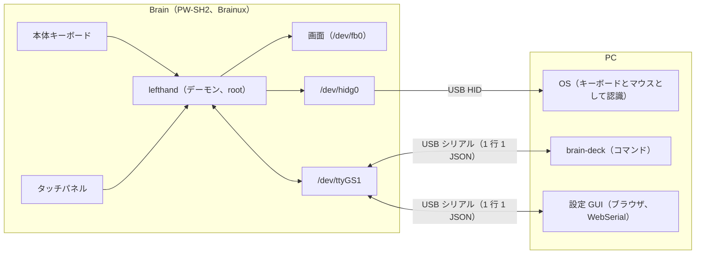

# brain-deck の仕組み（全体の地図）

brain-deck が、どの部品でできていて、それぞれが何をしていて、どうつながっているかを、最初から最後まで通して説明する資料。
README は「使い方」、REPORT.md は「作業の記録」、docs/config.md と docs/protocol.md は「形式の仕様」で、この資料は「仕組み」を受け持つ。

- **読み手**：Web のエンジニアを想定する。Go、Linux の組み込み、USB、端末の仕組みには詳しくない前提で、言葉はその都度説明する。
- **書き方**：2026-10-12 にコミット d18b7d3 のコードを読んで書き、2026-10-13 にコミット 4ac37a0（本番のデーモン 5c08f95ede53。フェーズ K6、K7 まで）に合わせて直した。ファイル名、関数名、設定の項目は、今のコードにあることを確かめてある。
  コードで確かめられなかったことは「未確認」と書いた。
- **設計の理由**：各章に「なぜこうなっているか」を短く書いた。出どころの多くは REPORT.md（作業の記録）。
- **新しいセッションの人へ**：まずこの目次と [1. 全体像](architecture/01-overview.md) を読み、作業に関係する章を読む。
  ファイルを探すときは [14. ソースの地図](architecture/14-source-map.md) の早見表から引く。

## 目次

| 章 | 内容 |
| --- | --- |
| [1. 全体像](architecture/01-overview.md) | Brain のデーモン（lefthand）、PC のコマンド（brain-deck）、設定 GUI。それぞれの役目とつながり。ハードウェア |
| [2. USB の構成](architecture/02-usb.md) | ネットワーク（NCM。RNDIS とスマホ向けの MAC に切り替えられる）、HID（キーボード、マウス、メディアキー、ペン）、ACM 2 つ。形の切り替え。gadget-setup.sh の役目 |
| [3. 入力の流れ](architecture/03-input.md) | キーとタッチのイベントが、レイヤーを通って、PC へのキーやアプリの操作になるまで |
| [4. 割り当ての重なり](architecture/04-layers.md) | レイヤー、セル、ソフトキー、ホーム画面、プロファイル、上書きの値が、どう重なって最終的な割り当てになるか |
| [5. 描画](architecture/05-display.md) | フレームバッファ、描画のスレッド、部分的な描き直し、回転、フォント、背景画像、状態の帯 |
| [6. ウィジェットとアプリ](architecture/06-widgets.md) | 一覧。データの置き場所、更新のきっかけ、PC が要るかどうか |
| [7. データ](architecture/07-data.md) | `/etc/lefthand/` と `/var/lib/lefthand/`（と `/run`）の中身。設定か、データか、取り直せるものか |
| [8. 通信](architecture/08-protocol.md) | シリアルのプロトコル、排他、分割して送る仕組み、通知 |
| [9. 端末モード、日本語入力、自分で足すアプリ](architecture/09-terminal-ime-apps.md) | PTY と user の権限でどう動かしているか |
| [10. 時刻、電源、画面の明るさ、ふた、PC から外したとき](architecture/10-time-power.md) | RTC、電池、自動減光とフォトフレーム、ふた、オフライン |
| [11. 保守](architecture/11-maintenance.md) | 更新（`brain-deck update`）と自動で戻す仕組み、設定の保存、バックアップと復元、同期 |
| [12. 起動の流れ](architecture/12-boot.md) | 電源を入れてから画面が出るまで。ユニットの順、デーモンの中の順 |
| [13. 安全のための仕組み](architecture/13-safety.md) | root と user の分け方、見られる場所の制限、上限、失敗したときに戻す仕組み |
| [14. ソースの地図](architecture/14-source-map.md) | ファイルごとの役目と、「〇〇を変えたいときはどこを見るか」の早見表 |
| [15. 用語集](architecture/15-glossary.md) | この資料と設定で使う言葉 |
| [16. 分かっている制約と、保留にしていること](architecture/16-limitations.md) | 充電、`\|` の同時押し、内蔵スピーカー、macOS と Windows など |

## いちばん短い説明

- Brain の **lefthand** が、本体のキーとタッチを読み、設定どおりのキー入力やマウスの操作にして、USB のキーボードとマウスとして PC に送る。同時に、画面にセル（ボタン）やウィジェット（時計、Todo、予定など）を描く。
- PC の **brain-deck** と、ブラウザの **設定 GUI** は、USB のシリアルで lefthand と話す（同じプロトコル）。設定の読み書き、データ（予定、天気、テキストなど）を送る、保守（更新、再起動、バックアップ）をする。
- PC 側に専用のドライバは要らない。キーボードとしては、つなぐだけで使える。
