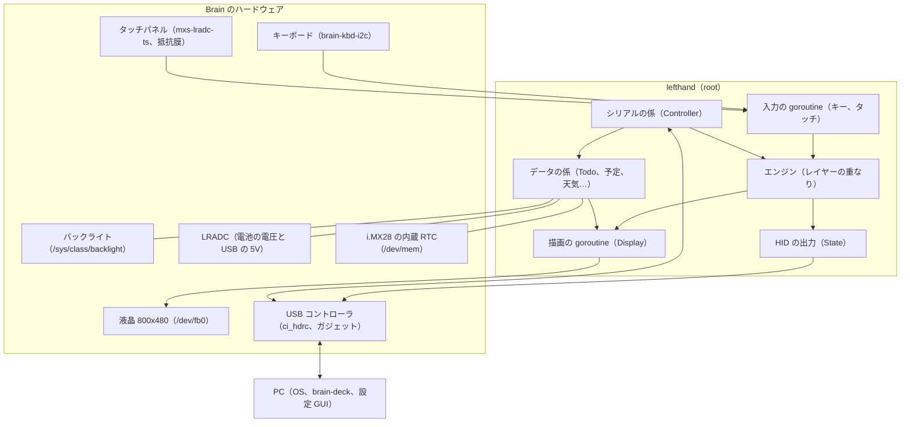
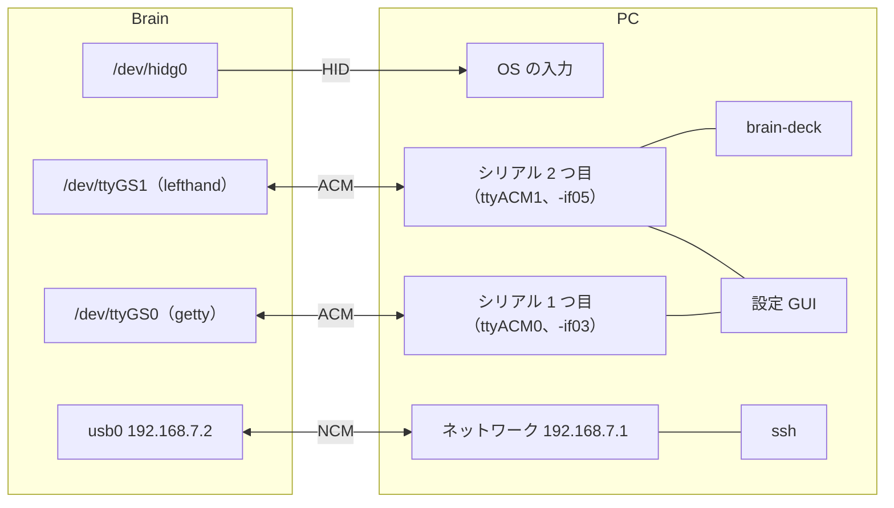

# 1. 全体像

[目次に戻る](../architecture.md)

## 3 つの部品

brain-deck は、Brain の上で動く 1 つのデーモンと、PC の上で動く 2 つの道具からなる。

| 部品 | どこで動くか | 言語 | ソース | 役目 |
| --- | --- | --- | --- | --- |
| **lefthand**（デーモン） | Brain（Brainux）。systemd の `lefthand.service`、root | Go | リポジトリの直下（`package main` の `*.go`） | 本体のキーとタッチを読み、PC にキーとマウスを送る。画面を描く。データを持つ。シリアルでリクエストに答える |
| **brain-deck**（コマンド） | PC（Linux、macOS）。ふつうのユーザー | Go | `cmd/brain-deck/` | PC から Brain を操作する。予定や天気を取ってきて送る、テキストを出す、更新、バックアップ、同期など |
| **設定 GUI** | PC のブラウザ（Chrome、Edge）。GitHub Pages に置くためのワークフローがある | TypeScript（Vite） | `gui/` | 設定を画面で編集し、プレビューを見て保存する。Todo の編集、背景画像の変換、Brain のコンソール |

「brain-deck」という名前は、プロジェクト全体の名前と、PC のコマンドの名前の両方に使われている（リポジトリは endohizumi/brain-deck）。
デーモンの名前の lefthand は、最初は「左手デバイス」（左手で押すショートカットのキーボード）だったことの名残で、今は PDA 全体を受け持つ。

## それぞれの役目

### lefthand（Brain のデーモン）

1 つの実行ファイル（ARMv5 向けに静的にビルドした Go のプログラム。約 7.9 MB。画面のフォントや説明書も埋め込んである。読み物の本文の文字だけは `/usr/local/share/lefthand/` の別のファイル）で、次のことを全部行う。

- **入力**：本体のキーボードとタッチパネルを Linux の evdev（入力イベントの仕組み。`/dev/input/eventN` から「キー X が押された」「座標が変わった」というイベントを読む）で読む。デーモンが動いているあいだは、ほかのプログラムに入力が行かないように専有（grab）する。
- **変換**：読んだ入力を、設定のレイヤー（割り当ての層）で解決して、PC に送るキー、マウスの操作、画面の中の操作（ウィジェットのタップ、レイヤーの切り替え）にする（[3. 入力の流れ](03-input.md)、[4. 割り当ての重なり](04-layers.md)）。
- **出力**：PC へは USB の HID（キーボードやマウスの共通の規格）のレポートを `/dev/hidg0` に書いて送る（[2. USB の構成](02-usb.md)）。
- **画面**：フレームバッファ（画面の画素を並べたメモリ。`/dev/fb0`）に、セル、ウィジェット、状態の帯を描く（[5. 描画](05-display.md)）。
- **データ**：Todo、手書きメモ、読み物、写真などを `/var/lib/lefthand/` に持つ。PC から受け取った予定や天気も置く（[7. データ](07-data.md)）。
- **通信**：USB のシリアル `/dev/ttyGS1` で、設定 GUI と brain-deck のリクエストに答える（[8. 通信](08-protocol.md)）。
- **保守**：自分自身の更新、再起動、設定の保存と反映、バックアップと復元（[11. 保守](11-maintenance.md)）。

ほかにも、時刻合わせ、電池の見張り、自動減光、ふたの開け閉め、端末モード、日本語入力、自分で足すアプリを受け持つ。

### brain-deck（PC のコマンド）

`brain-deck <サブコマンド>` の形で使う。主なもの：

| 種類 | サブコマンド |
| --- | --- |
| データを送る | `text`、`qr`、`presence`、`graph`、`todo`、`calendar sync`、`weather sync`、`photo add`、`images put`、`read add`、`files put`、`app install`、`time sync` |
| まとめて行う | `sync`（PC の名前を知らせる、時刻、予定、天気、RSS、手書きメモの取り出し、バックアップ） |
| 保守 | `update`、`restart`、`reboot`、`poweroff`、`logs`、`config get/put`、`backup`、`restore`、`status`、`run`（ssh なしで Brain のコマンドを user で動かす） |
| 切り替え | `usb-mode`、`net-mode`（USB のネットワークの方式と MAC）、`terminal`、`profile`、`overrides`、`calibrate` |
| ショートカットから | `exec`（コマンドを動かし、結果をテキストのタイルに出す） |

重い処理（ICS の繰り返しの展開、天気の API、SVG のアイコンを描く、画像の変換、EPUB や青空文庫の解釈）は、ここで行い、Brain には結果だけを送る。
一覧は `cmd/brain-deck/main.go` の `usage`、詳しい使い方は README の「brain-deck（PC のコマンド）」。

### 設定 GUI（ブラウザ）

- WebSerial（ブラウザからシリアルポートを開く API。Chrome と Edge にある）で、Brain の設定用のシリアルにつなぐ。
- 設定（`/etc/lefthand/config.yaml` と同じ構造）を読み、画面で編集し、Brain と同じ見た目のプレビューを描き、`set_config` で保存する。
- 背景画像と写真の変換（切り抜き、縮小、RGB565、ディザリング）は、ここ（PC）で行う。
- 「コンソール」のタブは、もう 1 つのシリアル（Brain のログイン画面）を xterm.js で開く。
- `?demo` を付けて開くと、本物の Brain の代わりに簡易のデーモン（`gui/src/demo.ts`）につながる。
- `.github/workflows/gui-pages.yml` が、`main` に push したときにテストしてビルドし、GitHub Pages に置く（今、公開されているかは未確認。手元の `npm run dev` でも開ける）。

## つながり方

- **キーとマウス**：HID。PC の OS は、ふつうの USB キーボード（とマウス）として扱う。
- **設定とデータ**：2 つ目のシリアル（ACM）。brain-deck と設定 GUI はここだけを使う。同時には 1 つしか開けない（[8. 通信](08-protocol.md)）。
- **ログイン**：1 つ目のシリアル。Brain の getty（ログイン画面）が出ている。設定 GUI のコンソールのタブ、`screen /dev/ttyACM0` などで使う。端末モードでは逆向きに使う（[9. 端末モード](09-terminal-ime-apps.md)）。
- **SSH**：NCM（USB のネットワーク）。開発と、brain-deck で足りない保守に使う。PC 側で固定 IP を付ける必要がある。brain-deck と設定 GUI はネットワークを使わない。

### なぜこうなっているか

- **なぜ設定とデータの通信を TCP（ネットワーク）でなく USB シリアルにしたか**：NCM の上で HTTP や WebSocket を使うには、PC 側で固定 IP の設定が要る。さらに、設定 GUI は https のページ（GitHub Pages）なので、http の Brain にはつなげない（混在コンテンツ）。WebSerial なら、ケーブルをつなぐだけで、どちらのページからも使える（docs/protocol.md の「ACM を分けた理由」）。brain-deck も同じシリアルを使えば、ネットワークのポートを Brain に開けずに済む。
- **なぜシリアルを 2 つにしたか**：1 つ目にはログイン画面（getty）が出ている。同じポートを lefthand も使うと、getty とデーモンが入力を取り合う。設定用に別のポートを足した。
- **なぜ PC 側に専用のソフトを入れないでもキーボードとして使えるか**：HID は OS が標準で持っているドライバで動く。brain-deck と設定 GUI は「便利にする」ためのもので、なくてもキーボードとしては使える。
- **なぜ重い処理を PC で行うか**：Brain は CPU が 1 つ（i.MX28、ARM926EJ-S）、RAM は約 112 MB（K4 で実機で測った値）で、YAML の解析だけで PC の約 150 倍かかる（REPORT.md のフェーズ K4）。予定（ICS）の取得では、Brain が直接インターネットに出る案も比べたが、PC 側の NAT と DNS の設定、時刻を合わせる前の HTTPS の証明書の確認、秘密の URL を SD カードに置くこと、遅さとメモリの点で、PC で取ってきて送る方法を選んだ（REPORT.md の「ほかの取得方法との比較」）。

## ハードウェアと OS

| 項目 | 内容 | どこで使うか |
| --- | --- | --- |
| 本体 | Sharp Brain PW-SH2（電子辞書） | |
| OS | Brainux（Debian 13 ベース）。カーネル 6.1.70 を HID と ACM のガジェットを有効にして再ビルド（docs/kernel-build.md、kernel/brain-deck.config） | |
| CPU | i.MX28（ARM926EJ-S、1 コア） | ビルドは `GOARCH=arm GOARM=5` |
| キーボード | `brain-kbd-i2c`。ふたの開け閉め（SW_LID）とタブレットの形（SW_TABLET_MODE）もこのデバイスが出す | main.go の `runKeyboard`、lid.go |
| タッチパネル | `mxs-lradc-ts`（抵抗膜、0〜4095 の生の座標と押す強さ）。画面の右の外に、ベゼルに印刷されたボタンの帯（ソフトキー） | main.go の `touchProc`、touchcal.go |
| 画面 | 800×480、`/dev/fb0` | fb.go、display.go |
| バックライト | `/sys/class/backlight/backlight@0`、0〜7 | backlight.go |
| 電池 | `/sys/class/power_supply` はない。LRADC（i.MX28 の AD 変換）の ch7 が電池の電圧、ch15 が USB の 5V | battery.go、link.go |
| 充電 | Brainux では充電されない（内蔵の充電器が止まったまま） | power.go（読むだけ） |
| RTC | i.MX28 の内蔵 RTC。Brainux ではドライバが無効なので、`/dev/mem` から直接読む | rtc.go |
| USB | ChipIdea の UDC（`ci_hdrc.0`）。ガジェット（USB の「機器の側」になる仕組み）として使う。IN のエンドポイントは 7 本 | gadget-setup.sh、hid.go |

## プロセスとスレッド（goroutine）の地図

Go の goroutine は、軽いスレッドのようなもの。lefthand の中では、次のものが並んで動いている（main.go の `main` の最後のほう）。

| goroutine | 何をするか | 待たせてはいけないもの |
| --- | --- | --- |
| メイン（`runKeyboard`） | 本体キーのイベントを読み、エンジンに渡す | — |
| タッチ（`runTouch`） | タッチのイベントを読み、エンジンに渡す | — |
| 描画（`Display.loop`） | 画面を描き直す。OS のスレッドに固定し、優先度を nice 10 に下げてある | 入力 |
| シリアル（`Controller.runSerial` と `Serve` の読み書き） | リクエストを 1 つずつ処理し、返事と通知を書く | 入力 |
| HID の送り直し（`State.retryLoop`） | 0.2 秒ごとに、送れなかったレポートを送り直す | — |
| 各データの係 | 保存（SD カードへの書き込み）を 1 つの goroutine でまとめて行う | 返事 |
| つながりの見張り（link.go）、電池（battery.go）、自動減光（backlight.go）、アプリの係（appsrun.go）など | 周期的に読む、時間で動く | 入力、描画 |

設計の決まりは「**入力の処理は、通信、描画、SD カードへの書き込み、スクリプトを一切待たない**」。どのファイルの冒頭にも「待たずに返る」「入力の処理は、ここを一切待たない」と書いてあるのはこのため。
CPU が 1 つなので、`runtime.GOMAXPROCS` を 2 以上にし、描画のスレッドの優先度を下げて、OS が入力の goroutine を先に動かすようにしている（main.go）。

ロックの取り方には注意が要る。エンジン（`Engine.mu`）のロックを持ったまま、ウィジェットのタップの処理や通知の関数を呼ぶので、そこから再びエンジンのロックを取ろうとすると止まる（デッドロック）。
K1 と K5 で実機でこれが起き（REPORT.md、コミット d18b7d3）、今は `Engine.Rotation` を atomic で読む、タップの処理では軽い `WidgetEnv`（`SetTouchEnv`）を使う、という形で避けている。新しく通知の関数を足すときは、「ロックを持ったまま呼ばれるか」を確かめること（[16. 制約](16-limitations.md) にも書いた）。
