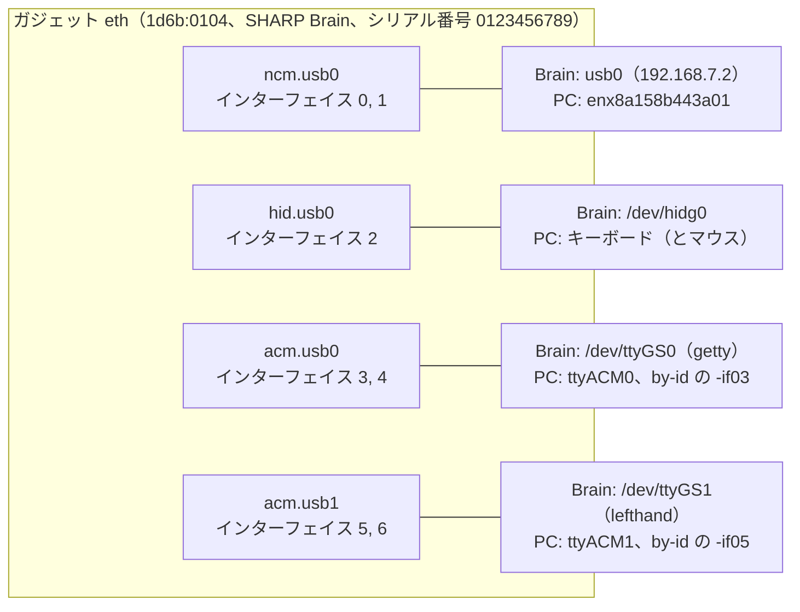
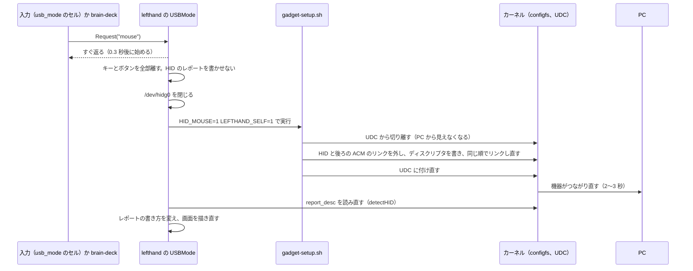

# 2. USB の構成

[目次に戻る](../architecture.md)

## USB ガジェットとは

ふつうの Linux は USB の「つなぐ側」（ホスト）だが、Brain は PC から見て「つながれる機器」（デバイス）になる。Linux でこれを行う仕組みを **USB ガジェット** と呼ぶ。
configfs（`/sys/kernel/config/usb_gadget/` の下に、ディレクトリとファイルを作って機器の形を決める仕組み）で、次の部品を組み立てる。

- **ファンクション**（functions/）：機器が持つ機能 1 つ。ネットワーク、キーボード、シリアルなど。
- **構成**（configs/c.1/）：ファンクションをどの順で並べるか。名前（文字列）、消費電流（MaxPower）、リモートウェイクアップの印（bmAttributes）を持つ。
- **UDC**：USB コントローラ。ガジェットの `UDC` ファイルにコントローラの名前（`ci_hdrc.0`）を書くと PC から見えるようになり（bind）、空にすると見えなくなる（unbind）。形を変えるときは、いったん切り離して付け直す。

Brain では、これを `gadget-setup.sh`（Brain の上では `/usr/local/sbin/lefthand-gadget-setup`）が行う。

## 4 つのファンクション

| ファンクション | Brain 側 | PC 側（Linux の例） | 使うもの |
| --- | --- | --- | --- |
| NCM（USB のネットワーク） | `usb0`、固定 IP 192.168.7.2/24 | `enx8a158b443a01`。PC 側で 192.168.7.1/24 を手で付ける | SSH |
| HID（入力機器） | `/dev/hidg0` | キーボード（「SHARP Brain」）。マウスありの形では「SHARP Brain Keyboard」と「SHARP Brain Mouse」 | lefthand が書く |
| ACM 1 つ目（シリアル） | `/dev/ttyGS0` | `/dev/ttyACM0`、`/dev/serial/by-id/…-if03` | Brain の getty（ログイン）。端末モード |
| ACM 2 つ目（シリアル） | `/dev/ttyGS1` | `/dev/ttyACM1`、`/dev/serial/by-id/…-if05` | lefthand（設定 GUI と brain-deck） |

- 機器の ID は 1d6b:0104（Linux Foundation の「Multifunction Composite Gadget」。個人の開発用の汎用の ID）。製品名 `Brain`、メーカー名 `SHARP`、シリアル番号 `0123456789`。
- 機器のクラスは 0xEF/0x02/0x01（IAD を使う複合デバイス）。Windows で NCM と ACM を正しく分けるため（gadget-setup.sh のコメント）。
- NCM の MAC アドレス（`dev_addr`、`host_addr`）は Brainux 標準の `enable_ethernet_gadget` と同じ値にしてある。変えると PC 側のインターフェイスの名前が変わるため。

### なぜこうなっているか

- **なぜマウスを別の HID にしないか**：Brain の USB コントローラ（ci_hdrc）は、機器から PC へ送るためのエンドポイント（IN）が 7 本しかない。NCM が 2 本、HID が 1 本、ACM 2 つで 4 本、と全部使っている。HID をもう 1 つ足すと足りなくなり、ガジェット全体（ネットワークも）がつながらなくなる（hid.go、gadget-setup.sh のコメント）。そこで、1 つの HID の中に「レポート ID」で複数の機器を入れる。
- **なぜ固定 IP で、DHCP を使わないか**：Brainux 標準のスクリプトは最後に dhclient を動かすが、PC 側に DHCP サーバーがないので約 77 秒止まっていた。そのため標準の処理を置き換えた（systemd/ethernet_gadget.service.d/lefthand.conf）。
- **なぜ ACM を 2 つにしたか**：[1. 全体像](01-overview.md) の「なぜこうなっているか」。

## HID の 2 つの形

HID の機器は「レポートディスクリプタ」（どんな形のデータを送るかを PC に知らせる表）を持つ。Brain は 2 つの形を切り替える。

| 形 | いつ | 中身 | レポート |
| --- | --- | --- | --- |
| **キーボードだけ**（ブートキーボード） | 起動したとき（既定） | キーボード | 8 バイト（修飾キー、予約、キー 6 つ）。レポート ID なし |
| **キーボードとマウス** | `usb_mode: mouse`、`brain-deck usb-mode mouse`、`/etc/lefthand/gadget.env` の `HID_MOUSE=1` | キーボード（ID 1）、マウス（ID 2）、メディアキー（ID 3）、ペン（ID 4） | キーボード 9 バイト、マウス 6 バイト、メディアキー 5 バイト、ペン 8 バイト |

- ディスクリプタは 2 か所に同じものがある：`gadget-setup.sh` の `KBD_DESC` と `COMBO_DESC`（configfs に書く）と、`hid.go` の `hidDescKeyboard` と `hidDescCombo`（デーモンが形を見分けるのに使う）。テストで同じであることを確かめ、`lefthand -check-gadget` でも確かめる（`brain-deck update` の確かめで使う）。
- デーモンは起動したとき（と、形を切り替えたあと）に configfs の `report_desc` を読み、どちらの形かを決める（hid.go の `detectHID` と `layoutOf`）。分からなければキーボードだけとして扱う（形を間違えると、PC に別のキーとして届くため）。
- キーの番号は F24（0x73）まで送れる（`hidKeyMax`）。F13〜F24 は PC のキーボードにないので、OS のショートカットにコマンドを割り当てるのに使う（README の「コマンドのショートカット」）。

| 出力 | ファイル | 送るもの |
| --- | --- | --- |
| キーボード | main.go の `State.send` | 押している入力ごとの修飾キーとキーを合わせた 1 つのレポート。6 キーを超えたら、入力の ID の順で決まったものを残す |
| マウス | mouse.go | ボタン 3 つ、X、Y、縦と横のホイール（-127〜127 の相対値）。ボタンは入力ごとに覚えて OR を送る |
| メディアキー | media.go | Consumer Control の番号 2 つ（音量、再生など）。ブートキーボードの形では送れない |
| ペン | pen.go | Tip Switch、In Range、X、Y（0〜32767 の絶対座標）、筆圧（0〜1023） |

### なぜこうなっているか

- **なぜ起動したときはブートキーボードか**：PC の BIOS や UEFI の画面（起動前のパスワード入力など）は、ディスクリプタを読まずに決まった 8 バイトの形（ブートプロトコル）でキーを読む。キーボードとマウスを 1 つの HID に入れた形はブートキーボードにならないので、BIOS では使えない。キーボードとして確実に使えることを優先し、マウスは使うときだけ切り替える（usbmode.go、README の「PC との接続」）。
- **なぜメディアキーとペンはマウスありの形だけか**：上と同じく、ブートキーボードの形はディスクリプタを標準のままにしてあるため（media.go、pen.go）。そのときにメディアキーのセルを押しても何も送らず、画面では「マウスオフでは無効」と描く。
- **なぜペンを Digitizer の「Pen」でなく「Digitizer」として出すか**：Pen（0x02）にすると、Linux は画面に重なったペン（タブレット液晶）として扱うため（hid.go のコメント。2026-10-11 に PC で確かめた）。

## 形の切り替え（USB の付け直し）

- 切り替えは USB の付け直しなので、2〜3 秒のあいだ、キー入力、SSH、シリアル（設定 GUI、brain-deck）が切れる。
- 付け直すときに `/dev/hidg0` を開いたままだと、このカーネル（6.1）の f_hid は、そのあと ENXIO で開けなくなる。そのため lefthand が自分で閉じてから実行する（`LEFTHAND_SELF=1` を渡し、スクリプトに lefthand.service を止めさせない）。
  ほかから gadget-setup.sh を実行したときは、スクリプトが lefthand.service を止めてから付け直し、終わったら再開する（`/run/lefthand-gadget-restart` の印）。
- ACM のファンクション自体は消さない（リンクを外して付け直すだけ）。`/dev/ttyGS0` と `/dev/ttyGS1` は同じ番号のまま残る。
- 実装：usbmode.go の `USBMode.Request`、`applyHook`、`runGadgetSetup`。

## gadget-setup.sh の役目

何度実行してもよい（冪等な）スクリプト。起動したときは `ethernet_gadget.service` の drop-in から、動いているあいだは lefthand から呼ばれる。

1. ガジェット `eth` がなければ、Brainux と同じ値で NCM だけのものを作る（`create_eth`）。
2. HID と ACM（1 つ目）がリンクされていなければ足す（`add_hid_acm`）。足せなくても、NCM だけは残して SSH を使えるようにする。
3. HID の形が `HID_MOUSE` と違えば作り直す（`update_hid`）。
4. 設定用の ACM（2 つ目）がなければ足す（`add_acm_gui`）。
5. 構成の名前を合わせる（`set_conf_name`）。ふだんは `NCM+HID+ACM+ACM`、端末モードでは `NCM+HID+ACM+ACM terminal`（PC の udev がこの名前を見て getty を起動する。[9. 端末モード](09-terminal-ime-apps.md)）。
6. リモートウェイクアップの印（`set_wakeup`、`USB_WAKEUP`、既定 1）と、MaxPower（`set_max_power`、`GADGET_MAX_POWER`、既定 500 mA）を合わせる。
7. UDC に付け、`usb0` に固定 IP を付ける。

環境変数（と `/etc/lefthand/gadget.env`）で動きを変える：`HID_MOUSE`、`USB_WAKEUP`、`GADGET_MAX_POWER`、`GADGET_TERMINAL`、`LEFTHAND_SELF`、`SKIP_BIND`、`GADGET_UNBIND_ONLY`（切り離すだけ。端末モードの切り替えの前半）、`GADGET_CHECK`（何も変えずに、付け直しが要るかを調べる。`brain-deck update` が使う）。
変えるたびに切り離すのは、構成の名前や印を PC が読むのは「つながったとき」だけだから。

- bash で実行すること。ディスクリプタを `printf` の `\x` で書くので、dash（`/bin/sh`）では壊れる。
- `/dev/hidg0` を開いたまま付け直さないこと（上の ENXIO）。

## スリープ中の PC を起こす

PC がスリープすると USB のバスがサスペンドになり、UDC の `state` が `suspended` になる。そのあいだに Brain のキーを押すと、lefthand は UDC の `srp` に 1 を書き、PC に「起きて」という信号（リモートウェイクアップ）を送らせる（wakeup.go の `Waker`）。
起こせるのは、構成に印（bmAttributes の 0x20）があり、PC がサスペンドの前にそれを許したときだけ。Linux はブートキーボードの形では自分で許すが、マウスありの形では許さないので、PC 側の udev の規則（contrib/udev/72-brain-wakeup.rules）で許す。
起こすのは「押したとき」だけ（離したとき、送り直しでは起こさない。デーモンの起動し直しの空のレポートで PC を起こさないため）。

## PC 側に置くもの（Linux）

| ファイル | 役目 |
| --- | --- |
| contrib/udev/70-brain-modemmanager.rules | ModemManager が Brain のシリアルに AT コマンドを送らないようにする（ログイン画面にユーザー名として入ってしまう） |
| contrib/udev/71-brain-terminal.rules、contrib/systemd/brain-terminal-getty@.service、contrib/profile.d/brain-terminal.sh | 端末モードのときだけ、1 つ目のシリアルで PC の getty を起動する。端末の大きさを合わせる |
| contrib/udev/72-brain-wakeup.rules | マウスありの形でも、Brain のキーでスリープを解除できるようにする |
| contrib/udev/73-brain-sync.rules、contrib/systemd/brain-deck-sync.service | Brain をつないだら、ユーザーの systemd で `brain-deck sync` を動かす |
| dialout グループ | `/dev/ttyACM*` を開く権限（README の「Linux でシリアルを使う権限」） |

どれもなくてもキーボードとしては使える。macOS と Windows 用のものはない（[16. 制約](16-limitations.md)）。
