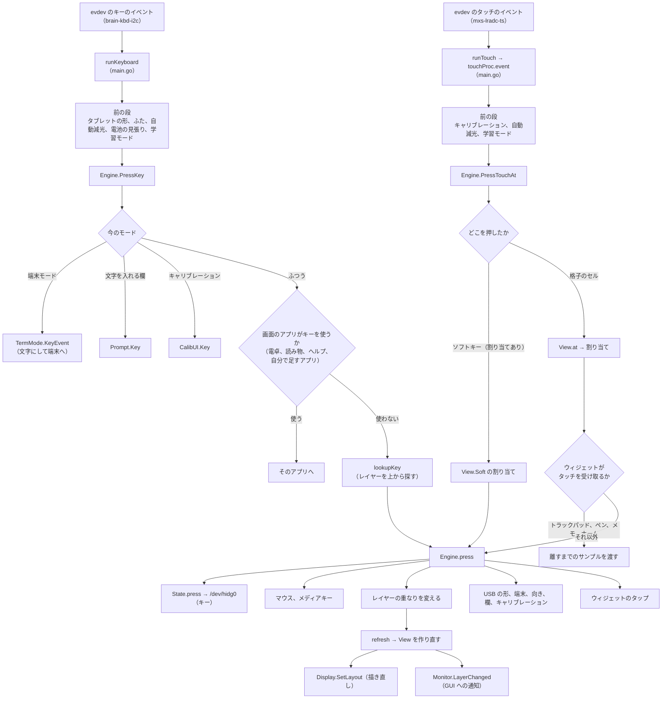
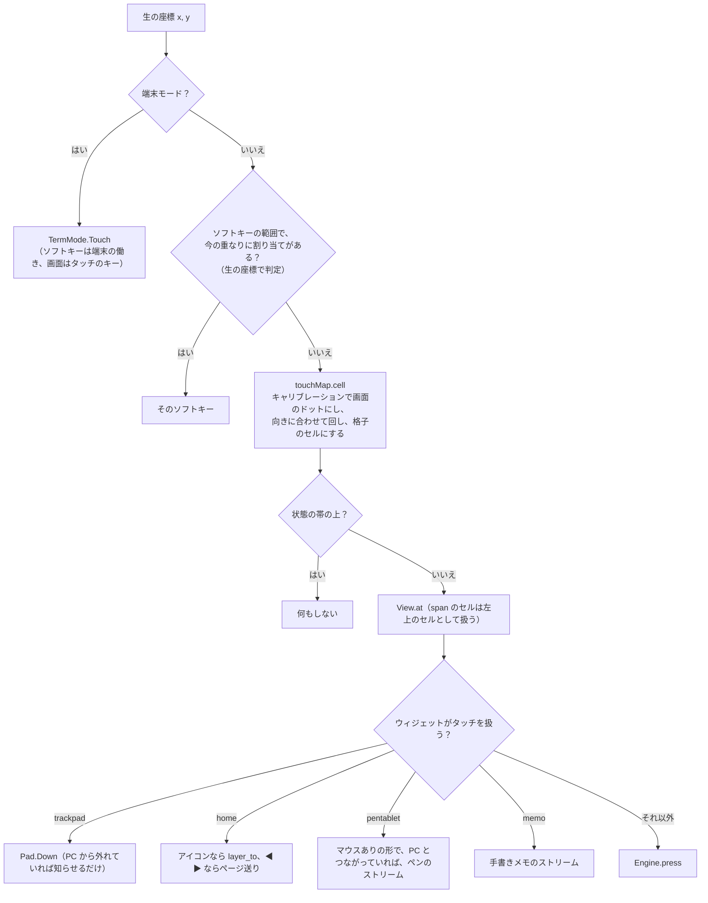

# 3. 入力の流れ

[目次に戻る](../architecture.md)

本体のキーやタッチが、PC へのキーやアプリの操作になるまで。どの段も、通信、描画、SD カードへの書き込みを待たない。

## 全体の流れ

## キー

`runKeyboard`（main.go）が、キーボードのデバイスから 1 つずつイベントを読む。evdev のイベントには「種類（EV_KEY、EV_SW など）、コード（KEY_A など）、値」がある。キーの値は 1 が押した、0 が離した、2 がオートリピート。

1. **タブレットの形**（`keyFilter`）：画面を裏返したタブレットの形のあいだは、裏になったキーボードが押されることがあるので、押したキーを捨てる（設定の `lid.tablet_keys`。lid.go）。捨て始める前に押していたキーの「離した」は通す（押しっぱなしにならないように）。
2. **スイッチ**（EV_SW）：ふた（SW_LID）とタブレットの形（SW_TABLET_MODE）は `Lid.Switch` へ（[10. 時刻、電源…](10-time-power.md)）。
3. **押した（1）**：
   - `Dimmer.Key`：自動減光の時間を数え直す（暗いときもキーは PC に送る。明るくするかは `backlight.wake_on_key`）。
   - `userActivity`：電池が少なくて電源を切ろうとしているのを取りやめる（batteryguard.go）。
   - `Monitor.KeyPressed`：設定 GUI が学習モード（入力を知らせてほしいと頼んだ状態。`subscribe_input` の `suppress`）なら、GUI に知らせるだけで PC には送らない。
   - `Engine.PressKey`。
4. **離した（0）**：`Engine.ReleaseKey`。
5. **オートリピート（2）**：HID では使わない（リピートは PC の OS が行う）。端末モードと文字を入れる欄だけで使う（`Engine.RepeatKey`）。

`Engine.PressKey`（layer.go）は、次の順に行き先を決める。

| 順 | 条件 | 行き先 |
| --- | --- | --- |
| 1 | 端末モード | `TermMode.KeyEvent`：PC には HID で送らず、US 配列の文字（バイト列）にして端末に書く（termkeys.go） |
| 2 | 文字を入れる欄が開いている | `Prompt.Key`：Todo の追加、時刻合わせ、アプリの入力欄（prompt.go）。日本語入力のときは uim-fep に送る |
| 3 | タッチのキャリブレーション中 | `CalibUI.Key` |
| 4 | 今の画面に電卓、読み物、ヘルプ、自分で足すアプリのセルがあり、そのアプリが使うキー | `calcKeyLocked`、`readerKeyLocked`、`helpKeyLocked`、`appKeyLocked`。Ctrl か Alt を押しているあいだはショートカットなので渡さない |
| 5 | それ以外 | `lookupKey` で、重ねたレイヤーを上から探し、最初に見つかった割り当てを `press` |

離したときは、**押したときの割り当てで離す**（`Engine.down` に、入力の ID ごとに押したときの割り当てを覚えている）。押しているあいだにレイヤーが変わっても、キーが押しっぱなしにならない。

## タッチ

タッチパネルは、触れているあいだ「X の値、Y の値、押す強さ、区切り（SYN_REPORT）」の組を 26 ms ごとに出す。触れた・離したは BTN_TOUCH で届く。
座標は 0〜4095 の生の値（抵抗膜の電圧）で、画面のドットではない。

`touchProc.event`（main.go）は、実機（`runTouch`）と記録の再生（`-replay-touch`）で同じものを使う。

1. **キャリブレーション中**（`calibTouch`）：生の座標をキャリブレーションの画面（calibui.go）に回す。ソフトキーの帯は生の座標で決めるので、最中も「戻る」と「決定」に使える。
2. **触れた瞬間の最初の区切り**で、どのセルかを決める（**スライドしても変えない**）。
   - `Dimmer.TouchDown` が「暗かった」を返したら、明るくするだけで、セルもソフトキーも押さない（離すまでのサンプルは捨てる）。誤操作を防ぐため。写真を出しているときも同じ。
   - 学習モードなら、GUI に知らせるだけ（`Monitor.TouchPressed`）。
   - `Engine.PressTouchAt` で押す。HID を先に送り、画面の「押した」の描き直しはそのあと（`Display.SetPressed`。待たずに返る）。
3. **触れているあいだ**：トラックパッド（`Pad.Sample`）か、ペンタブレットと手書きメモ（`touchStream.Sample`）なら、サンプルを渡し続ける。
4. **離した**：`touchStream.Up`、`Pad.Up`、`Engine.Release("t")`、押したセルの光を消す。

`Engine.PressTouchAt`（layer.go）の判定：

- **ソフトキー**（画面の右の外の、ベゼルに印刷されたボタンの帯）は、画面の外なので、キャリブレーションでも向きでも変わらない生の座標の範囲（`touch.soft_areas`）で決める。画面の右端と座標が重なるので、今の重なりで割り当てがあるときだけソフトキーとして扱い、なければ右の列のセルになる。
- **座標の変換**（rotate.go の `touchMap`、touchcal.go）：キャリブレーションの結果（`/var/lib/lefthand/touch-cal.json`。アフィン変換）があればそれで、なければ設定の `touch.min_x` などの範囲で、生の座標を「向き 0 の画面のドット」にする。そのあと画面の向き（0、90、180、270）に合わせて回し、状態の帯の高さを除いた範囲を格子で割る。
  画面の枠も同じ境界で描く（display.go の `cellSpan` と main.go の `cellOf` は同じ割り方）。
- **ウィジェット**のタップは、ウィジェットごとに働き方が違う（[6. ウィジェットとアプリ](06-widgets.md)）。Todo、電卓、カレンダーなどは「押した位置」で働くので、エンジンは押した位置（`widgetTouch`）を渡す。

## `Engine.press`：割り当てが働く

`press`（layer.go）は、割り当ての種類（`ActKind`）ごとに次のことをする。エンジンのロックを持ったまま動くので、どれも待たずに返る。

| 種類（設定の書き方） | 働き |
| --- | --- |
| `key` | `State.press`：押している入力の表に足し、キーボードのレポートを作って送る。スリープ中の PC を起こす |
| `layer_hold` | 押しているあいだ、そのレイヤーを重ねる |
| `layer_toggle` | 押すたびに、重ねる・外す |
| `layer_oneshot` | 次の 1 つの入力だけ重ねる（ほかの割り当てを押したら外れる） |
| `layer_to` | base とそのレイヤーだけにする。ホーム画面で HOME を押すと 1 ページ目へ |
| `mouse` | マウスのボタンを押す、またはスクロールを始める（mouse.go） |
| `media` | メディアキー（media.go） |
| `usb_mode` | USB の形を切り替える（[2. USB の構成](02-usb.md)） |
| `terminal` | 端末モードに入る・抜ける（[9.](09-terminal-ime-apps.md)） |
| `rotate` | 画面の向きを変える（`display.json` に残す） |
| `input` | 文字を入れる欄を開く（`todo`、`clock`） |
| `calibrate` | タッチのキャリブレーションを始める |
| ウィジェット（key も layer も書いていないセル） | `WidgetDef.touchDown` でウィジェットに任せる |
| `none` | 何もしない（下のレイヤーの割り当ても使わない） |

- **PC から外れているとき**（offline.go）：PC に送るもの（キー、マウス、メディアキー、トラックパッド、ペン、PC への端末）は送らず、画面の下に「PC につながっていません」と出す（[10.](10-time-power.md)）。
- 押したあと、重なりが変わっていれば `refresh` が新しい `View`（今の重なりで有効なセルとソフトキーの表）を作り、画面と設定 GUI に知らせる。レイヤーが変わったら、押しているマウスのボタンを離し、トラックパッドのドラッグをやめる。

## PC へのキーのレポート

`State`（main.go）が、押している入力（キー `k:<コード>`、タッチ `t` など）ごとの「修飾キーとキー」を持つ。押した・離したたびに全部を合わせて 1 つのレポートにし、`HIDWriter.Write` で `/dev/hidg0` に書く。

- `/dev/hidg0` は非ブロッキングで開く。PC がレポートを取りに来ない（スリープ中、つないでいない）と、ブロッキングでは書き込みが永久に止まり、終了するときの空のレポートも送れなくなるため。前のレポートが送れていなければ（EAGAIN）50 ms まで待ち、それでもだめなら失敗にする。
- 送れなかったら `dirty` にして、`retryLoop` が 0.2 秒ごとに今の状態を送り直す（離したレポートが落ちて、キーが押しっぱなしになるのを防ぐ）。マウスのボタンも同じ。マウスの移動とホイールは、送れなければ捨てる（あとから送ると思わぬところへ飛ぶため）。
- 終了するとき（SIGTERM、`State.shutdown`）、設定を反映するとき（`Engine.Reload`）、PC から外れたとき、USB を付け直す前は、すべてを離した空のレポートを送る。

### なぜこうなっているか

- **なぜ「押したときの割り当てで離す」か**：レイヤーを切り替えるキーを押しながらほかのキーを押すと、押したときと離したときで割り当てが違うことがある。離すときに今の割り当てを探すと、押したキーが離されないまま残る（README の「レイヤー」、layer.go の `Release`）。
- **なぜ触れた瞬間のセルで決めるか**：抵抗膜のパネルは、触れた直後と離す直前に座標が跳ねる。途中で別のセルに変えると誤操作になる。
- **なぜ暗いときのタッチは明るくするだけか**：暗い画面ではどのセルを押したか見えないので、誤操作を防ぐ（backlight.go）。キーは見なくても押せるので、暗くても送る。
- **なぜ HID を先に送り、描画をあとにするか**：PC への入力を遅らせないため。画面の「押した」の光は、描画の goroutine が後から描く（[5. 描画](05-display.md)）。

## 関連するファイル

main.go（`runKeyboard`、`touchProc`、`State`、`HIDWriter`）、layer.go（`Engine`）、rotate.go（`touchMap`）、touchcal.go、calibui.go、trackpad.go、pen.go、stroke.go、memo.go、mouse.go、media.go、wakeup.go、lid.go、backlight.go、prompt.go、termkeys.go、record.go（タッチの記録と再生）。
