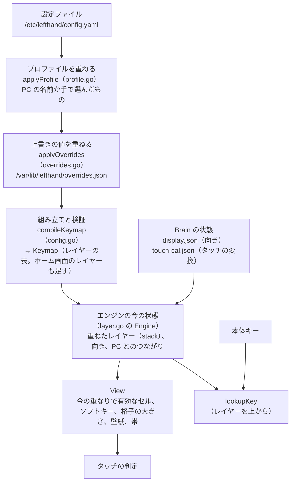
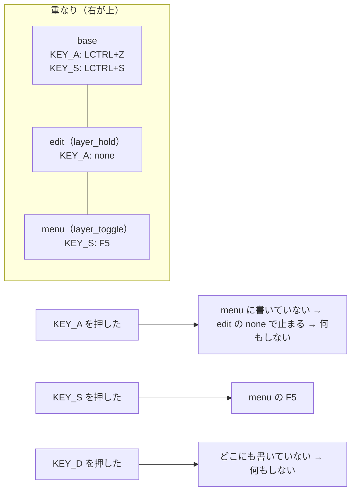

# 4. 割り当ての重なり

[目次に戻る](../architecture.md)

「このキー（セル）を押すと何が起きるか」は、いくつもの層を重ねて決まる。この章は、その重なりを外側から順に説明する。

## 全体の重なり



- **設定ファイル**は、PC（設定 GUI か `brain-deck config put`）か、手で編集して変える。
- **プロファイル**は「PC ごとの設定」。つないだ PC が名乗った名前で選ぶ。
- **上書きの値**は、Brain の設定のアプリで変えた値。設定ファイルを書き換えずに、別のファイルに置く。
- ここまでを重ねた設定（「効いている設定」）を組み立てたものが `Keymap`。
- **エンジン**は、今どのレイヤーを重ねているか（stack）、画面の向き、PC とつながっているかを持ち、`Keymap` と合わせて `View` を作る。

## レイヤー、セル、ソフトキー

設定の `layers` は、割り当ての層の並び。最初のものが **base**（いつもいちばん下）。

```yaml
layers:
  - name: base
    keys: { KEY_A: LCTRL+Z }                 # 本体キーの割り当て
    touch:                                   # タッチの格子（セル）
      cols: 4
      rows: 3
      cells:
        "0,0": { key: B, label: ブラシ }
        "1,0": { widget: clock, span: [2, 1] }
    soft_keys: { home: { layer_to: base } }  # 画面の右の帯（ソフトキー）
  - name: edit
    keys: { KEY_A: none }                    # none：下のレイヤーも使わない
```

| 部品 | 何か | 設定 | 組み立てたもの |
| --- | --- | --- | --- |
| **キー** | 本体のキー（`KEY_A` など、evdev の名前） | `keys` | `Layer.Keys`（コード → `Action`） |
| **セル** | タッチの格子の 1 マス（`"列,行"`） | `touch.cells`、縦向きは `touch_portrait.cells` | `Layer.Grid`、`Layer.PGrid` |
| **ソフトキー** | 画面の右の外の、ベゼルに印刷されたボタンの帯の区画（名前で呼ぶ。範囲は `touch.soft_areas`） | `soft_keys` | `Layer.Soft` |
| **割り当て** | 1 つのキー、セル、ソフトキーに書くもの（`ActionSpec`） | `B`、`none`、`{ key: B, label: … }`、`{ layer_hold: edit }`、`{ widget: clock }` など | `Action`（種類 `ActKind`、送るキー、行き先のレイヤー、ウィジェット） |

割り当てには、`key`、`layer_hold`、`layer_toggle`、`layer_oneshot`、`layer_to`、`mouse`、`media`、`usb_mode`、`terminal`、`rotate`、`input`、`calibrate` のうち、ちょうど 1 つを書く。ウィジェットのセルは省略してよく、書けばタップしたときにそれが働く（config.go の `ActionSpec.UnmarshalYAML`）。

### 透過（上から探して、書いてあるところで止まる）



- **キー**：重ねたレイヤーを上から順に見て、最初に書いてあるものを使う（layer.go の `lookupKey`）。`none` も「書いてある」ので、そこで止まる。
- **セル**：格子の大きさは、上から見て最初に `touch` を持つレイヤーで決まる。下のレイヤーへ透過するのは、格子の大きさが同じあいだだけ（`Keymap.view`）。
  `span`（複数のマスにまたがるセル）は、覆う範囲がすべて上のレイヤーで空いているときだけ使う。一部でも隠れると、そのセルは出さない。
- **ソフトキー**：上から見て最初に書いてあるもの。ホーム画面があれば、HOME のソフトキー（`home.soft_key`、既定 `home`）は、どのレイヤーでもホーム画面へ戻る（レイヤーの割り当てより優先）。
- **壁紙**（`touch.background`）：格子を作ったレイヤーから下へ、セルと同じく透過する範囲で、いちばん上のもの。
- **状態の帯**：上から見て、`status_bar` を書いたレイヤーか、格子を持つレイヤーで決まる（書いていなければ `status_bar.show`）。

### 重ね方（4 つの切り替え）

| 書き方 | 重なりへの働き | 画面の札の色（`LayerMode`） |
| --- | --- | --- |
| `layer_hold: X` | 押しているあいだ X を重ねる。離すと外れる | 一時的（橙） |
| `layer_oneshot: X` | 次の 1 つの入力だけ X を重ねる。もう一度押すと取り消す | 一時的（橙） |
| `layer_toggle: X` | 押すたびに X を重ねる・外す | 切り替えたまま（緑） |
| `layer_to: X` | base と X だけにする（ほかの重なりを外す） | 切り替えたまま（緑） |

- 重なりは `Engine.stack`（base の上に重ねたものを下から順に）。いちばん上が「今のレイヤー」。
- 検証（config.go の `checkWayBack`）：`layer_toggle` か `layer_to` で入るレイヤーには、base かホーム画面へ戻る手段（`layer_to base`、自分自身の `layer_toggle` など）がなければならない。戻れない設定は保存できない。使われないレイヤーは警告になる（`unreachable`）。

## ホーム画面

設定に `home` を書いたときだけ使う。

- `compileHome`（home.go）が、`home` という名前のレイヤーを `Keymap.Layers` のいちばん後ろに足す。格子は 1×1 で、そのセルにアプリを並べるウィジェット（`widget: home`）を置く。
- **アプリ**は、ホーム画面のアイコンの 1 つで、中身は「入る先のレイヤー」（`home.apps[].layer`）。アイコンをタップすると、そのレイヤーへの `layer_to` と同じことをする。
- HOME のソフトキーは、どのレイヤーでもホーム画面へ戻る。ホーム画面で押すと 1 ページ目に戻る。
- 起動したときと設定を反映したときに開くレイヤーは、`start_layer`（プロファイルでも変えられる）、なければ `home.start`（既定 `home`）で決める（layer.go の `startStack`）。
- ホーム画面の札は、base と同じ色で描く（出発点だから）。

### なぜこうなっているか

- **なぜアプリを「レイヤー」にしたか**：もとは左手デバイス（ショートカットのキーボード）で、レイヤーが画面の切り替えの単位だった。PDA にしたとき（フェーズ P1、R）、今までのレイヤーをそのままアプリにし、ホーム画面を入り口として足した（config/current.yaml の冒頭のコメント）。自分で足すアプリ（K5）も、新しい書き方を作らず「セルを置いたレイヤー＋ `home.apps`」にした。設定 GUI の編集とプレビューを変えずに済むため（REPORT.md の K5）。

## 縦向きの格子

画面を 90 度か 270 度に回すと、画面は 480×800 になる。そのときは、レイヤーの `touch_portrait` の格子（`Layer.PGrid`）を使う。書いていないレイヤーは、`display.portrait_grid` のとおり横向きの格子から作る（`transpose`：列と行を入れ替える、既定。`stretch`：そのまま縦に伸ばす。rotate.go）。

## プロファイル（PC ごとの設定）

Brain からは、つながれた PC を見分けられない。PC の `brain-deck sync`（つないだときの自動の同期）が、最初に PC の名前を知らせる（`set_pc`。名前は sync.yaml の `pc_name`、なければホスト名）。

```yaml
profiles:
  - name: mac
    label: Mac
    pcs: [my-macbook]             # 省略すると name と同じ名前の PC
    start_layer: code
    modifiers: { ctrl: gui, gui: ctrl }   # 割り当ての修飾キーを入れ替える
    layers:
      - name: base
        keys: { KEY_Z: LGUI+Z }   # 書いたものだけを差し替える
```

- `applyProfile`（profile.go）は、設定ファイルの値の写しに、`start_layer`、`home`（差し替え）、`layers`（名前で選んだレイヤーの、書いたキー、セル、ソフトキーだけを差し替え）、`modifiers`（修飾キーの入れ替え）を重ねる。プロファイルは、ある名前のレイヤーを変えるだけで、新しいレイヤーは足せない。
- どれを使うかは `resolveProfile`：手で「既定」を選んだ → なし。手で選んだ名前 → それ。名乗った PC の名前に合うもの → それ。どれでもなければ設定ファイルのとおり。
- 状態は `/var/lib/lefthand/profile.json`（最後に名乗った PC、手で選んだもの）。デーモンを起動し直しても同じ PC とみなす。USB を抜いてつなぎ直したあと 60 秒（`profileWait`）名乗らなければ、名乗らない PC とみなして既定に戻す。
- 変わったら `configStore.Reprofile`（apply.go）が割り当てごと反映し、最初に開くレイヤーを開き直す。既定以外のプロファイルを使っているときは、状態の帯にその名前を水色で出す。

## 上書きの値

Brain の設定のアプリ（`widget: settings`）で変えた値。設定ファイルを書き換えずに `/var/lib/lefthand/overrides.json` に置き、設定ファイル（とプロファイル）の値の上に重ねる（overrides.go）。

| 上書きの名前 | 画面の名前 |
| --- | --- |
| `backlight.level` | 明るさ |
| `backlight.dim_after` | 暗くなるまで（PC あり） |
| `backlight.offline.dim_after` | 暗くなるまで（PC なし） |
| `backlight.photo` | フォトフレーム |
| `ime.method` | 日本語入力 |
| `lid.close` | ふたを閉じたとき |

- 上書きできるのは、この表のもの（`overrideKeys`）だけ。割り当て（キーやセル）は上書きできない。
- 重ねた設定が正しくないとき（ほかの項目と合わないとき）は、その上書きを使わず、そのことを情報に出す。
- 上書きだけが変わったときは、割り当てを作り直さず、自動減光、ふた、日本語入力だけを反映する（main.go の `configStore.light`）。
- 設定 GUI の `get_config` と `brain-deck config get` が返すのは、上書きを重ねる前の設定ファイルの値。GUI が編集して保存しても、上書きは設定ファイルに入らない。上書きは `get_overrides`、`brain-deck overrides` で見る・消す。
- 画面の向きと読み物の文字の大きさは、上書きではなく「Brain の状態」（`display.json`、読み物の `reader.json`）として持つ。設定のアプリで変えると、そちらを変える。

### なぜこうなっているか

- **なぜ上書きを別のファイルにしたか**：設定ファイルにはコメントが書いてある。Brain で値を変えるたびに設定ファイルを書き直すと、コメントが消える（YAML を読み込んで書き出すとコメントは残らない）。そこで、Brain だけでよく変える値に限って、別のファイルに置くことにした（overrides.go の冒頭）。

## Brain の状態として持つもの

設定でも上書きでもなく、Brain が覚えている状態で、効いている割り当てや見え方に関わるもの。

| 状態 | ファイル | 何に効くか |
| --- | --- | --- |
| 画面の向き | `display.json` | 設定の `display.rotate` が保存したときと同じあいだは、保存した向きで始める（`RotateStore.Initial`）。設定の値を変えたら、設定の値に戻る |
| タッチの変換 | `touch-cal.json` | 設定の `touch.min_x` などより優先する |
| 今の重なり | （メモリだけ） | 起動したとき、設定を反映したとき、プロファイルが変わったときに `startStack` で決め直す |
| PC から外れて切り替えた前の重なり | （メモリだけ。`Engine.autoHome`） | `offline.home` で、外れたらホーム画面にし、つなぎ直したら戻す |

## 設定ファイルの読み込みと、旧形式

- `parseConfig`（config.go）は YAML を読み（JSON も YAML として読める）、知らない項目を誤りにする（`KnownFields`）。既定値を入れ、旧形式（トップレベルの `keys` と `touch.cells`）を base レイヤーに移す（`normalize`）。
- `compileKeymap` が中身を検証し、誤りを `Problems`（場所を JSON Pointer で表した誤りの一覧）で返す。設定 GUI は、この場所を使って誤りの欄を示す。
- 同じ検証は `lefthand -check` でも行える。`lefthand -dump-json` は、そろえた形を JSON で出す。
