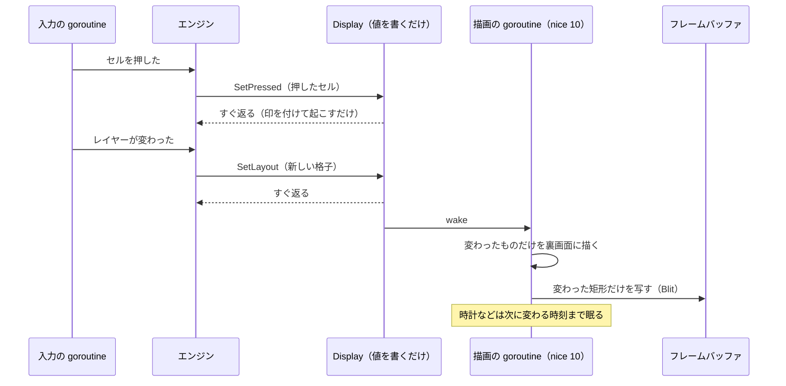

# 5. 描画

[目次に戻る](../architecture.md)

## 画面に描く仕組み

- **フレームバッファ**（`/dev/fb0`）：画面の画素を並べたメモリ。lefthand はこれを mmap（ファイルをメモリとして読み書きする）して、画素を直接書く（fb.go の `Framebuffer`）。画素の形（RGB565 など）は ioctl で読む（`queryFB`）。
- **専用の VT**：Linux のコンソールには、仮想端末（VT、tty1〜）がいくつもあり、表示されている 1 つだけが画面を使う。lefthand は空いている VT（tty8 以降）を 1 つ取り、そこに切り替えて KD_GRAPHICS（カーネルが文字を描かないモード）にする（vt.go）。
  ログイン画面の ly（tty2）や getty（tty1）は、自分の VT が表示されていないあいだ画面に触れないので、取り合いが起きない。
- **ほかのプロセスが VT を切り替えたとき**（ly の再起動など）：VT_PROCESS モードで知らせ（SIGUSR1）を受け、描画を止めて切り替えを許し、2 秒後に取り戻す（display.go の `handleVTSignal`、`reclaim`）。
- **終わるとき**：元の VT とテキストモードに戻す。強制終了などで戻せなかったときは、systemd の `ExecStopPost` で `lefthand -restore-console` が `/run/lefthand-vt` を読んで戻す。

### なぜこうなっているか

- **なぜ X や Wayland を使わず、フレームバッファに直接描くか**：Brain は CPU が 1 つで遅く、メモリも少ない。lefthand は静的な Go の実行ファイル 1 つで、フォントも埋め込み、ほかに何も要らない形にしている（README の「ビルド」）。描くのは格子とウィジェットだけなので、自前で描けば足りる（この理由はコードと README から読み取ったもの。REPORT.md に「なぜ X を使わないか」をはっきり書いた所は見つけられなかった）。
- **なぜ専用の VT か**：同じ画面をカーネルのコンソール（fbcon）や ly と取り合わないため（vt.go の冒頭）。

## 描画のスレッド

- `Display`（display.go）は、入力の側から値を受け取る口（`SetPressed`、`SetLayout`、`SetOverlay`、`Poke`、`Invalidate`、`SetTerminal`、`SetPhoto`、`SetFullScreen`、`SetPaused`、`Ink`）を持つ。どれも、ロックして値を書き、描画の goroutine を起こすだけで、描き終わるのを待たない。
- 描画の goroutine（`Display.loop`）は OS のスレッドに固定し、優先度を nice 10 に下げてある。入力の goroutine が先に動く。描画の中で panic しても、入力は動き続ける（画面だけ止める）。
- 裏画面（`Canvas`）に描いてから、変わった矩形だけをフレームバッファに写す（`Framebuffer.Blit`、`Display.flushLocked`）。

## 何を描くか（優先の順）

描画の goroutine は、起きるたびに次の順に見て、最初に当てはまるものを描く（`Display.redraw`）。

| 順 | 状態 | 描くもの |
| --- | --- | --- |
| 1 | ふたを閉じている（`SetPaused`） | 何も描かない。開けたら全体を一度描き直す |
| 2 | 画面を全部使う画面（`SetFullScreen`） | タッチのキャリブレーション（向き 0 で描く） |
| 3 | 端末モード（`SetTerminal`） | 端末の画面（termdraw.go） |
| 4 | 写真（`SetPhoto`） | フォトフレームの写真 |
| 5 | ふつう | 格子（セルとウィジェット）、状態の帯かレイヤーの札、画面の下に重ねる知らせと欄 |

## 部分的な描き直し

画面全体を描き直すと遅い（Brain では 1 回に数十〜数百 ms）。そのため、変わったところだけを描く。

| 何が変わったか | 描き直す範囲 | 仕組み |
| --- | --- | --- |
| レイヤー（格子）が変わった、向きが変わった | 全体 | `SetLayout`。向きが変われば裏画面を作り直す |
| 背景画像が増えた・消えた、USB の形が変わった | 全体 | `Invalidate` |
| セルを押した・離した | そのセル（`border` なら枠だけ、`fill` ならセル全体） | `SetPressed` で `want` を変え、`drawn` と違うセルだけ描く |
| ウィジェットの中身（時刻、データ） | 中身が変わったセルだけ | セルごとに中身の要約（`widgetKey`）を覚え、違うときだけ描く |
| 状態の帯 | 帯 | 帯の中身の要約（`barKey`） |
| 画面の下の知らせ、文字を入れる欄 | その範囲。小さくなったら全体 | `SetOverlay`、`updateOverlayLocked` |
| 手書きメモの線 | 線の範囲 | `Ink`。描き足すだけ |
| 端末の文字 | 変わった行だけ。画面全体が上に流れたら、裏画面の点を行ごとにずらして、新しい行だけ描く | termdraw.go |

**ウィジェットの描き直しの時刻**：ウィジェットは「次に中身が変わる時刻」（`widgetNext`。時計なら次の分、ストップウォッチなら次の秒）を返し、描画の goroutine はそれまで眠る（最長 1 分。`widgetWakeMax`）。
データが変わったとき（予定を受け取った、時刻を合わせた、電池の値が変わった）は、それぞれの係が `Display.Poke` を呼んで起こす（main.go で、各係の `SetOnChange(d.Poke)` をつないでいる）。

## 回転

- 画面の向き（`display.rotate`、動いているあいだは `rotate` の割り当てで変える）は、時計回りの角度（0、90、180、270）。90 では画面の上が本体の右側（ソフトキーの帯の側）になる。
- `Canvas` は「論理の座標」（回したあとの向きでの座標）で描き、`phys` で物理の座標に変えてバッファに書く（fb.go）。塗りは物理の矩形を行ごとに書く。向きが変わったら、裏画面を作り直して全体を描く。
- タッチも同じ向きに合わせて回す（[3. 入力の流れ](03-input.md)）。ソフトキーの帯はベゼルに印刷されていて動かないので回さない。
- 端末モードは、動いているあいだの向きでなく、設定の `display.rotate` の向きで描く（`Display.tcv`）。キャリブレーションは向き 0 で描く。

## フォント

| フォント | 使うところ | 形 |
| --- | --- | --- |
| k8x12（8×12 ドットの日本語ビットマップフォント） | セル、ウィジェット、帯、端末など、ほとんど全部 | `font/k8x12.bin`。`tools/mkfont` で BDF から変換し、`go:embed` で埋め込む。整数倍に拡大して描く（セルでは最大 6 倍。`fitScale` で入る大きさを選ぶ） |
| 読み物の明朝体（Noto Serif JP を 16 階調のビットマップにしたもの） | 読み物のアプリ、ヘルプ、ファイルのテキスト | `font/reader-{12,16,24,32}.lrf.gz`。`tools/mkreadfont` で作る。gzip のまま埋め込み、使う大きさを初めて使うときに戻す（readfont.go） |

フォントにない文字は □ になる（読み物では k8x12 を 2 倍にして描く）。設定 GUI も同じ k8x12 で描くので、プレビューも同じになる（gui/src/font.ts）。

## 背景画像、写真、天気のアイコン

- **背景画像**（`/var/lib/lefthand/images/<id>.565`）：セルの背景（`background`）、レイヤーとホーム画面の壁紙、ホーム画面のアイコンに使う。形は「`LHI1`、幅、高さ、RGB565 の画素」。id はファイルの SHA-256 の先頭 16 文字（image.go）。
  - 変換（切り抜き、縮小、RGB565、ディザリング）は PC で行い（設定 GUI の gui/src/image.ts。brain-deck は internal/imgconv）、Brain は受け取って写すだけ。
  - 読んだ画像はメモリに 4 MiB まで置く（`imageCacheBytes`）。設定を読んだら、使う画像を別の goroutine で先に読む（`ImageStore.Preload`）。
- **写真**（`photos/`）：背景画像と同じ形。フォトフレームで画面いっぱいに出す（[10.](10-time-power.md)）。
- **天気のアイコン**（`weather-icons/<番号>-<幅>x<高さ>.lha`）：透明度付きの RGB565。PC が気象庁の SVG をセルの大きさに描いて送る（weathericon.go、cmd/brain-deck/svg.go）。

### なぜこうなっているか

- **なぜ画像の変換を PC で行うか**：Brain は遅く、PNG や JPEG の読み込み、縮小、ディザリングに時間がかかる。PC で済ませておけば、Brain は画素を写すだけで済む（image.go の冒頭）。GUI（TypeScript）と brain-deck（Go）で同じ結果になるよう、変換は整数だけで計算する（internal/imgconv）。

## 状態の帯とレイヤーの札

- **状態の帯**（statusbar.go）：画面の上の高さ 28 ドットの帯。左に今のレイヤーの名前（既定以外のプロファイルなら、その名前を水色で）、右に項目（既定は左から 同期、マウスの形、PC とのつながり、電池、時刻。`status_bar.items`）。帯を出すレイヤーでは、格子は帯の下に並ぶ。
- **レイヤーの札**：帯を出さないレイヤーでは、右上に今のレイヤーの名前を、入り方の色（base、切り替えたまま＝緑、一時的＝橙）で出す（display.go の `drawBadge`）。

## 画面の下に重ねるもの

prompt.go の `Prompt` が、画面の下に重ねて出すもの（`Overlay`）を持つ。

- **知らせ**：「PC につながっていません」「電池が少なくなりました」などを数秒出す。
- **文字を入れる欄**：`input: todo`（Todo を足す）、`input: clock`（時刻を合わせる）、自分で足すアプリの入力欄。開いているあいだ、本体キーはすべて欄に行き、PC には送らない。日本語入力が使えるときは、欄が uim-fep の 2 行の端末になる（[9.](09-terminal-ime-apps.md)）。

## 設定 GUI のプレビューと、画素単位の一致

設定 GUI のプレビュー（gui/src/preview.ts）は、display.go の描き方を TypeScript で書き直したもので、配置、色、字形を同じにしてある。
`lefthand -render-png`（実機なしで画面を PNG に書く。main.go に `-render-*` のオプションが多数ある）の結果を gui/test/fixtures/ に置き、GUI のテストで画素単位で比べている（README の「テスト」）。
描き方を変えるときは、Go と TypeScript の両方を変え、fixture を作り直す。

## 関連するファイル

display.go（`Display`、`drawCell`、`drawAll`）、fb.go（`Framebuffer`、`Canvas`）、vt.go、splash.go（起動中の画面）、font.go、readfont.go、widget.go（`widgetKey`、`widgetNext`）、statusbar.go、prompt.go、image.go、photo.go、weathericon.go、termdraw.go、icons.go、home.go、gui/src/preview.ts。
