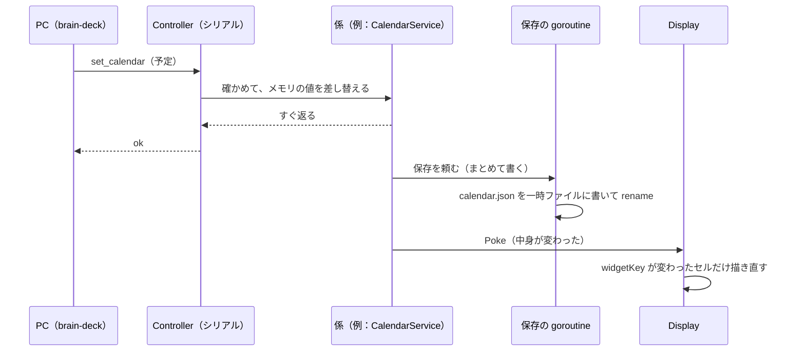

# 6. ウィジェットとアプリ

[目次に戻る](../architecture.md)

## 言葉の整理

この資料と設定では「アプリ」が 3 つの意味で使われる。混ざりやすいので先に整理する。

| 言葉 | 中身 | 設定 |
| --- | --- | --- |
| **ウィジェット** | タッチのセルに、キーの代わりに情報や操作の部品を出すもの（時計、Todo、予定…） | セルに `{ widget: <種類> }` |
| **ホーム画面のアプリ** | ホーム画面のアイコン 1 つ。中身は「入る先のレイヤー」 | `home.apps[]` の `{ name, icon, layer }` |
| **〇〇のアプリ**（読み物、設定、ヘルプ、ファイル、手書きメモ） | 画面いっぱいの大きなセルで使う、機能の多いウィジェット。コードでも「読み物のアプリ」「設定のアプリ」と呼ぶ | `{ widget: reader }` など |
| **自分で足すアプリ** | `/var/lib/lefthand/apps/<名前>/` に置いたスクリプトの出力を描くウィジェット（フェーズ K5） | `{ widget: app, name: <名前> }` |

ウィジェットの組み立ては widget.go の `compileWidget`（設定の項目を確かめて `WidgetDef` にする）、描画は `drawCell` から種類ごとの関数、タップは `WidgetDef.touchDown` から種類ごとの処理へ行く。
ウィジェットの描画に要る状態（時刻、データの写し）は `WidgetEnv`（widget.go）にまとめ、main.go の `widgetEnvOf` が各係から集める。描画は写しを読むだけで、係のロックを長く持たない。

## 一覧

「PC が要るか」の列：**要らない**＝PC から外しても使える。**データは PC から**＝中身は PC が送るが、受け取ったものは外しても出る。**要る**＝PC がないと働かない（外しているあいだは「PCなし」と出て休む。offline.go の `needsPC`、`fromPC`）。

### 情報を出すもの

| 種類（`widget:`） | 出すもの | データの置き場所 | 更新のきっかけ | PC |
| --- | --- | --- | --- | --- |
| `clock` | 時刻と日付 | （システムの時刻） | 次に表示が変わる時刻（分か秒）。時刻を合わせたとき | 要らない（時刻合わせは PC か Brain のキーボードか RTC） |
| `text` | PC から送ったテキスト（ビルドの結果など）。有効期限つき | `text.json`（id ごと） | `set_text`（`brain-deck text`、`brain-deck exec`） | データは PC から（外すと隅に「PCなし」） |
| `qr` | 文字列の QR コード | `qr.json` | `set_qr`（`brain-deck qr`） | データは PC から |
| `todo` | Todo の一覧。ページ送り、長押しで完了 | `todo.json` | Brain での操作、`todo_*`（設定 GUI の Todo のタブ、`brain-deck todo`）、`input: todo` の欄 | 要らない（Brain のデータが正） |
| `calendar` | 今日の予定と次の予定 | `calendar.json` | `set_calendar`（`brain-deck calendar sync`、`sync`）。古くなると橙（既定 3 時間） | データは PC から |
| `month` | 月の表示（卓上カレンダー）。祝日、予定のある日の点。日付を選ぶと `follow` のカレンダーに出る | `calendar.json` | 同上と、日付が変わったとき | データは PC から |
| `weather` | 今日（と明日）の天気、気温、降水確率 | `weather.json`、`weather-icons/` | `set_weather`（`brain-deck weather sync`、`sync`）。古くなると橙（既定 3 時間） | データは PC から |
| `graph` | PC から送った値の折れ線か棒 | `graph.json`（id ごとに 120 個。SD カードには 5 分に 1 回まとめて書く） | `add_graph`（`brain-deck graph`） | データは PC から（外すと「PCなし」） |
| `battery` | 電池の残り（電圧からの見積もり）、USB の 5V | （なし。LRADC を 30 秒ごとに読む） | 読んだ値が変わったとき | 要らない |

### 道具（タップで動かすもの）

状態は `widgets.json` に、種類と id ごとに置く（gadgets.go の `GadgetService`）。同じ id のセルは同じ状態を出す。

| 種類 | 働き | 備考 |
| --- | --- | --- |
| `stopwatch` | タップで開始・停止、長押し（0.5 秒）で 0 に | 始めた時刻を覚える。Brain を再起動したときは、終了したときに書いた時刻（`last_seen`）で扱う |
| `pomodoro` | 作業と休憩を数える。切り替わったら 15 秒セルを点滅（音は出ない） | 動いているあいだは写真を出さない |
| `counter` | タップで数を増やす、長押しで 0 に | |
| `presence` | 在席ランプ。タップで次の状態、長押しで前の状態 | `set_presence`（`brain-deck presence`）でも変えられる |
| `presenter` | プレゼン用タイマー。残り時間で色を変える | 動いているあいだは自動減光しない |
| `calculator` | 電卓（有理数で誤差なし）。本体キーでも入力。結果を PC に打ち込む | `calc.json`。打ち込むのは PC が要る |

### PC を操作するもの

| 種類 | 働き | PC |
| --- | --- | --- |
| `trackpad` | 指でカーソル、タップでクリック、右端でスクロール（trackpad.go） | 要る。マウスありの形（`usb_mode: mouse`）で使う |
| `pentablet` | セルをペンタブレットにする。HID のペン（絶対座標、筆圧） | 要る。マウスありの形で使う |
| （ウィジェットでないセル） | `key`、`mouse`、`media` | 要る |

### アプリ（大きなウィジェット）

| 種類 | 働き | データの置き場所 | PC |
| --- | --- | --- | --- |
| `home` | ホーム画面（設定の `home` から自動で作る。直接は書かない） | 設定 | 要らない |
| `memo` | 手書きメモ。ページ、太さ、消しゴム、戻す | `memo/<id>.json`（点の列） | 要らない（PC へは `brain-deck memo get`、`sync` で写す） |
| `reader` | 読み物（縦書き・横書き、ルビ、しおり） | `reader/<id>.json.gz`、`reader/index.json`、`reader/reader.json`（しおり） | 要らない（足すのは `brain-deck read add`） |
| `files` | ファイルエクスプローラ（見られる場所だけ）。テキストと画像を見る、ほかのアプリに足す | 設定の `files.roots` の場所 | 要らない |
| `settings` | 設定のアプリ（明るさ、減光、フォトフレーム、向き、ふた、日本語入力、時刻、プロファイル。情報。再起動と電源） | 上書きの値（`overrides.json`）など | 要らない |
| `help` | 使い方の説明 | デーモンに埋め込み（help/ja.md）。版と合う | 要らない |
| `app` | 自分で足すアプリ（[9.](09-terminal-ime-apps.md)） | `apps/<名前>/`（スクリプト）、`apps-data/<名前>/`（スクリプトが書くもの） | アプリによる |

### ウィジェットでない「画面」

| 画面 | 何か | きっかけ |
| --- | --- | --- |
| 端末モード | Brain の画面とキーボードを、PC か Brain 自身のログインの端末にする | `terminal` の割り当て、`brain-deck terminal` |
| フォトフレーム | 自動減光の「暗くする」段階で、写真を順に出す | `backlight.photo` |
| タッチのキャリブレーション | 十字を順に押して、タッチの変換を決める | `calibrate` の割り当て、`brain-deck calibrate` |
| 起動中の画面 | 「起動中…」と版 | デーモンが起動したとき |

## タップの扱いの 3 つの型

| 型 | どのウィジェット | 働き |
| --- | --- | --- |
| **押した位置で働く**（`ownsTouch`） | todo、calendar、month、calculator、trackpad、home、pentablet、memo、reader、files、settings、help、app | 押した点を受け取り、セルの中のどこを押したかで決める。押したことは自分で描く（セル全体を光らせない） |
| **タップと長押し**（`tapWidget`） | stopwatch、pomodoro、counter、presence、presenter | 離したときに働き、0.5 秒押し続けると長押しの働き。セル全体の枠を光らせる |
| **キーやレイヤーとして働く** | それ以外（clock、text など）と、key や layer_* を書いたセル | 割り当てのとおり |

## データの更新が画面に届くまで

- 返事は、SD カードへの書き込みを待たない（SD カードは書き込みが遅いことがある）。保存は 1 つの goroutine がまとめて行う。
- 書き込みは一時ファイルに書いてから名前を変える（store.go、apply.go の `writeFileAtomic`）。途中で電源が切れても、前の内容か新しい内容のどちらかが残る。
- 終了するときは、まだ書いていないものを書く（main.go の `addAtExit(todos.Flush)` など）。電池が少なくて電源を切るときも、ここを通る。

### なぜこうなっているか

- **なぜ Todo は Brain のデータが正か**：Brain で完了にしたり足したりでき、PC から外しても使うため。設定 GUI や brain-deck からの書き換えは、項目ごとの更新番号（rev）を付けて送り、そのあいだに Brain で変わっていれば断る（`conflict`。todo.go）。
- **なぜ予定や天気は PC が取ってくるか**：Brain はインターネットに出ない。秘密の URL（ICS）を PC にだけ置く。繰り返しの展開やタイムゾーンは PC で済ませ、Brain には「時刻の決まった予定」と「日付だけの終日の予定」だけを送る（calendar.go、[1. 全体像](01-overview.md)）。
- **なぜデータを設定ファイルと分けたか**：設定 GUI で設定を保存し直しても、Todo や予定が消えないように（store.go）。
