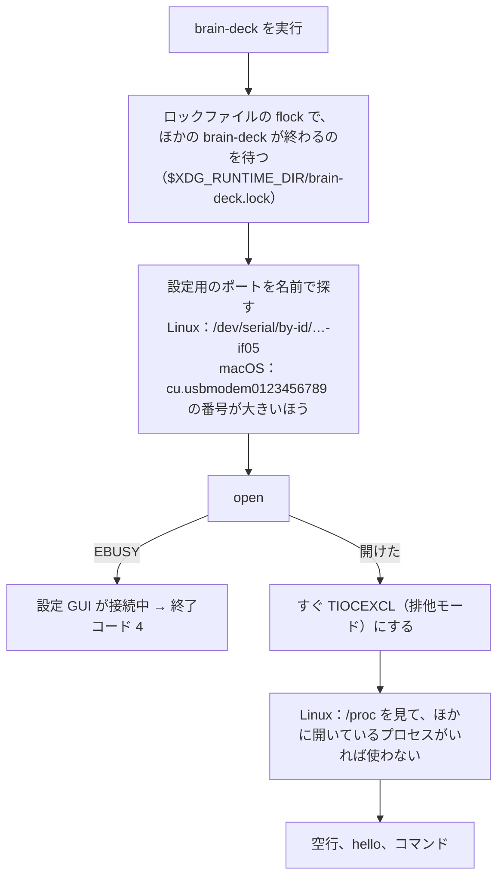
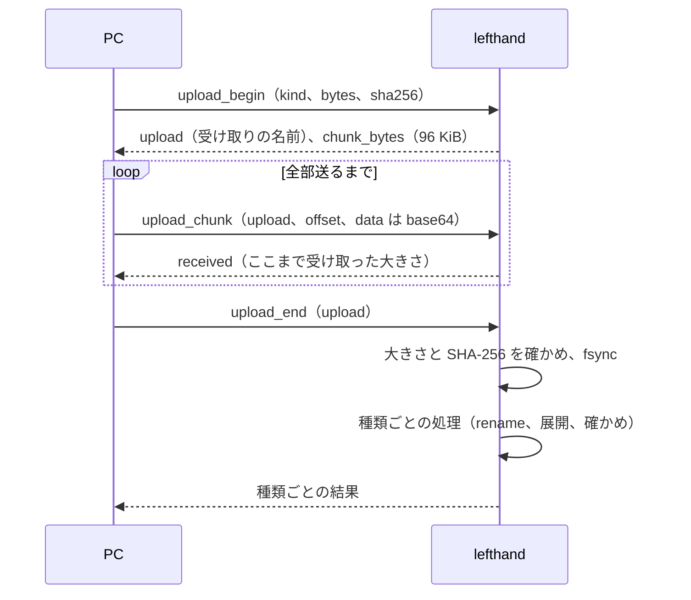

# 8. 通信

[目次に戻る](../architecture.md)

設定 GUI と brain-deck は、Brain の 2 つ目のシリアル（Brain 側 `/dev/ttyGS1`）で lefthand と話す。形式の仕様（コマンドごとの引数と結果）は docs/protocol.md にある。この章は仕組みを説明する。

実装は、Brain 側が control.go（`Controller`）、GUI 側が gui/src/protocol.ts と gui/src/serial.ts、brain-deck 側が cmd/brain-deck/client.go と serial_unix.go。

## 形式：1 行に 1 つの JSON

シリアルは「バイトの流れ」しかない（HTTP のような「リクエストの区切り」がない）。そこで、改行で区切った JSON を 1 つずつ送る。

```text
→ {"id":1,"cmd":"hello","client":"brain-deck/0123456789ab"}
← {"id":1,"ok":true,"result":{"protocol":1,"daemon":"lefthand","version":"8a09379808bb","max_line":262144,"commands":[...],"upload_kinds":[...]}}
→ {"id":2,"cmd":"set_text","name":"build","text":"ビルド成功","style":"ok"}
← {"id":2,"ok":true,"result":{...}}
← {"event":"layer","layer":"edit","mode":"temp",...}
```

- **リクエスト**：`id`（数か文字列）と `cmd` が必須。
- **レスポンス**：同じ `id` で、`ok` と `result`、失敗なら `error`（`code`、`message`、設定の誤りなら `problems`）。
- **通知**：`id` がなく、`event` がある行。頼んだときだけ届く。
- 処理は**届いた順に 1 つずつ**（`Controller.Serve` が 1 行ずつ `handle` を呼ぶ）。並べて処理はしない。
- 書き込みは 1 つの goroutine だけが行うので、レスポンスと通知が行の途中で混ざらない。
- シリアルは生のモード（エコーなし、行の編集なし、改行の変換なし。`makeRaw`）にして使う。

### 壊れた入力と上限

| 状況 | 動き |
| --- | --- |
| 1 行が 256 KiB を超えた | 次の改行まで読み捨て、`too_large` |
| 改行が来ないまま 2 秒 | 途中の行を捨て、`incomplete_line`（ケーブルが抜けた、GUI を閉じた） |
| JSON でない、UTF-8 でない、`id` がない | `parse_error`、`bad_request`（`id` は `null`） |
| PC が読まない | 書き込みが 5 秒進まなければ、その接続をやめてポートを開き直す |
| 通知が多すぎる | 64 個まで待ち行列に入れ、あふれたら捨てる |
| ポートがない、開けない | 1 秒ごとに開き直す（ログは 10 分に 1 回）。入力の処理には何の影響もない |

GUI はポートを開いたら、まず空行を 1 つ送る。前の接続の切れ端が残っていても、新しいリクエストとつながらないように。

### 版の合わせ方

- `hello` の `protocol` は、互換性のない変更をしたら上げる（今は 1）。
- コマンドを足しただけのときは上げない。代わりに `commands`（受け付けるコマンドの一覧）と `upload_kinds` を見て、使えるものだけを使う（GUI は「`get_todo` があるときだけ Todo を読む」など。brain-deck は、なければ「lefthand を新しくしてください」で終わる）。
- `version` は、デーモンをビルドした git のリビジョン（12 桁。`-ldflags "-X main.version=…"` で入れる。version.go）。

## 1 つのポートを 1 つのプロセスだけが使う（排他）

Brain 側からは、PC で何個のプロセスがポートを開いているか分からない。2 つのプロセスが同時に開くと、返事がどちらに届くか決まらず、両方の通信が壊れる。そこで PC 側で同時に開かないようにする。



| 仕組み | 何を防ぐか |
| --- | --- |
| **TIOCEXCL** | 開いたらすぐ排他モードにする。以後、ほかのプロセス（root を除く）の open は EBUSY になる。Chrome の WebSerial も Linux と macOS では開くと TIOCEXCL にする（Chromium の `serial_io_handler_posix.cc` の `PostOpen`）。そのため、GUI と brain-deck は互いを締め出す |
| **flock** | brain-deck どうし（cron とスクリプトが同時に動いたなど）は、ロックファイルで順番を待つ。TIOCEXCL だけでは、相手が GUI か brain-deck か分からないため |
| **/proc の確かめ**（Linux） | TIOCEXCL を使わないプログラム（screen、minicom）や root のプロセスが開いていれば使わない |

- 設定 GUI が接続しているあいだ、brain-deck は送らずに終わる（終了コード 4）。定期実行の同期は、次の回に送る。
- root で brain-deck を動かさない（root は TIOCEXCL を無視できる）。

### 2 つのシリアルを見分ける

1 つ目のシリアル（コンソール用）では getty がログイン画面を出している。そこに `hello` を書くと、ユーザー名として入力されてしまう（ログインの失敗が残る）。そのため、**コンソール用には何も書かずに**設定用を見分ける。

- **brain-deck**：ポートの名前だけで見分け、設定用の 1 つだけを開く（cmd/brain-deck/ports.go）。Linux はインターフェイスの番号（`-if05` が設定用、`-if03` がコンソール用）、macOS は名前の末尾の番号が大きいほう。
- **設定 GUI**：WebSerial からは 2 つの ACM が同じに見える（USB の ID しか分からない）。そこで、役割の分からないポートには自動で書かず、ブラウザのポートの一覧でユーザーに選んでもらう。選んだポートでは、`hello` の前に 0.3 秒何も書かずに待ち、ログイン画面の文字が届いたら送らない。分かった役割は、ページを開いているあいだ覚える（gui/src/ports.ts）。
- PC の ModemManager も、つないだシリアルに AT コマンドを送るので、udev の規則で止める（contrib/udev/70-brain-modemmanager.rules）。

## 分割して送る（大きなファイル）

1 行の上限（256 KiB）より大きなファイル（背景画像、写真、更新のファイル、バックアップなど）は、分けて base64 で送る。受け取りの手順はどれも同じ（transfer.go の `Receiver`）。



- 一時ファイル `<dir>/.upload-<token>.part` に書く。`offset` が、それまでに受け取った大きさと違えば断る（受け取りは続く。PC は送り直せる）。言った大きさを超えたら捨てる。
- やめるのは：`upload_abort`、別の `upload_begin`、接続が切れた、60 秒何も来ない、デーモンの再起動。受け取りは同時に 1 つだけ。
- 種類（`kind`）：`update`（更新のファイル）、`image`（背景画像）、`photo`（写真）、`read`（読み物）、`file`（ファイル）、`backup`（復元するバックアップ）、`app`（自分で足すアプリ）、`weather_icon`（天気のアイコン）。main.go で `ctl.uploads.Register` している。種類ごとの上限は docs/protocol.md。
- 背景画像には、`upload_*` より前からある `image_begin`、`image_chunk`、`image_end` もある（同じ仕組み）。
- Brain から PC へ大きなものを渡すとき（`get_image`、`get_file`、`backup_read`）は、`offset` を付けて少しずつ読む。

## 通知

| 通知（`event`） | いつ | 頼み方 |
| --- | --- | --- |
| `input` | 本体キーを押した、タッチした（生の座標、セル、ソフトキー、今のレイヤー） | `subscribe_input` |
| `layer` | 重なりが変わった（今のレイヤー、入り方、重なり、格子の大きさ、向き） | `subscribe_input` |
| `terminal` | 端末モードに入った・抜けた・状態が変わった | `subscribe_input` |
| `todo` | Brain で Todo が変わった | `subscribe_data` |
| `widgets` | ストップウォッチなどの状態が変わった | `subscribe_data` |

- 通知は、入力の goroutine から「待ち行列に入れるだけ」で送る（`Monitor.publish`）。PC が読まなければ捨てる。GUI は次に読み直したときにそろう。
- **学習モード**：`subscribe_input` に `suppress: true` を付けると、押した入力を PC に送らず、GUI に知らせるだけにする（GUI で「このキーを割り当てる」ときに、実際に押して選ぶため）。止めておく時間は 30 秒で、リクエストが届くたびに延びる（`suppressLease`、`Monitor.renew`）。GUI が切れるか、リクエストが 30 秒来なければ、自動で元に戻る。

## 主なコマンドの分類

一覧は `hello` の `commands`（control.go）。詳しくは docs/protocol.md。

| 分類 | コマンド |
| --- | --- |
| 設定 | `get_config`、`validate`、`set_config`、`get_config_text`、`put_config_text`、`get_keymap`、`get_overrides`、`set_override`、`clear_overrides` |
| 状態 | `hello`、`get_status`（`hid.preparing` は起動のときの USB の準備中）、`get_logs`、`get_battery_log` |
| 切り替え | `set_usb_mode`、`set_net_mode`、`set_terminal`、`set_rotate`、`set_pc`、`get_profile`、`set_profile`、`calibrate` |
| データ（PC → Brain） | `set_time`、`set_text`、`set_qr`、`set_calendar`、`set_weather`、`add_graph`、`clear_graph`、`set_presence`、`set_sync` |
| データ（読む・変える） | `get_text`、`get_qr`、`get_calendar`、`get_weather`、`get_weather_icon`、`get_widgets`、`get_graph`、`get_todo`、`todo_*` |
| ファイル | `list_images`、`image_*`、`get_image`、`prune_images`、`list_photos`、`get_photo`、`delete_photo`、`list_memos`、`get_memo`、`delete_memo`、`list_reads`、`delete_read`、`list_files`、`get_file`、`delete_file`、`list_apps`、`delete_app`、`upload_*` |
| 保守 | `update_apply`、`update_discard`、`update_rollback`、`update_confirm`、`update_status`、`restart`、`power`、`backup_create`、`backup_read`、`backup_done`、`restore_apply`、`run`（コマンドを user で動かし、結果を返すまでこの接続のほかの要求は待つ） |
| 通知 | `subscribe_input`、`subscribe_data` |

### なぜこうなっているか

- **なぜ JSON の行か**：ブラウザ（TypeScript）と Go の両方で扱いやすく、人がシリアルの端末で読んでも分かる。
- **なぜ 1 つずつ処理するか**：シリアルは 1 本で、相手も 1 つ（排他）なので、並べて処理しても速くならない。順番が決まっていれば、GUI とデーモンの状態がずれにくい。時間のかかるもの（更新の入れ替え、復元）は、別のユニット（更新の係）に任せて、返事はすぐ返す（[11. 保守](11-maintenance.md)）。
- **なぜ排他を PC 側で行うか**：Brain 側からは、相手が何個のプロセスか分からないため（docs/protocol.md の「1 つの接続だけ」）。
- **デーモンが開く前に送った行**：デーモンが ttyGS1 を開いていないあいだ（再起動の途中など）に PC が送った行は、Brain 側で捨てられ、返事が来ない。brain-deck は、返事がなければ一度だけ開き直してもう一度送る（client.go の `connect`）。
