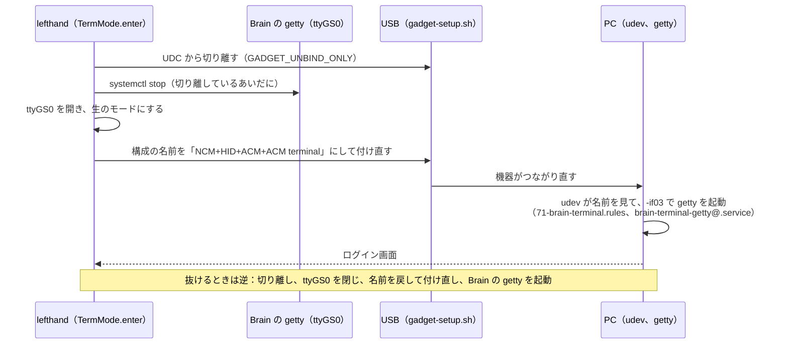
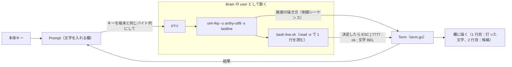
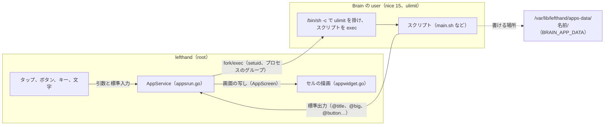

# 9. 端末モード、日本語入力、自分で足すアプリ

[目次に戻る](../architecture.md)

この 3 つは、どれも「lefthand（root）が、ほかのプログラムを動かして、その入出力を画面とキーボードにつなぐ」仕組み。共通の部品は PTY と、Brain の user の権限。

## 前提：PTY と端末

- **端末**（ターミナル）：文字を受け取って画面に描き、キーを文字（バイト列）にして送るもの。昔は物理の機械で、今はソフト（xterm、ブラウザの xterm.js など）。画面の制御（カーソルを動かす、色を変える）は、ESC で始まる「制御シーケンス」で行う。
- **PTY**（疑似端末）：プログラムに「端末につながっている」と思わせる仕組み。親（ptmx）と子（pts）の組で、子をプログラムの標準入出力にし、親から読み書きする。シェル、`login`、`ssh`、`vi` などは、端末につながっていないと正しく動かない。
- **getty**：シリアルなどの端末にログイン画面を出し、名前を受け取って `login` を動かすプログラム（agetty）。

lefthand は、端末（制御シーケンスの解釈と文字の格子）を自分で持っている（term.go。xterm-256color の一部）。端末モードと日本語入力の欄の両方で使う。

## 端末モード

Brain の画面とキーボードを、ログインの端末にする。相手は 3 通り。

| 相手 | 設定 | つなぎ方 | 権限 |
| --- | --- | --- | --- |
| **PC（シリアル）**（既定） | `terminal` の既定 | 1 つ目のシリアル（ttyGS0）を逆向きに使い、PC の getty にログインする | PC の側でログインする |
| **PC（コマンド）** | `terminal.command`（`ssh` など） | コマンドを PTY で動かす | `terminal.user`（root は不可） |
| **Brain 自身** | `terminal: brain`、PC から外しているときの `terminal: on` | `/bin/login <terminal.brain_user>` を PTY で動かし、パスワードを聞く | login は root で動き、ログインしたら user のシェル |

PC につないでいるときの `terminal: on` と `toggle` は、「PC」と「Brain」を選ぶ画面を出す。端末モードのあいだ、本体キーは HID で送らず、US 配列の文字にして端末に書く（termkeys.go）。タッチは画面の下のタッチのキー（12 列 × 2 段）と、HOME（抜ける）などのソフトキーになる。

### シリアルの端末モードの入り方

ふだん、1 つ目のシリアルでは Brain の getty（`serial-getty@ttyGS0`）がログイン画面を出している。両端で getty が同時に動くと、互いのログイン画面をユーザー名として読み合い、ログインの失敗が続く。そこで次の順に切り替える。

- 切り離しているあいだに getty を止め、ttyGS0 を開くのは、USB がつながっていると、閉じるときに u_serial（シリアルのガジェットのドライバ）が「まだ送っていない出力」を PC が読むまで最大 15 秒待ち、残った出力が次の接続で PC に届いてしまうため（termmode.go、gadget-setup.sh の `GADGET_UNBIND_ONLY`）。
- 端末の大きさ（行と桁）はシリアルでは伝わらないので、PC のログインのスクリプト（contrib/profile.d/brain-terminal.sh）が、Brain の端末に `ESC [ 18 t` で問い合わせて `stty` で合わせる。
- lefthand が途中で落ちたときは、`/run/lefthand-terminal` の印を見て、`lefthand -restore-console`（ExecStopPost）と次の起動が、構成の名前と Brain の getty を元に戻す（`restoreTerminal`）。
- 実装：termmode.go（`TermMode.enter`、`leave`、`KeyEvent`、`Touch`）、termpty.go、term.go、termdraw.go、termkeys.go、usbmode.go の `SetTerminal`。

### なぜこうなっているか

- **なぜ構成の名前で PC に知らせるか**：PC の udev がつながった機器の属性を見て getty を起動できるのは「つながったとき」だけ。ふだんの名前では何も起動しないので、設定 GUI のコンソールのタブ（Brain のログイン画面）とぶつからない（gadget-setup.sh の `set_conf_name` のコメント）。
- **なぜ PC の getty はシリアルの制御線（DCD）を当てにしないか**：このカーネルの f_acm は、ttyGS0 を開いたときに一度だけ状態を送り、PC がポートを開く前だと届かないため（termmode.go の冒頭）。
- **なぜ Brain 自身のログインは root のシェルにしないか**：lefthand は root で動いているが、画面とキーボードだけで root のシェルが開けると危ない。`/bin/login` にパスワードを聞かせ、`login -f`（パスワードなし）は使わない。
- **なぜ macOS と Windows ではシリアルの端末モードが使えないか**：PC 側の設定（udev、systemd）が Linux 用しかないため。`terminal.command` で ssh する方法なら使える見込みがある（未確認。[16.](16-limitations.md)）。

## 日本語の入力（uim-fep）

Brainux には uim-fep（端末の中で動く日本語入力）と Anthy（かな漢字変換）が入っている。uim-fep は端末の中で動く仕組みなので、lefthand の文字を入れる欄を「2 行だけの小さな端末」にして、その中で動かす。

- lefthand が、`/var/lib/lefthand/ime/` に `uim.scm`（uim の設定）、`inputrc`（readline の設定）、`line.sh`（1 行を読んで結果を返すスクリプト）を書き、`uim-fep -u <方式> -s lastline -e bash … line.sh` を、Brain の user として PTY で動かす（ime.go の `IME.startLocked`、termpty.go の `startUserPTY`）。
- uim-fep の設定は `~/.uim` を書き換えず、`LIBUIM_USER_SCM_FILE` で lefthand の `uim.scm` を読ませる（`~/.uim` があれば最後に読む）。
- `line.sh` は、決定（Enter）で `ESC ] 7777 ; ok ; <文字> BEL`、やめる（Ctrl+]）で `ESC ] 7777 ; cancel BEL` を書く（端末の「OSC」という制御シーケンスを、結果を返す合図に使っている）。lefthand は `Term.OnOSC` でそれを受け取る。
- uim-fep は起動に 3 秒ほど（デーモンの中では 4〜7 秒）かかる（ARM926）ので、一度起動したら欄を閉じても止めず、しばらく（`ime.idle`、既定 10 分）使わなければ止める。起動が終わるまでに打ったキーは、ためておいて終わってから送る。
- 欄ごとに、開いたときのかなと英数を決める（`ime.start`。Todo はかな、時刻は英数）。
- **Brain 自身のシェル**でも使う：端末モードで Brain にログインするとき、lefthand は `login -p` に `BRAIN_TERMINAL=1`、`BRAIN_IME=<方式>`、`LIBUIM_USER_SCM_FILE` を渡す。ログインのスクリプト `/etc/profile.d/lefthand-ime.sh`（contrib/brain/lefthand-ime.sh。install.sh が置く）が、それを見て `exec uim-fep` でシェルを開き直す。
- 学習（Anthy の `~/.anthy/last-record2_default.utf8` など）は user のホームにあり、バックアップに入る。
- uim-fep が入っていなければ（`ime.method: auto` で見つからない、`off`）、欄は英数字と記号だけ（US 配列）になる。

### なぜこうなっているか

- **なぜ Mozc ではなく uim-fep と Anthy か**：Brainux に入っていて、uim に登録されている方式が `anthy-utf8` だけだった。Mozc は入っていない（実機で調べた。REPORT.md のフェーズ K2）。新しく入れずに使える。X がないので fcitx は使えない。
- **なぜ root でなく user で動かすか**：uim-fep と bash はふつうのプログラムで、root で動かす理由がない。学習も user のホームに置く。

## 自分で足すアプリ（widget: app）

`/var/lib/lefthand/apps/<名前>/` に `app.yaml` とスクリプトを置くと、セル（`{ widget: app, name: <名前> }`）にスクリプトの出力を描く（フェーズ K5。書き方は docs/apps.md）。

- **動かし方**：`interval`（画面にあるあいだ `every` ごとに動かし、出力を描く。タップ、ボタン、キー、文字のときはすぐ）と、`stream`（画面にあるあいだ動かし続け、1 行ごとに描き直す。止まったら 5 秒から倍にして最大 5 分待って動かし直す。画面から消えて 30 秒で止める）。
- **出力の決まり**：`@` で始まらない行はそのまま文字、`@title`、`@big`、`@color`、`@bar`、`@row`、`@item`、`@sep`、`@button`、`@input`、`@clear` は指示（appwidget.go、docs/apps.md）。
- **渡すもの**：interval では引数（`tap`、`button <id>`、`item <id>`、`key <名前>`、`input <id>`）と標準入力（入れた文字）、stream では同じものを標準入力の 1 行で渡す。環境変数 `BRAIN_APP`、`BRAIN_APP_DIR`、`BRAIN_APP_DATA`、`BRAIN_EVENT`（docs/apps.md の「スクリプトに渡すもの」）。
- **権限と上限**：Brain の user（`terminal.brain_user`、既定 `user`。root なら断る）として、`/bin/sh` の `ulimit` で仮想メモリ（`memory_mb`、既定 32 MB）、CPU の時間、書けるファイルの大きさ（16 MiB）、開けるファイル（64）、プロセスの数（今の user の数 + 32）を掛けてから動かす。プロセスのグループごと動かし（止めるときは子も止める）、優先度は nice 15。
  時間（`timeout`、既定 10 秒）、出力（`output_kb`、既定 32 KiB）を超えたら止め、セルの下に理由を出す。同時に動かすのは全部で 3 つまで（`apps.max_running`）。上限は設定の `apps` で決め、超える値の `app.yaml` は断る。
- **置き方**：`brain-deck app install`（`upload_*` の `kind: app`）。Brain が確かめてから入れ替える：名前は英小文字、数字、`_`、`-`、ファイルの名前は英数字と `. _ -`、ふつうのファイルだけ（リンクやフォルダ、ほかの場所を指す名前は断る）、32 個、1 つ 256 KiB、合計 1 MiB まで（apps.go）。アプリのファイルは root のもの（0755 と 0644）で、スクリプトは書き換えられない。スクリプトが書けるのは `apps-data/<名前>/`（user のもの、0700）だけ。
- 入力と描画は、スクリプトを待たない（別の goroutine で動かし、描くのは写し）。

### なぜこうなっているか

- **なぜ画面にあるあいだだけ動かすか**：Brain は CPU が 1 つで、充電もされない。見ていないときに動かす理由が少ない（REPORT.md の K5「無人で決めたこと」）。
- **なぜメモリの上限が仮想メモリ（ulimit -v）か**：Brain の cgroup はコントローラーが有効でなく、cgroup でメモリを制限できない（実機で調べた）。Python も 16 MB の仮想メモリで動いた。
- **なぜプロセスの数を「今の数 + 32」にしたか**：RLIMIT_NPROC は user のスレッドの合計を数えるので、決まった数にすると、user のほかのもの（Brain のシェルなど）が多いと動かせない。
- **なぜ出力を「@ で始まる指示の行」にしたか**：sh の `echo` だけで書け、ふつうの行はそのまま文字になる。
- **実機での確かめ**：REPORT.md と PROGRESS.md（2026-10-12 の朝）では「PC のテストまで。実機では確かめていない」。そのあとのコミット d666a95（apps-data の権限）と d18b7d3（タップでのデッドロック）は、実機の試験で見つけた不具合の直し。2026-10-12 14:40 に読むだけで確かめたとき、Brain では試験のデーモン（`lefthand-hwtest`、d18b7d3）が動いていて、本番の `/usr/local/bin/lefthand` は 8a09379808bb（K5 の前）のままだった。実機の試験がどこまで済んだかは、リポジトリには書いていない（未確認）。

## 3 つの比較

| | 端末モード（Brain） | 端末モード（コマンド） | 日本語入力 | 自分で足すアプリ |
| --- | --- | --- | --- | --- |
| 動かすもの | `/bin/login` | `terminal.command` | `uim-fep` + `bash line.sh` | `app.yaml` の `run` |
| 権限 | login は root、シェルは user | `terminal.user` | `ime.user`（既定 `terminal.brain_user`、なければ user） | `terminal.brain_user`（既定 user） |
| 端末 | PTY | PTY | PTY（2 行） | PTY なし（パイプ） |
| 入出力 | 本体キー → 文字、出力 → term.go | 同じ | 本体キー → 欄 → PTY、出力 → term.go → 欄 | 引数と標準入力、標準出力 → 出力の決まり |
| 上限 | なし（ログインしたシェル） | なし | idle で止める | ulimit、時間、出力、同時に 3 つ |
| 起動の関数 | `startLoginPTY` | `startPTY` → `startUserPTY` | `startUserPTY` | `AppService.command` |
