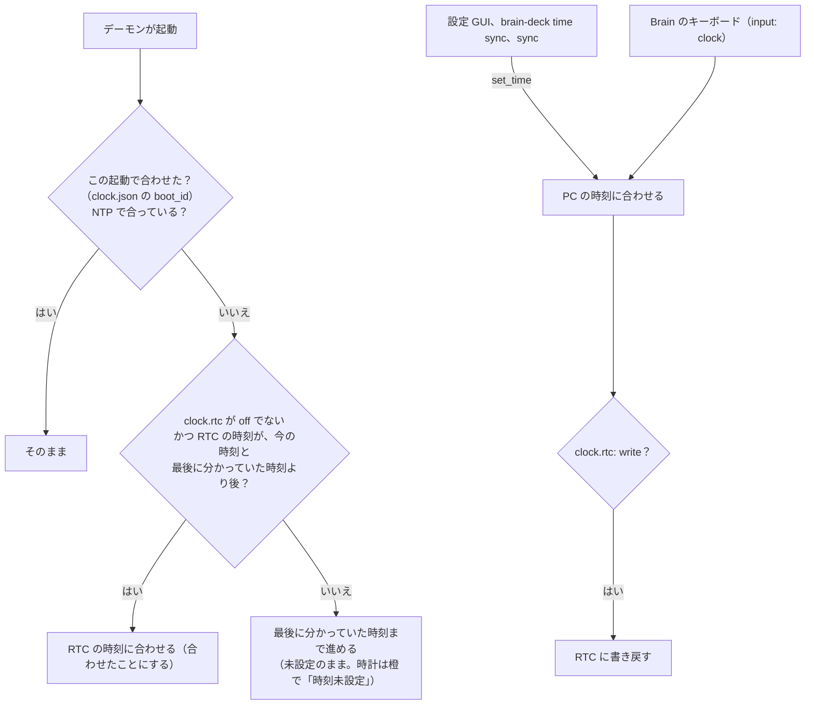
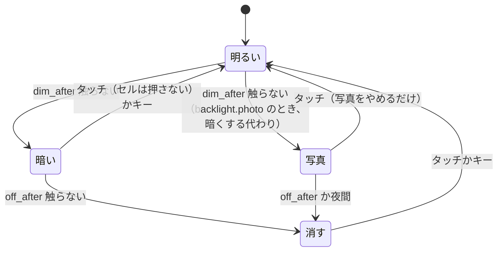
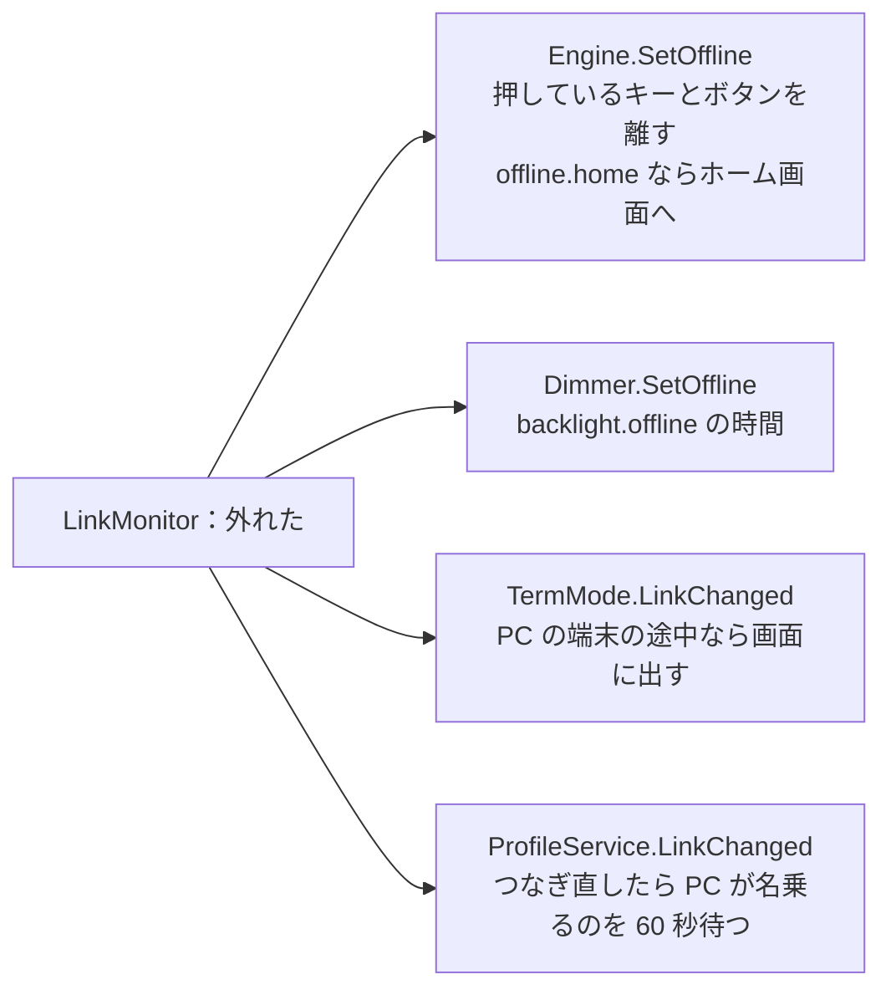

# 10. 時刻、電源、画面の明るさ、ふた、PC から外したとき

[目次に戻る](../architecture.md)

Brain を「PC のそばに置き、ときどき持ち歩く」道具として使うための仕組み。どれも Brain のハードウェアの癖（RTC が使われていない、充電されない、抵抗膜）に合わせてある。

## 時刻

### Brain の時計の事情

- Brainux は内蔵の RTC（電源を切っても時を数える時計）を使っていない。起動したときの時刻は、fake-hwclock（1 時間ごとに保存した時刻）と systemd-timesyncd が保存した時刻から戻すので、電源を切っていたあいだの分だけ遅れる（timesync.go の冒頭）。
- i.MX28 の内蔵 RTC は、本体の電池がある限り数え続けている。純正のファームウェアは `HW_RTC_SECONDS` を「2000-01-01 起点の秒、日本の時刻」として使う。Linux のドライバ（rtc-stmp3xxx）は 1970 年起点の UTC が前提なので、Brainux のデバイスツリーでは無効になっている。lefthand はドライバを使わず、`/dev/mem` からレジスタを直接読む（rtc.go）。

### 時刻の合わせ方

- `TimeService`（timesync.go）が、合わせたときの `boot_id`（起動ごとに変わる番号）を `clock.json` に残す。デーモンを再起動しても「この起動で合わせた」と分かり、Brain を再起動すると未設定に戻る。NTP で合っているときも合わせたとみなす。
- 合わせていないあいだは、時計を橙で「時刻未設定」と描く。写真も出さない（時刻が当てにならないため）。
- 合っているあいだは、30 分ごとに「最後に分かっていた時刻」（`last_known`）を書く。RTC が狂っているとき（それより前の時刻を言う）は使わない。
- 受け付ける時刻は 2024 年〜2100 年（PC の時計が明らかにおかしいときに巻き込まれないように）。0.5 秒より小さいずれは動かさない。
- `clock.rtc` は `read`（既定。起動したときに読むだけ）、`write`（合わせたら書き戻す）、`off`。本番の設定（config/current.yaml）は `write`（フェーズ R2 で反映）。書くのは `STAT` の `NEW_REGS` が 0 のときだけで、PERSISTENT のレジスタには触らない。
- `clock.json` の `rtc_log` に、PC から合わせたときの RTC と PC の時刻の差を残す（RTC の遅れ方を調べるため。README の「内蔵 RTC の遅れ方」）。

## 電池と電源

### 読めるもの

| 値 | どこから | 頻度 |
| --- | --- | --- |
| 電池の電圧 | LRADC の ch7（`/sys/bus/iio/devices/iio:deviceN`、名前 `mxs-lradc-adc`） | 30 秒ごと（battery.go の `batteryPoll`） |
| USB の 5V | LRADC の ch15 | 同じ。つながりの判定（link.go）でも、要るときだけ読む |
| 残り（%） | 電圧から、表（`battery.curve`）で見積もる。正確でない | |
| 充電しているか | 読めない。`HW_POWER_CHARGE` を `/dev/mem` から読むと、内蔵の充電器は止まっている（power.go。読むだけ） | |

`/sys/class/power_supply` はない（カーネルの設定で無効）。

### 電池が少ないとき（`battery`、batteryguard.go）

| 条件 | 動き |
| --- | --- |
| 残りが `warn` 以下（既定 20%）、電圧が `warn_mv` を下回る | 画面の下に知らせる（橙。画面を明るくする） |
| 残りが `critical` 以下（既定 10%） | もう一度知らせ、画面を明るくする（赤） |
| 残りが `poweroff` 以下、電圧が `poweroff_mv` を下回る | 60 秒後に電源を切ると知らせる。キーかタッチで取りやめなければ、データを保存して（デーモンを止めるときに保存する）`systemctl poweroff` |

- 残り（%）の判定は、電池だけで動いているとき（USB の 5V がないとき）だけ。電圧の判定は、`poweroff_plugged`（既定 true）なら USB につないでいても行う（つないでいても充電されず、電池が減るため）。
- 本番の設定は「3.5 V で知らせ、3.4 V で電源を切る」（`warn_mv: 3500`、`poweroff_mv: 3400`。% では知らせない）。
- 電圧はつないだ・外した直後に跳ぶので、外してから 3 回読むまでは判断しない。
- 電源を切るのは更新の係と同じ `Updater.Power`（systemd のサービスとして動いているときだけ）。
- 記録：電池だけで動いているあいだ、読むたびに 1 行を `battery-log.csv` に足す（`battery.log`、既定 true）。`brain-deck battery log --fit` で、残りの表を作るのに使う。

### なぜこうなっているか

- **なぜ充電を扱わないか**：Brainux のカーネルには i.MX28 の電源と充電のドライバがなく、内蔵の充電器は止まったまま（`PWD_BATTCHRG` が 1、電流 0）。USB につないでも充電されない。充電器を動かすには電源のレジスタを書く必要があり、制御を誤ると電池の劣化や発火につながるおそれがあるので保留にした。作るなら brain-deck とは別の仕事として、カーネルのドライバにし、Brain Hackers のコミュニティで見てもらう（README の「充電」の「決めたこと」、PROGRESS.md）。充電は純正のファームウェアで行う（電源を入れると出る「電源につないでお待ちください」の画面）。
- **なぜ電圧で電源を切るか**：残り（%）の見積もりはまだ正確でない。電池が切れて止まると、書きかけのデータが壊れることがある。決まった電圧で、保存してから切る。
- **なぜ MaxPower を 500 mA にしたか**：Brainux 標準は 250 で、電池が減り続けていたので、USB 2.0 の上限にした（gadget-setup.sh。ただし充電されない問題は解決しない）。

## 自動減光（`backlight`、backlight.go）

- バックライトは `/sys/class/backlight/backlight@0`（0〜7。0 で消える）。書き込みは別の goroutine で行い、入力を待たせない（`Dimmer.writer`）。
- 暗いとき（暗い、消した、写真）のタッチは、明るくするだけで、セルを押さない（[3. 入力の流れ](03-input.md)）。本体キーは暗くても PC に送る（`wake_on_key` なら明るくもする）。
- 暗くしないとき：端末モード（`in_terminal` でなければ）、プレゼン用タイマーが動いているあいだ（`Dimmer.SetBusy`）。電池やポモドーロの知らせ、キャリブレーションなどは `Dimmer.Wake` で明るくする。
- PC から外しているあいだは `backlight.offline` の時間と明るさを使う（`Dimmer.SetOffline`）。
- 終わるときは起動したときの明るさに戻す。強制終了で戻せなかったときは `-restore-console` が `/run/lefthand-backlight` から戻す。
- Brain の設定のアプリで変えた明るさや時間は、上書きの値に置く（[4.](04-layers.md)）。

## フォトフレーム（`photo`、`backlight.photo`、photo.go）

- 自動減光の「暗くする」段階を、写真を順に出すことに置き換える（`PhotoFrame`。`interval` ごとに次の写真、`order` は足した順かランダム）。
- 写真は `/var/lib/lefthand/photos/` に、背景画像と同じ形で置く。PC（設定 GUI、`brain-deck photo add`）が 800×480 か 480×800 に変換して送る。縦向きの画面に横向きの写真しかなければ、縮めて帯を入れる。
- 出さないとき：時刻が合っていない、プレゼン用タイマーかポモドーロが動いている、端末モード、写真がない。夜間（`photo.night`、既定 23:00〜7:00）は写真を出さずに画面を消す。

## ふた（`lid`、lid.go）

- キーボードのデバイスが、ふたを閉じると `SW_LID 1`、開けると 0 を出す。画面を裏返したタブレットの形では `SW_TABLET_MODE 1`。
- `lid.close: off`（既定）：閉じたら、バックライトを消し、タッチを受け付けず（`Dimmer.SetLid`）、描き直しを止める（`Display.SetPaused`）。時計、タイマー、同期は動き続ける（描かないだけ）。開けたら全体を一度描き直す。`none` なら何もしない。
- タブレットの形のあいだは、本体のキーを使わない（`lid.tablet_keys: off`、既定）。
- ドライバは起動したときの状態を知らせないので、電源を入れたときは開いているとみなす。デーモンを起動し直したときは、カーネルが覚えている状態を読む（`Lid.Init`、EVIOCGSW）。

## PC から外したとき（link.go、offline.go）

### つながりの見分け方

`LinkMonitor`（link.go）が、2 秒ごとに UDC の `state` と USB の 5V を読む。

| UDC の state | 5V | つながり | 扱い |
| --- | --- | --- | --- |
| `configured` | — | PC とつながっている | オンライン |
| `suspended` | — | PC がスリープ中 | オンライン（キーで起こせる） |
| それ以外 | ある | 電源だけ（充電器、電源の入っていない PC、USB の付け直しの途中） | オフライン（8 秒続いてから） |
| それ以外 | ない | 外れている | オフライン（すぐ） |

USB の形の切り替えや端末モードでは、付け直すあいだ数秒 `configured` でなくなるので、5V があるあいだは 8 秒続いてから外れたとみなす。

起動したときに USB の構成がまだできていない（`/dev/hidg0` がない。フェーズ K6）あいだも、UDC の state は `configured` でないので、PC から外れているときと同じに動く。キーは送れず、構成ができたら何も押していない状態を送る（[2. USB の構成](02-usb.md)、[12. 起動の流れ](12-boot.md)）。

### 外れたときに変わること

- PC に送るもの（キー、マウス、メディアキー、トラックパッド、ペン、PC への端末）は休みにする。押すと「PC につながっていません」と出し、セルは薄く描いて「PCなし」と出す（`Action.needsPC`）。PC から受け取るテキストとグラフのタイルにも、隅に「PCなし」と出す。
- `offline.home: true` なら、外れたときにホーム画面に切り替え、つなぎ直したら外れる前の重なりに戻す（ホーム画面のまま触っていなければ）。
- Todo は Brain のキーボードで足せ（`input: todo`）、時刻も Brain で合わせられる（`input: clock`）。
- 端末モードは、外しているあいだ Brain 自身のシェルを開く（`terminal: on`）。

### なぜこうなっているか

- **なぜ 5V でも見分けるか**：UDC の state だけでは、「ケーブルが抜けた」と「USB を付け直している途中」の区別がつかない。5V があれば付け直しの途中かもしれないので待ち、なければすぐ外れたとみなす。
- **なぜ外れたらキーを離すか**：押したまま外れて、つなぎ直したときに押しっぱなしのキーが届かないように。
