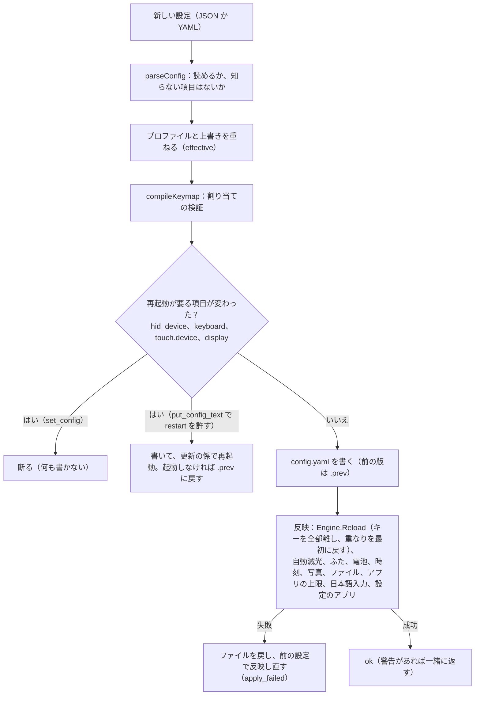
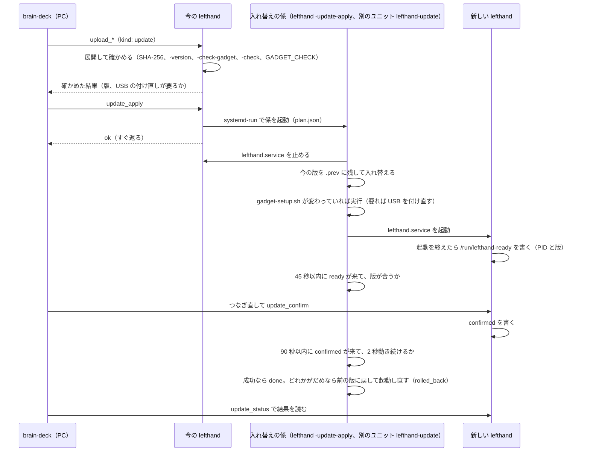
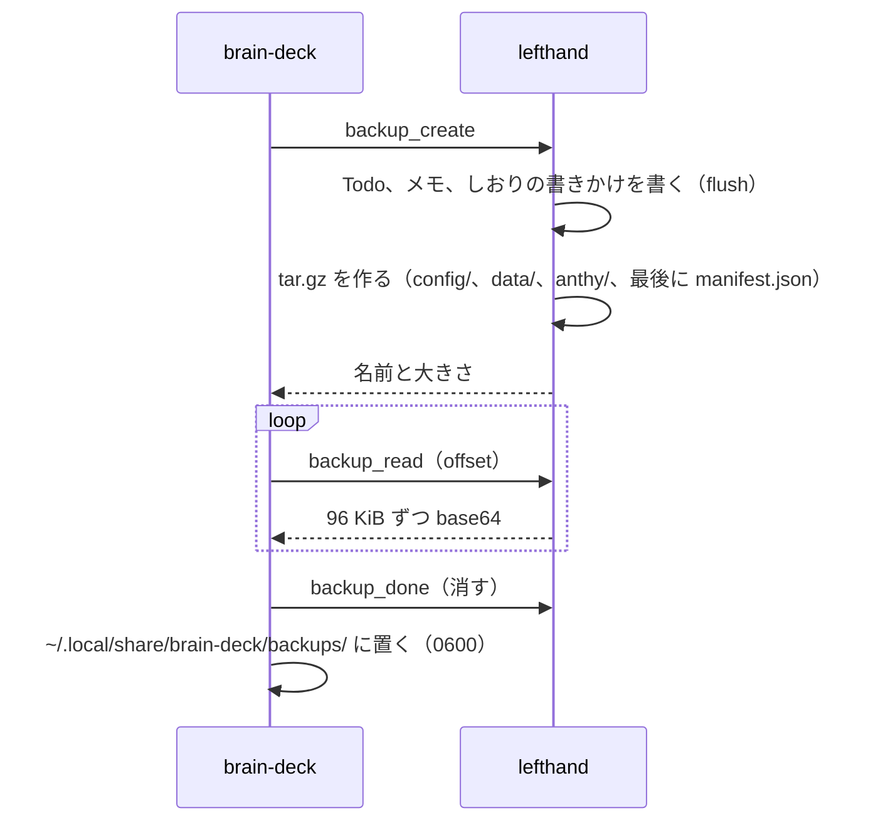

# 11. 保守：設定の保存、更新、バックアップと復元、同期

[目次に戻る](../architecture.md)

一度入れたあとの保守は、ssh を使わずに、USB のシリアル（brain-deck と設定 GUI）で行える。どの操作も「確かめてから変える」「失敗したら前に戻す」の形になっている。

## 設定の保存と反映（再起動しない）

設定 GUI の `set_config` と、`brain-deck config put`（`put_config_text`）は、デーモンを止めずに新しい設定を反映する（apply.go の `configStore`）。

- `set_config`（GUI）は、設定を YAML に書き出し直すので、**手で書いたコメントは消える**。書き出した YAML を読み直して同じになることを確かめてから置き換える。
- `put_config_text`（`brain-deck config put`）は、テキストをそのまま置くので、コメントが残る。
- どちらも、前の版を `config.yaml.prev` に残す（1 つだけ）。書き込みは一時ファイルと rename（電源が切れても壊れない）。
- 反映の中身は main.go の `cstore.apply`（ここに反映する係が全部並んでいる。新しい設定の項目を足したら、ここにも足す）。

## 更新（`brain-deck update`）と自動で戻す仕組み

更新は、デーモン（lefthand）と gadget-setup.sh を組で入れ替える（update.go、updatehelper.go）。

### 更新のファイル

`go run ./tools/mkupdate -bin <lefthand> -version <版> -o <名前>.update.tar.gz` で作る。中身は `manifest.json`（形の版、版、ファイルごとの SHA-256）、`lefthand`（ARMv5 の実行ファイル。`-ldflags "-s -w"` でビルドする）、`gadget-setup.sh`、読み物の本文の文字（`reader-24.lrf.gz`、`reader-32.lrf.gz`。フェーズ K7 から。`-fonts none` で入れない）。文字は lefthand と組で `/usr/local/share/lefthand/` に入れ替え、`.prev` を残す（`--rollback` で一緒に戻す。初めて置いたときに失敗したら消す）。新しい lefthand の `-check-fonts` で確かめ、入っていなくて Brain にもなければ注意を返す。K7 より前のデーモンは知らないファイルの入った更新のファイルを断るので、K7 にする最初の一度は、文字なしと文字ありの 2 回に分けて送る。

### 流れ

- **確かめ**（入れ替える前。update.go）：manifest の SHA-256、新しい lefthand の `-version`（manifest の版と同じか）、`-check-gadget`（新しい lefthand のディスクリプタと gadget-setup.sh のものが同じか）、`-check`（今の設定を新しい lefthand が読めるか）、`GADGET_CHECK=1`（USB の付け直しが要るか）。ここで断ったら何も変えない（`update_rejected`）。空きも確かめる（16 MiB か、ファイルシステムの 10% を残す）。
- **入れ替えの係**：デーモンは自分を止められないので、別のユニット（`lefthand-update`）として、自分の実行ファイルを `-update-apply <plan.json>` で起動する。進み具合は `/var/lib/lefthand/update/state.json` に書き、`update_status` と `brain-deck logs` で見られる。
- **自動で戻す**：新しいデーモンが 45 秒以内に起動を知らせない、版が違う、PC が 90 秒以内につなぎ直して `update_confirm` を送らない、確認のあと 2 秒以内に落ちた、のどれでも、前の版（と前の gadget-setup.sh）に戻して起動し直す。PC がつなぎ直せることまで確かめるのは、新しい版で USB やシリアルが壊れていたら、PC から直せなくなるため。
- **前の版に戻す**（`brain-deck update --rollback`）：`.prev` を「受け取ったもの」として同じ手順で入れ替える（今の版が `.prev` になる）。
- **再起動**（`brain-deck restart`、`restart --usb`）も同じ係が行う。**電源**（`reboot`、`poweroff`）は 0.5 秒待って `systemctl` に頼む（返事を送り終えるため）。
- brain-deck は、ポートが切れてもロック（ほかの brain-deck との順番待ち）は持ったまま、つなぎ直して結果を確かめる（cmd/brain-deck/admin.go の `session`、`redial`、`waitHelper`）。

### なぜこうなっているか

- **なぜ lefthand と gadget-setup.sh を組で入れ替えるか**：HID のディスクリプタが両方にあり、食い違うと PC に別のキーとして届く（[2. USB の構成](02-usb.md)）。
- **なぜ ssh を使わないか**：USB のネットワークは PC 側で IP の設定が要る。シリアルなら、ケーブルをつなぐだけで保守できる。最初の 1 回は SD カードに直接入れられる（install.sh の `--root`）。

## バックアップと復元

### バックアップ（`brain-deck backup`、`sync` で 1 日 1 回）

- 入るもの：[7. データ](07-data.md) の「バックアップに入る」もの。取り直せるもの（予定、天気、テキスト、記録）は入れない。
- `manifest.json` を最後に置くのは、ファイルを読みながら SHA-256 を数えるため（作っているあいだにデータが書き換わっても、manifest の値は入れた中身と合う）。
- 実機で 3.8 秒（REPORT.md のフェーズ K3）。

### 復元（`brain-deck restore`）

1. PC が `upload_*`（`kind: backup`）で送る。Brain が確かめる（形、版、SHA-256、名前、設定ファイルが今のデーモンで使えるか、大きさとファイルの数の上限）。
2. `restore_apply`：今の状態を `backup/before-restore.tar.gz` に残し、更新の係（`action: restore`）がデーモンを止めて入れ替える。戻すものは選べる（`items`）。
3. 新しいデーモンが起動して PC がつなぎ直せたら終わり。起動しなければ、入れ替えたものを元に戻して起動し直す。
4. `brain-deck restore --undo` で、復元の前の状態に戻せる。

- 日本語入力の学習は user の持ち物（0600）で書き、アプリのデータの持ち主は user に直す。
- 実機で復元 31 秒、undo 22 秒（REPORT.md のフェーズ K3）。

## 同期（`brain-deck sync`）

PC と Brain のあいだのやり取りを、1 つのコマンドで順に行う（cmd/brain-deck/sync.go）。何をするかは PC の `~/.config/brain-deck/sync.yaml`（なければ既定）。

| 順 | すること | 既定 |
| --- | --- | --- |
| 1 | `set_sync`（始め）：Brain の状態の帯に「同期中」 | いつも |
| 2 | PC の名前を知らせる（`set_pc`。PC ごとの設定） | する（`profile`） |
| 3 | 時刻を合わせる（`set_time`。`clock.rtc: write` なら RTC にも） | する（`time`） |
| 4 | 予定（`calendar sync`） | `calendars.yaml` があれば |
| 5 | 天気（`weather sync`） | `weather.yaml` があれば |
| 6 | 読み物の RSS（`read feed sync`） | `feeds.yaml` があれば |
| 7 | 手書きメモを PC に写す（PNG と JSON） | `memo.dir` を書いたときだけ |
| 8 | バックアップ | 20 時間たっていれば取り、7 個残す（`backup`） |
| 9 | `set_sync`（終わり）：最後に同期した時刻（失敗があれば橙） | いつも |

- どれかが失敗しても、ほかは続ける。終了コードは、全部成功なら 0、失敗があれば 9、Brain が見つからなければ 3。
- **つないだときに自動で**：PC の udev の規則（contrib/udev/73-brain-sync.rules）が、Brain の設定用のシリアルができたときに、ユーザーの systemd の `brain-deck-sync.service`（`sync --wait 90s --if-older 10m`）を起動する。USB の形の切り替えなどで付け直したときは、10 分のうちに同期していれば何もしない。
- **Brain のボタンから**：セルに F18 などを割り当て、PC の OS のショートカットで `brain-deck sync` を動かす（README の「Brain のボタンから同期する」）。
- 同期は Brain のデータ（Todo、手書きメモ、しおり）を書き換えない。Brain のデータが正。

### なぜこうなっているか

- **なぜ同期を PC の側から始めるか**：Brain はインターネットに出ず、PC を呼び出す手段もない（シリアルは PC が開く）。PC が「つながった」ことを udev で知り、PC から始めるのが自然。
- **なぜバックアップを同期に入れたか**：手で取るのを忘れても、ふだんの同期で 1 日 1 回残るように（README の「同期のときに自動で取る」）。
