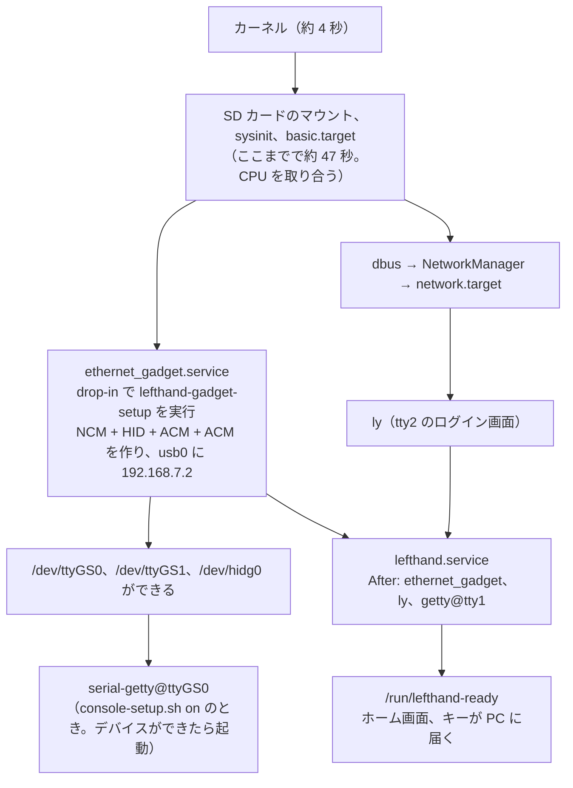

# 12. 起動の流れ

[目次に戻る](../architecture.md)

電源を入れてから、brain-deck のホーム画面が出て、キーが PC に届くまで。

## systemd のユニットの順

| ユニット | ファイル | 役目 |
| --- | --- | --- |
| `ethernet_gadget.service`（Brainux のもの）+ drop-in | systemd/ethernet_gadget.service.d/lefthand.conf | `ExecStart` を `/usr/local/sbin/lefthand-gadget-setup` に置き換え、`RemainAfterExit=yes` |
| `lefthand.service` | systemd/lefthand.service | `ExecStart=/usr/local/bin/lefthand /etc/lefthand/config.yaml`。`Wants`/`After=ethernet_gadget.service`、`After=ly.service getty@tty1.service`。`Restart=on-failure`、`ExecStopPost=-/usr/local/bin/lefthand -restore-console`、`KillSignal=SIGTERM`、`TimeoutStopSec=5` |
| `serial-getty@ttyGS0.service`（systemd のもの）+ drop-in | systemd/serial-getty@ttyGS0.service.d/lefthand.conf | `TERM=xterm-256color`、`TTYReset=no`、agetty の `--wait-cr`（Enter が届くまでログイン画面を出さない）。console-setup.sh が enable と `dev-ttyGS0.device.wants` のリンクを置く |
| `lefthand-update`（一時的なユニット） | なし（`systemd-run` で作る） | 更新、再起動、復元の係（[11.](11-maintenance.md)） |

- `Wants=` なので、ガジェットの作成が失敗しても lefthand は起動する（HID への書き込みの失敗は中で吸収する）。
- lefthand は ly のあとに起動する。ly は起動するときに tty2 へ切り替えるので、lefthand が先に専用の VT を取っても画面を取られる（REPORT.md のフェーズ K4。「lefthand を ly より先に起動する案は取らない」）。
- 実機の測った値（2026-10-12、REPORT.md のフェーズ K4）：kernel 4.0 秒 + userspace 76.6 秒 = 約 80 秒。ly が約 73 秒、lefthand の起動が約 77 秒、シリアルで答えるのが約 82 秒。CPU が 1 つなので、並んで起動するサービスが CPU を取り合う。
  起動を速くする案（止めてよいサービス）は contrib/boot/boot-tune.sh に用意してあるが、**まだ適用していない**（README の「Brain の起動を速くする」）。

## デーモンの中の順（main.go の `main`）

`bootTrace.mark(...)` の名前で、起動の段階ごとの時間を測り、起動を終えたときに `startup: …` の 1 行をログに出す（startup.go）。

```mermaid
flowchart TD
  A["フラグを読む。-version、-check-gadget、-update-apply、-restore-console、<br/>-replay-* ならそれをして終わる"] --> B["GC を減らす（GOGC 400）"]
  B --> C["設定を読む（loadConfig）【config】"]
  C --> D["起動中の画面：フレームバッファと専用 VT を開き「起動中…」と版【splash】"]
  D --> E["割り当てを組み立てる（compileKeymap）【keymap】<br/>-check、-dump-json、-render-png、-record-touch ならここで終わる"]
  E --> F["プロファイルと上書きを重ねて組み立て直す【overrides】"]
  F --> G["時刻：RTC か最後に分かっていた時刻で合わせる【clock】"]
  G --> H["キーボードとタッチを開く。失敗したら HID に何も送らずに終わる【input】"]
  H --> I["前に端末モードのまま落ちていたら、USB の構成の名前と getty を戻す【terminal】"]
  I --> J["/dev/hidg0 を開き、HID の形を読む（detectHID）。エンジン、USB の形、端末モード、日本語入力【hid】"]
  J --> K["データの係（Todo、予定、天気、電池、自動減光、ふた、電池の見張り…）【services】"]
  K --> L["背景画像の確かめ【images】"]
  L --> M["つながりの見張り、向き、ウィジェット、ファイル、アプリ、設定のアプリ【widgets】"]
  M --> N["SIGTERM の受け口、送り直しの goroutine、空のレポートを送る"]
  N --> O["キーボードとタッチを専有（grab）。ふたの状態を読む【grab】"]
  O --> P["描画を始める：起動中の画面のフレームバッファと VT を引き継ぎ、最初の画面を描く【display】"]
  P --> Q["係の変化を描画につなぐ（SetOnChange(d.Poke) など）【display-hooks】"]
  Q --> R["設定の置き場所、バックアップ、更新の係、シリアルの係を作り、シリアルを開く goroutine【control】"]
  R --> S["アプリの係を始める。タッチの goroutine を始める"]
  S --> T["/run/lefthand-ready を書く。startup の行。GOGC を 100 に戻す"]
  T --> U["runKeyboard（ここから戻らない）"]
```

- **起動中の画面**（splash.go、フェーズ K4）：設定を読んだらすぐ（exec から約 1.2 秒）フレームバッファと VT を開いて「起動中…」と版を出す。`StartDisplayFrom` がそのまま引き継ぐので、開き直さず、画面がちらつかない。ただし K4 の版は**本番に入っていない**（PROGRESS.md）。
- **入力を先に開く**のは、開けなかったときに HID に何も送らずに終わるため（設定の誤りでキーが変なものを送り続けないように）。
- **起動直後に空のレポートを送る**（`s.releaseAll()`）のは、前に異常終了したときの押しっぱなしを解くため。
- **画面が使えなくても入力は動かす**：フレームバッファや VT を開けなければ、ログに出して、画面なしで続ける。

## 起動のあとに PC で起きること

1. PC が USB の機器を見つける。HID はキーボードとして使える。
2. Linux なら、udev の規則で ModemManager が触らないようにし（70）、スリープの解除を許し（72）、`brain-deck-sync.service` を起動する（73）。
3. `brain-deck sync --wait 90s` が、lefthand が答えるのを待って、PC の名前、時刻、予定、天気などを送る（[11.](11-maintenance.md)）。

## 止まるとき

- `systemctl stop`、電池の見張りの電源断、更新の係：SIGTERM を受けて `State.shutdown` が、キーとボタンを全部離した空のレポートを送り、`addAtExit` で登録した後始末（端末モードを抜ける、日本語入力を止める、データを書く、明るさと画面を戻す）を一度だけ行う。
- 強制終了などで後始末ができなかったときは、`ExecStopPost` の `lefthand -restore-console` が、VT、明るさ、端末モード（USB の構成の名前と getty）を戻す。
