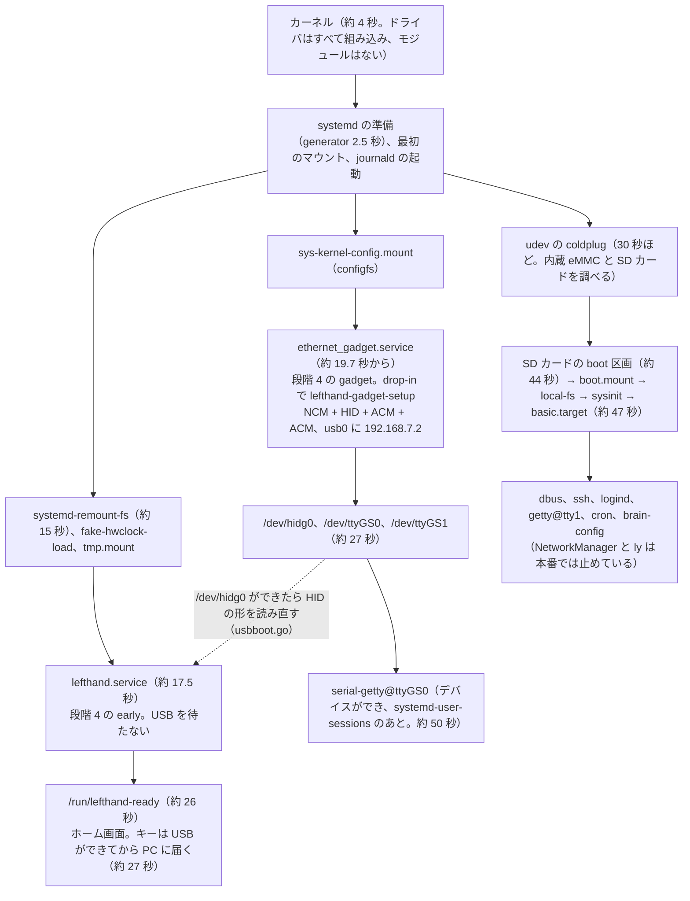

# 12. 起動の流れ

[目次に戻る](../architecture.md)

電源を入れてから、brain-deck のホーム画面が出て、キーが PC に届くまで。

## systemd のユニットの順

本番の Brain は、contrib/boot/boot-tune.sh の段階 1〜6 を適用している（2026-10-12。段階 4〜6 はフェーズ K6）。
lefthand と ethernet_gadget は `DefaultDependencies=no`（段階 4 の drop-in）で、basic.target を待たない。

| ユニット | ファイル | 役目 |
| --- | --- | --- |
| `ethernet_gadget.service`（Brainux のもの）+ drop-in | systemd/ethernet_gadget.service.d/lefthand.conf、boot-early.conf（段階 4 の gadget。boot-tune.sh が置く） | `ExecStart` を `/usr/local/sbin/lefthand-gadget-setup` に置き換え、`RemainAfterExit=yes`。段階 4 では `DefaultDependencies=no`、`After=sys-kernel-config.mount systemd-remount-fs.service` |
| `lefthand.service` | systemd/lefthand.service、lefthand.service.d/boot-early.conf（段階 4 の early。boot-tune.sh が置く） | `ExecStart=/usr/local/bin/lefthand /etc/lefthand/config.yaml`。`Wants=ethernet_gadget.service`（**After= にはしない**。フェーズ K6）、`After=ly.service`。`Restart=on-failure`、`ExecStopPost=-/usr/local/bin/lefthand -restore-console`、`KillSignal=SIGTERM`、`TimeoutStopSec=5`。段階 4 では `DefaultDependencies=no`、`After=systemd-remount-fs.service fake-hwclock-load.service tmp.mount systemd-journald.socket`、`Conflicts=`/`Before=shutdown.target` |
| `serial-getty@ttyGS0.service`（systemd のもの）+ drop-in | systemd/serial-getty@ttyGS0.service.d/lefthand.conf | `TERM=xterm-256color`、`TTYReset=no`、agetty の `--wait-cr`（Enter が届くまでログイン画面を出さない）。console-setup.sh が enable と `dev-ttyGS0.device.wants` のリンクを置く |
| `lefthand-update`（一時的なユニット） | なし（`systemd-run` で作る） | 更新、再起動、復元の係（[11.](11-maintenance.md)） |

- **lefthand は USB の構成を待たない**（フェーズ K6）。起動したときに `/dev/hidg0` がなければ「USB の準備中」とし、PC から外れているときと同じに動く（キーは届かず、送れなかった状態はあとで送り直す。つながりは UDC の state から）。`/dev/hidg0` ができたら（0.25 秒ごとに stat で見る。3 分まで）、HID の形を読み直して、何も押していない状態を送る。準備中は USB の形の切り替えを断り（`switching`）、端末モードを待たせる。`get_status` の `hid.preparing`、`brain-deck status` の「起動のときの USB の準備中」。
- 起動のときの gadget-setup.sh は、ガジェットを作ってから**最後に 1 回だけ** UDC に付ける（付け直さない）。なので `/dev/hidg0` ができてから開いても、「開いたまま付け直すと使えなくなる」f_hid の問題は起きない。lefthand が gadget-setup.sh を動かす前（USB の形の切り替え、端末モード、端末モードの後始末）は、`ethernet_gadget.service` が `activating` のあいだ待つ（同時に configfs を書き換えないように。`waitGadgetUnit`。試験のデーモンのように別のスクリプトを使うときは待たない）。
- 入力のデバイスとフレームバッファは、見つからなければ 30 秒まで待つ（ドライバの読み込みが遅れたとき。今のカーネルは組み込みなので待たない）。
- `Wants=` なので、ガジェットの作成が失敗しても lefthand は起動する（HID への書き込みの失敗は中で吸収する）。
- ly を使うときは、lefthand は ly のあとに起動する（`After=ly.service`）。ただし段階 4 の early では、ly は basic.target のあとなので、lefthand が先に起動し、ly が tty2 に切り替えたら 2 秒後に取り返す。ly を戻すなら段階 4 も戻す。
- **段階**：1〜3 は使っていないサービスの disable（accounts-daemon、udisks2、e2scrub_reap、triggerhappy、avahi / NetworkManager、timesyncd、networking、apt-daily のタイマー / ly）。4 は early と gadget（上の drop-in）。5 は quiet（`ShowStatus=no`、`kernel.printk = 4 4 1 7`）、modprobe（modprobe@drm と efi_pstore の mask。configfs と fuse はマウントが `Requires=` するので触らない）、udev（止めたサービスの規則 4 つを /dev/null で隠す）。6 は journal（`SystemMaxUse=32M`）。記録は `/etc/lefthand/boot-tune.state`、戻すのは `boot-tune.sh revert [段階|項目]`。
- 実機の測った値（2026-10-12。電源を入れてからの秒。systemd の monotonic と `startup:` の行から）：

| | 段階 3 | 段階 4（early） | 段階 4（+ gadget） | 段階 5 | 段階 6（今） |
| --- | --- | --- | --- | --- | --- |
| 起動の合計 | 69.2 | 60.3 | 59.4 | 56.2 | **55.2** |
| lefthand の exec | 60.9 | 20.2 | 20.1 | 17.5 | 17.6 |
| 「起動中」の画面 | 70.3 | 26.0 | 27.2 | 24.3 | **24.4** |
| 準備ができた（画面とタッチ） | 71.2 | 29.8 | 29.7 | 26.4 | **26.4** |
| PC へのキー、brain-deck | 約 71 | 57.6 | 約 30.5 | 約 26.9 | **約 27.9** |
| ssh / ttyGS0 のログイン | 約 61 | 約 60 | 59.2 / 57.3 | 55.7 / 50.4 | 55.1 / 52.8 |

- **実行ファイルの大きさ**（フェーズ K7）：13.4 MB → 7.9 MB（`-s -w`、読み物の本文の文字を別のファイルに）にしたが、exec から main までは変わらなかった（キャッシュなしの SD カードから 0.71 秒、起動のときは 2.7 秒）。Linux は触ったページだけを読むので、デバッグの情報や読み物の文字は、もともと起動のときに読まれていなかった。
- **残っている遅れ**：lefthand の exec から準備までの約 9 秒は、udev の coldplug や journald と同時に動くための CPU と SD の取り合い（ふだんは 2 秒。exec から main まで 2.6〜2.9 秒、設定の読み込み 3.1〜3.4 秒）。起動の合計の大半は、udev の coldplug（SD カードの boot 区画が見えるのが約 44 秒）で、lefthand はもう待たない。

## デーモンの中の順（main.go の `main`）

`bootTrace.mark(...)` の名前で、起動の段階ごとの時間を測り、起動を終えたときに `startup: …` の 1 行をログに出す（startup.go）。

```mermaid
flowchart TD
  A["フラグを読む。-version、-check-gadget、-update-apply、-restore-console、<br/>-replay-* ならそれをして終わる"] --> B["GC を減らす（GOGC 400）"]
  B --> C["設定を読む（loadConfig）【config】"]
  C --> D["起動中の画面：フレームバッファと専用 VT を開き「起動中…」と版【splash】"]
  D --> E["割り当てを組み立てる（compileKeymap）【keymap】<br/>-check、-dump-json、-render-png、-record-touch ならここで終わる"]
  E --> F["プロファイルと上書きを重ねて組み立て直す【overrides】"]
  F --> G["時刻：RTC か最後に分かっていた時刻で合わせる【clock】"]
  G --> H["キーボードとタッチを開く。失敗したら HID に何も送らずに終わる【input】"]
  H --> I["前に端末モードのまま落ちていたら、USB の構成の名前と getty を戻す【terminal】"]
  I --> J["/dev/hidg0 を開き、HID の形を読む（detectHID）。エンジン、USB の形、端末モード、日本語入力。<br/>/dev/hidg0 がまだなければ USB の準備中にして、できるのを待つ goroutine（usbboot.go）【hid】"]
  J --> K["データの係（Todo、予定、天気、電池、自動減光、ふた、電池の見張り…）【services】"]
  K --> L["背景画像の確かめ【images】"]
  L --> M["つながりの見張り、向き、ウィジェット、ファイル、アプリ、設定のアプリ【widgets】"]
  M --> N["SIGTERM の受け口、送り直しの goroutine、空のレポートを送る"]
  N --> O["キーボードとタッチを専有（grab）。ふたの状態を読む【grab】"]
  O --> P["描画を始める：起動中の画面のフレームバッファと VT を引き継ぎ、最初の画面を描く【display】"]
  P --> Q["係の変化を描画につなぐ（SetOnChange(d.Poke) など）【display-hooks】"]
  Q --> R["設定の置き場所、バックアップ、更新の係、シリアルの係を作り、シリアルを開く goroutine【control】"]
  R --> S["アプリの係を始める。タッチの goroutine を始める"]
  S --> T["/run/lefthand-ready を書く。startup の行。GOGC を 100 に戻す"]
  T --> U["runKeyboard（ここから戻らない）"]
```

- **起動中の画面**（splash.go、フェーズ K4）：設定を読んだらすぐ（ふだんは exec から約 1.2 秒、起動のときは約 7 秒）フレームバッファと VT を開いて「起動中…」と版を出す。`StartDisplayFrom` がそのまま引き継ぐので、開き直さず、画面がちらつかない。
- **入力を先に開く**のは、開けなかったときに HID に何も送らずに終わるため（設定の誤りでキーが変なものを送り続けないように）。
- **起動直後に空のレポートを送る**（`s.releaseAll()`）のは、前に異常終了したときの押しっぱなしを解くため。
- **画面が使えなくても入力は動かす**：フレームバッファや VT を開けなければ、ログに出して、画面なしで続ける。

## 起動のあとに PC で起きること

1. PC が USB の機器を見つける。HID はキーボードとして使える。
2. Linux なら、udev の規則で ModemManager が触らないようにし（70）、スリープの解除を許し（72）、`brain-deck-sync.service` を起動する（73）。
3. `brain-deck sync --wait 90s` が、lefthand が答えるのを待って、PC の名前、時刻、予定、天気などを送る（[11.](11-maintenance.md)）。

## 止まるとき

- `systemctl stop`、電池の見張りの電源断、更新の係：SIGTERM を受けて `State.shutdown` が、キーとボタンを全部離した空のレポートを送り、`addAtExit` で登録した後始末（端末モードを抜ける、日本語入力を止める、データを書く、明るさと画面を戻す）を一度だけ行う。
- 強制終了などで後始末ができなかったときは、`ExecStopPost` の `lefthand -restore-console` が、VT、明るさ、端末モード（USB の構成の名前と getty）を戻す。
